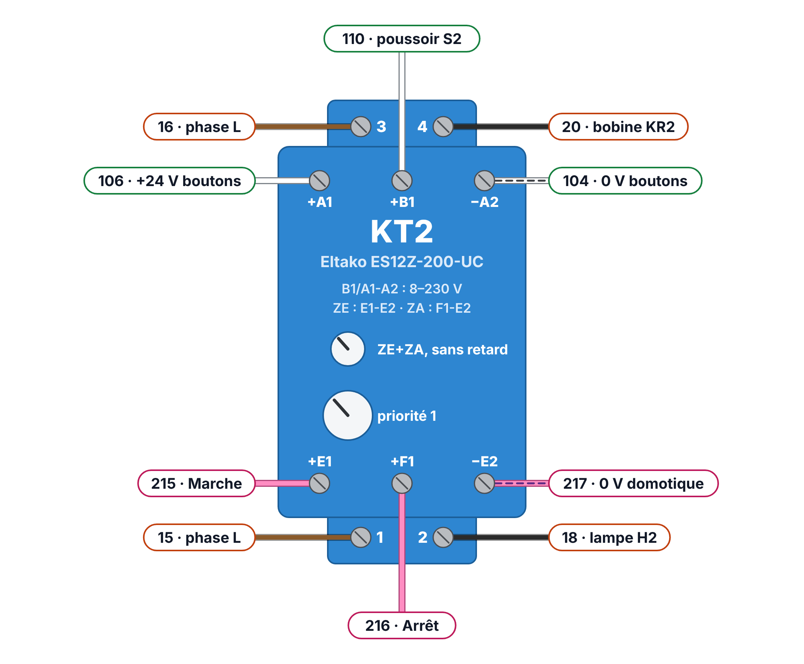
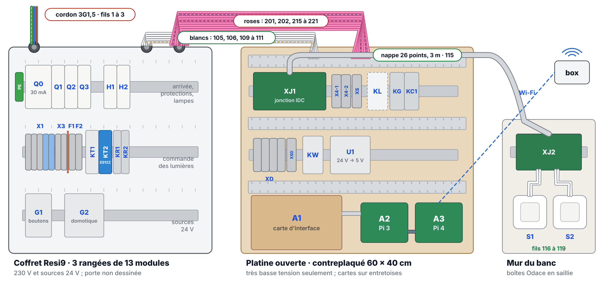
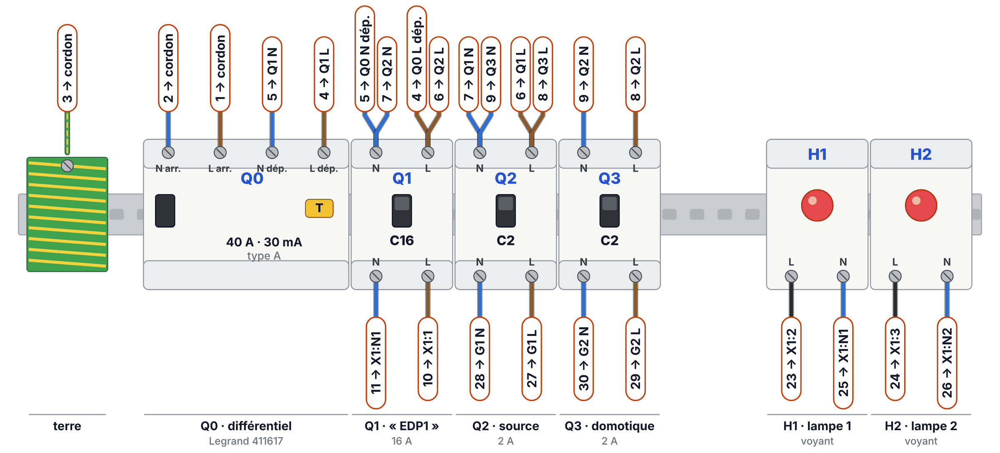
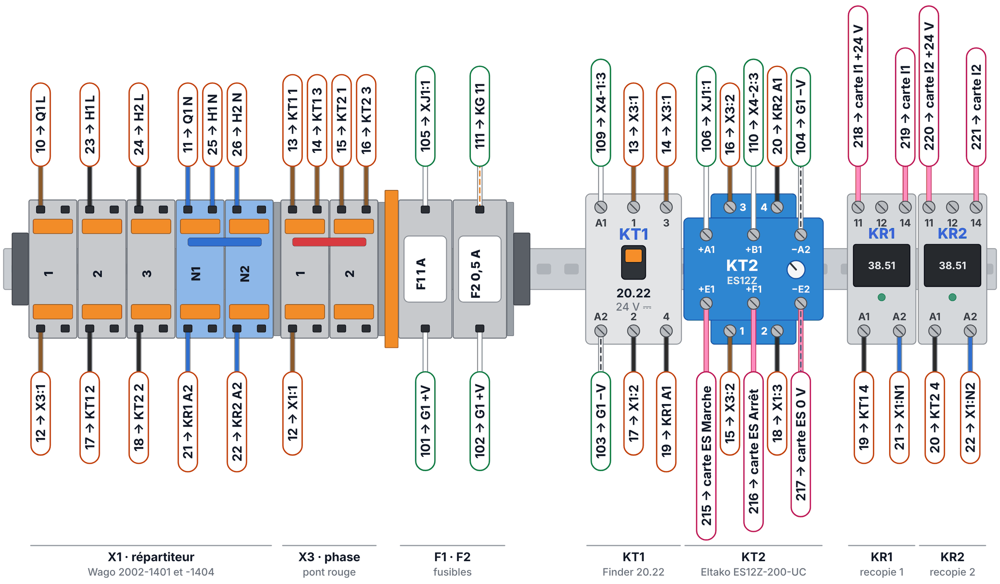
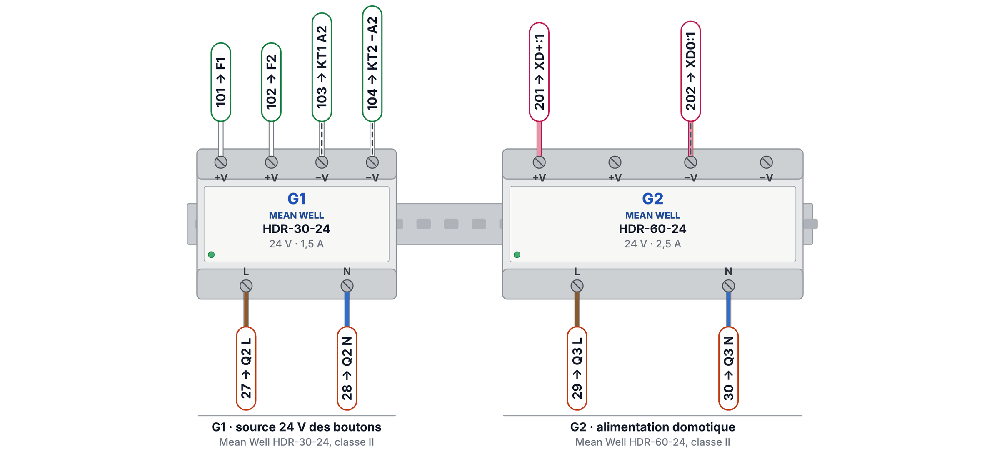
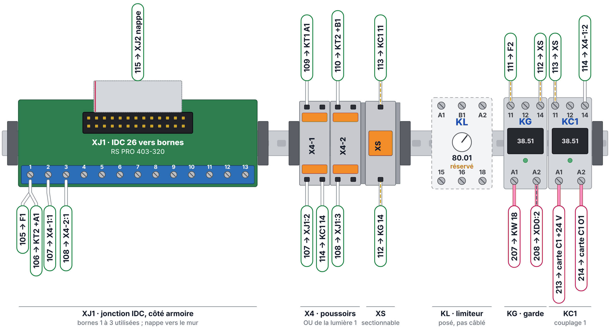
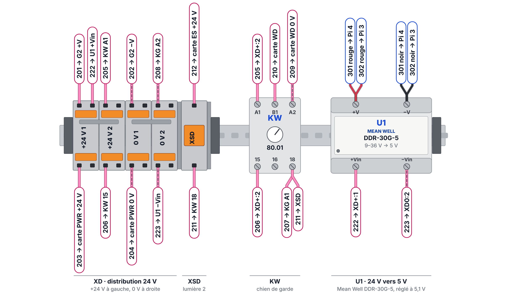
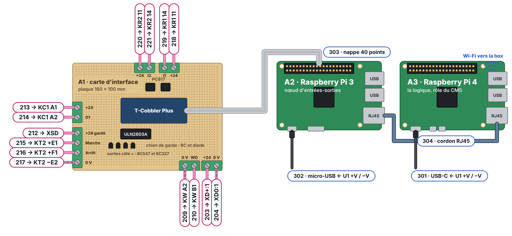
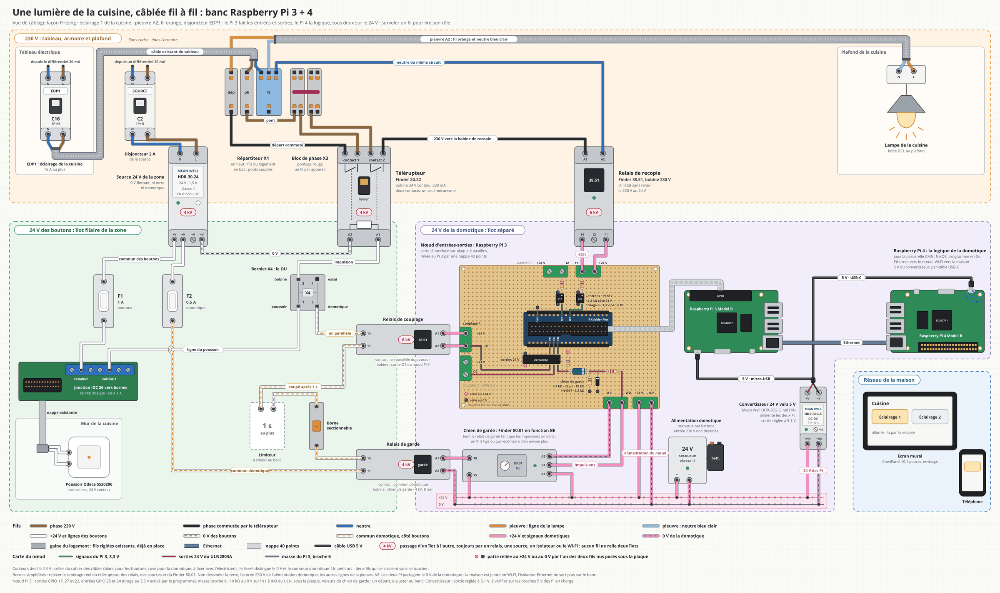

# Banc deux lumières

Le banc reprend la chaîne V2 « filaire d'abord » pour deux lumières, du disjoncteur au Raspberry Pi. Il sert à prouver, avant toute commande en série, que les boutons gardent la main quand la domotique se tait, se fige ou envoie un ordre faux. Il compare aussi les deux façons de commander une lumière que le conseil n'a pas départagées : un télérupteur électromécanique ou un actionneur électronique Eltako.

!!! info "État au 23 octobre 2026"
    Liste d'achats, implantation et liste des fils prêtes ; matériel à commander. Les bornes sont placées de façon schématique sur les vues : on câble par le nom de la borne relevé sur l'appareil. La réponse d'ensemble est sur la page [Répondre à l'exigence de résilience](resilience.md).

## Ce que le banc doit montrer

- **Les boutons d'abord** : chaque poussoir commande sa lampe, domotique coupée, débranchée ou figée.
- **Le chien de garde** : arrêter le programme du Raspberry Pi 3 fait retomber le relais de garde KG et coupe le +24 V gardé de la lumière 2 en moins d'une seconde.
- **L'ordre maintenu** : un ordre Marche tenu par la domotique n'empêche pas le poussoir 2 d'éteindre (ES12Z en priorité 1).
- **L'état lu** : la recopie de chaque lampe donne son état réel, sans jamais l'imposer.
- **Le retour arrière** : les bornes sectionnables XS et XSD débranchent la domotique d'un geste, et les poussoirs marchent toujours.
- **Les essais du conseil** : relais de garde, contact soudé, priorités, conflits, fusibles, court-circuit et onde de choc, au banc avant l'armoire.

## Deux lumières, deux organes

| | Lumière 1 : télérupteur Finder | Lumière 2 : Eltako ES12Z-200-UC |
| --- | --- | --- |
| Organe | Finder 20.22, bobine 24 V continu, 2 NO 16 A, levier | Relais bistable électronique, 2 NO 16 A, 1 module |
| Poussoir | Attaque la bobine (A1-A2) | Entrée locale +B1, alimentation +A1 et −A2 sur le 24 V des boutons, d'après le marquage « B1/A1-A2 », à confirmer avec la notice |
| Ordre domotique | Contact sec du relais de couplage KC1 (Finder 38.51), en parallèle du poussoir, derrière le relais de garde KG et la borne XS | Entrées centrales séparées : Marche (+E1) et Arrêt (+F1), commun −E2 au 0 V de la domotique, alimentées par le +24 V gardé à travers XSD |
| Ordre collé | Limiteur KL d'une seconde, posé mais pas câblé, à mettre au point au banc | Rien à ajouter : en priorité 1, un ordre central maintenu n'empêche pas le poussoir |
| État | Second contact (3-4) vers la bobine 230 V du relais de recopie KR1 | Contact 3-4 vers la bobine 230 V du relais de recopie KR2 |
| Réglages | — | Sélecteur du haut sur ZE+ZA sans retard, celui du bas sur 1 ; bornes livrées ouvertes, à fermer avant l'essai |
| Isolement à faire attester | Entre bobine et contacts : 4 kV déclarés, isolation renforcée non déclarée | Entre entrée locale, entrées centrales et contacts : non publié |
| Prix relevé | 23,15 € TTC | 52,39 € TTC ; il remplace aussi le relais de couplage et le limiteur |

{ loading=lazy }

## Trois îlots, aucun fil commun

On passe d'un îlot à l'autre par un relais, l'ES12Z, une source ou le Wi-Fi, jamais par un fil.

| Îlot | Ce qu'il porte | Fils |
| --- | --- | --- |
| 230 V | Disjoncteurs, répartiteur X1, bloc de phase X3, contacts des télérupteurs, bobines de recopie et lampes | 1 à 30, coffret |
| 24 V des boutons | Source G1 (Mean Well HDR-30-24), fusibles F1 et F2, jonctions IDC, poussoirs, bornier X4, bobine de KT1, entrée locale de l'ES12Z, contacts de couplage et de garde | 101 à 119 : coffret, platine, mur |
| 24 V de la domotique | Alimentation G2 (Mean Well HDR-60-24), distribution XD, carte d'interface, chien de garde KW, bobines de couplage et de garde, entrées centrales de l'ES12Z, contacts de recopie, convertisseur 5 V et Raspberry Pi | 201 à 223 et 301 à 304 : platine |

Les deux Raspberry Pi sont dans l'îlot domotique et le réseau de la maison n'est joint qu'en Wi-Fi.

{ loading=lazy }

## Implantation

- **Coffret** : un coffret de 3 rangées de 13 modules porte le 230 V et les deux sources (rangées C1 à C3).
- **Platine ouverte** : une planche en très basse tension seulement, deux rails (P1 et P2) et la zone des cartes : carte d'interface, Raspberry Pi 3 et Raspberry Pi 4.
- **Mur du banc** : deux poussoirs en boîtes saillie, reliés au coffret par une nappe IDC de 3 m, comme dans la maison.

Chaque vue porte, au bout de chaque fil, un repère « n° → borne » : le numéro du fil, le même à ses deux bouts, et la borne où arrive l'autre bout. Le contour du repère donne l'îlot : orange pour le 230 V, vert pour les boutons, rose pour la domotique, bleu pour le 5 V et le réseau.

<figure markdown="span">
  { loading=lazy }
  <figcaption>Coffret, rangée C1 : différentiel 30 mA, disjoncteurs (Q1 tient le rôle d'un disjoncteur d'éclairage, Q2 et Q3 alimentent les deux sources) et les deux lampes du banc.</figcaption>
</figure>

<figure markdown="span">
  { loading=lazy }
  <figcaption>Coffret, rangée C2 : répartiteur X1, bloc de phase X3, fusibles F1 et F2, télérupteur KT1, Eltako ES12Z (KT2) et relais de recopie KR1 et KR2. Une cloison sépare le 230 V des fusibles 24 V.</figcaption>
</figure>

<figure markdown="span">
  { loading=lazy }
  <figcaption>Coffret, rangée C3 : la source G1 des boutons et l'alimentation G2 de la domotique, sans aucun fil commun.</figcaption>
</figure>

<figure markdown="span">
  { loading=lazy }
  <figcaption>Platine, rail P1 : jonction IDC de la nappe, bornier X4 (le OU du poussoir et de la domotique), relais de couplage KC1, relais de garde KG, borne sectionnable XS et limiteur KL réservé.</figcaption>
</figure>

<figure markdown="span">
  { loading=lazy }
  <figcaption>Platine, rail P2 : distribution XD du 24 V de la domotique, chien de garde KW, borne sectionnable XSD de la lumière 2 et convertisseur U1 vers le 5 V des Raspberry Pi.</figcaption>
</figure>

<figure markdown="span">
  { loading=lazy }
  <figcaption>La zone des cartes : la carte d'interface A1 et ses borniers, le Raspberry Pi 3 relié par la nappe de 40 points, le Raspberry Pi 4 en Ethernet direct.</figcaption>
</figure>

## La domotique du banc

- **Raspberry Pi 3, nœud d'entrées-sorties** : il tient le rôle du serveur d'E/S léger de l'étude. Une carte d'interface sur plaque à pastilles, reliée par un T-Cobbler et une nappe de 40 points, porte un ULN2803A (couplage 1 et chien de garde), un BC547 et un BC327 par ordre de l'ES12Z (Marche et Arrêt), et deux optocoupleurs PC817 pour les recopies.
- **Raspberry Pi 4, logique** : il tient le rôle de la passerelle et parle au Pi 3 en Ethernet direct.
- **Alimentation** : les deux Pi prennent le 24 V de la domotique par un convertisseur isolé Mean Well DDR-30G-5, réglé à 5,1 V ; plus aucun bloc USB sur le secteur. Ils tirent 0,25 à 0,55 A sur le 24 V, 1,5 A au plus.
- **Chien de garde** : un relais temporisé Finder 80.01 en fonction BE, réarmé par un signal alterné couplé en capacitif. Valeurs de départ : 4,7 kΩ, 22 µF, 10 kΩ, 2,2 kΩ et une 1N4007, à ajuster au banc.

| GPIO | Broche | Rôle |
| --- | --- | --- |
| 17 | 11 | ULN IN3 vers O1 : couplage 1 |
| 22 | 15 | ULN IN1 vers WD : chien de garde |
| 27 | 13 | BC547 puis BC327 : Marche de la lumière 2 |
| 23 | 16 | BC547 puis BC327 : Arrêt de la lumière 2 |
| 25 | 22 | PC817 n° 1 depuis I1 : recopie 1 |
| 24 | 18 | PC817 n° 2 depuis I2 : recopie 2 |
| GND | 6 | 0 V de la domotique |

Une résistance de 10 kΩ au 0 V sur chaque entrée du ULN2803A et sur la base de chaque BC547 : rien ne s'enclenche pendant le démarrage du Pi 3. Marche et Arrêt partagent leur commun au 0 V (−E2) : chaque BC327 envoie le +24 V gardé sur son entrée, si bien que sans impulsions du chien de garde, l'ES12Z ne reçoit aucun ordre.

{ loading=lazy }

Cette vue sert de schéma de principe ; elle ne porte pas les numéros de fils. Les vues des rails et la liste des fils font foi pour le câblage.

## Mise en service

1. **Hors tension** : chaque fil contrôlé contre la liste ; isolement sous 500 V continu entre le 230 V et chaque îlot 24 V, sous 250 V continu entre les deux îlots 24 V, plus de 100 MΩ ; aucune continuité entre le 0 V de G1 et celui de G2 ; vis serrées au couple ; ES12Z réglé.
2. **Q0 et Q2** : 24 V sur F1 et F2 ; S1 fait claquer KT1, S2 fait basculer l'ES12Z.
3. **Q1** : S1 allume la lampe 1, S2 la lampe 2 ; KR1 et KR2 suivent.
4. **Q3, Pi débranchés** : 24 V sur XD, convertisseur réglé à 5,1 V. Sans impulsions, KG reste ouvert et le bornier de l'ES12Z reste sans +24 V.
5. **Pi branchés** : le chien de garde est réarmé et KG colle ; un ordre fait claquer KC1 puis KT1 ; Marche puis Arrêt allument puis éteignent la lampe 2.
6. **Les replis** : ordre Marche maintenu, S2 éteint quand même ; XS et XSD ouvertes, la domotique n'agit plus et les poussoirs marchent toujours ; programme du Pi 3 arrêté, KG retombe en moins d'une seconde.

## Liste des fils

76 fils et câbles, repérés à leurs deux bouts. Couleurs : marron pour la phase, bleu pour le neutre, noir pour la phase commutée par un télérupteur, blanc pour le 24 V des boutons (repère 0V pour son 0 V, CD pour le commun domotique), rose pour le 24 V de la domotique (repère 0V). Un fil par point sur les bornes Wago ; deux fils au plus sur une borne à vis, dans un embout double. Le blanc et le rose suivent le [cahier des câbles](remplacement-armoire/v2/sections-de-cables.md) ; dans l'armoire, ces couleurs restent à fixer avec l'électricien.

??? note "230 V : fils 1 à 30"
    | N° | D'un bout | À l'autre | Fil | Rôle |
    | --- | --- | --- | --- | --- |
    | 1 | cordon, fil marron | Q0 L arr. | marron 1,5 | Arrivée du secteur, phase |
    | 2 | cordon, fil bleu | Q0 N arr. | bleu 1,5 | Arrivée du secteur, neutre |
    | 3 | cordon, fil vert-jaune | barrette de terre | vert-jaune (cordon) | Terre du cordon sur la barrette du coffret |
    | 4 | Q0 L dép. | Q1 L | marron 1,5 | Pontage : départ du différentiel vers EDP1 |
    | 5 | Q0 N dép. | Q1 N | bleu 1,5 | Pontage : neutre |
    | 6 | Q1 L | Q2 L | marron 1,5 | Pontage vers le 2 A de la source |
    | 7 | Q1 N | Q2 N | bleu 1,5 | Pontage : neutre |
    | 8 | Q2 L | Q3 L | marron 1,5 | Pontage vers le 2 A de la domotique |
    | 9 | Q2 N | Q3 N | bleu 1,5 | Pontage : neutre |
    | 10 | Q1 L | X1:1 haut | marron 1,5 | Phase de EDP1 sur le répartiteur |
    | 11 | Q1 N | X1:N1 haut | bleu 1,5 | Neutre de EDP1 sur le répartiteur |
    | 12 | X1:1 bas | X3:1 bas | marron 1,5 | Pont du répartiteur vers le bloc de phase |
    | 13 | X3:1 haut | KT1 1 | marron 1,5 | Phase vers le contact 1 du télérupteur 1 |
    | 14 | X3:1 haut | KT1 3 | marron 1,5 | Phase vers le contact 2 du télérupteur 1 |
    | 15 | X3:2 haut | KT2 1 | marron 1,5 | Phase vers le contact 1-2 de l'ES12Z (lumière 2) |
    | 16 | X3:2 haut | KT2 3 | marron 1,5 | Phase vers le contact 3-4 de l'ES12Z (recopie 2) |
    | 17 | KT1 2 | X1:2 bas | noir 1,5 | Phase commutée de la lumière 1 |
    | 18 | KT2 2 | X1:3 bas | noir 1,5 | Phase commutée de la lumière 2 |
    | 19 | KT1 4 | KR1 A1 | noir 1,5 | 230 V vers la bobine de recopie 1 |
    | 20 | KT2 4 | KR2 A1 | noir 1,5 | 230 V vers la bobine de recopie 2 |
    | 21 | KR1 A2 | X1:N1 bas | bleu 1,5 | Neutre du même circuit, recopie 1 |
    | 22 | KR2 A2 | X1:N2 bas | bleu 1,5 | Neutre du même circuit, recopie 2 |
    | 23 | X1:2 haut | H1 L | noir 1,5 | Départ de la lampe 1 |
    | 24 | X1:3 haut | H2 L | noir 1,5 | Départ de la lampe 2 |
    | 25 | H1 N | X1:N1 haut | bleu 1,5 | Neutre de la lampe 1 |
    | 26 | H2 N | X1:N2 haut | bleu 1,5 | Neutre de la lampe 2 |
    | 27 | Q2 L | G1 L | marron 1,5 | Phase de la source 24 V des boutons |
    | 28 | Q2 N | G1 N | bleu 1,5 | Neutre de la source des boutons |
    | 29 | Q3 L | G2 L | marron 1,5 | Phase de l'alimentation domotique |
    | 30 | Q3 N | G2 N | bleu 1,5 | Neutre de l'alimentation domotique |

??? note "24 V des boutons : fils 101 à 119"
    | N° | D'un bout | À l'autre | Fil | Rôle |
    | --- | --- | --- | --- | --- |
    | 101 | G1 +V | F1 bas | blanc 0,75 | +24 V de la source vers F1 (boutons) |
    | 102 | G1 +V | F2 bas | blanc 0,75 | +24 V de la source vers F2 (domotique) |
    | 103 | G1 −V | KT1 A2 | blanc 0,75, repère 0V | 0 V de la zone, retour de la bobine 1 |
    | 104 | G1 −V | KT2 −A2 | blanc 0,75, repère 0V | 0 V de la zone vers −A2 de l'ES12Z |
    | 105 | F1 haut | XJ1 borne 1 | blanc 0,75 | Commun des boutons, vers la jonction IDC |
    | 106 | XJ1 borne 1 | KT2 +A1 | blanc 0,75 | +24 V des boutons : alimentation de l'ES12Z |
    | 107 | XJ1 borne 2 | X4-1 point 1 | blanc 0,75 | Ligne du poussoir 1 vers le OU de la lumière 1 |
    | 108 | XJ1 borne 3 | X4-2 point 1 | blanc 0,75 | Ligne du poussoir 2 vers X4-2 |
    | 109 | X4-1 point 3 | KT1 A1 | blanc 0,75 | Impulsion vers la bobine du télérupteur 1 |
    | 110 | X4-2 point 3 | KT2 +B1 | blanc 0,75 | Ligne du poussoir 2 vers l'entrée locale B1 de l'ES12Z |
    | 111 | F2 haut | KG 11 | blanc 0,75, repère CD | Commun domotique, vers le relais de garde |
    | 112 | KG 14 | XS bas | blanc 0,75, repère CD | Commun domotique après le relais de garde |
    | 113 | XS haut | KC1 11 | blanc 0,75, repère CD | Commun d'impulsion (provisoire, sans le limiteur KL) |
    | 114 | KC1 14 | X4-1 point 2 | blanc 0,75 | Contact de couplage 1, en parallèle du poussoir 1 |
    | 115 | XJ1 nappe | XJ2 nappe | nappe | Nappe 26 points, 3 m, entre les deux jonctions |
    | 116 | XJ2 borne 1 | S1 borne a | blanc 0,75 | Commun du poussoir 1 |
    | 117 | XJ2 borne 1 | S2 borne a | blanc 0,75 | Commun du poussoir 2 |
    | 118 | S1 borne b | XJ2 borne 2 | blanc 0,75 | Ligne du poussoir 1 |
    | 119 | S2 borne b | XJ2 borne 3 | blanc 0,75 | Ligne du poussoir 2 |

??? note "24 V de la domotique : fils 201 à 223"
    | N° | D'un bout | À l'autre | Fil | Rôle |
    | --- | --- | --- | --- | --- |
    | 201 | G2 +V | XD+:1 haut | rose 0,75 | +24 V domotique vers la distribution |
    | 202 | G2 −V | XD0:1 haut | rose 0,75, repère 0V | 0 V domotique vers la distribution |
    | 203 | XD+:1 bas | A1 PWR +24 V | rose 0,75 | Alimentation de la carte d'interface |
    | 204 | XD0:1 bas | A1 PWR 0 V | rose 0,75, repère 0V | 0 V de la carte d'interface |
    | 205 | XD+:2 haut | KW A1 | rose 0,75 | Alimentation du chien de garde |
    | 206 | XD+:2 bas | KW 15 | rose 0,75 | Commun du contact 15-18 |
    | 207 | KW 18 | KG A1 | rose 0,75 | Bobine du relais de garde |
    | 208 | KG A2 | XD0:2 haut | rose 0,75, repère 0V | Retour 0 V de la bobine de garde |
    | 209 | A1 WD 0 V | KW A2 | rose 0,75, repère 0V | 0 V du nœud vers A2 du chien de garde |
    | 210 | A1 WD | KW B1 | rose 0,75 | Impulsions du chien de garde vers B1 |
    | 211 | KW 18 | XSD bas | rose 0,75 | +24 V gardé vers la borne sectionnable de la lumière 2 |
    | 212 | XSD haut | A1 ES +24 V | rose 0,75 | +24 V gardé vers les sorties côté + de la carte |
    | 213 | A1 C1 +24 V | KC1 A1 | rose 0,75 | +24 V de la bobine de couplage 1 |
    | 214 | A1 C1 O1 | KC1 A2 | rose 0,75 | Sortie O1 : le ULN2803A tire la bobine au 0 V |
    | 215 | A1 ES Marche | KT2 +E1 | rose 0,75 | Ordre Marche de la lumière 2 (ZE) |
    | 216 | A1 ES Arrêt | KT2 +F1 | rose 0,75 | Ordre Arrêt de la lumière 2 (ZA) |
    | 217 | A1 ES 0 V | KT2 −E2 | rose 0,75, repère 0V | 0 V des entrées centrales de l'ES12Z |
    | 218 | A1 I1 +24 V | KR1 11 | rose 0,75 | +24 V du nœud vers le contact de recopie 1 |
    | 219 | KR1 14 | A1 I1 | rose 0,75 | État de la lumière 1, entrée I1 |
    | 220 | A1 I2 +24 V | KR2 11 | rose 0,75 | +24 V du nœud vers le contact de recopie 2 |
    | 221 | KR2 14 | A1 I2 | rose 0,75 | État de la lumière 2, entrée I2 |
    | 222 | XD+:1 haut | U1 +Vin | rose 0,75 | +24 V vers le convertisseur des Pi |
    | 223 | XD0:2 bas | U1 −Vin | rose 0,75, repère 0V | 0 V vers le convertisseur des Pi |

??? note "5 V et réseau : câbles 301 à 304"
    | N° | D'un bout | À l'autre | Fil | Rôle |
    | --- | --- | --- | --- | --- |
    | 301 | U1 +V | A3 USB-C | câble USB | Câble USB-C à bout libre : rouge sur +V, noir sur −V |
    | 302 | U1 +V | A2 micro-USB | câble USB | Câble micro-USB à bout libre : rouge sur +V, noir sur −V |
    | 303 | A1 T-Cobbler | A2 GPIO | nappe | Nappe 40 points entre la carte et le Pi 3 |
    | 304 | A2 Ethernet | A3 Ethernet | cordon RJ45 | Cordon RJ45 entre le Pi 3 et le Pi 4 |

## Liste d'achats

Prix relevés les 22 et 23 octobre 2026, hors frais de port.

| Îlot | À acheter (€ TTC) |
| --- | --- |
| 230 V | 302,85 |
| 24 V des boutons | 214,31 |
| Domotique, variante Raspberry Pi 3 et 4 | 128,90 |
| Montage et câblage | 91,73 |
| **Total** | **737,79** |

La couche filaire seule (230 V, 24 V des boutons et montage) coûte 608,89 € TTC. Les Raspberry Pi 3 et 4, déjà possédés, ne sont pas comptés. Avec une Revolution Pi Connect 5 et un module DIO à la place des deux Pi, le banc coûterait environ 1 586 € TTC, et environ 962 € TTC avec un Pico 2 Ethernet et un Compute Module 5.

## Points ouverts

| Point | Ce qu'il reste à faire |
| --- | --- |
| Limiteur KL | Posé, pas câblé : le fil 113 relie XS au couplage KC1. Son montage, qui doit couper au-delà d'une seconde sans se réarmer seul, reste à mettre au point. L'ES12Z n'en a pas besoin. |
| Chien de garde | Valeurs de départ à ajuster au banc. |
| Bornes des appareils | Relever le repérage réel des Finder, des Mean Well et de la jonction IDC, puis câbler par le nom de la borne. |
| ES12Z : bornes | Poussoir sur +B1, alimentation sur +A1 et −A2 : à confirmer avec la notice livrée. |
| ES12Z : isolement | À faire attester par Eltako avant l'armoire. |
| Jonction IDC | La RS PRO 403-320 est en voie de retrait : prévoir une équivalente pour l'armoire. |

Sans limiteur, le banc fonctionne : la bobine du télérupteur tient une impulsion d'une heure. Le limiteur ne sert qu'en cas de contact domotique collé.
