# Étude de remplacement : ESSENSYS → Arduino Opta

!!! warning "Version V1 du 20 octobre 2026, figée le 21 octobre 2026"
    Cette étude ne tient pas l'exigence de résilience posée après la foudre : si son calculateur meurt, des boutons perdent leur charge. Le conseil d'autocritique dit pourquoi dans l'[autocritique des études V1](v2/autocritique-v1.md#arduino-opta). L'architecture recommandée est désormais l'[étude V2 « filaire d'abord »](v2/filaire-d-abord.md) ; voir aussi [Répondre à l'exigence de résilience](../resilience.md). Le texte ci-dessous est conservé tel quel.

## Synthèse

Remplacer l'armoire ESSENSYS par des Arduino Opta est faisable. Quatre Opta reprennent les rôles actuels, un pour le BP et un par BA, avec douze extensions pour les 76 entrées et 85 sorties. Le matériel coûte environ 5 600 € HT, câblage de migration compris. Le logiciel demande 11 à 16 semaines-personne avant la bascule, puis 2,5 à 4 pour MQTT et le démarrage signé.

Ce que l'Opta apporte face à la Revolution Pi :

- **Pas de panne unique pour les boutons** : chaque Opta de zone garde la logique de ses boutons, comme les BA aujourd'hui. Une panne ne prive qu'une zone, si le banc confirme le comportement des extensions.
- **La logique C existante est reprise** : environ 6 000 lignes métier du BP et 1 550 lignes de logique BA. Les trames BA passent sur Ethernet avec leur CRC ; les pilotes matériels et la commande du fil pilote sont réécrits.
- **Un banc d'essai d'environ 845 € HT**, contre 1 120 €, qui reproduit une zone complète et sert ensuite dans l'armoire.
- **Un câblage prêt pour la suite** : les fils passent par un répartiteur et des jonctions repérés, avec 25 % de réserve. La bascule et le retour arrière ne déplacent que des ponts, et plus de 130 entrées et 20 sorties restent libres.

Ce qu'il faut accepter :

- **Environ 3,1 m de rail**, répartiteur, blocs de phase et jonctions compris, dont 1,12 m pour les seize modules Opta : il faut deux coffrets de plus, accolés à droite du coffret actuel.
- **Une plateforme logicielle en transition** : Mbed OS est arrêté, et le cœur Arduino sous Zephyr n'est déclaré stable que depuis fin juillet 2026.
- **Des extensions sur un bus I2C interne**, chacune avec son alimentation et son firmware, sans signal de vie : c'est le premier point à tester.
- **Des entrées non isolées**, alors que celles des modules DIO de la Revolution Pi le sont.
- **Un élément sécurisé au lieu d'un TPM**, et un démarrage signé à construire ; la Revolution Pi n'a pas non plus de démarrage sécurisé actif.
- **Aucun engagement de disponibilité publié**, contre 2036 pour la Connect 5 ; Arduino appartient désormais à Qualcomm.

Ce que cela coûte : environ 5 600 € HT de matériel par armoire, dont 37 % pour les Opta et leurs extensions et 23 % pour les relais d'interface. Les 11 à 16 semaines de logiciel font 4,5 à 6,5 mois à 20 h par semaine. S'y ajoutent 2 à 3 jours de pré-câblage, l'armoire restant en service, 3 à 4 jours de câblage du panneau et une journée de bascule.

Recommandation : fixer d'abord l'exigence de durée de vie. Si une disponibilité garantie de dix ans est requise, la Revolution Pi s'impose. Sinon, monter le banc étendu : la porte G1 retient l'architecture par zone si trois de ses onze critères, décisifs, sont validés. Ce sont le bus des extensions, leur repli quand un Opta se tait, et le cœur logiciel. Si l'un d'eux échoue, la Revolution Pi reste le choix.

Décisions à prendre :

- [ ] Fixer l'exigence de durée de vie de l'armoire, avant tout achat
- [ ] Commander le banc étendu (environ 845 € HT)
- [ ] Choisir le cœur logiciel à la porte G1 : Arduino sous Zephyr, Zephyr natif ou Mbed figé
- [ ] Trancher entre Opta par zone et Revolution Pi à la porte G1
- [ ] Prévoir deux coffrets de plus, accolés à droite du coffret actuel
- [ ] Faire poser le répartiteur et les jonctions des nappes, utiles quelle que soit la solution retenue
- [ ] Pendant le projet, appliquer les protections de priorité 1 de l'analyse experte : étoile 0 V N2, PTC et TVS sur le +15 V, FL ISOLATOR devant le BP
- [ ] Lancer la réparation provisoire des BA CHB et PDE
- [ ] Faire valider par l'électricien la TBTS, les alimentations de classe II et les boutons des salles de bains

## Existant ESSENSYS

L'armoire repose sur quatre cartes propriétaires : un boîtier principal (BP, SC944D) et trois boîtiers auxiliaires (BA) chaînés sur un bus I2C non isolé. Depuis la foudre du 9 août 2026, les BA CHB et PDE ne répondent plus : 38 relais et 5 variateurs sont hors service. Le détail figure dans Étude de remplacement ESSENSYS → Revolution Pi.

Chaque BA bascule lui-même ses relais sur un appui de bouton ; le BP alimente les BA, pilote l'alarme et le chauffage, et dialogue avec l'écran et la passerelle. Les besoins à couvrir sont les mêmes que pour la Revolution Pi :

| Fonction | Existant | Entrées | Sorties |
| --- | --- | --- | --- |
| Boutons muraux | 63 contacts secs sur 3 nappes J3 (20, 21 et 22) | 63 | 0 |
| Éclairage | 25 relais monostables 6 A | 0 | 25 |
| Volets et store | 15 moteurs, 30 relais bistables 16 A | 0 | 30 |
| Variateurs | 8 cartes SC943, remplacées par 8 variateurs à commande centrale ON et OFF | 0 | 16 |
| Fil pilote | 4 zones sur TRIAC | 0 | 8 |
| Cumulus, prise sécurité, arrosage, machines | 3 relais et 1 sortie | 0 | 4 |
| Sirènes | Intérieure en PWM, extérieure | 0 | 2 |
| Alarme, pluie et vent, secteur, réserves | Détecteurs, autoprotections, capteurs, contacts | 13 | 0 |
| Fuites | 2 détecteurs SC947 lus sur ADC | 2 analog. | 0 |
| Linky, écran SC945D | TIC à 1 200 bauds ; RS-485 à 9 600 bauds, écran maître | — | — |
| Total |  | 76 + 2 analog. | 85 |

Les exigences de l'étude Revolution Pi restent valables. L'îlot TBTS n'a aucune liaison au PE, et chaque liaison qui sort de l'îlot est isolée à 4 kV. La table d'échange de 953 indices reste le contrat avec l'écran et la passerelle. S'y ajoute une leçon de sa relecture : les boutons ne doivent pas dépendre d'un seul organe.

## Gamme Arduino Opta 2026

L'Opta est un micro-automate conçu par Arduino avec Finder, qui le vend aussi sous la référence 8A. Trois variantes partagent le même cœur. L'Opta RS485 est la moins chère qui porte le RS-485 de l'écran ; l'Opta WiFi l'a aussi, mais ajoute une radio inutile ici.

| Variante | Liaisons | Prix HT |
| --- | --- | --- |
| [Opta Lite](https://pt.farnell.com/arduino/afx00003/arduino-opta-lite-board-cortex/dp/4141844) (AFX00003) | Ethernet, USB-C | 129,25 € |
| [Opta RS485](https://ie.farnell.com/arduino/afx00001/arduino-opta-rs485-board-cortex/dp/4141845) (AFX00001) | Ethernet, RS-485 semi-duplex, USB-C | 137,59 € |
| [Opta WiFi](https://ie.farnell.com/arduino/afx00002/arduino-opta-wifi-board-cortex/dp/4141846) (AFX00002) | Ethernet, RS-485, Wi-Fi, BLE, USB-C | 170,11 € |

Points communs aux trois variantes :

- **Cœur** : STM32H747XI, Cortex-M7 à 480 MHz et Cortex-M4 à 240 MHz ; 1 Mo de RAM, 2 Mo de flash et 16 Mo de flash QSPI.
- **Entrées** : 8, chacune en TOR 0-24 V ou en analogique 0-10 V ; protégées par diodes Zener, mais non isolées.
- **Sorties** : 4 relais à fermeture, 10 A sous 250 V AC, avec une charge minimale de 300 mW. Finder annonce 4 000 V AC entre alimentation et contacts, et 6 kV en onde de choc.
- **Alimentation** : 12 à 24 V continu, admise de 10,2 à 27,6 V ; consommation de 0,6 à 2,2 W.
- **Sécurité** : élément sécurisé ATECC608B, avec 16 emplacements de clés ou de certificats.
- **Format** : 70 mm de large, IP20, de −20 à 50 °C ; homologation cULus selon l'UL 61010-2-201.

| Extension | Entrées | Sorties | Prix HT |
| --- | --- | --- | --- |
| [D1608E](https://store.arduino.cc/en-fr/collections/opta-family/products/opta-ext-d1608e) (AFX00005) | 16, en TOR 0-24 V ou en analogique | 8 relais à fermeture, 6 A sous 250 V AC | 114 € |
| [D1608S](https://store.arduino.cc/en-es/products/opta-ext-d1608s) (AFX00006) | 16, idem | 8 relais statiques, 3 A sous 1,5 à 30 V continu | 122 € |
| [A0602](https://store.arduino.cc/en-fr/collections/opta-family/products/opta-ext-a0602) (AFX00007) | 8 voies : tension, courant ou PT100 | jusqu'à 2 sorties analogiques et 4 sorties PWM | 185 € |

Chaque Opta accepte cinq extensions au plus, enclenchées sur son connecteur latéral AUX, de types mélangés. Ce connecteur porte un bus I2C dont l'Opta est le maître, mais il n'alimente pas les extensions. Chacune s'alimente à part en 12 à 24 V, et a son propre microcontrôleur et son propre firmware. Ce firmware se met à jour depuis l'Opta, par la bibliothèque Arduino\_Opta\_Blueprint. Un Opta complet offre 88 entrées et 44 sorties sur 420 mm de rail. Les prix des extensions sont déduits des pages France et Espagne de la boutique Arduino, relevées le 20 octobre 2026.

Côté logiciel et éditeur :

- **Programmation** : Arduino IDE en C et C++, ou PLC IDE, qui combine un sketch C++ et des programmes dans les langages de la norme CEI 61131-3. Le PLC IDE est gratuit, sous Windows, et sa licence est incluse avec l'Opta ; Finder vend aussi une version Codesys (8A.04-832C).
- **Cœur logiciel** : le cœur historique repose sur Mbed OS, arrêté par Arm en juillet 2026. Le cœur Arduino sous Zephyr gère l'Opta depuis ses versions bêta 0.5x. Arduino l'a déclaré stable avec la 0.90.0, fin juillet 2026, et la 1.0.0 date du 2 septembre 2026.
- **Deux façons d'utiliser Zephyr** : le cœur Arduino charge le sketch comme un module LLEXT dans un chargeur précompilé, qui n'expose que ses propres fonctions. Une application Zephyr native, sur la carte arduino\_opta que décrit Zephyr, a la main sur tout le système, mais sans les bibliothèques Arduino.
- **Limites sous Zephyr** : ArduinoModbus n'y est pas déclarée, et la bibliothèque des extensions n'a pas de validation Zephyr publiée. MCUboot n'est documenté que pour le cœur Mbed, et la page Zephyr de l'Opta ne cite pas l'ATECC608B.
- **Liaisons** : Modbus TCP et RTU, MQTT, client et serveur Ethernet. Le PLC IDE 1.1.0 de mars 2026 met à jour l'Opta à distance par Modbus TCP.
- **Éditeur** : Qualcomm a racheté Arduino ; sa FAQ n'annonce « aucun changement » pour les cartes existantes, sans citer l'Opta. Les correctifs de sécurité durent au moins deux ans après la sortie ou la dernière vente.

Sources : [datasheet Opta](https://docs.arduino.cc/resources/datasheets/AFX00001-AFX00002-AFX00003-datasheet.pdf), [fiche Finder série 8A](https://cdn.findernet.com/app/uploads/S8AFR.pdf), [datasheet D1608E et D1608S](https://docs.arduino.cc/resources/datasheets/AFX00005-AFX00006-datasheet.pdf), [datasheet A0602](https://docs.arduino.cc/resources/datasheets/AFX00007-datasheet.pdf), [manuel de l'Opta](https://docs.arduino.cc/tutorials/opta/user-manual/), [bibliothèque Arduino\_Opta\_Blueprint](https://github.com/arduino-libraries/Arduino_Opta_Blueprint), [fin de Mbed OS](https://www.arm.com/products/iot/mbed-os), [cœur Arduino sous Zephyr](https://github.com/arduino/ArduinoCore-zephyr), [cœur Zephyr déclaré stable](https://www.hackster.io/news/arduino-s-zephyr-rtos-based-cores-exit-beta-with-legacy-mbed-cores-to-be-deprecated-56ec71ef1f7f), [version 1.0.0](https://www.cnx-software.com/2026/09/04/arduinocore-zephyr-1-0-0-adds-support-for-arduino-ventuno-q-updates-to-zephyr-4-4-1-and-more/), [carte Opta dans Zephyr](https://docs.zephyrproject.org/latest/boards/arduino/opta/doc/index.html), [démarrage sécurisé Arduino](https://docs.arduino.cc/arduino-cli/secure-boot), [PLC IDE 1.1.0](https://blog.arduino.cc/2026/03/03/new-plc-ide-version-1-1-0-brings-remote-lifecycle-management-to-opta/), [FAQ Qualcomm](https://www.arduino.cc/qualcomm-faq/), [politique de support Arduino](https://support.arduino.cc/hc/en-us/articles/26339046977180).

## Correspondance fonctionnelle

Quatre Opta se partagent les 76 entrées et 85 sorties en reprenant le découpage actuel : un « BP » et trois zones. Il reste 20 sorties et plus de 130 entrées libres. Les Opta ne commutent jamais le 230 V : 84 sorties pilotent des relais d'interface ou des variateurs, la 85e est la PWM de la sirène.

| Opta | Matériel | Entrées utilisées / disponibles | Sorties utilisées / disponibles | Rôle |
| --- | --- | --- | --- | --- |
| BP | Opta RS485, 2 D1608S, 1 A0602 | 13 TOR, 2 analog. et la TIC / 40 TOR et 8 voies | 13 / 20, plus la PWM de la sirène | Alarme, chauffage et fil pilote, charges, sirènes, écran, passerelle |
| PDV | Opta Lite, 3 D1608S | 20 / 56 | 23 / 28 | Pièces de vie : 5 relais d'éclairage, 6 volets, 3 variateurs |
| CHB | Opta Lite, 3 D1608S | 21 / 56 | 25 / 28 | Chambres : 7 relais d'éclairage, 5 volets, 4 variateurs |
| PDE | Opta Lite, 3 D1608S | 22 / 56 | 23 / 28 | Pièces d'eau : 13 relais d'éclairage, 3 volets et le store, 1 variateur |
| Total | 4 Opta, 11 D1608S, 1 A0602 | 76 TOR et 2 analog. / 208 TOR | 84 et 1 PWM / 104 |  |

Adaptations électriques :

- **Sorties** : les relais statiques des D1608S pilotent les bobines des relais d'interface, comme pour la Revolution Pi. Les relais internes des Opta ne servent qu'aux charges de plus de 300 mW, minimum fixé par Finder : bobines de 48.P6 (0,5 W) ou contacts secs. Le 230 V reste hors des automates, et le « sens » des volets garde son verrouillage câblé.
- **Variante écartée** : les relais des D1608E commuteraient l'éclairage en direct et économiseraient 25 relais d'interface, environ 480 €. Mais ils mènent le 230 V sur les extensions, dont Arduino ne documente pas l'isolement, et n'ont pas de contact inverseur.
- **Entrées** : seuil haut d'environ 6 V, soit 6,6 V selon Arduino et 5,9 V selon Finder ; les entrées des extensions consomment 4,12 mA sous 24 V. Aucune n'est isolée. Arduino nie que les extensions supportent une inversion de polarité, Finder l'affirme : on la tient pour absente.
- **Communs d'entrées** : Finder limite les entrées à 24 V, or le bus secouru est à 27 V. Les boutons de chaque zone prennent donc leur commun sur le bus secteur, réglé à 24 V, avec un fusible par zone. Les entrées de l'Opta « BP » le prennent sur le rail 12 V, comme les détecteurs ; le 0 V du DDR-60G-12, isolé, est relié en un point au 0 V du bus secouru.
- **Sirène intérieure** : l'A0602 produit une PWM jusqu'à 10 kHz selon Finder, ce qui couvre les 1,7 kHz émis par le BP (calcul d'après Hard.c, à confirmer). Son alimentation PWM, limitée à 8–24 V, vient du rail 12 V. Le SC946D a son propre microcontrôleur : le signal qu'il attend reste à caractériser.
- **Fuites** : les entrées analogiques de l'A0602, ou celles de l'Opta en 0-10 V, lisent les détecteurs SC947 ; leur niveau de sortie reste à mesurer.
- **Téléinformation** : aujourd'hui, le BP lit la TIC lui-même. Son délestage monte d'un cran à chaque trame qui porte l'ADPS, et redescend d'un cran à chaque trame sans ADPS. L'écran occupe le seul port RS-485 de l'Opta « BP ». Piste retenue : un démodulateur TIC à optocoupleur sur une entrée native, lue par une UART logicielle à 1 200 bauds, à valider en P0. L'optocoupleur isole aussi la ligne du compteur. À défaut, la passerelle relaie l'ADPS : le délestage est alors à refondre, et il s'arrête si la passerelle tombe.
- **Anémomètre** : sur une entrée native de l'Opta « BP ». Celles des extensions sont lues par l'I2C et limitées à 300 Hz.
- **Liaisons internes** : un commutateur Phoenix FL SWITCH 1008N relie les quatre Opta et l'isolateur Ethernet, à l'intérieur de l'îlot TBTS. Trois de ses huit ports restent libres, dont un pour la maintenance.
- **Écran** : le RS-485 de l'Opta n'est pas isolé, et l'Opta n'a pas de terminaison intégrée. La référence 0 V commune avec l'écran et la terminaison de 120 Ω sont à fixer sur banc.
- **Frontières de l'îlot** : chaque liaison qui sort de l'îlot TBTS est isolée à 4 kV, comme pour la Revolution Pi. Cela vaut pour l'Ethernet (FL ISOLATOR), les deux alimentations de classe II, la TIC et les lignes extérieures.

Sources : [datasheet Opta](https://docs.arduino.cc/resources/datasheets/AFX00001-AFX00002-AFX00003-datasheet.pdf), [datasheet D1608E et D1608S](https://docs.arduino.cc/resources/datasheets/AFX00005-AFX00006-datasheet.pdf), [fiche Finder série 8A](https://cdn.findernet.com/app/uploads/S8AFR.pdf), [manuel de l'Opta](https://docs.arduino.cc/tutorials/opta/user-manual/), [FL SWITCH 1008N](https://industry-electronics.de/phoenix-contact/1085256-phoenix-fl-switch-1008n-industrial-ethernet-druckansicht-1775494.htm), [délestage dans Chauffage.c](https://github.com/essensys-hub/client-essensys-legacy/blob/main/C/Chauffage.c), [téléinformation dans TeleInfo.c](https://github.com/essensys-hub/client-essensys-legacy/blob/main/C/TeleInfo.c), [commande de la sirène dans Hard.c](https://github.com/essensys-hub/client-essensys-legacy/blob/main/C/Hard.c), [sirène SC946D](https://github.com/essensys-hub/essensys-memory/blob/main/raw/architecture/repos/essensys-board-SC946D.md).

## Alimentation et autonomie

L'alimentation reprend les blocs de l'étude Revolution Pi, répartis sur deux bus 24 V. Le bus secouru part d'un Mean Well HDR-150-24 de classe II, isolé à 4 kV, suivi du module DUPS40 et de deux batteries de 12 V 12 Ah. Il alimente l'Opta « BP », ses extensions, le commutateur et le convertisseur 12 V isolé des détecteurs, de la sirène et de l'écran. Finder limite les extensions à 27,5 V : la tension d'entretien des batteries se règle donc à 27,0 V, soit 2,25 V par élément.

Le bus secteur part d'un second HDR-150-24, identique et réglé à 24 V. Il alimente les trois Opta de zone, leurs neuf D1608S, les bobines des relais d'interface et les communs des boutons. Il s'éteint avec le 230 V, comme le +15 V que le BP coupe aujourd'hui aux BA, 12 s après une coupure du secteur.

| Poste | Repos (W) | Pire cas (W) | Sur batterie (W) | Base du calcul |
| --- | --- | --- | --- | --- |
| **Bus secouru, à 27,0 V** |  |  |  |  |
| Opta « BP » | 1 | 2,2 | 1 | 0,6 à 2,2 W selon Arduino ; repos estimé |
| 2 D1608S et 1 A0602 | 5 | 9 | 5 | 1 W nominal (Finder) ou 3 W au plus (Arduino) par D1608S ; A0602 estimée à 3 W |
| Commutateur Ethernet | 2 | 2 | 2 | estimation |
| 13 bobines des sorties du BP | 0,5 | 4 | 0 | 0,25 W sous 24 V, + 27 % sous 27 V ; relâchées sur batterie, sauf la sirène extérieure |
| Rail 12 V : détecteurs, sirène, écran, communs du BP | 5 | 33 | 5 | sirène de 25 W en alarme, rendement de 88 % ; repos estimé |
| Recharge des batteries | 0 | 54 | — | DUPS40, 2 A sous 27 V |
| Sous-total : 70 % d'un HDR-150-24 au pire cas | ≈ 14 | ≈ 104 | ≈ 13 |  |
| **Bus secteur, à 24 V** |  |  |  |  |
| 3 Opta de zone | 3 | 6,6 | — | 2,2 W au plus chacun |
| 9 D1608S | 9 | 27 | — | 1 à 3 W chacune |
| 55 bobines des zones | 2,5 | 17,5 | — | 40 × 0,25 W et 15 × 0,5 W ; repos estimé |
| Communs des boutons | 0,5 | 1 | — | 4,12 mA par entrée active |
| Sous-total : 35 % du second HDR-150-24 | ≈ 15 | ≈ 52 | — |  |

Chaque bloc garde au moins 30 % de marge au pire cas, alarme et recharge comprises. La mesure du banc P0 confirmera ces estimations.

Sur batterie, seul le bus secouru reste alimenté, soit environ 13 W. Deux batteries de 12 V 12 Ah tiennent alors environ 15 à 16 h hors alarme, en comptant 70 à 75 % de leur capacité (estimation à mesurer en P0). Le placement ne change pas : blocs HDR-150-24 dans le coffret, DUPS40, convertisseur et batteries côté TBTS.

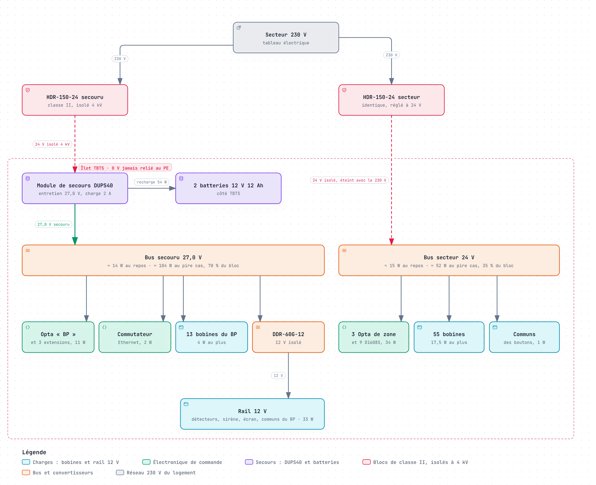{ loading=lazy }

Lecture : deux blocs HDR-150-24 identiques séparent deux bus. Le bus secouru de 27,0 V, tenu par le DUPS40 et ses batteries, alimente l'Opta « BP », ses extensions, le commutateur, les bobines du BP et le rail 12 V. Le bus secteur de 24 V alimente les trois Opta de zone, leurs extensions, les 55 bobines et les communs des boutons ; il s'éteint avec le 230 V. Chaque bloc garde au moins 30 % de marge au pire cas. La version interactive du schéma, générée par Archify, accompagne l'étude.

Sources : [fiche Finder série 8A](https://cdn.findernet.com/app/uploads/S8AFR.pdf), [datasheet Opta](https://docs.arduino.cc/resources/datasheets/AFX00001-AFX00002-AFX00003-datasheet.pdf), [datasheet D1608E et D1608S](https://docs.arduino.cc/resources/datasheets/AFX00005-AFX00006-datasheet.pdf), [HDR-150](https://www.meanwell.com/Upload/PDF/HDR-150/HDR-150-SPEC.PDF), [DUPS40](https://www.power-supplies-australia.com.au/mean-well-dups40-ups-module), [DDR-60G-12](https://befr.rs-online.com/web/p/dc-dc-converters/1757796).

## Architectures cibles

L'architecture par zone (scénario B) est recommandée : elle reproduit le partage actuel entre BP et BA, avec Ethernet à la place du bus I2C non isolé entre cartes. Seules les extensions gardent un bus I2C, court et interne à chaque groupe de modules. Les deux variantes plus denses gagnent de la place ou de l'argent, mais perdent en résilience.

| Critère | A. Deux Opta | B. Quatre Opta par zone | C. Trois Opta |
| --- | --- | --- | --- |
| Répartition | Un Opta RS485 et un Opta Lite, 5 extensions chacun | Un « BP » et un Opta par zone | BP fusionné avec les pièces de vie |
| Sirène en PWM | Pas de place pour l'A0602 : commande à revoir | A0602 sur l'Opta « BP » | A0602 sur l'Opta « BP et PDV », sans sortie de réserve |
| Panne d'un Opta | La moitié des circuits | Une zone, ou les fonctions centrales | Une zone, ou les fonctions centrales et les pièces de vie |
| Modules sur le rail | 12 | 16 | 14 |
| Automates HT | ≈ 1 490 € | ≈ 2 050 € | ≈ 1 800 € |
| Verdict | Écarté | **Recommandé** | Repli si la place manque |

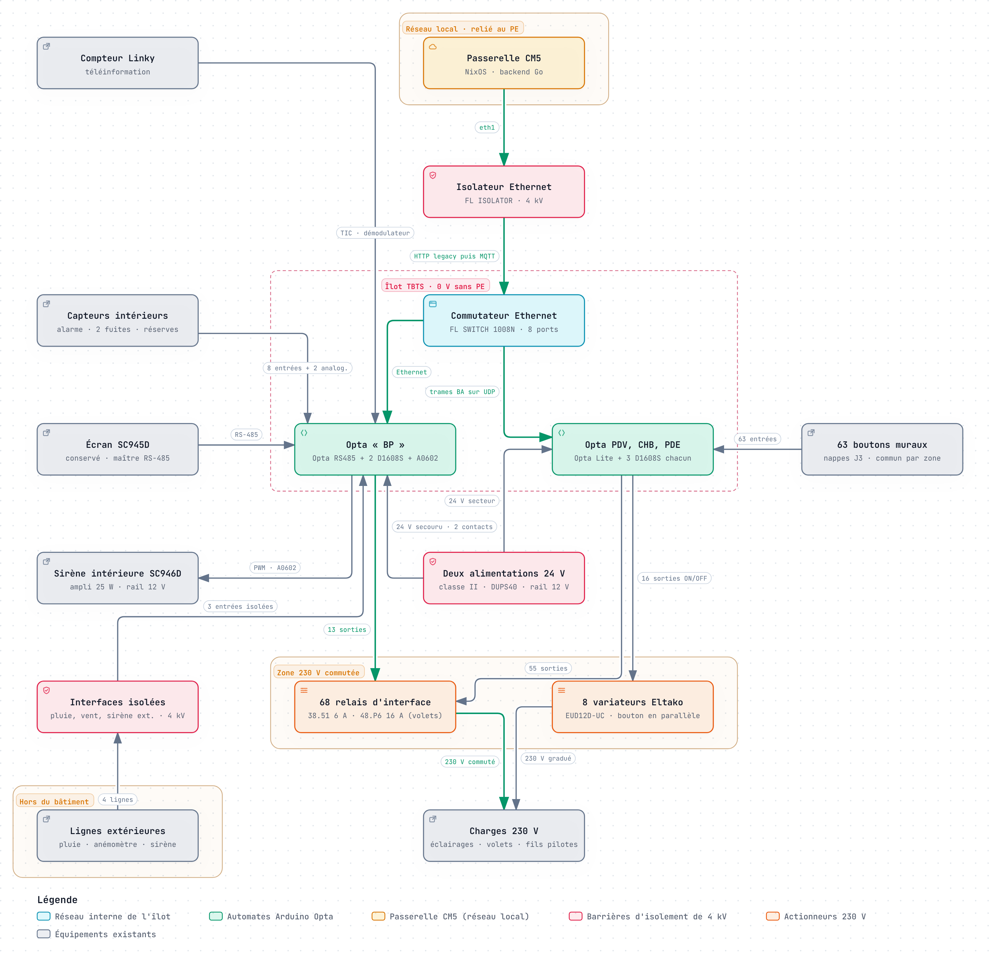{ loading=lazy }

Lecture : l'Opta « BP » lit la TIC et dialogue avec l'écran et la passerelle ; chaque Opta de zone traite ses boutons en local. Les barrières de 4 kV (en rose) gardent l'îlot TBTS, et le 230 V ne passe que par les relais et les variateurs. Le bloc des deux alimentations envoie le 24 V secouru à l'Opta « BP » et le 24 V secteur aux zones. La version interactive du schéma, générée par Archify, accompagne l'étude.

En phase 1, la passerelle CM5 ne change pas si l'Opta « BP » lit la TIC. Celui-ci reprend le client HTTP legacy du BP et son adresse sur eth1. La réservation DHCP passe sur l'adresse MAC de l'Opta, qui reprend aussi la clé d'accès distant de 16 octets. Si la lecture locale de la TIC échoue, la passerelle évolue dès la phase 1 : elle lit la TIC et écrit l'index ADPS que le BP écrit aujourd'hui.

Le panneau occupe environ 3,1 m de rail, répartiteur, blocs de phase et jonctions compris. Les cartes restent en place jusqu'à G3 : il faut donc deux coffrets de plus, de quatre rangées de 24 modules, accolés à droite du coffret actuel. Le premier reçoit le répartiteur, les blocs de phase, les relais d'interface et les variateurs ; le second, les automates, le commutateur et les alimentations. Les liaisons entre coffrets font 0,5 m au plus, et un conducteur relie leurs 0 V. Si les coffrets ne peuvent pas être accolés, chaque liaison qui les relie doit être isolée à 4 kV.

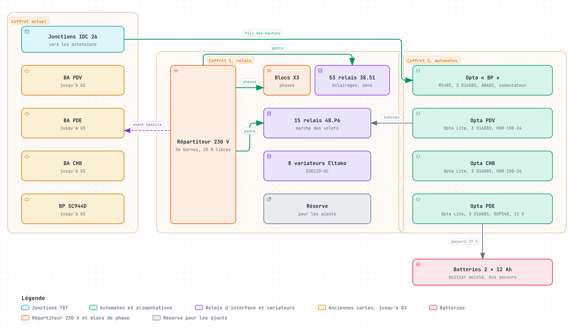{ loading=lazy }

Lecture : le premier coffret ajouté, contre le coffret actuel, reçoit le répartiteur, les blocs de phase, les relais et les variateurs ; le second, les quatre Opta, leurs extensions et les alimentations. Les Opta commandent les bobines des relais du premier coffret. Le coffret actuel garde les jonctions et les quatre cartes jusqu'à G3, et les batteries vont dans un boîtier accolé. Implantation indicative, à confirmer au relevé de P0.

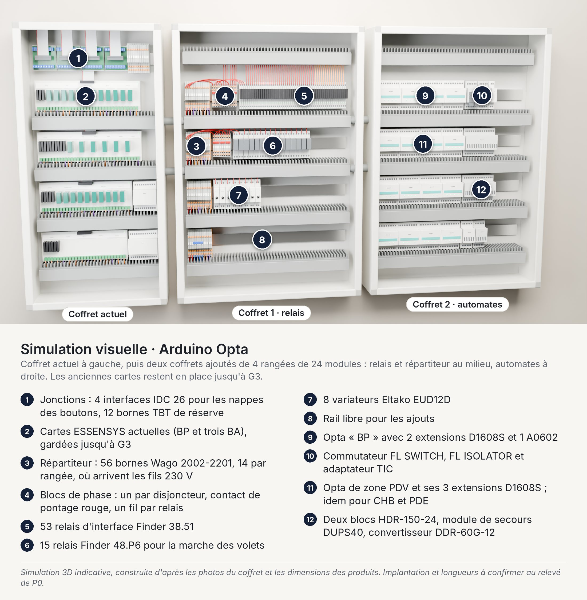{ loading=lazy }

Lecture : simulation 3D d'après les photos du coffret et les dimensions des produits, après la pose du panneau ; les fils rouges partent des blocs de phase vers chaque relais. Le coffret 1 reçoit le répartiteur, les blocs de phase et les relais, le coffret 2 les automates ; l'implantation exacte sera fixée au relevé de P0.

Une combinaison Revolution Pi pour le rôle de BP et Opta pour les zones reste possible, mais elle cumule deux chaînes logicielles.

## Câblage de migration et évolutivité

Aujourd'hui, les fils du logement arrivent directement sur les bornes des cartes, et les boutons sur leurs nappes. Changer d'équipement oblige à reprendre chaque fil, et revenir en arrière aussi. Le câblage de migration sépare ces fils de l'équipement qui les pilote. Il est commun aux trois études, et peut être posé avant même de choisir.

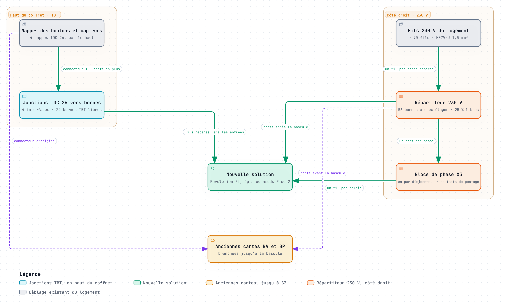{ loading=lazy }

Lecture : les fils 230 V arrivent sur un répartiteur, sur le côté droit ; les nappes arrivent sur des jonctions, en haut. Des ponts repérés relient ces bornes à l'équipement : d'abord aux anciennes cartes, puis aux Opta. La version interactive du schéma, générée par Archify, accompagne l'étude.

Ce qu'il faut poser :

- **Répartiteur 230 V, à droite (coffret 1, ou côté droit du coffret actuel si le relevé de P0 le permet)** : chaque fil existant quitte sa carte pour une borne repérée. Cela concerne les 63 départs des BA, les 8 départs du BP, une douzaine de phases d'alimentation et jusqu'à 7 neutres du BP, soit environ 90 fils. Les fils en place sont en H07V-U 1,5 mm² rigide, que des bornes à poussoir reçoivent tels quels. La phase de chaque disjoncteur est ensuite répartie vers les relais par un bloc de phase (voir plus bas).
- **Jonctions des nappes, en haut** : les quatre nappes IDC 26 arrivent par le haut, sur les J3 des trois BA et du BP. Un second connecteur, serti sur chaque nappe, la relie à une interface IDC 26 vers bornes. L'ancienne carte reste branchée sur le connecteur d'origine jusqu'à la bascule.
- **Tensions séparées** : la TBT en haut, le 230 V sur le côté droit, avec des goulottes distinctes. L'analyse experte demande aussi, en priorité 1, d'éloigner les nappes des bornes de phase.
- **Réserve** : 25 % de bornes libres au répartiteur, soit une vingtaine de circuits, et 12 bornes TBT à deux étages libres près des jonctions, soit 24 circuits. Les conducteurs inutilisés des nappes arrivent aussi sur bornes.
- **Repérage** : chaque fil, borne et pont porte le même repère, reporté dans un plan de bornage tenu à jour dans essensys-doc.

| Élément | Quantité | Place sur rail | Prix HT |
| --- | --- | --- | --- |
| Bornes à poussoir à deux étages, 2,5 mm² (Wago 2002-2201) : 90 fils et 25 % de réserve | 56 | ≈ 0,3 m, côté droit | ≈ 99 € |
| Interfaces IDC 26 vers bornes, 50 V et 1 A (RS PRO) | 4 | ≈ 0,3 m, en haut | 256 € |
| Bornes TBT à deux étages, en réserve | 12 | ≈ 6 cm, en haut | ≈ 21 € |
| Embouts, cloisons, butées, repères, connecteurs IDC à sertir, contacts de pontage bleus des neutres (/000-006) | — | — | ≈ 55 € (estimation) |
| Fil H07V-K 1,5 mm² et embouts de câblage pour les ponts | — | — | ≈ 40 € (estimation) |
| Total |  | ≈ 0,65 m | ≈ 470 € |

Connecteurs retenus, les mêmes dans les trois études :

| Connecteur | Rôle | Référence |
| --- | --- | --- |
| Borne de passage à deux étages, à poussoir, 2,5 mm², 5,2 mm de large | Répartiteur : chaque étage reçoit un circuit, le fil du logement d'un côté, le pont repéré de l'autre. 56 bornes, soit 112 circuits | [Wago 2002-2201](https://buerklin.com/en/p/wago/series-terminals/2002-2201/09H4322) |
| Interface IDC 26 vers bornes à vis, sur rail DIN, 50 V et 1 A | Jonction : reçoit la nappe des boutons d'une zone et ramène ses 26 conducteurs sur bornes. Une par nappe, soit 4 | [RS PRO 403-320](https://befr.rs-online.com/web/p/interface-modules/0403320) |
| Connecteur IDC 26 femelle, pas de 2,54 mm, pour nappe au pas de 1,27 mm, avec serre-câble | Second connecteur serti sur chaque nappe : l'interface se branche sans débrancher l'ancienne carte | [3M 3399-6026](https://fr.rs-online.com/web/p/connecteurs-idc/8280403) |

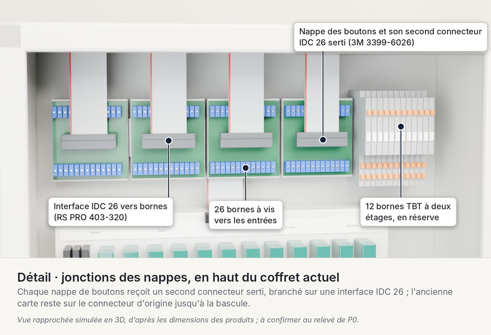{ loading=lazy }

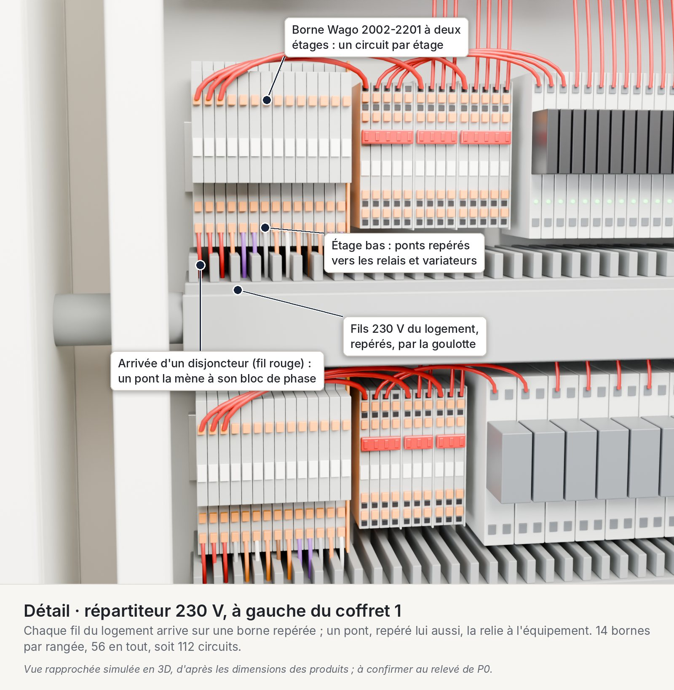{ loading=lazy }

Lecture : les deux vues rapprochées montrent les connecteurs retenus en place, en haut du coffret actuel pour les nappes et à gauche du coffret 1 pour le répartiteur ; les ponts et les repères sont ceux du plan de bornage.

### Repiquer une phase sur plusieurs relais

Un disjoncteur du tableau alimente toujours plusieurs relais. Sur les BA, les relais d'un même groupe ont leur commun relié sur le circuit imprimé, et ce commun sort sur deux bornes P : la phase arrive sur l'une et repart vers le groupe suivant par l'autre, avec un fil rouge. C'est le repiquage. Les schémas « Borniers » des cartes comptent 10 groupes sur le BA PDV, 13 sur le BA CHB et 14 sur le BA PDE, pour 63 sorties ; le BP reçoit trois phases (alimentation, fil pilote, arrosage) et jusqu'à sept neutres, reliés sur sa carte.

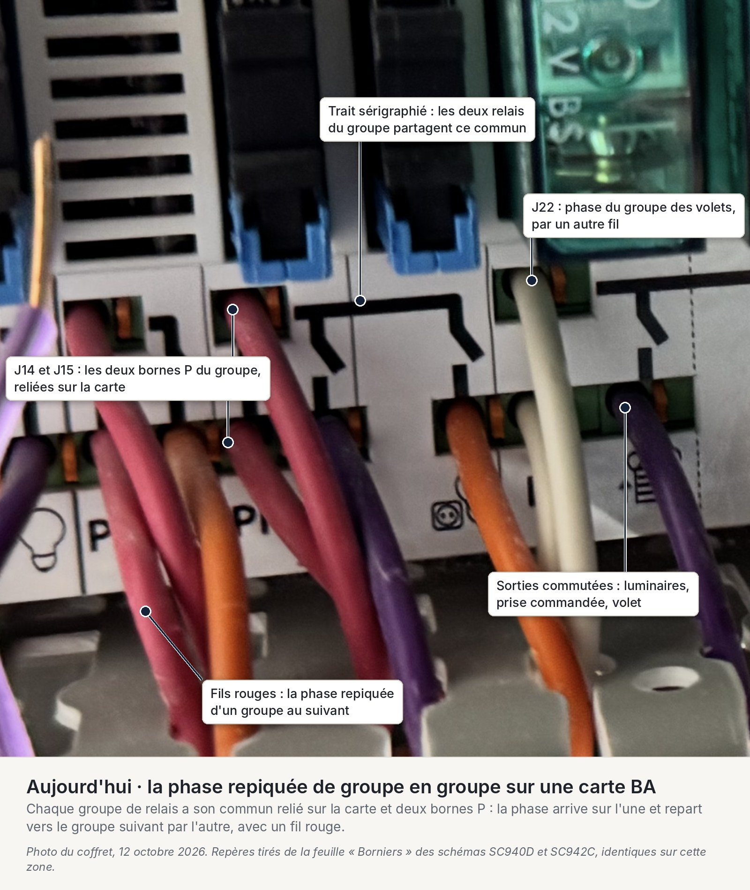{ loading=lazy }

Lecture : chaque groupe a deux bornes P reliées sur la carte, ici J14 et J15 ; le trait sérigraphié montre le commun des deux relais du groupe. Les fils rouges repiquent la phase d'un groupe au suivant, et le groupe des volets reçoit la sienne par un autre fil, blanc. Les fils orange et violets partent vers les luminaires, la prise commandée et le volet.

Avec les Opta, aucune carte ne relie plus les communs : chaque relais d'interface a sa propre borne COM (11), et les peignes Finder des supports 93.01 ne relient que les bornes de bobine A1 ou A2. Des bornes Wago pontées répartissent donc la phase, dans un bloc de phase par disjoncteur, noté X3, au début des rangées de relais du coffret 1.

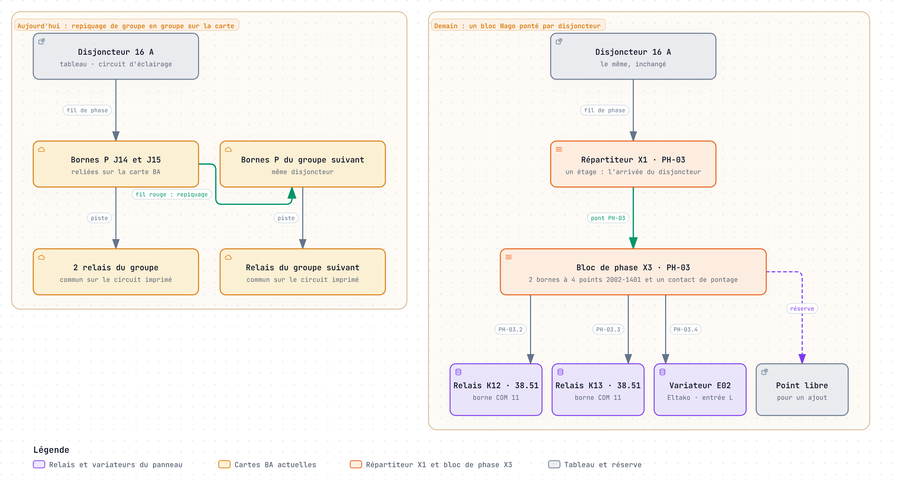{ loading=lazy }

Lecture : à gauche, la phase passe d'une borne P à l'autre sur les cartes. À droite, elle arrive sur son étage du répartiteur X1 ; un pont la mène à son bloc X3, où un contact de pontage relie quelques bornes à quatre points, et chaque point donne un fil à un seul relais. La version interactive du schéma, générée par Archify, accompagne l'étude.

Comment un bloc Wago repique la phase :

1. **Un bloc par disjoncteur** : la phase garde son étage au répartiteur X1, repéré PH-03 par exemple. Un pont la conduit au bloc PH-03 du panneau.
2. **Un contact de pontage** : le bloc réunit quelques bornes de passage à quatre points, Wago 2002-1401, de la même série que le répartiteur mais à un seul étage. Un contact de pontage Wago de 2 à 10 raccords (2002-402 à 2002-410, 25 A, en rouge avec le suffixe /000-005) s'enfonce dans leur fente de pontage : toutes portent la phase.
3. **Un fil par point** : chaque borne a quatre points à poussoir, deux en haut et deux en bas. Le pont venu de X1 prend le premier ; chaque autre point reçoit un seul fil, vers la borne COM d'un relais 38.51 ou 48.P6, ou l'entrée L d'un variateur ou d'un bloc 24 V. Au moins un point reste libre pour un ajout.
4. **Un repère par fil** : « PH-03.2 → K12:11 » se lit « bloc PH-03, point 2, vers la borne 11 du relais K12 ». Le plan de bornage tient ces listes.

Un fil par relais, plutôt qu'un repiquage de relais en relais, permet de retirer un relais sans couper les suivants et d'essayer chaque fil seul. Aucune borne de relais ne porte plus le courant de tout le groupe.

Règles, à faire valider par l'électricien :

- **Jamais deux disjoncteurs dans un bloc** : relier deux blocs mettrait deux disjoncteurs en parallèle ; un fil du bloc pourrait alors porter la somme de leurs calibres sans qu'aucun ne déclenche, et couper l'un ne mettrait plus le bloc hors tension. Un bloc ne sert que les circuits de son disjoncteur actuel, relevés en P0.
- **Courants** : les fils en place et les ponts sont en 1,5 mm², que la NF C 15-100 protège par un disjoncteur de 16 A au plus, sous les 24 A de la borne et les 25 A du contact de pontage. Le calibre de chaque disjoncteur qui alimente l'armoire est à vérifier en P0 : un circuit en 20 A demanderait du 2,5 mm² de bout en bout.
- **Même disjoncteur** : un circuit prend sa phase et son neutre sur le même disjoncteur phase-neutre, donc sous le même interrupteur différentiel. Un neutre pris sur un autre circuit fait déclencher le différentiel, ou n'est plus coupé avec sa phase.
- **Neutres** : les neutres du BP arrivent sur X1, chacun avec la phase de son circuit : N\_ALIM (alimentation et bobines des contacteurs, quatre bornes), N\_FP (fil pilote) et N\_EV (électrovanne, deux bornes). Un contact de pontage bleu (suffixe /000-006) ne relie que les bornes d'un même neutre ; ces trois neutres restent séparés. Les blocs 24 V prennent leur phase sur PH\_ALIM et leur neutre sur N\_ALIM. Les BA n'ont pas de borne de neutre : si la notice des Eltako demande le neutre, il faudra l'amener de la borne N du disjoncteur de chaque circuit concerné.

Pendant la migration :

- **Pré-câblage** : le fil du disjoncteur quitte la borne P de la carte pour son étage de X1, et un pont le ramène sur la même borne P. Les repiquages des cartes ne bougent pas.
- **Bascule** : un seul pont par disjoncteur passe de la carte au bloc X3, câblé vers les relais avec le panneau et resté hors tension jusque-là.
- **Retour arrière** : ces ponts reviennent sur les cartes.

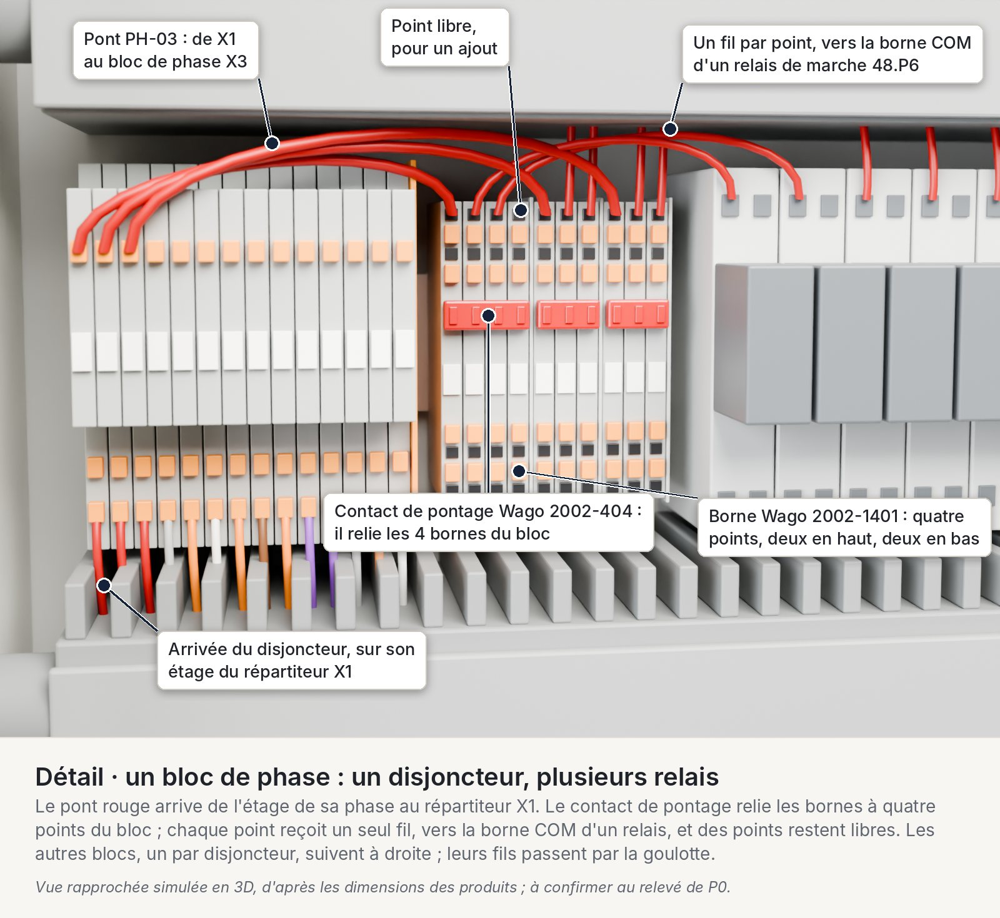{ loading=lazy }

Lecture : le pont rouge arrive de X1, le contact de pontage relie quatre bornes à quatre points, deux fils partent vers les premiers relais de marche des volets, et des points restent libres ; les autres blocs suivent, et leurs fils passent par la goulotte. Vue simulée en 3D, à confirmer au relevé de P0.

Pour l'Opta, cela fait 62 fils de phase : 25 relais d'éclairage, 15 relais de marche des volets, 8 relais de fil pilote, 4 relais d'options, 8 variateurs et les deux blocs 24 V. Les relais de sens prennent la phase sur la marche de leur volet. Avec une douzaine de blocs, il faut environ 24 bornes à quatre points et 12 contacts de pontage : environ 90 € HT et 13 cm de rail.

Sources : [schémas des BA, feuille Borniers](https://github.com/essensys-hub/essensys-board-SC940), [schéma du BP](https://github.com/essensys-hub/essensys-board-SC944D), [fiche Wago 2002-2201 et ses accessoires](https://www.alldataresource.com/assets/Wago_Corporation/Wago-Corporation-2002-2201-Double-Deck-Terminal-Block-Specification-Sheet.pdf), [borne à quatre points Wago 2002-1401](https://buerklin.com/en/p/wago/series-terminals/2002-1401/09H4219), [contact de pontage Wago 2002-410](https://www.wago.com/ch-fr/bornes-sur-rail/contact-de-pontage/p/2002-410), [contacts de pontage pour la série 2002](https://uk.rs-online.com/web/p/din-rail-terminal-accessories/5076591), [version rouge 2002-410/000-005](https://www.rowse-automation.co.uk/wago-2002-410-000-005), [version bleue 2002-402/000-006](https://uk.rs-online.com/web/p/din-rail-terminal-accessories/2783244), [peigne Finder 093.20.1, bornes A1 ou A2](https://buerklin.com/en/p/finder/relays-accessories/093-20-1/34G1079), [notice Eltako EUD12D, entrées séparées du 230 V](https://www.eltako.com/fileadmin/downloads/de/_bedienung/EUD12D_21100905-3_dt.pdf), [calibres de la NF C 15-100](https://hager.com/fr/normes/nfc-15-100/disjoncteur).

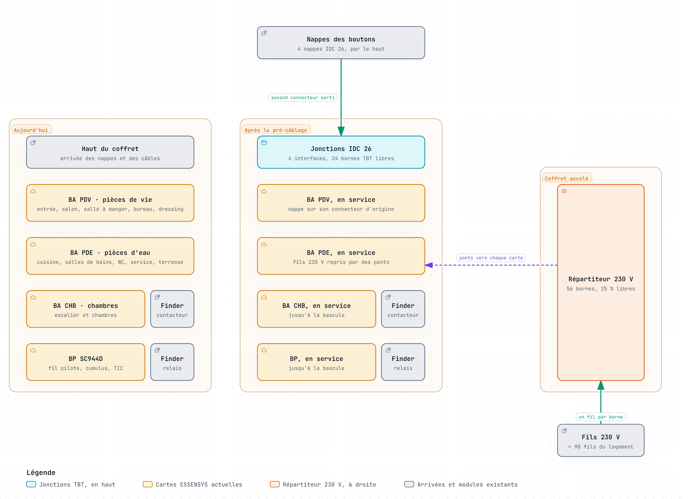{ loading=lazy }

Lecture : à gauche, le coffret tel qu'il est. Chaque carte reçoit sa nappe par le haut et ses fils 230 V par le bas, et le côté droit n'a qu'environ 4 cm libres. À droite, le même coffret après le pré-câblage : les jonctions occupent le haut, les fils passent par le répartiteur du premier coffret ajouté, et des ponts les ramènent aux cartes, toujours en service. La version interactive du schéma, générée par Archify, accompagne l'étude.

Le répartiteur prend place dans le premier des deux coffrets ajoutés à droite, avec les blocs de phase, les relais d'interface et les variateurs ; les jonctions restent en haut du coffret actuel. Le relevé de P0 dit si le côté droit du coffret actuel peut recevoir le répartiteur.

Déroulement :

1. **Relevé et plan, en P0** : place libre sur le côté droit et en haut, longueur des fils, plan de bornage.
2. **Pré-câblage, 2 à 3 jours d'électricien, armoire en service** : chaque fil passe sur sa borne, un pont le relie à l'ancienne carte, et le circuit est essayé. La phase de chaque disjoncteur revient par un pont sur la borne P qu'elle quittait ; les repiquages des cartes ne bougent pas. Le second connecteur des nappes est serti et branché sur sa jonction.
3. **Bascule, une journée** : les ponts passent sur les relais d'interface et les variateurs que pilotent les Opta, chaque phase sur son bloc de phase, les nappes quittent les anciennes cartes, et les bornes des jonctions, déjà câblées vers les entrées des D1608S pendant le câblage du panneau, sont mises en service en fermant le commun des boutons de chaque zone, resté ouvert jusque-là. Pendant cette journée, le logement n'a ni boutons, ni écran, ni alarme, ni fil pilote : prévenir les occupants, choisir une journée hors période de chauffe, prévoir un éclairage d'appoint.
4. **Retour arrière, une demi-journée** : les ponts reviennent sur les anciennes cartes, qui restent en place jusqu'à G3, et les nappes se rebranchent une fois rouverts les communs des boutons de chaque zone.

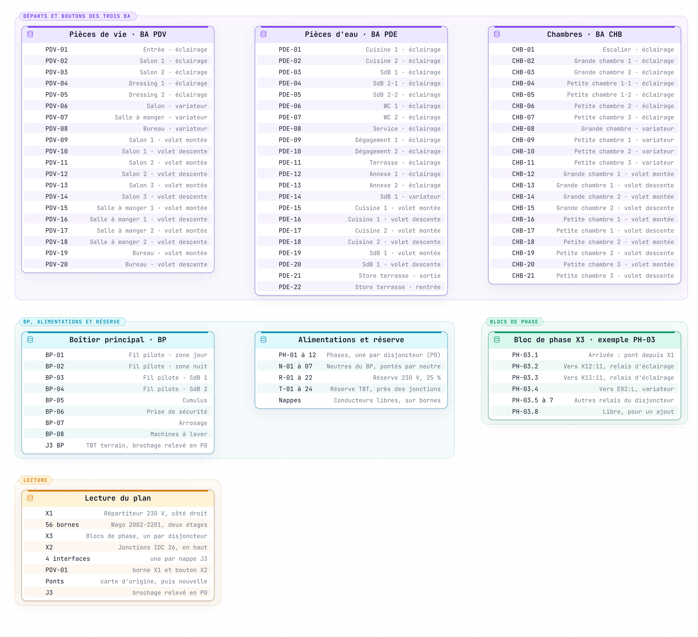{ loading=lazy }

Lecture : chaque circuit a un seul repère, porté par sa borne 230 V au répartiteur X1 et par la borne de son bouton à la jonction X2. Les tables suivent l'ordre éclairages, variateurs, volets ; les phases, les neutres du BP et la réserve complètent les 112 circuits du répartiteur ; chaque bloc de phase a sa table, comme l'exemple PH-03. Le brochage J3 de chaque bouton et les phases restent à relever en P0. La version interactive du schéma, générée par Archify, accompagne l'étude.

Évolutivité : aujourd'hui, le brochage des BA est figé dans le code (881 lignes de hard.h), le bus I2C ne connaît que trois BA, et chaque ajout demande de reprendre une carte. Avec les Opta et ce câblage, un ajout se résume à une borne, un pont, un fil de phase et une ligne de configuration. Le neutre d'un nouveau départ se prend sur son circuit, hors de l'armoire, dans la limite de 8 points d'éclairage par circuit.

| Ajout | Comment | Capacité libre |
| --- | --- | --- |
| Un éclairage ou un volet | Relais d'interface dans le premier coffret, sortie libre d'une extension, pont au répartiteur, fil de phase sur un point libre de son bloc | 20 sorties ; 8 emplacements d'extension, de 16 entrées et 8 sorties chacun |
| Un bouton ou un capteur | Borne TBT de réserve vers une entrée libre de la zone | Plus de 130 entrées |
| Une zone ou un bâtiment | Opta de plus sur un port libre du commutateur, avec son commun et son fusible | 2 zones, le troisième port libre restant à la maintenance |
| Une commande à distance | Table de correspondance en flash, chargée sans recompiler ; MQTT et Home Assistant en phase P4 | — |

Après G3, la dépose des cartes libère aussi le coffret actuel pour les ajouts.

Sources : [interface IDC 26 RS PRO](https://befr.rs-online.com/web/p/interface-modules/0403320), [borne Wago 2002-2201](https://buerklin.com/en/p/wago/series-terminals/2002-2201/09H4322), [nappes J3 du BP et des BA](https://github.com/essensys-hub/essensys-doc/blob/main/archi/hardware-overview.md), [cheminement des nappes dans l'analyse experte](https://github.com/essensys-hub/essensys-doc/blob/main/docs/retex/foudre-2026/analyse-experte.md).

## Modes dégradés

Aucune panne d'automate ne prive toute la maison de ses boutons : c'est le principal gain sur la Revolution Pi. Chaque Opta de zone garde la logique de ses boutons, comme les BA, sans dépendre du BP ni de la passerelle. Ce gain suppose que le banc valide le comportement des extensions.

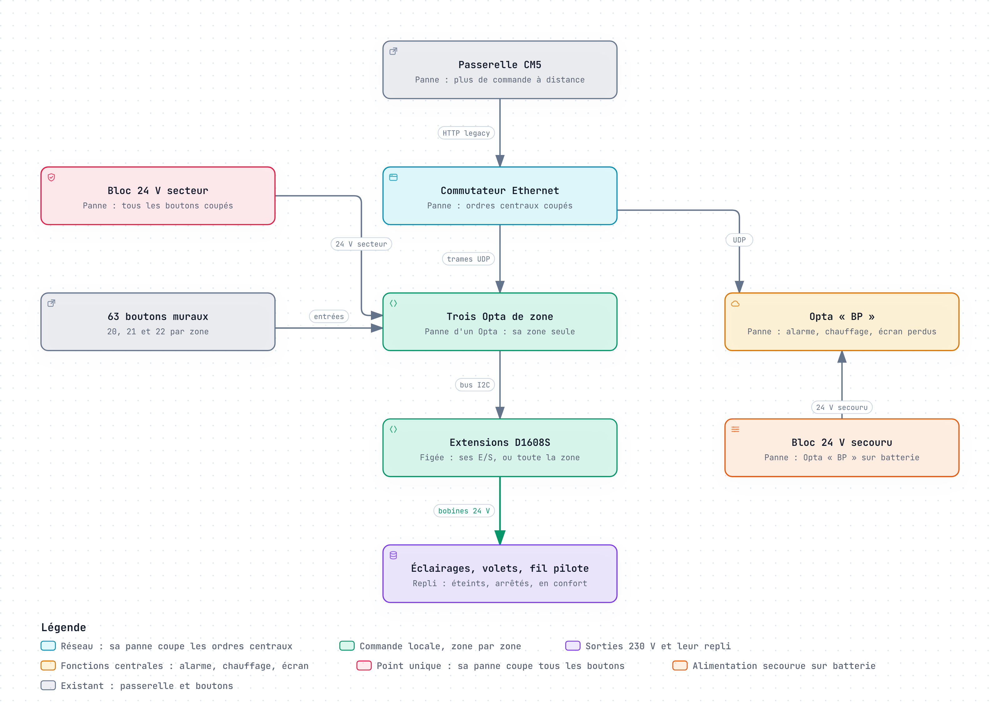{ loading=lazy }

Lecture : chaque Opta de zone garde ses boutons. La panne d'un Opta, ou d'une extension figée, ne prive que sa zone ; celle de l'Opta « BP », de la passerelle ou du commutateur laisse les boutons actifs. Seul le bloc 24 V secteur, en rose, éteint les trois zones à la fois. Les sorties retombent dans la matrice de repli, et l'Opta « BP » tient l'alarme et l'écran sur batterie. La version interactive du schéma, générée par Archify, accompagne l'étude.

| Panne | Effet | Parade |
| --- | --- | --- |
| Un Opta de zone | La zone perd ses 20, 21 ou 22 boutons et ses 23 à 25 sorties | Opta RS485 de rechange, qui peut tenir les quatre rôles |
| Une extension figée ou sans alimentation | Ses 16 entrées et 8 sorties, ou toute la zone si le bus I2C se bloque : à mesurer en P0 | D1608S de rechange ; coupure de l'alimentation des extensions par le chien de garde, si le banc l'exige |
| L'Opta « BP » | Alarme, chauffage programmé, écran, scénarios et commande à distance perdus. Fil pilote en confort si les sorties retombent, sinon figé sur le dernier ordre. Les boutons restent actifs | Opta RS485 de rechange, matrice de repli |
| La passerelle CM5 | Plus de commande à distance ; la maison fonctionne en local. Le délestage continue si l'Opta « BP » lit la TIC ; sinon il s'arrête, ce qui est une régression | Lecture locale de la TIC, critère G1 |
| Le commutateur Ethernet | Plus d'ordres centraux vers les zones, ni de lien entre le BP et la passerelle : commande à distance perdue. Les boutons restent actifs | Commutateur de rechange, environ 141 € HT |
| Le bloc 24 V du bus secteur | Les trois zones s'éteignent, comme les BA aujourd'hui si leur +15 V tombe ; l'alarme reste active | HDR-150-24 de rechange, identique pour les deux bus, environ 32 € HT |
| Le bloc 24 V du bus secouru | L'Opta « BP » passe sur batterie jusqu'à la fin de l'autonomie | Même rechange |
| Le secteur | Zones, relais et variateurs s'éteignent ; l'Opta « BP » garde l'alarme et l'écran sur batterie, environ 15 h | Au retour, chaque zone redemande l'état de ses sorties à l'Opta « BP » |

Un Opta bloqué est relancé par son chien de garde matériel, et ses relais internes retombent pendant le redémarrage. Les extensions ont leur propre microcontrôleur et leur propre alimentation : leur comportement quand l'Opta se tait est un critère de G1. Si elles gardent leur dernier état, le chien de garde coupera leur alimentation par un relais. La matrice de repli reste celle de la Revolution Pi : lumières éteintes, volets arrêtés, fil pilote en confort.

Chaque Opta de zone garde sa configuration en flash, temporisations et extinctions automatiques comprises, comme les BA dans leur EEPROM. Aujourd'hui, les BA sauvent aussi l'état de leurs sorties sur ordre du BP, avant que leur +15 V soit coupé. Les Opta de zone, éteints sans préavis, redemandent cet état à l'Opta « BP », resté sur batterie, et évitent ainsi d'écrire la flash à chaque changement.

Sources : [datasheet D1608E et D1608S](https://docs.arduino.cc/resources/datasheets/AFX00005-AFX00006-datasheet.pdf), [bibliothèque Arduino\_Opta\_Blueprint](https://github.com/arduino-libraries/Arduino_Opta_Blueprint), [commande locale des BA](https://github.com/essensys-hub/essensys-board-SC940/blob/main/SC940D/Prog/code_ba%20%28fichiers%20sources%201.7%29/source/traitement.c), [démarrage du BP et des BA](https://github.com/essensys-hub/essensys-memory/blob/main/raw/analyses/2026-10-demarrage-bp-ba/analyse.md), [téléinformation dans TeleInfo.c](https://github.com/essensys-hub/client-essensys-legacy/blob/main/C/TeleInfo.c), [délestage dans Chauffage.c](https://github.com/essensys-hub/client-essensys-legacy/blob/main/C/Chauffage.c).

## Migration logicielle

La logique C du BP et des BA est portée sur les Opta au lieu d'être réécrite. Le BP compte environ 6 000 lignes métier, sur 16 800 lignes de C avec la console Espion et la cryptographie. Les BA comptent 4 766 lignes de C, dont 881 de brochage et environ 1 550 de logique réutilisable. Les quatre Opta partagent un même code, compilé avec le rôle de chacun.

Le portage part d'essensys-gcc, qui compile déjà le BP avec GCC et les BA avec XC8, et fait tourner des tests Unity sur PC. Les appels MQX restent à émuler sur le cœur retenu.

| Bloc | Aujourd'hui | Sur Opta |
| --- | --- | --- |
| Logique BP | C sur MQX 3.8 : alarme, chauffage et fil pilote, scénarios, arrosage, réveil, téléinfo, écran | Reprise sur l'Opta « BP », avec une couche qui émule la centaine d'appels MQX utilisés : tâches, mutex, sémaphores, minuteries |
| Logique BA | C v1.7 sur PIC : anti-rebond, appui long, double clic, temporisation des volets, extinction automatique | Logique reprise sur chaque Opta de zone ; brochage, pilotes et trame série des variateurs SC943 réécrits |
| Bus BA | I2C non isolé, CRC-16, 5 codes de trame, pilote aux sources perdues | Mêmes trames et même CRC sur UDP, avec un numéro de version de protocole. Seule la liaison change, comme dans l'ADR 0001, au statut « Proposé » |
| Table d'échange | Flash 0x7E000 et EEPROM SPI | Flash QSPI de l'Opta « BP », écrite de façon atomique |
| Contenu de la table : horaires, scénarios, réglages | Lu dans le BP 099-37 | Exporté avant la bascule, importé dans l'Opta « BP », sauvegardé chaque jour vers la passerelle par HTTP legacy, restauration essayée en G2 |
| Passerelle | Client HTTP legacy (www.c) | Repris sur la pile réseau de l'Opta ; MQTT en phase P4 |
| Mises à jour | OTA S19, binaire 099-37 seul flashable | USB-C sur place, avec un portable sur batterie ou un isolateur USB ; mise à jour signée en phase P4 |

Le cœur logiciel est le choix structurant, et il sort de la porte G1. Trois voies existent : le cœur Arduino sous Zephyr, une application Zephyr native, ou le cœur Mbed figé le temps du portage. Le banc P0 valide, sur la voie retenue, les extensions, l'Ethernet, le RS-485, l'ATECC608B et le démarrage signé.

Points de vigilance du portage :

- **Fil pilote** : la logique des ordres est reprise. ECO et ECO+ sont les ordres Confort −1 et −2 du GIFAM, et le hors-gel forcé de 500 ms aux transitions est conservé. La commande des TRIAC, synchronisée sur le passage à zéro par les interruptions du ColdFire, est remplacée par celle des relais, et le hors-gel forcé est re-temporisé.
- **Téléinformation** : TeleInfo.c est repris derrière une UART logicielle à 1 200 bauds, si l'entrée native suit ce débit. Sinon, l'ADPS vient de la passerelle, et le délestage est à refondre.
- **Parité** : rejouer sur banc les ordres du backend et les traces de l'espion I2C. Comparer ensuite la table d'échange du BP 099-37 et celle de l'Opta « BP », scénario par scénario.
- **Source et binaire** : aucun build qualifié du BP n'existe, et le source courant contient des ajouts d'octobre 2026. La parité se mesure donc contre le BP en service, pas contre une compilation du source.
- **Versions figées** : cœur logiciel, bibliothèque et firmware des extensions sont figés et mis à jour ensemble, selon une procédure écrite.
- **Chien de garde** : watchdog matériel sur chaque Opta, là où les BA actuels n'en ont aucun.

| Lot | Semaines-personne |
| --- | --- |
| Banc P0 et choix du cœur | 1,5 à 2 |
| Couche matérielle et émulation MQX | 1,5 à 2 |
| Logique BA | 1,5 à 2 |
| Domaines BP, dont le fil pilote sur relais | 2 à 3 |
| Liaison BP–zones sur UDP | 1 à 1,5 |
| HTTP legacy | 0,5 à 1 |
| TIC locale et délestage | 1 à 1,5 |
| Écran RS-485 | 0,5 à 1 |
| Outillage de mise à jour des Opta et des extensions | 0,5 |
| Parité sur banc | 1 à 1,5 |
| **Avant la bascule, P0 à P3** | **11 à 16** |
| MQTT sur TLS | 1 à 1,5 |
| Démarrage et mise à jour signés | 1,5 à 2,5 |
| **Après la bascule, P4** | **2,5 à 4** |

L'effort est compté à temps plein, hors câblage du panneau. À périmètre égal, MQTT compris, l'Opta demande 12 à 17,5 semaines et la Revolution Pi 13 à 16 : la reprise du C ne fait pas gagner de temps. Elle évite la réécriture en Go, mais quatre automates, le bus des extensions, la TIC locale et l'outillage de mise à jour absorbent ce gain. Le PLC IDE n'aide pas le portage du C, et Codesys imposerait de tout réécrire en langage d'automate.

Sources : [firmware BP](https://github.com/essensys-hub/client-essensys-legacy), [firmware BA v1.7](https://github.com/essensys-hub/essensys-board-SC940), [essensys-gcc](https://github.com/essensys-hub/essensys-memory/blob/main/raw/architecture/repos/essensys-gcc.md), [remise en service et builds qualifiés](https://github.com/essensys-hub/essensys-doc/blob/main/docs/install/remise-en-service-surtension.md), [ADR 0001 génération 3](https://github.com/essensys-hub/essensys-board-SC944D/blob/main/docs/adr/0001-generation-3-rs485-isole.md), [cœur Arduino sous Zephyr](https://github.com/arduino/ArduinoCore-zephyr), [carte Opta dans Zephyr](https://docs.zephyrproject.org/latest/boards/arduino/opta/doc/index.html).

## Sécurité et PKI

L'élément sécurisé ATECC608B de chaque Opta peut porter l'identité matérielle de l'armoire, comme le TPM de la Revolution Pi. La surface d'attaque est plus petite, sans système d'exploitation ni page web. Le durcissement est moindre : le démarrage n'est pas verrouillé, pas plus que sur la Revolution Pi.

| Sujet | Aujourd'hui | Avec les Opta |
| --- | --- | --- |
| Identité de l'armoire | MAC et clé de 16 octets en EEPROM | Clé privée générée dans l'ATECC608B, certificat émis par step-ca sur demande signée |
| Lien eth1 | HTTP clair, MD5 en Basic | Phase 1 : HTTP legacy, pare-feu limité à la passerelle. Phase P4 : MQTT sur TLS avec certificat client |
| Liaison BP–zones | I2C interne, sans authentification | Trames UDP sans authentification, sur le réseau interne de l'îlot ; numéro de version de protocole |
| Démarrage | Aucun contrôle | MCUboot avec signature ECDSA-P256, en option ; documenté pour le cœur Mbed seulement, à valider sur le cœur retenu. Clés à générer, celles du dépôt étant publiques |
| Administration | Console Espion série, mot de passe figé dans le code | Aucun service réseau d'administration ; mise à jour par USB-C, puis signée |
| Suivi des failles | Aucun | Bulletins de sécurité Arduino ; un seul concerne l'Opta (ArduinoModbus, corrigé en 1.0.9) |

Points à retenir :

- **Démarrage non verrouillé** : Arduino ne verrouille ni le démarrage ni l'interface de débogage. Quiconque ouvre le coffret peut lire ou remplacer le firmware.
- **Réseau** : les Opta n'ont pas de page web et restent derrière l'isolateur et le pare-feu de la passerelle. Seul ce réseau fermé protège les trames UDP entre BP et zones. La mise à jour du PLC IDE par Modbus TCP, dont l'authentification n'est pas décrite, n'est pas utilisée.
- **Maintenance** : un portable branché sur secteur relierait la TBTS au PE par l'USB-C. Les mises à jour se font sur batterie ou derrière un isolateur USB, selon une procédure écrite.
- **Engagements** : correctifs de sécurité pendant au moins deux ans après la sortie ou la dernière vente. Aucune déclaration sur le Cyber Resilience Act n'a été trouvée pour l'Opta.
- **Sécurité électrique** : homologation cULus selon l'UL 61010-2-201. Les déclarations CE publiées ne citent que la CEM, pas la directive Basse Tension que le datasheet revendique : il faut demander la déclaration complète.
- **Limite d'emploi** : Finder précise que l'Opta n'est pas un produit de sécurité, et le repli des extensions n'est pas documenté. L'alarme et la détection de fuite ne doivent pas être présentées comme telles.

Sources : [modèle de sécurité Arduino](https://docs.arduino.cc/tutorials/security/intended-use-and-security-model), [démarrage sécurisé Arduino](https://docs.arduino.cc/arduino-cli/secure-boot), [bulletins de sécurité Arduino](https://support.arduino.cc/hc/en-us/sections/10926243830172-Arduino-Security-Bulletins), [Opta et AWS IoT](https://docs.arduino.cc/tutorials/opta/getting-started-with-aws-iot-core), [politique de support Arduino](https://support.arduino.cc/hc/en-us/articles/26339046977180), [certificats de l'Opta](https://github.com/arduino/docs-content/tree/main/content/hardware/opta/opta-family/opta/certifications), [FAQ Finder](https://opta.findernet.com/download/FAQ-FOCUS-OPTA-EN.pdf), [PKI passerelle](https://github.com/essensys-hub/essensys-memory/blob/main/wiki/concepts/gateway-pki.md).

## Nomenclature et budget

L'architecture à quatre Opta demande environ 5 600 € HT de matériel par armoire, soit 6 720 € TTC, câblage de migration compris. Les automates en représentent 37 % (2 052 €) et les relais d'interface 23 % (1 261 €).

| Poste | Qté | Prix unitaire HT | Total HT | Source |
| --- | --- | --- | --- | --- |
| Opta RS485 (AFX00001) | 1 | 137,59 € | 138 € | [Farnell Irlande](https://ie.farnell.com/arduino/afx00001/arduino-opta-rs485-board-cortex/dp/4141845) |
| Opta Lite (AFX00003) | 3 | 129,25 € | 388 € | [Farnell Portugal](https://pt.farnell.com/arduino/afx00003/arduino-opta-lite-board-cortex/dp/4141844) |
| Extension D1608S (AFX00006) | 11 | 122,00 € | 1 342 € | [boutique Arduino Espagne](https://store.arduino.cc/en-es/products/opta-ext-d1608s), HT déduit |
| Extension A0602 (AFX00007) | 1 | 185,00 € | 185 € | [boutique Arduino France](https://store.arduino.cc/en-fr/collections/opta-family/products/opta-ext-a0602), 222 € TTC |
| Commutateur Phoenix FL SWITCH 1008N, 8 ports | 1 | 141,28 € | 141 € | [industry-electronics.de](https://industry-electronics.de/phoenix-contact/1085256-phoenix-fl-switch-1008n-industrial-ethernet-druckansicht-1775494.htm) |
| Relais Finder 38.51.7.024.0050, 6 A | 53 | 19,06 € | 1 010 € | [RS France](https://fr.rs-online.com/web/p/relais-d-interface/3864419) |
| Relais Finder 48.P6.7.024.1050, 16 A, « marche » des volets | 15 | 16,70 € | 251 € | [RS France](https://fr.rs-online.com/web/p/relais-d-interface/2868578) |
| Variateur Eltako EUD12D-UC | 8 | 43,45 € | 348 € | [zaehlerschrank24](https://www.zaehlerschrank24.de/multi-dimmschalter-eud12d-uc.html), 51,70 € TTC |
| Alimentation classe II Mean Well HDR-150-24 | 2 | 31,64 € | 63 € | [alimentatorishop](https://www.alimentatorishop.com/en/power-supplies-din-guide/meanwell-hdr-150-din-rail-power-supply-150w-voltages-12v-15v-24v-and-48v) |
| Module de secours Mean Well DUPS40 | 1 | 40,87 € | 41 € | [Prof-Elec](https://prof-elec.com/all-categories/power-supplies-transformers-ups/ups-battery-chargers/uninterruptible-dc-ups-din-rail-controller-output-24vdc-at-40a-2a-battery-charging-current-for-4ah135ah-lead-acid-battery-ups-module/) |
| Batteries plomb 12 V 12 Ah | 2 | ≈ 30 € | 60 € | estimation |
| Convertisseur isolé 24 → 12 V Mean Well DDR-60G-12 | 1 | 49,98 € | 50 € | [RS Belgique](https://befr.rs-online.com/web/p/dc-dc-converters/1757796) |
| Isolateur Ethernet Phoenix FL ISOLATOR 100-RJ/RJ | 1 | 204,97 € | 205 € | [RS France](https://fr.rs-online.com/web/p/modules-dinterface/7511392) |
| Démodulateur TIC à optocoupleur, sur une entrée de l'Opta « BP » | 1 | ≈ 15 € | 15 € | estimation |
| Interfaces isolées des lignes extérieures et leur alimentation | 1 | ≈ 150 € | 150 € | estimation |
| Câblage de migration : 56 bornes à deux étages, 4 interfaces IDC 26, bornes de réserve, ponts, repérage | 1 | ≈ 470 € | 470 € | section Câblage de migration |
| Blocs de phase : 24 bornes à quatre points 2002-1401, 12 contacts de pontage rouges (/000-005), fils de phase | 1 | ≈ 90 € | 90 € | section Câblage de migration |
| Petit matériel : fusibles par zone, peignes, goulottes TBT et 230 V séparées, fils du panneau | 1 | ≈ 250 € | 250 € | estimation |
| Coffrets de quatre rangées de 24 modules, accolés à droite : répartiteur et relais, puis automates | 2 | ≈ 200 € | 400 € | estimation |
| Total matériel |  |  | ≈ 5 600 € |  |

Les prix sont relevés les 19 et 20 octobre 2026, hors port. Ceux des extensions sont déduits des pages par pays de la boutique Arduino ; les grossistes Finder n'affichent les prix de la série 8A qu'après connexion. Pour les éclairages à LED, prévoir la variante à contacts AgSnO2 de la série 38, qui tient mieux le courant d'appel ; référence et prix à confirmer. Le FL ISOLATOR est à déduire s'il a déjà été acheté au titre des mesures de priorité 1.

À mettre en regard :

- **Banc étendu P0** : un Opta RS485 avec l'A0602, un Opta Lite avec trois D1608S, soit une zone complète, et une alimentation Mean Well MDR-60-24 à 27,50 €. Il coûte environ 845 € HT, et tout sauf l'alimentation sert ensuite dans l'armoire.
- **Rechanges conseillées** : un Opta RS485, qui peut tenir les quatre rôles, une D1608S et un HDR-150-24, soit environ 290 € HT. L'A0602 n'a pas de rechange.
- **Revolution Pi, scénario B** : environ 5 450 € HT, câblage de migration compris, avec un kit de banc à 1 120 €.
- **Main-d'œuvre** : 11 à 16 semaines-personne de logiciel avant la bascule, puis 2,5 à 4 ; ce travail interne n'est pas valorisé dans le budget et vaudrait, à 500 € par jour, 27 500 à 40 000 € HT avant la bascule. L'électricien pose le répartiteur en 2 à 3 jours, l'armoire restant en service, puis câble le panneau en 3 à 4 jours : environ 2 000 à 2 800 € HT (estimation). La bascule demande une journée.

## Comparaison avec la Revolution Pi

À coût de matériel voisin, l'Opta gagne sur la résilience, le prix du banc et la capacité libre. La Revolution Pi gagne sur la durée de vie garantie, l'isolement des entrées, la sécurité et la place. Le logiciel ne les départage pas : 12 à 17,5 semaines pour l'Opta, MQTT compris, contre 13 à 16 pour la Revolution Pi. Le câblage de migration est le même pour les deux.

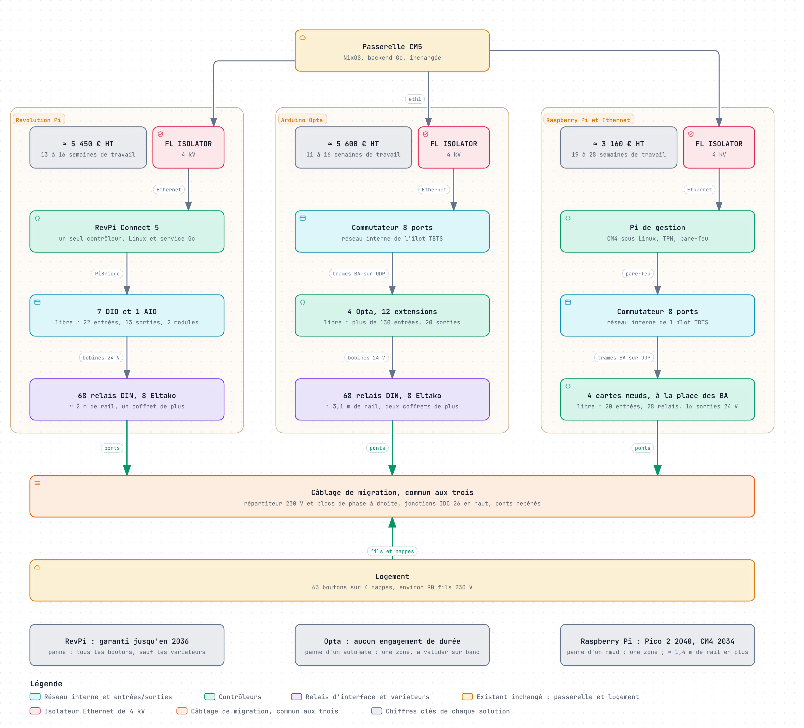{ loading=lazy }

Lecture : les trois solutions gardent la passerelle, l'isolateur de 4 kV et le câblage de migration ; seule la chaîne de contrôle change. La Revolution Pi concentre tout sur un contrôleur, l'Opta place un automate par zone, et la refonte Raspberry Pi un nœud Pico 2 par zone, relais soudés. Les cases grises donnent le matériel, le travail avant la bascule, la durée de vie annoncée et l'effet d'une panne. La version interactive du schéma, générée par Archify, accompagne l'étude.

| Critère | Revolution Pi, scénario B | Arduino Opta, scénario B |
| --- | --- | --- |
| Automates | 1 Connect 5 et 8 modules | 4 Opta et 12 extensions |
| Panne d'un automate | Tous les boutons, sauf les 8 variateurs | Une zone, si le banc valide le repli des extensions ; la panne de l'Opta « BP » laisse les boutons actifs |
| Stratégie logicielle | Réécriture en Go, 13 à 16 semaines, MQTT compris ; le C réhébergé sous Linux reste possible | Reprise du C, 11 à 16 semaines avant la bascule, plus 1 à 1,5 pour MQTT |
| Socle | Linux (RevPi OS, Debian 13), supporté jusqu'en 2030 | Microcontrôleur ; cœur Zephyr stable depuis fin juillet 2026 |
| Disponibilité | Connect 5 garantie jusqu'en 2036 | Aucun engagement publié |
| Isolement des entrées | Entrées DIO isolées du bus | Entrées non isolées, commun protégé par zone |
| Sécurité | TPM 2.0, image durcie, avis publiés en CSAF ; démarrage sécurisé non pris en charge | ATECC608B ; démarrage signé optionnel, non verrouillé, à construire |
| Sirène à 1,7 kHz | PWM du DIO limitée à 400 Hz ; sortie analogique de l'AIO, sinon sirène autonome | PWM de l'A0602, jusqu'à 10 kHz selon Finder |
| Émission radio | Classe industrielle (IEC 61000-6-4) | Classe A selon Arduino, classe B selon Finder |
| Rail occupé par les automates | 225 mm | 1 120 mm |
| Rail total, répartiteur et jonctions compris | ≈ 2 m : un coffret de plus | ≈ 3,1 m : deux coffrets de plus |
| Capacité libre | 22 entrées et 13 sorties ; 2 emplacements de module | Plus de 130 entrées et 20 sorties ; 8 emplacements d'extension ; 3 ports du commutateur |
| Matériel HT | ≈ 5 450 € | ≈ 5 600 € |
| Kit de banc P0 | ≈ 1 120 € | ≈ 845 €, une zone complète |
| Logiciel interne, valorisé à 500 € par jour | 32 500 à 40 000 € HT | 27 500 à 40 000 € HT avant la bascule |

Critère de décision : la durée de vie garantie se tranche d'abord, car aucun banc ne la teste. Si elle est exigée, la Revolution Pi l'emporte. Sinon, l'Opta l'emporte si G1 valide le bus des extensions, leur repli et le cœur logiciel : les boutons survivent alors à la panne d'un automate. Si l'un de ces points échoue, la Revolution Pi reprend l'avantage. La sirène ne départage pas : le SC946D a son propre microcontrôleur, et les deux plateformes peuvent produire son signal.

## Risques et points ouverts

Aucun risque ne bloque l'Opta à ce stade, mais douze points sont à lever sur le banc P0. Neuf d'entre eux, l'avis de l'électricien et la déclaration CE forment les onze critères de la porte G1. Le plus lourd est le bus des extensions, avec leur comportement en panne.

| Risque | Conséquence | Parade | Quand |
| --- | --- | --- | --- |
| Bus I2C des extensions : alimentation séparée, firmware propre, aucun signal de vie | Une extension figée ou sans alimentation fait taire toute la zone | Couper puis figer une extension sur banc ; versions de bibliothèque et de firmware figées | P0 |
| Sorties des extensions quand l'Opta redémarre ou se tait : comportement non documenté | Sorties figées, fil pilote bloqué en hors-gel ou en ECO | Essai sur banc ; sinon coupure de leur alimentation par le chien de garde | P0 |
| Cœur logiciel : Arduino sous Zephyr récent, sketch chargé en module LLEXT ; Mbed OS arrêté ; bibliothèque des extensions sans validation Zephyr | Portage bloqué ou rallongé | Essai des extensions, de l'Ethernet, du RS-485, de l'ATECC608B et du démarrage signé ; choix du cœur à G1 | P0 |
| TIC lue par une UART logicielle sur une entrée native | Sans elle, délestage à refondre et perdu quand la passerelle tombe | Essai sur banc ; sinon ADPS relayé par la passerelle, régression acceptée à G1 | P0 |
| Écran SC945D sur un RS-485 non isolé, sans terminaison intégrée | Écran mural perdu à la bascule | Référence 0 V et terminaison fixées, temps de réponse mesuré ; sinon écran web | P0 |
| Sirène SC946D : signal attendu inconnu, PWM d'environ 1,7 kHz à confirmer | Sirène muette ou mal pilotée | Caractériser l'entrée ; PWM de l'A0602 sur le rail 12 V, sinon sirène autonome | P0 |
| Détecteurs SC947 : niveau de sortie inconnu | Fuite non signalée | Mesure sur banc ; entrée analogique ou TOR | P0 |
| Classe d'émission contradictoire : A selon Arduino, B selon Finder | Perturbations radio dans le logement | Essai DAB, DECT et Wi-Fi sur banc | P0 |
| Place : environ 3,1 m de rail, répartiteur, blocs de phase et jonctions compris, dont 2,75 m hors du coffret actuel tant que les cartes restent en place | Panneau impossible à loger | Relever chaque rangée, le côté droit et le haut du coffret ; deux coffrets de plus au budget ; goulottes TBT et 230 V séparées | P0 |
| Extensions limitées à 27,5 V selon Finder, bus secouru à 27,0 V | Extensions du BP hors tolérance pendant la charge | Seuls l'Opta « BP » et ses extensions sur ce bus ; mesure sur banc | P0 |
| Entrées locales des Eltako séparées du 230 V, sans isolation renforcée déclarée | TBT des boutons non garantie : bouton mural exposé au secteur en cas de défaut | Faire confirmer l'isolation par Eltako ; sinon relais de couplage entre bouton et variateur | P0 |
| Neutre peut-être demandé par les variateurs Eltako : les BA n'ont pas de borne de neutre | Neutres d'éclairage à amener à l'armoire, depuis le différentiel de chaque circuit | Lire la notice ; sinon prévoir ces neutres au répartiteur, ou un variateur sans neutre | P0 |
| Environ 250 points de connexion ajoutés : bornes, ponts et blocs de phase | Faux contact | Bornes à poussoir de marque, essai de chaque circuit à la pose, repère sur chaque pont | PC |
| Fils existants trop courts pour rejoindre le côté droit | Rallonges dans les goulottes | Bornes de passage repérées ; répartiteur placé au plus près de l'arrivée des fils, décidé au relevé | PC |
| Repiquage : deux disjoncteurs reliés par un bloc, ou un relais sur le mauvais bloc | Protection faussée, déclenchements intempestifs | Un bloc par disjoncteur, relevé en P0 et repéré ; à la mise en service, ouvrir chaque disjoncteur et vérifier que seul son bloc tombe | PC |
| Boutons en 24 V dans les volumes 1 et 2 (NF C 15-100, §701) | Non-conformité | Avis de l'électricien avant tout câblage | G1 |
| Directive Basse Tension absente des déclarations CE publiées | Doute sur la conformité | Demander la déclaration complète à Arduino ou à Finder | G1 |
| Écart entre le source et le binaire 099-37, sans build qualifié | Parité fausse ou impossible | Parité mesurée contre le BP en service, traces à l'appui | P1 |
| Portage de 11 à 16 semaines-personne | Bascule retardée | Lots livrables, tests de parité automatisés, réparation provisoire des BA | P1 |
| Trames UDP entre BP et zones non authentifiées | Ordre forgé depuis le réseau interne | Réseau interne fermé derrière l'isolateur et le pare-feu de la passerelle ; version de protocole | P1 |
| Entrées non isolées ; inversion de polarité des extensions niée par Arduino, affirmée par Finder | Extension détruite par une erreur de câblage | Commun protégé par zone, contrôle du câblage avant mise sous tension | P2 |
| Maintenance par USB-C avec un portable sur secteur | TBTS reliée au PE | Portable sur batterie ou isolateur USB, procédure écrite | P2 |
| Démarrage non verrouillé | Firmware lisible ou remplaçable sur place | MCUboot signé avec des clés propres ; coffret fermé | P4 |
| Aucun engagement de disponibilité ; Arduino racheté par Qualcomm | Pièces introuvables dans dix ans | Rechanges en stock ; double source Arduino et Finder ; code C portable | Décision |

## Feuille de route

La bascule intervient après 11 à 16 semaines de travail à temps plein, sur une base de 35 h, et deux portes de décision, G1 et G2. La porte G3 suit la bascule et autorise la dépose des cartes. En durée calendaire, cela fait 4,5 à 6,5 mois à 20 h par semaine, ou 9 à 13 mois à 10 h, hors délais de livraison. La phase P4, après la bascule, ajoute 2,5 à 4 semaines.

L'électricien pose le répartiteur et les jonctions pendant le portage (PC), l'armoire restant en service. Il câble ensuite le panneau en atelier (P2), pendant la fin du portage. En parallèle, la réparation provisoire des BA CHB et PDE garde chambres et pièces d'eau pilotables pendant le projet.

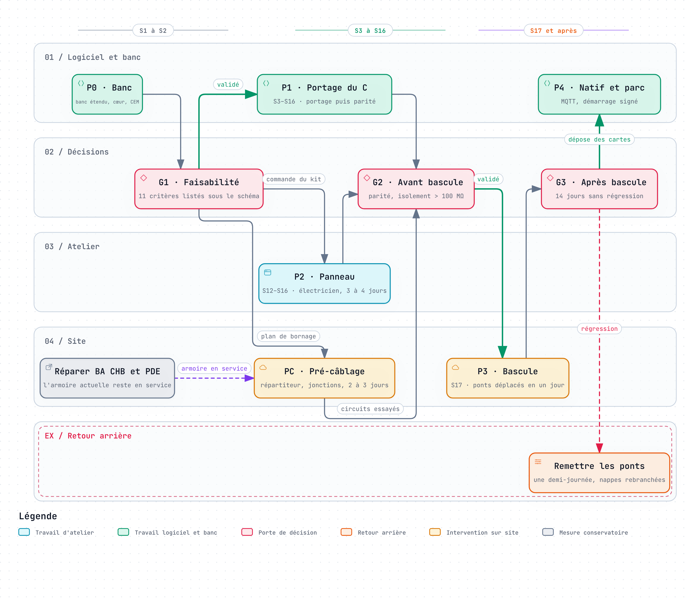{ loading=lazy }

Lecture : le schéma montre le cas de 16 semaines. P1 couvre le portage puis la parité, de S3 à S16 ; le pré-câblage et le panneau se font pendant ce temps, et la bascule a lieu en S17. Critères des portes :

- **G1, fin de P0**, onze critères :
  - cœur logiciel choisi, avec les extensions, l'Ethernet, le RS-485, l'ATECC608B et le démarrage signé validés dessus ;
  - une extension coupée ou figée ne bloque pas les autres ;
  - sorties des extensions retombées quand l'Opta se tait ;
  - TIC lue par l'Opta « BP », ou régression acceptée ;
  - écran SC945D vérifié, temps de réponse compris ;
  - sirène SC946D caractérisée ;
  - sortie des SC947 mesurée ;
  - essai CEM ;
  - place relevée dans le coffret et à sa droite ;
  - avis de l'électricien sur la TBTS, les alimentations et les boutons des salles de bains ;
  - déclaration CE complète obtenue.
- **G2, avant la bascule** : parité de la table d'échange scénario par scénario ; isolement supérieur à 100 MΩ sous 500 V entre 230 V pontés et TBTS pontée ; matrice de repli validée ; retour du secteur vérifié ; répartiteur posé et chaque circuit essayé.
- **G3, 14 jours après la bascule** : aucune régression ; les quatre cartes peuvent être déposées.

Le retour arrière reste possible jusqu'à G3 : les quatre cartes restent en place, et les ponts du répartiteur reviennent sur elles en une demi-journée (estimation). Après G3, leur dépose libère le coffret actuel pour les ajouts.

## Glossaire

| Terme | Sens |
| --- | --- |
| BP, BA | Boîtier principal (SC944D) et boîtiers auxiliaires (SC940D, SC941C, SC942C) de l'armoire |
| PDV, CHB, PDE | Zones des trois BA : pièces de vie, chambres, pièces d'eau |
| TBT, TBTS | Très basse tension ; la TBTS (SELV en anglais) reste sous 50 V alternatif ou 120 V continu, est séparée du 230 V par une isolation double ou renforcée, et n'est pas reliée à la terre |
| PE, FE | Conducteur de protection relié à la terre ; borne de terre fonctionnelle, utile à la compatibilité électromagnétique |
| TVS | Diode qui écrête les surtensions |
| PTC | Fusible réarmable, dont la résistance monte quand le courant est trop fort |
| N2 | Carte annexe « étoile 0 V » du retex, qui relie le BP à chaque BA en étoile autour d'un plan 0 V |
| CEM | Compatibilité électromagnétique |
| TOR | Tout ou rien : entrée ou sortie à deux états |
| TIC, ADPS | Téléinformation du compteur Linky ; avertissement de dépassement de la puissance souscrite |
| PWM | Modulation de largeur d'impulsion |
| I2C | Bus série court entre circuits : celui des BA aujourd'hui, celui des extensions de l'Opta demain |
| RS-485 | Liaison série différentielle, ici entre l'écran et le BP |
| UART | Liaison série asynchrone d'un microcontrôleur |
| Modbus | Protocole industriel d'échange de registres, sur RS-485 ou sur TCP |
| MQTT | Protocole de messages par sujets |
| HTTP legacy | Protocole actuel entre le BP et la passerelle, repris tel quel en phase 1 |
| DHCP | Service qui attribue les adresses réseau |
| UDP | Protocole réseau sans connexion, qui porte ici les trames BA sur Ethernet |
| MQX | Système temps réel du BP actuel |
| QSPI | Liaison rapide vers une mémoire flash externe |
| S19 | Format de fichier du firmware du BP |
| OTA | Mise à jour à distance, par le réseau |
| ATECC608B | Élément sécurisé de Microchip qui garde les clés privées |
| TPM | Puce de sécurité qui garde les clés et mesure le démarrage, présente sur la Revolution Pi |
| MCUboot | Chargeur de démarrage qui vérifie la signature du firmware |
| ECDSA | Algorithme de signature à courbe elliptique |
| step-ca | Autorité de certification logicielle de la passerelle |
| CSAF | Format normalisé des avis de sécurité |
| Mbed OS, Zephyr | Systèmes temps réel pour microcontrôleurs ; Mbed OS est arrêté depuis juillet 2026 |
| LLEXT | Mécanisme de Zephyr qui charge un module, ici le sketch Arduino, dans un programme déjà installé |
| PLC IDE, Codesys | Environnements de programmation d'automates dans les langages de la norme CEI 61131-3 |
| mTLS | TLS avec un certificat de chaque côté |
| GIFAM | Groupement qui a normalisé les ordres du fil pilote |
| Fil pilote | Fil qui transmet aux radiateurs électriques les ordres confort, ECO, hors-gel ou arrêt |
| Délestage | Coupure temporaire de charges pour rester sous la puissance souscrite |
| Table d'échange | Les 953 indices que le BP partage avec l'écran et la passerelle |
| Parité | Même comportement que le BP actuel, vérifié scénario par scénario |
| Matrice de repli | État que prend chaque sortie quand sa commande se tait |
| Bascule | Passage des anciennes cartes à la nouvelle solution |
| Répartiteur | Rangée de bornes où arrivent les fils 230 V du logement ; des ponts les relient à l'équipement |
| Pont | Fil court et repéré entre une borne du répartiteur et l'équipement |
| Jonction, IDC 26 | Interface qui reçoit une nappe de boutons à 26 conducteurs et la ramène sur bornes |
| PC | Pré-câblage : pose du répartiteur et des jonctions, l'armoire restant en service |
| P0 à P4, G1 à G3 | Phases et portes de décision de la feuille de route |
| ADR | Décision d'architecture écrite et versionnée, comme l'ADR 0001 de la génération 3 |
| CE, directive BT | Marquage de conformité européen ; la directive Basse Tension couvre la sécurité électrique de 50 à 1 000 V en alternatif et de 75 à 1 500 V en continu |
| cULus | Marque de certification UL valable aux États-Unis et au Canada |
| Priorité 1 | Mesures que l'analyse experte de la foudre classe comme les plus urgentes |
| Archify | Outil qui génère les schémas interactifs joints à l'étude |
| Unity | Cadre de tests unitaires en C, utilisé par essensys-gcc |
| Ansible | Outil de déploiement reproductible d'un système Linux |
| Bloc de phase (X3) | Bornes Wago à quatre points (2002-1401) voisines, reliées par un contact de pontage : elles répartissent la phase d'un disjoncteur vers plusieurs relais |
| Contact de pontage | Barrette Wago enfoncée dans les fentes de bornes voisines pour les relier |
| Repiquage | Reprise d'une phase d'une borne à une autre pour alimenter plusieurs appareils |
| Borne P | Borne de phase d'un groupe de relais sur une carte BA : les relais du groupe partagent ce commun |

## Sources

ESSENSYS, dépôts essensys-hub, branche main au 14 octobre 2026 :

- Matériel et protection : [vue d'ensemble](https://github.com/essensys-hub/essensys-doc/blob/main/archi/hardware-overview.md), [BP SC944D](https://github.com/essensys-hub/essensys-doc/blob/main/archi/hardware-sc944d.md), [BA SC940D](https://github.com/essensys-hub/essensys-doc/blob/main/archi/hardware-sc940d.md), [protection surtensions](https://github.com/essensys-hub/essensys-doc/blob/main/docs/install/protection-surtensions.md), [îlots TBTS](https://github.com/essensys-hub/essensys-memory/blob/main/wiki/concepts/ilots-tbts-et-equipotentialite.md), [ADR 0001 génération 3](https://github.com/essensys-hub/essensys-board-SC944D/blob/main/docs/adr/0001-generation-3-rs485-isole.md), [sirène SC946D](https://github.com/essensys-hub/essensys-memory/blob/main/raw/architecture/repos/essensys-board-SC946D.md)
- Logiciel : [firmware BP](https://github.com/essensys-hub/client-essensys-legacy) (FilPilote.c, Hard.c, Chauffage.c, TeleInfo.c), [firmware BA v1.7](https://github.com/essensys-hub/essensys-board-SC940), [essensys-gcc](https://github.com/essensys-hub/essensys-memory/blob/main/raw/architecture/repos/essensys-gcc.md), [démarrage du BP et des BA](https://github.com/essensys-hub/essensys-memory/blob/main/raw/analyses/2026-10-demarrage-bp-ba/analyse.md), [remise en service et builds qualifiés](https://github.com/essensys-hub/essensys-doc/blob/main/docs/install/remise-en-service-surtension.md), [table d'échange](https://github.com/essensys-hub/essensys-doc/blob/main/archi/exchange-table.md), [PKI passerelle](https://github.com/essensys-hub/essensys-memory/blob/main/wiki/concepts/gateway-pki.md)

Arduino et Finder, pages relevées le 20 octobre 2026 :

- Matériel : [datasheet Opta](https://docs.arduino.cc/resources/datasheets/AFX00001-AFX00002-AFX00003-datasheet.pdf), [datasheet D1608E et D1608S](https://docs.arduino.cc/resources/datasheets/AFX00005-AFX00006-datasheet.pdf), [datasheet A0602](https://docs.arduino.cc/resources/datasheets/AFX00007-datasheet.pdf), [manuel de l'Opta](https://docs.arduino.cc/tutorials/opta/user-manual/), [fiche Finder série 8A](https://cdn.findernet.com/app/uploads/S8AFR.pdf), [FAQ Finder](https://opta.findernet.com/download/FAQ-FOCUS-OPTA-EN.pdf), [certificats de l'Opta](https://github.com/arduino/docs-content/tree/main/content/hardware/opta/opta-family/opta/certifications)
- Prix : [Opta Lite chez Farnell](https://pt.farnell.com/arduino/afx00003/arduino-opta-lite-board-cortex/dp/4141844), [Opta RS485 chez Farnell](https://ie.farnell.com/arduino/afx00001/arduino-opta-rs485-board-cortex/dp/4141845), [Opta WiFi chez Farnell](https://ie.farnell.com/arduino/afx00002/arduino-opta-wifi-board-cortex/dp/4141846), [D1608E](https://store.arduino.cc/en-fr/collections/opta-family/products/opta-ext-d1608e), [D1608S](https://store.arduino.cc/en-es/products/opta-ext-d1608s), [A0602](https://store.arduino.cc/en-fr/collections/opta-family/products/opta-ext-a0602)
- Logiciel : [fin de Mbed OS](https://www.arm.com/products/iot/mbed-os), [cœur Arduino sous Zephyr](https://github.com/arduino/ArduinoCore-zephyr), [cœur Zephyr déclaré stable](https://www.hackster.io/news/arduino-s-zephyr-rtos-based-cores-exit-beta-with-legacy-mbed-cores-to-be-deprecated-56ec71ef1f7f), [version 1.0.0](https://www.cnx-software.com/2026/09/04/arduinocore-zephyr-1-0-0-adds-support-for-arduino-ventuno-q-updates-to-zephyr-4-4-1-and-more/), [carte Opta dans Zephyr](https://docs.zephyrproject.org/latest/boards/arduino/opta/doc/index.html), [bibliothèque Arduino\_Opta\_Blueprint](https://github.com/arduino-libraries/Arduino_Opta_Blueprint), [démarrage sécurisé Arduino](https://docs.arduino.cc/arduino-cli/secure-boot), [PLC IDE 1.1.0](https://blog.arduino.cc/2026/03/03/new-plc-ide-version-1-1-0-brings-remote-lifecycle-management-to-opta/)
- Sécurité et éditeur : [modèle de sécurité](https://docs.arduino.cc/tutorials/security/intended-use-and-security-model), [bulletins de sécurité](https://support.arduino.cc/hc/en-us/sections/10926243830172-Arduino-Security-Bulletins), [Opta et AWS IoT](https://docs.arduino.cc/tutorials/opta/getting-started-with-aws-iot-core), [politique de support](https://support.arduino.cc/hc/en-us/articles/26339046977180), [FAQ Qualcomm](https://www.arduino.cc/qualcomm-faq/)

Composants tiers : [Finder série 38](https://manualmachine.com/finder/3891/8656803-user-manual/), [Finder série 48](https://www.emas.cz/files/1703329/J3fkWmjV/elosos1086851.pdf), [Eltako EUD12D-UC](https://www.eltako.com/fileadmin/downloads/de/_bedienung/EUD12D_21100905-3_dt.pdf), [Mean Well HDR-150](https://www.meanwell.com/Upload/PDF/HDR-150/HDR-150-SPEC.PDF), [Mean Well DUPS40](https://www.power-supplies-australia.com.au/mean-well-dups40-ups-module), [Phoenix FL ISOLATOR](https://www.phoenixcontact.com/en-nz/products/network-isolator-fl-isolator-100-rjrj-2313931), [Phoenix FL SWITCH 1008N](https://industry-electronics.de/phoenix-contact/1085256-phoenix-fl-switch-1008n-industrial-ethernet-druckansicht-1775494.htm).
