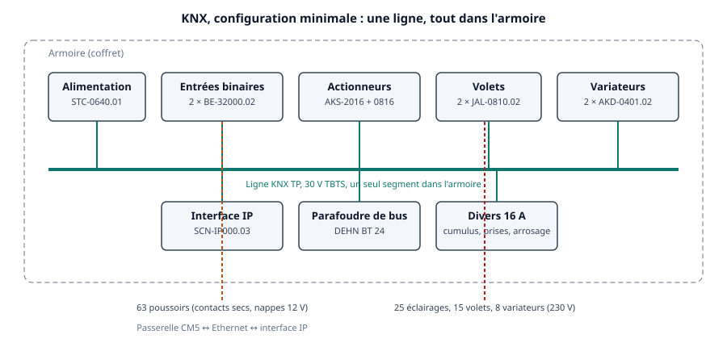
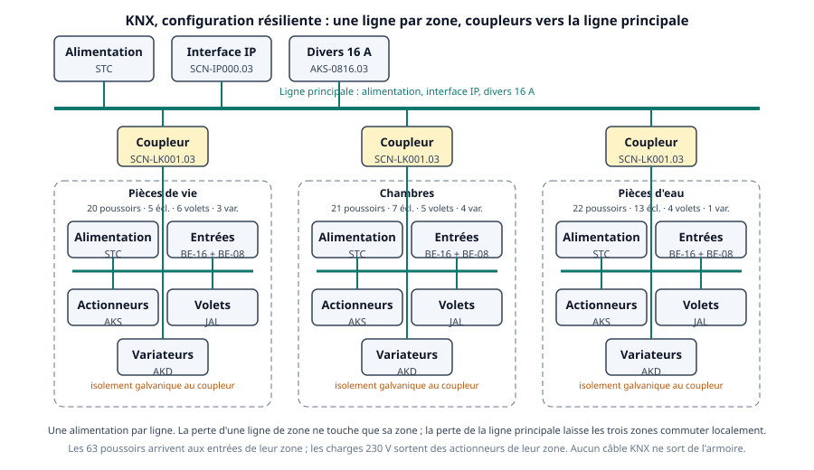

# KNX TP

KNX est le bus de bâtiment normalisé (EN 50090, ISO/IEC 14543-3), porté par plus de 500 fabricants. C'est la première solution à laquelle on pense pour remplacer une armoire domotique, et la question de départ de ce [comparatif](index.md) : peut-il reprendre les 63 poussoirs et toutes les charges sans changer un fil, et que reste-t-il quand le bus meurt ?

!!! abstract "Synthèse"
    - **Seule** : KNX remplace les quatre cartes sans recâblage, et le bus ne sort pas de l'armoire. Mais chaque poussoir passe par le bus : **règle 1 non tenue**. En configuration par zone (une ligne, une alimentation par zone, coupleurs), **aucune des huit défaillances uniques ne prive toute la maison de ses boutons** ; la perte d'une alimentation ou d'une ligne prive sa zone, soit 20 à 22 boutons, et c'est la panne la plus fréquente rapportée sur le terrain. Les éclairages gardent leur état (relais bistables) ; la commande manuelle sans bus n'existe que sur les actionneurs à manettes mécaniques (ABB, Theben, Gira), pas sur MDT.
    - **En dérivation** : une couche domotique normalisée, sans Linux ni logiciel du projet sur le chemin des contacts, avec une minuterie d'actionneur qui sert de battement de cœur au relais de garde. Elle est à comparer à la Revolution Pi Connect 5 (≈ 581 € HT nue, modules d'entrées-sorties non chiffrés ici), sans Linux dans l'armoire, et demande ETS.
    - **Coût estimé** : ≈ 2 950 € HT en configuration minimale, ≈ 5 200 € HT par zone, licence ETS comprise ; ≈ 3 100 € HT en couche domotique seule. Prix d'octobre 2026, boutiques allemandes, convertis en HT.
    - **Réserve** : estimations à confirmer par un électricien, des devis, les fabricants et des essais. Deux prix d'actionneurs sont dérivés d'un prix par voie, faute de prix public trouvé ; l'alimentation STC-0640.01 est comptée à un prix indicatif, TVA non précisée.

## Principe et gamme

KNX descend de l'EIB (1990) ; le standard actuel date de 2001, la norme européenne de 2003, la norme internationale de 2006, KNX Secure de 2015. La KNX Association (Bruxelles) certifie plus de 8 000 produits. Le support **TP1** est une paire torsadée à 30 V continu TBTS qui porte à la fois l'alimentation et les télégrammes : jusqu'à 1 000 m de câble et 64 appareils par ligne (256 pour les appareils récents), 350 m entre l'alimentation et un appareil, une alimentation obligatoire par ligne, jusqu'à 15 lignes par ligne principale à travers des coupleurs.

Le système est **décentralisé** : chaque module d'entrées et chaque actionneur porte son coupleur de bus et son programme ; une entrée traduit un contact en télégramme de groupe, l'actionneur abonné à ce groupe commute. Il n'y a pas de contrôleur central ; l'ordinateur et le logiciel ETS ne servent qu'à la mise en service.

Fabricants retenus pour chiffrer : MDT (Allemagne, gamme la plus répandue chez les particuliers), ABB, Theben, Gira, Hager, Weinzierl, DEHN pour les parafoudres. Les fiches consultées datent de 2025 et 2026.

## Dans l'armoire sans recâblage

Les poussoirs sont des contacts secs : des **modules d'entrées binaires** les lisent, et le bus reste dans l'armoire. Seules les nappes des poussoirs parcourent la maison, comme aujourd'hui.

| Fonction | Module | Voies | Largeur | Ce qu'il faut savoir |
| --- | --- | --- | --- | --- |
| 63 poussoirs | MDT BE-32000.02 | 32 contacts libres de potentiel | 12 modules | 12 V générés en interne, « séparation galvanique par rapport au bus », « longueur de ligne totale admissible 100 m » (par entrée ou cumulée : à confirmer), bornes 0,5 à 2,5 mm² |
| | MDT BE-16000.02 / BE-08000.02 | 16 / 8 | 8 / 4 | Même famille, pour un découpage par zone |
| 25 éclairages | MDT AKS-2016.03, AKS-1616.03, AKS-0816.03 | 20 / 16 / 8 | 12 / 8 / 6 | Relais **bistables** 16 A, 140 µF, 600 A d'appel ; les relais gardent leur position à la perte du bus ; boutons manuels électroniques |
| | ABB SA/S 12.16.6.2 | 12 | 12 | 16 A, mesure du courant et de l'énergie, **manettes mécaniques** manœuvrables sans bus |
| | Theben RMG 8 S KNX | 8 | 4 | 16 A, alimenté en 230 V, « commande manuelle aussi sans tension de bus », module bus amovible |
| 15 volets dont le store | MDT JAL-0810.02 | 8 volets (16 relais) | 8 | Relais monostables avec **alimentation auxiliaire 230 V**, deux sens verrouillés par construction, comportement à la perte du bus réglable ; 8 A et 300 W par voie sur la fiche, 10 A et 600 W chez les boutiques |
| 8 variateurs | MDT AKD-0401.02 | 4 | 6 | Universel, 250 W par voie (200 W en LED), charge minimale 2 W, deux voies couplables en 500 W, boutons manuels, mesure de puissance, protections |
| Fil pilote | aucune offre vérifiée | | | Un module ProKNX deux zones est référencé chez KNX mais absent de la boutique du fabricant. Repli : relais externes commandés par un actionneur |
| Cumulus, prises, arrosage, machines | MDT AKS-0816.03 ou AKK-0816.03 | 8 | 6 / 4 | Voies 16 A ; la bobine du contacteur de cumulus se commande par une voie |
| Alimentation du bus | MDT STC-0640.01 | 640 mA | 4 | Diagnostic, journal, redémarre seule après un court-circuit ; version redondante STR-0640.01 (6 modules, deux entrées secteur) |
| Coupleur de ligne | MDT SCN-LK001.03 ou Hager TYFS130 | | 2 / 1 | Isolement galvanique entre lignes ; une alimentation par ligne obligatoire |
| Interface IP | MDT SCN-IP000.03 | 4 tunnels | 2 | Alimentée par le bus, KNX IP Secure et Data Secure |
| Parafoudre | DEHN BUStector BT 24 | | borne de bus | Uc 45 V, 5 kA, Up 1 200 V entre fils |

La tension de boucle des entrées MDT (12 V, courant faible) convient aux jonctions IDC données pour 1 A et aux lignes de 30 m, sous réserve que les « 100 m » admissibles soient par entrée et non cumulés sur le module : une zone de 20 lignes de 30 m en cumulerait 600. Les boutons tactiles KNX, les écrans et les poussoirs connectés ne sont pas retenus : ils demanderaient de tirer le bus jusqu'aux murs.

### Configuration minimale

Une ligne, une alimentation, tout dans l'armoire : STC-0640.01, deux BE-32000.02 (64 entrées), AKS-2016.03 et AKS-0816.03 (28 voies d'éclairage), deux JAL-0810.02 (16 volets), deux AKD-0401.02 (8 variateurs), un AKS-0816.03 pour le cumulus, les prises, l'arrosage et les machines, une interface IP, un parafoudre de bus. **82 modules, soit ≈ 1,5 m de rail**, dix participants, moins de 3 W sur le bus.

### Configuration résiliente

Une **ligne par zone**, chacune avec son alimentation, ses entrées et ses actionneurs, reliées à une ligne principale par trois coupleurs. La ligne principale porte l'interface IP et l'actionneur des fonctions communes.

| Ligne | Modules | Largeur |
| --- | --- | --- |
| Principale | STC-0640.01, SCN-IP000.03, 3 × SCN-LK001.03, AKS-0816.03 divers | 18 |
| Pièces de vie (20 poussoirs, 5 éclairages, 6 volets, 3 variateurs) | STC, BE-16000.02 + BE-08000.02, AKS-0816.03, JAL-0810.02, AKD-0401.02 | 36 |
| Chambres (21, 7, 5, 4) | Identique | 36 |
| Pièces d'eau (22, 13, 4 dont le store, 1) | STC, BE-16000.02 + BE-08000.02, AKS-1616.03, JAL 4 voies, AKD-0201.02 | ≈ 30 |

**≈ 120 modules, soit ≈ 2,1 m de rail**, quatre alimentations, trois coupleurs, une vingtaine de participants. Chaque ligne tient seule la règle « une alimentation par ligne ». La largeur du JAL 4 voies et de l'AKD-0201.02 n'a pas été vérifiée.

<!-- schemas:fritzing:debut -->
### Câblage d'un poussoir à une charge (Fritzing)

![Câblage coloré de gauche à droite. Un poussoir mural envoie son contact sec (jaune) à un module d'entrées MDT BE-16000.02. Le module est relié par deux fils bleus à la ligne KNX de la zone, alimentée par une STC-0640.01 (rouge pour le 30 V, noir pour le 0 V). La ligne alimente un actionneur MDT AKS-0816.03 et une interface IP, reliée en violet à la passerelle Essensys. L'actionneur reçoit la phase du secteur (marron) et la renvoie par sa sortie 1 à une lampe, qui reçoit aussi le neutre (bleu clair).](fritzing/knx_breadboard.png){ loading=lazy }

Une zone, une lampe, avec les modules de la configuration résiliente. Source Fritzing : [knx.fzz](fritzing/knx.fzz){ download="knx.fzz" } (Fritzing 1.0.x). Principe de câblage, non validé au banc.
<!-- schemas:fritzing:fin -->

## Seule face à l'exigence

<!-- schemas:seule:debut -->
<iframe src="../archify/knx-seule.html?embed=1&amp;theme=light" title="Diagramme d'architecture interactif : KNX seul, du poussoir à la charge, une ligne par zone" loading="lazy" style="width:100%;aspect-ratio:1270/540;height:auto;border:0"></iframe>

[Ouvrir le diagramme en plein écran](archify/knx-seule.html){ target="_blank" rel="noopener" }. Le poussoir passe par un module d'entrées, la ligne KNX de la zone et un actionneur ; l'alimentation de la ligne et le secteur arrivent par le bas ; la ligne principale porte l'interface IP vers la passerelle.

??? info "Image fixe du diagramme"
    { loading=lazy }
<!-- schemas:seule:fin -->

### Les sept règles

| Règle | Tenue | Pourquoi |
| --- | --- | --- |
| 1. Pas de calculateur entre le bouton et sa charge | **Non tenue** | Le poussoir attaque un module d'entrées qui émet un télégramme ; l'actionneur l'exécute. Aucun actionneur KNX trouvé dont les entrées commandent les sorties sans tension de bus : les modules sont alimentés par le bus |
| 2. L'état vit dans un organe bistable | Tenue pour les éclairages | Relais bistables des AKS, ABB et Gira : « les relais gardent leur position » à la perte du bus. Les JAL sont monostables, ce qui convient à un volet |
| 3. La domotique ajoute, ne retire jamais | Non tenue | Le bus **est** la domotique : un télégramme faux ou piraté commute n'importe quelle voie. Parades : KNX Data Secure, interface IP bridée |
| 4. Une source et un fusible par zone, un fusible pour la domotique | Partielle | Une alimentation et un disjoncteur par ligne de zone, oui ; mais boutons et domotique partagent la même ligne, pas de fusible qui sépare les deux |
| 5. Barrière 4 kV et 8 mm, 0 V jamais au PE, parafoudres hors coffrets | Partielle | Bus TBTS flottant, catégorie de surtension III sur les alimentations et l'ABB ; **aucune fiche ne chiffre la tension d'essai bus / 230 V** ; DEHN place les parafoudres aux tableaux |
| 6. Replis choisis au câblage, essayés à la recette | Partielle | Le repli existe, mais il se règle dans ETS, voie par voie (« à la perte du bus : ouvert / fermé / inchangé »), pas dans le câblage |
| 7. Isolement mesuré chaque année | Tenue | Rien ne l'empêche ; les alimentations à diagnostic journalisent les défauts du bus |

### Les causes communes

Dans la configuration résiliente, la liste fermée du comparatif donne :

| Défaillance unique | Prive de ses boutons… | Pourquoi |
| --- | --- | --- |
| 1. Alimentation du bus | une zone | Une STC par ligne ; la ligne principale morte laisse chaque zone commuter en interne ; les ordres inter-zones, l'interface IP et les fonctions communes sont perdus (raisonnement d'après les fiches des coupleurs, scénario non documenté par les fabricants) |
| 2. Court-circuit ou ligne collée | une zone | Les coupleurs isolent galvaniquement ; un court-circuit sur une ligne « ne tue pas les autres » quand chaque ligne a son alimentation (fiches et retours de terrain) |
| 3. Contrôleur central | rien | Il n'y en a pas |
| 4. Logiciel figé | un module | Pas de logiciel central ; un actionneur figé prive ses voies |
| 5. Mise à jour ratée | un module | Le téléchargement ETS se fait appareil par appareil |
| 6. Licence, compte ou cloud | rien | Aucun en exploitation ; la licence ETS ne sert qu'à programmer |
| 7. Commutateur ou routeur | rien | Hors du chemin du bouton |
| 8. Foudre sur le chemin du bus | une zone | Le bus reste dans l'armoire ; l'onde entre par les lignes de poussoirs et frappe le module d'entrées de la zone, séparé galvaniquement du bus (tenue en kV non chiffrée) |

**Total : 0 défaillance unique prive toute la maison**, 3 privent une zone. En configuration minimale, l'alimentation, le court-circuit et la foudre sur la ligne unique privent toute la maison : **3**.

Ce décompte dit l'essentiel : KNX par zone retrouve l'architecture d'aujourd'hui, trois boîtiers indépendants, sans le boîtier principal et sans le bus I2C qui les reliait. Il ne retrouve pas le bouton qui commande seul sa charge. Et la panne qui prive une zone, l'alimentation qui dérive à 20 V ou lâche, est celle que les forums KNX citent le plus souvent, avec les relais collés.

### Ce qui reste, panne par panne

| Panne | Ce qui reste |
| --- | --- |
| Alimentation ou ligne d'une zone | Les deux autres zones. Dans la zone touchée : éclairages dans leur état (bistables), volets arrêtés, variateurs à vérifier ; aucun bouton. Manette mécanique sur ABB, Theben ou Gira ; rien sur MDT. Une STR redondante par zone écarte la panne d'un seul convertisseur |
| Ligne principale | Les trois zones commutent localement ; perdus : fonctions communes, interface IP, application |
| Passerelle ou interface IP | Tout le local ; perdue : l'application |
| Coupure du secteur | Tout s'arrête ; au retour, chaque voie reprend l'état réglé dans ETS (inchangé, ouvert ou fermé) |
| Un actionneur | Ses voies ; échange et rechargement du programme ETS |
| Foudre par une ligne de poussoirs | Le module d'entrées de la zone au pire ; les autres zones. Un coup direct qui emprunte le bus a détruit 70 % d'une installation rapportée, mais son bus sortait du bâtiment |

## En dérivation sur le filaire V2

<!-- schemas:derivation:debut -->
<iframe src="../archify/knx-derivation.html?embed=1&amp;theme=light" title="Diagramme d'architecture interactif : KNX en dérivation sur le filaire V2" loading="lazy" style="width:100%;aspect-ratio:1260/680;height:auto;border:0"></iframe>

[Ouvrir le diagramme en plein écran](archify/knx-derivation.html){ target="_blank" rel="noopener" }. En bas, le filaire V2 : source 24 V, poussoirs, télérupteur, lampe. En haut, la couche KNX : passerelle, interface IP, ligne, actionneurs, relais de garde, relais de couplage en parallèle du poussoir, relais de recopie et entrées qui relisent l'état.

??? info "Image fixe du diagramme"
    ![Capture du diagramme d'architecture. Cadre du bas « Filaire V2 » : source 24 V de zone, poussoirs muraux, télérupteur Finder 20.22, lampe. Cadre du haut « Couche domotique KNX » : passerelle Essensys, interface IP, ligne KNX, actionneurs AKS, relais de garde, relais de couplage, entrées MDT BE et relais de recopie. Le relais de couplage ferme un contact sec en parallèle des poussoirs ; le second contact du télérupteur remonte par le relais de recopie jusqu'aux entrées. Quatre cartes : si KNX tombe, ce que la couche apporte, ce qu'elle coûte, réserve.](archify/knx-derivation.png){ loading=lazy }
<!-- schemas:derivation:fin -->

Dans cette lecture, les télérupteurs, les chaînes de volets et les variateurs à entrée locale gardent le chemin du bouton. KNX fournit la couche domotique :

- **Sorties** : des actionneurs AKS-2016.03 (quatre pour 80 voies, plus un AKS-0816.03) commandent les bobines des relais de couplage 38.51 de la V2, qui ferment les contacts secs en parallèle des poussoirs. Les relais 16 A sont surdimensionnés pour une bobine de 24 V ; les AKK 8 voies, plus compacts, feraient aussi bien, mais leur prix n'a pas été trouvé.
- **Entrées** : deux BE-32000.02 et un BE-08000.02 lisent les contacts des relais de recopie.
- **Battement de cœur** : la **fonction minuterie** (« Treppenlicht ») d'une voie d'actionneur, relancée par un télégramme périodique de la passerelle, tient la bobine du relais de garde ; si la passerelle se tait, la voie retombe. Le chien de garde matériel de la V2 reste en place ; la voie se règle « ouvert » à la perte du bus. Aucun actionneur ne fournit un battement de cœur autonome.
- **Logique et interface utilisateur** : la passerelle, par KNXnet/IP. KNX n'a pas de logique centrale ; les actionneurs offrent des scènes et des opérations logiques simples par voie.
- **Durées bornées** : la fonction minuterie des AKS limite aussi la durée d'une impulsion ; le câblage de la V2 les borne de toute façon.

Ce que la couche apporte : un standard à 500 fabricants, aucun Linux ni logiciel du projet sur le chemin des contacts, des pièces disponibles à dix ans, une mise en service par ETS que n'importe quel intégrateur KNX sait reprendre. Ce qu'elle coûte : ≈ 3 100 € HT, 88 modules (≈ 1,6 m de rail, à ajouter aux 1,6 à 2,1 m de la couche filaire : trois coffrets probables), une licence ETS Lite et quelques jours d'apprentissage. À comparer à la Revolution Pi Connect 5 (≈ 581 € HT nue, modules d'entrées-sorties non chiffrés ici) ; KNX n'a pas de Linux à maintenir dans l'armoire. Face au serveur d'entrées-sorties léger ([dossier Modbus](modbus-es.md)), il est nettement plus cher et plus large.

## Foudre et isolement

- **Le bus reste dans l'armoire** quand tous les poussoirs sont classiques : la configuration ci-dessus ne sort aucun câble KNX du coffret. Les nappes des poussoirs portent les 12 V des modules d'entrées, « séparés galvaniquement » du bus. L'îlot du bus et l'îlot des boutons sont distincts par construction.
- **Tensions d'essai** : aucune fiche MDT, ABB ou Theben consultée ne donne la tension d'essai entre le bus TBTS et les contacts 230 V, ni entre les entrées et le bus. La catégorie de surtension III figure sur les alimentations MDT et ABB et sur l'actionneur ABB. La barrière de 4 kV et 8 mm de la V2 est donc **à faire attester** par les fabricants ; sans attestation, un relais de couplage 38.51 (6 kV) devant chaque voie, comme la V2 le prévoit déjà en dérivation.
- **Mélange interdit** : MDT interdit de commuter du 230 V et de la TBTS sur un même actionneur universel. Les contacts secs de la couche en dérivation commandent des bobines 24 V : il faut des actionneurs dédiés à la TBTS, pas de voie 230 V dans le même boîtier.
- **Parafoudres** : DEHN recommande des parafoudres de bus au tableau principal et au tableau KNX, pas à chaque appareil, et une liaison équipotentielle de foudre là où le bus sort du bâtiment, ce qui n'arrive pas ici. Le BUStector BT 24 (≈ 54 € HT) se pose sur la borne de bus de chaque ligne.
- **Retours de terrain** : un coup direct par une lampe extérieure a détruit 70 % des composants d'une installation dont le bus sortait ; les intervenants conseillent des actionneurs à commande mécanique et des parafoudres aux alimentations et aux sorties du bâtiment. Une alimentation qui dérive après une surtension secteur fige les actionneurs sans signaler de défaut : la STC n'a pas de coupure en cas de surtension réseau.

## Logiciel, paramétrage et passerelle Essensys

| Point | Ce qu'on a trouvé |
| --- | --- |
| Outil | **ETS 6** (Windows) : Lite 200 € HT (20 appareils), Home 350 € HT (64 appareils, usage privé), Professional 1 000 € HT ; dongle 80 € HT en option. La configuration minimale et la couche en dérivation tiennent dans Lite ; la configuration par zone demande Home |
| Formation | ETS eCampus gratuit, avec licence Lite de trois mois ; cours Basic en centre agréé |
| Mise à jour | Programme d'application rechargé par ETS, appareil par appareil ; micrologiciel de l'interface IP actualisable ; aucun cas de module rendu inutilisable trouvé |
| Sécurité | KNX IP Secure et Data Secure (AES-128), optionnels, portés par l'interface IP et le coupleur MDT |
| API pour la passerelle | **KNXnet/IP** en tunnel (4 tunnels sur la SCN-IP000.03) ou en routage ; Weinzierl BAOS 777 pour un accès REST et JSON (≈ 500 £ HT) ; passerelles Modbus TCP (MDT, Wachendorff) |
| Bibliothèques libres | knxd (GPL, TPUART ou IP), xknx (Python, IP Secure et Data Secure), intégrations Home Assistant et openHAB (Calimero). Bibliothèque Go : non vérifiée par cette étude |
| Cloud | Aucun en exploitation ; compte MyKNX pour la licence et les bases de produits |

Côté passerelle, le backend Go doit parler KNXnet/IP, soit directement, soit à travers knxd ou xknx en relais local. L'estimation est de **quatre à huit semaines-personne** pour l'intégration, plus une à deux semaines de paramétrage ETS : ≈ 5 à 10 semaines avant la bascule, contre 11 à 28 pour les V1. Aucun logiciel du projet ne tourne dans l'armoire.

## Nomenclature et coût estimé

Prix relevés le 24 octobre 2026 chez des boutiques allemandes (elektromax24, voelkner, zaehlerschrank24, Voltus, comparateurs), TTC à 19 %, convertis ici en HT. Deux références (AKS-0816.03, AKS-1616.03) n'ont pas de prix public trouvé : elles sont **dérivées** du prix par voie de l'AKS-2016.03 et marquées comme telles. Le JAL 4 voies et l'AKD-0201.02 sont estimés à la moitié de leur grand frère.

### Configuration minimale

| Poste | Référence | Qté | Prix unitaire HT | Total HT | Source |
| --- | --- | --- | --- | --- | --- |
| Alimentation | MDT STC-0640.01 | 1 | ≈ 200 € (indicatif, TVA non précisée par les comparateurs) | 200 € | comparateur |
| Entrées | MDT BE-32000.02 | 2 | 322,51 € | 645 € | elektromax24 |
| Éclairages | MDT AKS-2016.03 | 1 | 389,92 € | 390 € | voelkner |
| Éclairages | MDT AKS-0816.03 | 1 | ≈ 156 € (dérivé) | 156 € | — |
| Volets | MDT JAL-0810.02 | 2 | 233,56 € | 467 € | elektromax24 |
| Variateurs | MDT AKD-0401.02 | 2 | 264,62 € | 529 € | contorion |
| Divers | MDT AKS-0816.03 | 1 | ≈ 156 € (dérivé) | 156 € | — |
| Interface IP | MDT SCN-IP000.03 | 1 | 141,26 € | 141 € | Voltus |
| Parafoudre | DEHN BT 24 | 1 | 54,29 € | 54 € | Voltus |
| **Matériel** | | | | **≈ 2 740 € HT** | |
| Logiciel | ETS6 Lite | 1 | 200 € | 200 € | my.knx.org |
| **Total** | | | | **≈ 2 950 € HT** | |

### Configuration résiliente

| Poste | Référence | Qté | Prix unitaire HT | Total HT |
| --- | --- | --- | --- | --- |
| Alimentations | MDT STC-0640.01 | 4 | ≈ 200 € (indicatif, TVA non précisée) | 800 € |
| Coupleurs | MDT SCN-LK001.03 | 3 | 160,12 € (190,54 € TTC) | 480 € |
| Interface IP | MDT SCN-IP000.03 | 1 | 141,26 € | 141 € |
| Entrées | MDT BE-16000.02 | 3 | 223,19 € | 670 € |
| Entrées | MDT BE-08000.02 | 3 | ≈ 160 € (189,95 € TTC, eBay, non daté) | 479 € |
| Éclairages | AKS-0816.03 × 2, AKS-1616.03 × 1, AKS-0816.03 divers × 1 | 4 | dérivés | ≈ 780 € |
| Volets | JAL-0810.02 × 2, JAL 4 voies × 1 | 3 | 233,56 € ; ≈ 120 € (estimé) | ≈ 587 € |
| Variateurs | AKD-0401.02 × 2, AKD-0201.02 × 1 | 3 | 264,62 € ; ≈ 140 € (estimé) | ≈ 669 € |
| Parafoudres | DEHN BT 24 | 4 | 54,29 € | 217 € |
| **Matériel** | | | | **≈ 4 820 € HT** |
| Logiciel | ETS6 Home | 1 | 350 € | 350 € |
| **Total** | | | | **≈ 5 200 € HT** (5 173 € arrondis à la centaine) |

Soit ≈ 2 250 € HT de plus que la configuration minimale, pour passer de 3 à 0 défaillance unique touchant toute la maison. Une alimentation redondante STR-0640.01 par zone s'y ajouterait (prix non relevé).

### Couche domotique en dérivation

| Poste | Référence | Qté | Total HT |
| --- | --- | --- | --- |
| Sorties vers les relais de couplage | MDT AKS-2016.03 × 4, AKS-0816.03 × 1 | 5 | ≈ 1 716 € (dont ≈ 156 € dérivés) |
| Entrées de recopie | MDT BE-32000.02 × 2, BE-08000.02 × 1 | 3 | ≈ 805 € |
| Alimentation, interface IP, parafoudre | STC-0640.01, SCN-IP000.03, BT 24 | 3 | ≈ 395 € (dont ≈ 200 € indicatifs, TVA non précisée) |
| **Matériel** | | | **≈ 2 920 € HT** |
| Logiciel | ETS6 Lite | 1 | 200 € |
| **Total** | | | **≈ 3 100 € HT**, 88 modules |

### Ce qui n'est pas dans les totaux

- **Fonctions à reporter** : KNX n'a pas de centrale d'alarme ; des modules de sécurité et des entrées d'alarme existent, la sirène et les détecteurs se raccordent à des voies, mais une alarme certifiée est un produit à part. Écran : un panneau KNX de 3,3" coûte ≈ 185 € HT. Délestage : l'ABB SA/S mesure l'énergie par voie (≈ 372 € HT pour 12 voies), la logique revient à la passerelle.
- **Fil pilote** : aucune offre KNX vérifiée ; prévoir des relais externes.
- **Électricien** : de l'ordre de 4 à 6 jours (estimation sans devis, moins de câblage que la V2 : les modules remplacent les télérupteurs et les relais de volets).
- **Logiciel** : ≈ 5 à 10 semaines-personne (ETS et passerelle).
- **Place** : ≈ 1,5 m (minimale), ≈ 2,1 m (par zone), ≈ 1,6 m (dérivation, en plus de la couche filaire).

## Ouverture et pérennité

- **Norme ouverte** depuis 2003, plus de 500 fabricants, plus de 8 000 produits, rétrocompatibilité affichée depuis 1990 : des installations de 13 à 20 ans sont en service, les coupleurs actuels gèrent encore les appareils anciens. Durée de vie estimée ≈ 15 ans avec une forte dispersion ; les alimentations et les relais collés sont les pannes typiques ; certains gardent une alimentation de rechange.
- **Vente libre** en ligne, sans statut d'installateur, prix publics. Les gammes d'un fabricant qui disparaît se remplacent par celles d'un autre, sur le même bus.
- **Cloud** : aucun pour les appareils ; la licence ETS est gérée en ligne ou sur dongle. KNX IoT (IP, REST) existe depuis 2023, non étudié ici.
- **Communauté** : forums très actifs en allemand, nombreux retours de pannes ; outils libres mûrs (knxd, xknx, Home Assistant, openHAB).

## Verdict

- **Seule** : KNX remplace l'armoire sans toucher un fil et, découpé en une ligne par zone, ne laisse aucune défaillance unique priver toute la maison de ses boutons. Il ne tient pas la règle 1 : chaque bouton passe par le bus, et la perte d'une alimentation de zone, panne la plus courante, coupe 20 à 22 boutons jusqu'à l'échange. C'est l'architecture à bus la plus proche de l'exigence dans ce comparatif, pas une réponse à l'exigence.
- **En dérivation** : une couche domotique sérieuse, normalisée et durable, sans Linux dans l'armoire, à comparer à la Revolution Pi Connect 5 (≈ 581 € HT nue, modules d'entrées-sorties non chiffrés ici), mais plus large et plus chère qu'un serveur d'entrées-sorties Modbus.
- **À qui elle convient** : à qui veut une couche domotique qu'un intégrateur quelconque reprendra dans dix ans, et accepte d'apprendre ETS.

## Sources

Toutes consultées le 24 octobre 2026.

1. [KNX Association, histoire et évolution](https://knx.org/news/knxis35-knx-history-and-evolution) : chronologie 1990-2023, rétrocompatibilité.
2. [KNX Association, qu'est-ce que KNX](http://www.knx.org/explore-knx/what-is-knx) : 500 fabricants, 8 000 produits, fonctionnement local sans cloud.
3. [Chipkin, topologie KNX](https://store.chipkin.com/articles/knx-topology) : règles de ligne TP1.
4. [Fiche MDT BE-32000.02](https://www.ottofischer.ch/pim/6a77d6b7-bb6a-4b33-9cdd-c9b596e8a4f3/BE-32000-02_MDT_DS_FR.pdf) (06/2025) : 32 entrées, 12 V interne, 100 m, séparation galvanique.
5. [Manuel MDT entrées binaires série .02](https://www.mdt.fr/fileadmin/user_upload/user_upload/download/MDT_TM_BE_02_Binary_Input_Universal_Interface.pdf) : gamme, envoi cyclique.
6. [Fiche MDT JAL-0810.02](https://www.ottofischer.ch/pim/8bbbb700-83ac-40aa-92f7-ae178b3753e6/JAL-0810-02_MDT_DS_DE.pdf) (06/2025) : monostable, alimentation auxiliaire 230 V, comportement à la perte du bus.
7. [Fiche MDT AKS](https://www.meinhausshop.de/media/pdf/62_129_98--DBL-01-de.pdf) : relais bistables, position gardée à la perte du bus, alimentation par le bus.
8. [Manuel MDT AKI/AKS/AKK](https://www.mdt.de/fileadmin/user_upload/user_upload/download/Archiv/MDT_THB_Schaltaktor_03.pdf) : § 4.3.4, comportement à la perte et à la reprise du bus, télégramme « en service » cyclique.
9. [Fiche MDT AKU-1616.03](https://ariba.ottofischer.ch/pim/a091d553-a042-4f73-9e1b-050ad407a40d/AKU-1616-03_MDT_DS_FR.pdf) : interdiction de mélanger 230 V et TBTS.
10. [Fiche MDT AKD-0401.02](https://www.ottofischer.ch/pim/c79c7bd6-4cdc-40e5-b9e8-ab0c09e6b8e8/AKD-0401-02_MDT_DS_DE.pdf) : 250 W, 200 W LED, boutons manuels.
11. [Manuel ABB SA/S x.16.6.2](https://www.knx.org/devices/2/M-0002_H-2CDG.20110.20271.20R0011-1_HP-A0E4-12-95B2-A0E4-22-959B_CI-2CDG.20110.20271.20R0011-1/de-DE/download) : manettes manœuvrables sans bus, catégorie III.
12. [Gira, actionneur 2 voies](https://partner.gira.com/data3/10403110.pdf) : commande manuelle indépendante du bus.
13. [Fiche Theben RMG 8 S KNX](https://www.siblik.com/fileadmin/mam/medias/docus/41/T4930220_datasheet_4930220_de.xml.pdf) (27.08.2026) : commande manuelle sans tension de bus, 230 V.
14. [Fiche MDT STC-0640/0960/1280.01](https://www.meinhausshop.de/media/pdf/62_131_46--DBL-02-de.pdf) : diagnostic, redémarrage automatique, catégorie III.
15. [Fiche MDT STR-0640.01](https://www.mdt.de/fileadmin/user_upload/MDT_DB_Busspannungsversorgung_STR.pdf) : alimentation redondante, pas de mise en parallèle.
16. [Manuel ABB SV/S](https://library.e.abb.com/public/13627e0e431744a1ac715b1550b5fedf/SVS_30xx1_PH_de_V1-2_2CDC501049D0101_Rev_A.pdf) : 200 m entre deux alimentations, courant de court-circuit 1,4 A.
17. [Fiche coupleur MDT SCN-LK001.03](https://www.siblik.com/fileadmin/mam/medias/docus/174/MDTSCN-LK001.03_Datenblatt.pdf) : une alimentation par ligne.
18. [Notice coupleur Hager TYFS130](https://assets.hager.com/step-content/P/HA_45907281/Document/std.lang.all/6LE009843A_TYFS130_Linien-Bereichkoppler_KNX_Secure_Manua.pdf) : isolement galvanique entre lignes.
19. [Fiche MDT SCN-IP000.03](https://www.ottofischer.ch/pim/0671c514-96b0-4d6a-b0c6-ab4dffbe6c06/SCN-IP000-03_MDT_DS_FR.pdf) : 4 tunnels, KNX Secure.
20. [Weinzierl KNX IP BAOS 777](https://knx.org/devices/knx-ip-baos-777) : accès REST et JSON.
21. [Fiche ProKNX fil pilote deux zones](https://www.knx.org/devices/184/M-00B8_H-15022012.5F2-0_HP-5003-10-6ADD_CI-201-2/fr-FR/download) et [boutique ProKNX](https://www.proknx.com/en/all-products/) : module absent de la boutique.
22. [Boutique ETS](https://my.knx.org/en/shop/ets) : Lite 200 €, Home 350 €, Professional 1 000 € HT, dongle 80 €.
23. [KNX eCampus](https://knx.org/professionals/free-online-training) : formation gratuite et licence Lite de trois mois.
24. [KNX Secure](http://www.knx.org/news/what-makes-knx-secure-solution-your-smart-building) : AES-128, certification 2022.
25. [knxd](https://github.com/knxd/knxd), [xknx](https://xknx.io/), [Home Assistant KNX](https://www.home-assistant.io/integrations/knx), [openHAB KNX](https://www.openhab.org/addons/bindings/knx/).
26. [DEHN, protection des bus KNX](https://www.dehn.de/sites/default/files/media/files/2018-07/wpx019-d-knx.pdf) et [Voltus, BUStector BT 24](https://www.voltus.com/en/dehn-925001-surge-arrester-for-knx-eib-bus-bustector-type-2.html) : parafoudres aux tableaux, 64,61 € TTC.
27. Prix : [elektromax24 BE-32000.02](https://www.elektromax24.de/mdt-binaereingang-knx-32fach-12te-reg-potentialfrei), [elektromax24 BE-16000.02](https://www.elektromax24.de/mdt-binaereingang-be-16000.02-16fach-8te-reg-eingaenge), [voelkner AKS-2016.03](https://www.voelkner.de/products/5841011/MDT-technologies-Schaltaktor-20-fach-12TE-AKS-2016.03.html), [elektromax24 JAL-0810.02](https://www.elektromax24.de/mdt-jalousieaktor-8fach-8te-reg-10a-230vac), [contorion AKD-0401.02](https://www.contorion.de/p/mdt-technologies-dimmaktor-4-fach-6te-reg-250w-230vac-akd-0401-02-59888549), [Voltus SCN-IP000.03](https://www.voltus.com/en/mdt-scn-ip000-03-knx-ip-interface-reg.html), [billiger.de SCN-LK001.03](https://www.billiger.de/pricelist/2944346041-mdt-scn-lk001-03), [voelkner ABB SA/S 12.16.6.2](https://www.voelkner.de/products/4337575/ABB-Stotz-S-J-Schaltaktor-12-fach-SA-S12.16.6.2.html).
28. Forum KNX-User-Forum (allemand), fils consultés : [pannes de plusieurs actionneurs, bus à 20 V](https://knx-user-forum.de/forum/öffentlicher-bereich/knx-eib-forum/1152119-ausfall-mehrerer-aktoren-in-knx-anlage-ursache) ; [AKS-2016.03 relais bloqués](https://knx-user-forum.de/forum/öffentlicher-bereich/knx-eib-forum/1456610-mdt-aks-2016-03-defekt) ; [STC-0640.01 et surtension secteur](https://knx-user-forum.de/forum/öffentlicher-bereich/knx-eib-forum/1950883-hohe-netzeingangsspannung-ausfall-mdt-spannungsversorgung-stc-0640-01) ; [durée de vie des composants](https://knx-user-forum.de/forum/öffentlicher-bereich/knx-eib-forum/984652-lebensdauer-knx-komponenten) ; [paramétrage à la perte du bus](https://knx-user-forum.de/forum/öffentlicher-bereich/knx-eib-forum/knx-einsteiger/1244310-knx-anlage-fragen-zur-parametrierung-bei-busspannungsausfall) ; [plusieurs alimentations obligatoires ?](https://knx-user-forum.de/forum/öffentlicher-bereich/knx-eib-forum/knx-einsteiger/1501631-sind-mehrere-sv-pflicht) ; [actionneurs en ligne extérieure](https://knx-user-forum.de/forum/öffentlicher-bereich/knx-eib-forum/knx-einsteiger/1607484-aktoren-in-aussenlinie) ; [coup de foudre direct](https://knx-user-forum.de/forum/öffentlicher-bereich/knx-eib-forum/1399858-direkter-blitzeinschlag-in-die-elektroinstallation-über-eine-außenleuchte) ; [tolérance aux surtensions](https://knx-user-forum.de/forum/öffentlicher-bereich/knx-eib-forum/1565657-zulässige-buskapazität-einer-knx-tp-linie-überspannungstoleranz-von-knx-geräten).

!!! note "À confirmer auprès des fabricants"
    La portée des « 100 m » du BE-32000.02 (par entrée ou cumulée) et le nombre de ses communs ; l'absence de toute liaison entrée → sortie hors bus sur les actionneurs à entrées ; la tension d'essai bus / 230 V des actionneurs et des entrées ; la mise en parallèle des STC ; les valeurs du JAL-0810.02 (8 ou 10 A) et l'existence d'un JAL 4 voies ; la disponibilité d'un module fil pilote ; les prix des AKS-0816.03, AKS-1616.03 et de l'alimentation redondante.
