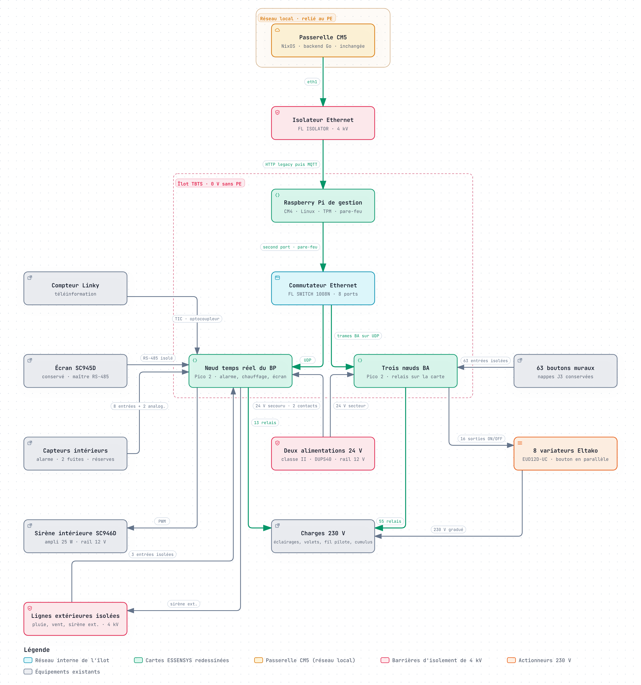
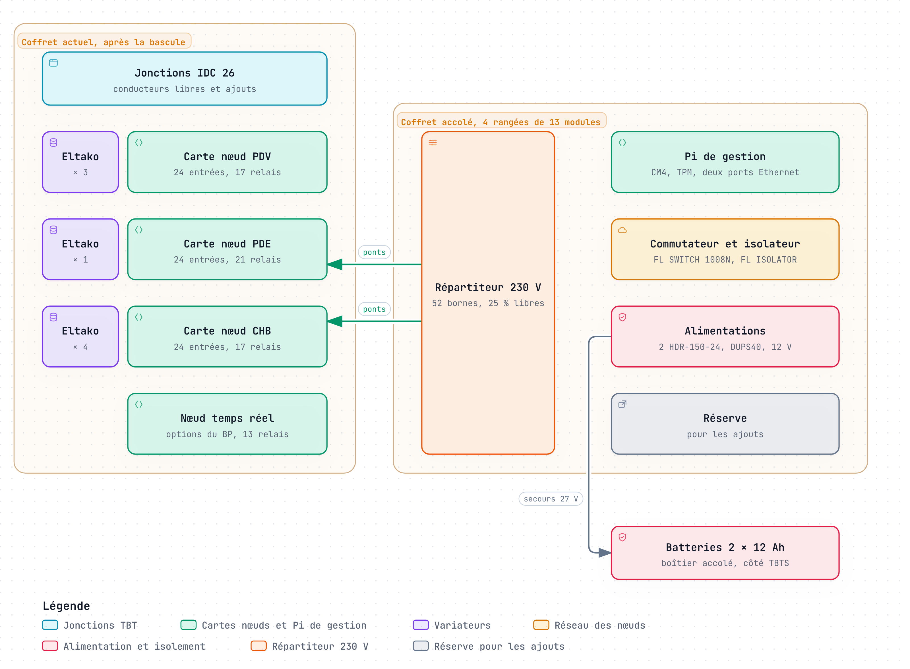
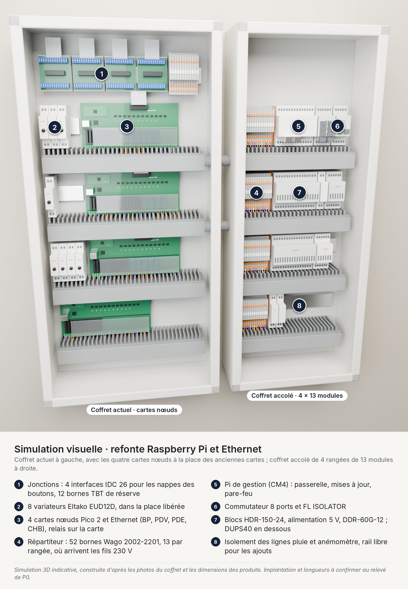
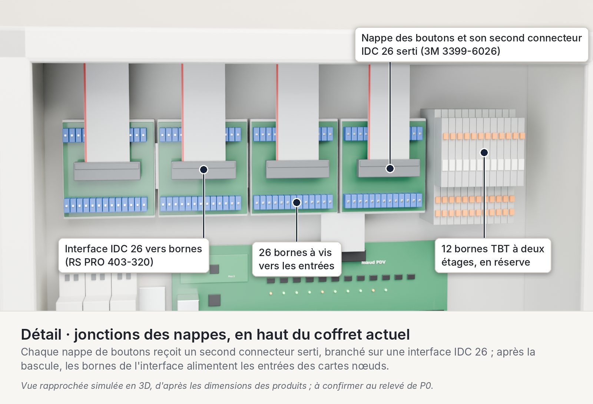
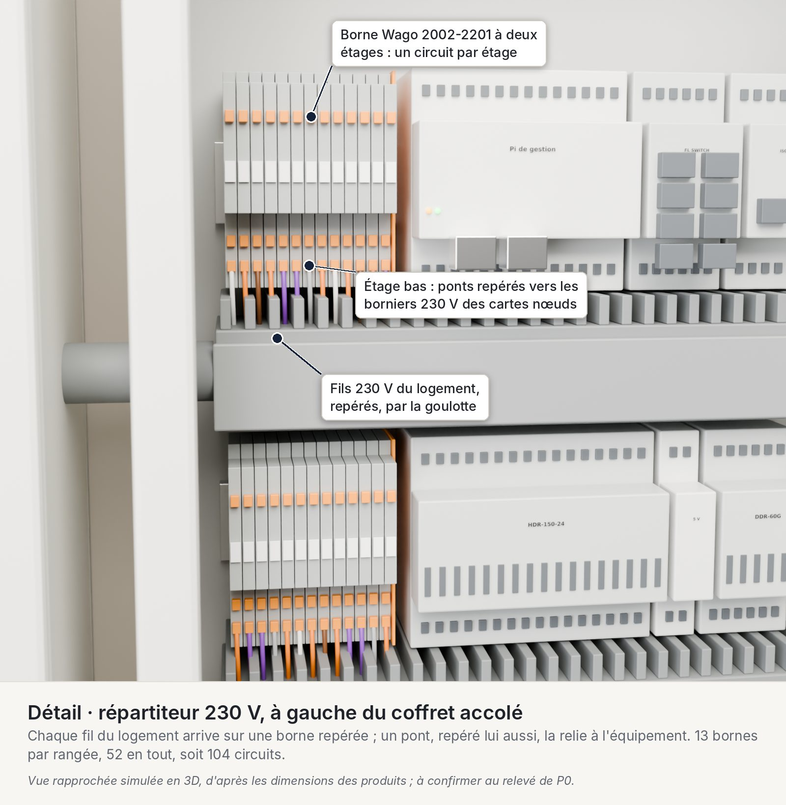
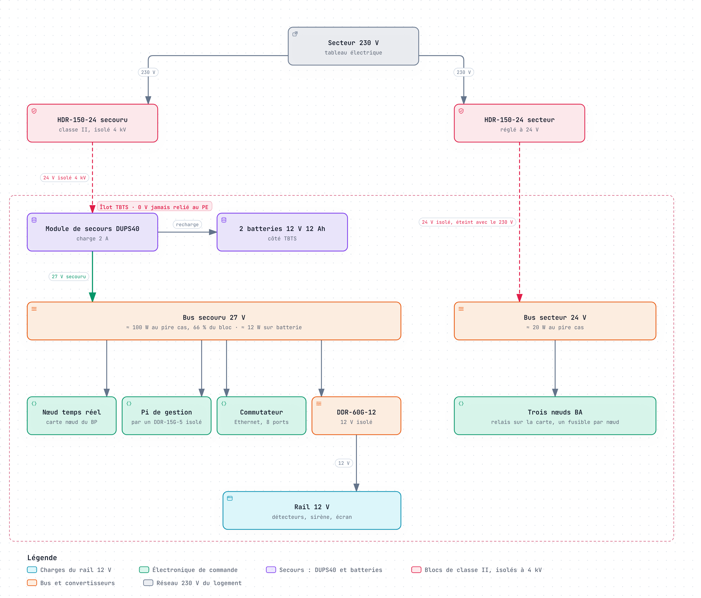
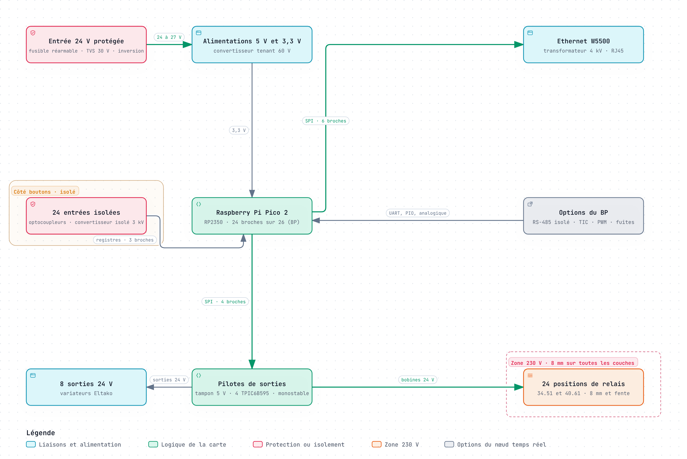
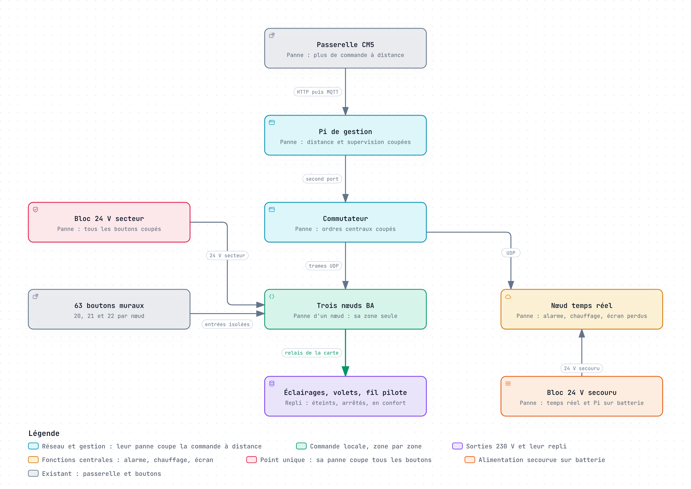
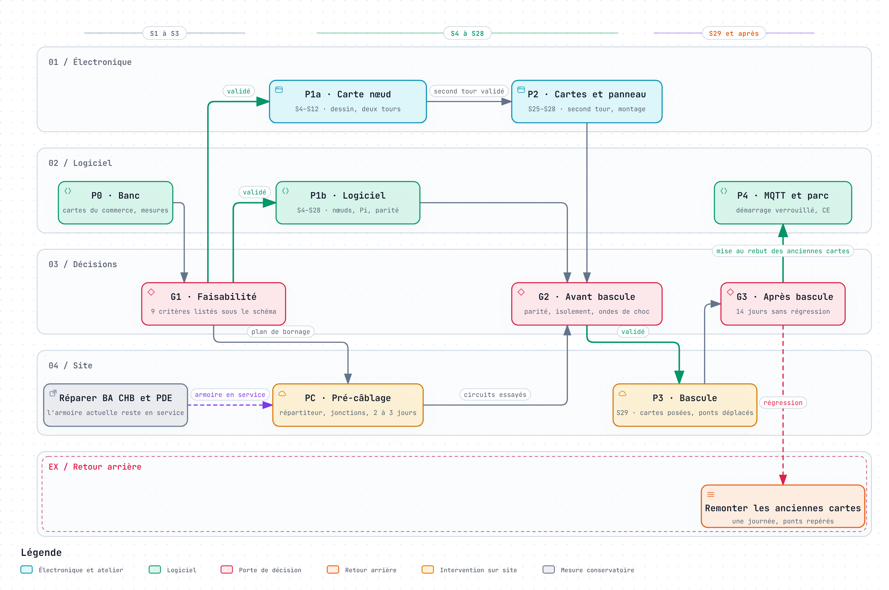

# Étude de refonte : ESSENSYS sur Raspberry Pi et Ethernet

Oct 20, 2026 · @Nicolas

## Synthèse

Refaire les cartes ESSENSYS autour de Raspberry Pi reliés en Ethernet est faisable, et c'est la voie la moins chère en matériel. Chaque BA devient une carte nœud portée par un Raspberry Pi Pico 2, avec ses relais soudés. Le BP réunit un Raspberry Pi de gestion sous Linux et un nœud temps réel bâti sur la même carte que les BA. Un commutateur Ethernet remplace le bus I2C.

Ce que cette voie apporte :

- **Le coût** : environ 3 090 € HT de matériel par armoire, câblage de migration compris, contre 5 350 € pour la Revolution Pi et 5 500 € pour l'Opta. Les relais soudés coûtent 446 €, contre 1 261 € de relais DIN.
- **Des boutons qui ne dépendent que de leur zone** : chaque nœud BA garde la logique de ses boutons. Le nœud temps réel, le Pi de gestion, la passerelle ou le commutateur peuvent tomber sans les priver ; seule la perte du bloc 24 V secteur les coupe tous, comme aujourd'hui celle de l'alimentation du BP.
- **Des cartes dessinées contre la foudre** : entrées isolées, entrée 24 V protégée, Ethernet par transformateur, repli matériel des sorties. Le projet corrige ainsi les faiblesses relevées, dans des cartes qu'il dessine.
- **Un câblage prêt pour la suite** : les fils passent par un répartiteur et des jonctions repérés, avec 25 % de réserve. 20 entrées, 28 positions de relais et 16 sorties 24 V restent libres.
- **La place** : les cartes reprennent l'emplacement des BA, et le reste tient sur environ 1,3 m de rail, câblage de migration compris (à vérifier en P0).
- **La durée** : Raspberry Pi annonce le Pico 2 jusqu'en janvier 2040 et sa puce RP2350 jusqu'en janvier 2045 ; le projet garde le dossier de fabrication de ses cartes.

Ce qu'il faut accepter :

- **Le projet le plus long** : 19 à 28 semaines-personne avant la bascule, dont 6 à 9 d'électronique, contre 13 à 16 pour la Revolution Pi.
- **Des cartes maison** à concevoir, fabriquer, tester et garder en rechange, avec deux tours de prototypes.
- **Du 230 V sur les cartes**, comme aujourd'hui : règles d'isolement strictes et, pour un parc, marquage CE à la charge du projet. Une variante à relais DIN évite le 230 V sur les cartes, pour environ 815 € de plus.
- **Un écart à l'ADR 0001**, qui retient un RS-485 isolé pour la génération 3 : il faudra l'amender.
- **Une seule personne** pour l'électronique, les firmwares et Linux.

Ce que cela coûte : environ 3 090 € HT de matériel, câblage de migration compris, plus environ 640 € de prototypes et 65 € de banc, dont le Pi de gestion est celui de l'armoire. Les 19 à 28 semaines de travail font 8 à 11 mois à 20 h par semaine. S'y ajoutent 2 à 3 jours de pré-câblage, l'armoire restant en service, 2 à 3 jours de montage du panneau et une journée de bascule.

Recommandation : retenir cette refonte si l'armoire doit équiper d'autres maisons, ou si la maîtrise des cartes compte plus que le délai. Chaque armoire économise alors environ 2 300 € de matériel. Pour une seule maison à remettre en service vite, la Revolution Pi ou l'Opta arrivent 2,5 à 5 mois plus tôt et demandent 15 000 à 30 000 € de logiciel interne de moins. Dans tous les cas, commencer par le banc P0, sur cartes du commerce, et par le câblage de migration.

Décisions à prendre :

- [ ] Fixer le nombre de maisons visées, qui départage les trois études
- [ ] Valider le Pico 2 pour les BA et le nœud temps réel, et le CM4 pour la gestion
- [ ] Choisir entre relais soudés et relais DIN
- [ ] Commander le banc P0 (environ 225 € HT, dont le Pi de gestion de l'armoire)
- [ ] Commander tôt le CM4 et une carte porteuse à deux ports Ethernet
- [ ] Faire poser le répartiteur et les jonctions des nappes, utiles quelle que soit la solution retenue
- [ ] Lancer la réparation provisoire des BA CHB et PDE
- [ ] Pendant le projet, appliquer les protections de priorité 1 de l'analyse experte : étoile 0 V N2, PTC et TVS sur le +15 V, FL ISOLATOR devant le BP
- [ ] Amender l'ADR 0001 si l'Ethernet est retenu
- [ ] Faire valider par l'électricien la TBTS, le 230 V sur les cartes et les boutons des salles de bains

## Architecture proposée

Le BP garde son rôle de chef d'orchestre, mais se divise en deux Raspberry Pi. Un Raspberry Pi de gestion, sous Linux, parle à la passerelle et administre le réseau. Un nœud temps réel tient l'alarme, le chauffage, le délestage et le dialogue avec l'écran. Les trois BA deviennent des nœuds bâtis sur la même carte que le nœud temps réel. Un commutateur Ethernet relie le tout, à la place du bus I2C.

| Élément | Matériel | Rôle |
| --- | --- | --- |
| Raspberry Pi de gestion | CM4 1 Go sur une carte porteuse à deux ports Ethernet, module TPM | Lien avec la passerelle, miroir de la table d'échange, mises à jour des nœuds, supervision, pare-feu |
| Nœud temps réel du BP | Carte nœud et Raspberry Pi Pico 2, options du BP | Code C du BP : alarme, chauffage et fil pilote, délestage, scénarios, écran, sirènes, ordres aux BA |
| Nœuds BA (PDV, CHB, PDE) | Carte nœud et Raspberry Pi Pico 2 | Code C des BA : boutons, relais, volets, variateurs, en autonomie |
| Commutateur | Phoenix FL SWITCH 1008N, 8 ports | Réseau interne de l'îlot TBTS |
| Passerelle CM5 | Inchangée | Backend, cloud et applications |

{ loading=lazy }

Lecture : la passerelle ne voit que le Raspberry Pi de gestion, à travers l'isolateur de 4 kV. Le Pi de gestion relie les deux réseaux par ses deux ports et filtre tout le trafic. Le nœud temps réel lit la TIC, répond à l'écran, maître de la liaison RS-485, commande les sirènes et envoie les ordres aux BA ; chaque BA traite ses boutons en local. Les barrières de 4 kV (en rose) gardent l'îlot TBTS. La version interactive du schéma, générée par Archify, accompagne l'étude.

Ce découpage suit un principe : plus une fonction est critique, moins elle dépend d'autres organes. Les boutons ne dépendent que de leur nœud BA. L'alarme, le chauffage et l'écran ne dépendent que du nœud temps réel. Le Pi de gestion n'est sur aucun de ces chemins : sa panne coupe la commande à distance, comme celle de la passerelle aujourd'hui.

Placement : les quatre cartes nœuds prennent la place du BP et des BA actuels, à la bascule, et les huit variateurs se logent à côté d'elles. Un coffret de quatre rangées de 13 modules, accolé à droite, reçoit le répartiteur, le Pi de gestion, le commutateur, l'isolateur et les alimentations : environ 0,8 m de rail sur 0,95 m. Les jonctions restent en haut du coffret actuel. Le relevé de P0 confirme ces places.

{ loading=lazy }

Lecture : après la bascule, chaque carte nœud occupe la rangée de l'ancienne carte, avec ses variateurs à côté. Le coffret accolé reçoit le répartiteur, contre le coffret actuel, puis le Pi de gestion, le réseau et les alimentations ; une réserve reste libre. Les anciennes cartes sont gardées hors du coffret jusqu'à G3. Implantation indicative, à confirmer au relevé de P0.

{ loading=lazy }

Lecture : simulation 3D d'après les photos du coffret et les dimensions des produits, après la bascule. Les cartes nœuds prennent la place des anciennes cartes ; l'implantation exacte sera fixée au relevé de P0.

Deux variantes restent ouvertes :

- **Relais DIN au lieu de relais soudés** : les cartes ne portent plus de 230 V, et les relais s'échangent sans outil. Il faut alors 68 relais d'interface, comme dans les autres études : environ 815 € de plus, 0,6 m de rail et 1 à 2 jours de câblage en plus (estimation).
- **Sans Raspberry Pi de gestion** : la passerelle CM5 tient ce rôle, à travers l'isolateur. On économise environ 160 € et un système Linux, mais la passerelle devient l'unique entrée du réseau des nœuds et doit porter son pare-feu.

## Câblage de migration et évolutivité

Aujourd'hui, les fils du logement arrivent directement sur les bornes des cartes, et les boutons sur leurs nappes. Changer d'équipement oblige à reprendre chaque fil, et revenir en arrière aussi. Le câblage de migration sépare ces fils de l'équipement qui les pilote. Il est commun aux trois études, et peut être posé avant même de choisir.

{ loading=lazy }

Lecture : les fils 230 V arrivent sur un répartiteur, sur le côté droit ; les nappes arrivent sur des jonctions, en haut. Des ponts repérés relient ces bornes à l'équipement : d'abord aux anciennes cartes, puis aux cartes nœuds. La version interactive du schéma, générée par Archify, accompagne l'étude.

Ce qu'il faut poser :

- **Répartiteur 230 V, à droite (coffret accolé, ou côté droit du coffret actuel si le relevé de P0 le permet)** : chaque fil existant quitte sa carte pour une borne repérée. Cela concerne les 63 départs des BA, les 8 départs du BP et une douzaine de phases d'alimentation, soit environ 83 circuits. Les fils en place sont en H07V-U 1,5 mm² rigide, que des bornes à poussoir reçoivent tels quels.
- **Jonctions des nappes, en haut** : les quatre nappes IDC 26 arrivent par le haut, sur les J3 des trois BA et du BP. Un second connecteur, serti sur chaque nappe, la relie à une interface IDC 26 vers bornes. L'ancienne carte reste branchée sur le connecteur d'origine jusqu'à la bascule.
- **Tensions séparées** : la TBT en haut, le 230 V sur le côté droit, avec des goulottes distinctes. L'analyse experte demande aussi, en priorité 1, d'éloigner les nappes des bornes de phase.
- **Réserve** : 25 % de bornes libres au répartiteur, soit une vingtaine de circuits, et 24 bornes TBT libres près des jonctions. Les conducteurs inutilisés des nappes arrivent aussi sur bornes.
- **Repérage** : chaque fil, borne et pont porte le même repère, reporté dans un plan de bornage tenu à jour dans essensys-doc.

| Élément | Quantité | Place sur rail | Prix HT |
| --- | --- | --- | --- |
| Bornes à poussoir à deux étages, 2,5 mm² (Wago 2002-2201) : 83 circuits et 25 % de réserve | 52 | ≈ 0,3 m, côté droit | ≈ 92 € |
| Interfaces IDC 26 vers bornes, 50 V et 1 A (RS PRO) | 4 | ≈ 0,3 m, en haut | 256 € |
| Bornes TBT à deux étages, en réserve | 12 | ≈ 6 cm, en haut | ≈ 21 € |
| Embouts, cloisons, butées, repères, connecteurs IDC à sertir | — | — | ≈ 50 € (estimation) |
| Fil H07V-K 1,5 mm² et embouts de câblage pour les ponts | — | — | ≈ 40 € (estimation) |
| Total |  | ≈ 0,65 m | ≈ 460 € |

Connecteurs retenus, les mêmes dans les trois études :

| Connecteur | Rôle | Référence |
| --- | --- | --- |
| Borne de passage à deux étages, à poussoir, 2,5 mm², 5,2 mm de large | Répartiteur : chaque étage reçoit un circuit, le fil du logement d'un côté, le pont repéré de l'autre. 52 bornes, soit 104 circuits | [Wago 2002-2201](https://buerklin.com/en/p/wago/series-terminals/2002-2201/09H4322) |
| Interface IDC 26 vers bornes à vis, sur rail DIN, 50 V et 1 A | Jonction : reçoit la nappe des boutons d'une zone et ramène ses 26 conducteurs sur bornes. Une par nappe, soit 4 | [RS PRO 403-320](https://befr.rs-online.com/web/p/interface-modules/0403320) |
| Connecteur IDC 26 femelle, pas de 2,54 mm, pour nappe au pas de 1,27 mm, avec serre-câble | Second connecteur serti sur chaque nappe : l'interface se branche sans débrancher l'ancienne carte | [3M 3399-6026](https://fr.rs-online.com/web/p/connecteurs-idc/8280403) |

{ loading=lazy }

{ loading=lazy }

Lecture : les deux vues rapprochées montrent les connecteurs retenus en place, en haut du coffret actuel pour les nappes et à gauche du coffret accolé pour le répartiteur ; après la bascule, les ponts rejoignent les borniers 230 V des cartes nœuds.

{ loading=lazy }

Lecture : à gauche, le coffret tel qu'il est. Chaque carte reçoit sa nappe par le haut et ses fils 230 V par le bas, et le côté droit n'a qu'environ 4 cm libres. À droite, le même coffret après le pré-câblage : les jonctions occupent le haut, les fils passent par le répartiteur du coffret accolé, et des ponts les ramènent aux cartes, toujours en service. La version interactive du schéma, générée par Archify, accompagne l'étude.

Le répartiteur prend place dans un coffret de quatre rangées de 13 modules, accolé à droite du coffret actuel, pour environ 80 € HT (estimation), avec le Pi de gestion, le réseau et les alimentations ; les jonctions restent en haut. Le relevé de P0 dit si le côté droit du coffret actuel suffit au répartiteur.

Déroulement :

1. **Relevé et plan, en P0** : place libre sur le côté droit et en haut, longueur des fils, plan de bornage.
2. **Pré-câblage, 2 à 3 jours d'électricien, armoire en service** : chaque fil passe sur sa borne, un pont le relie à l'ancienne carte, et le circuit est essayé. Le second connecteur des nappes est serti et branché sur sa jonction.
3. **Bascule, une journée** : les anciennes cartes sont déposées et les cartes nœuds posées à leur place. Les ponts passent sur leurs borniers 230 V, et chaque nappe sur leur connecteur IDC 26. Pendant cette journée, le logement n'a ni boutons, ni écran, ni alarme, ni fil pilote : prévenir les occupants, choisir une journée hors période de chauffe, prévoir un éclairage d'appoint.
4. **Retour arrière, une journée** : les anciennes cartes, gardées jusqu'à G3, sont remontées ; les ponts reviennent sur elles et les nappes se rebranchent.

{ loading=lazy }

Lecture : chaque circuit a un seul repère, porté par sa borne 230 V au répartiteur X1 et par la borne de son bouton à la jonction X2. Les tables suivent l'ordre éclairages, variateurs, volets ; les phases d'alimentation et la réserve complètent les 104 points du répartiteur. Le brochage J3 de chaque bouton et les phases restent à relever en P0. La version interactive du schéma, générée par Archify, accompagne l'étude.

Évolutivité : aujourd'hui, le brochage des BA est figé dans le code (881 lignes de hard.h), le bus I2C ne connaît que trois BA, et chaque ajout demande de reprendre une carte. Avec les cartes nœuds et ce câblage, un ajout se résume à une borne, un pont et une ligne de configuration :

| Ajout | Comment | Capacité libre |
| --- | --- | --- |
| Un éclairage ou un volet | Relais soudé sur une position libre de la carte de la zone, ou relais DIN piloté par une sortie 24 V ; pont au répartiteur | 28 positions de relais, 16 sorties 24 V |
| Un bouton ou un capteur | Borne TBT de réserve vers une entrée isolée libre | 20 entrées |
| Une zone ou un bâtiment | Carte nœud de plus sur un port libre du commutateur, même firmware avec un autre rôle | 2 ports, le troisième restant à la maintenance |
| Une commande à distance | Table de correspondance tenue par le Pi de gestion et envoyée aux nœuds, sans recompiler ; MQTT et Home Assistant en phase P4 | — |

Sources : [interface IDC 26 RS PRO](https://befr.rs-online.com/web/p/interface-modules/0403320), [borne Wago 2002-2201](https://buerklin.com/en/p/wago/series-terminals/2002-2201/09H4322), [nappes J3 du BP et des BA](https://github.com/essensys-hub/essensys-doc/blob/main/archi/hardware-overview.md), [cheminement des nappes dans l'analyse experte](https://github.com/essensys-hub/essensys-doc/blob/main/docs/retex/foudre-2026/analyse-experte.md).

## Le petit Raspberry Pi des BA

Trois Raspberry Pi peuvent tenir le rôle d'un BA. Le Raspberry Pi Pico 2 est retenu : c'est le plus petit des trois, avec 520 Ko de mémoire. C'est une carte à microcontrôleur, sans Linux : son firmware tourne directement sur la puce.

| Critère | Pi Zero 2 W | CM4 1 Go Lite | Pico 2 (RP2350) |
| --- | --- | --- | --- |
| Mémoire | 512 Mo | 1 Go | 520 Ko |
| Ethernet filaire | Aucun : Wi-Fi seul | Gigabit intégré | 10/100 par un W5500 sur la carte |
| Logiciel | Linux sur carte microSD | Linux sur carte microSD : le Lite n'a pas d'eMMC | Firmware C sur un système temps réel, sans Linux |
| Démarrage | Plusieurs secondes | Plusieurs secondes | Quelques millisecondes, à mesurer en P0 |
| Entrées analogiques | Aucune | Aucune | 3 |
| Température | −20 à 70 °C | −20 à 85 °C | −20 à 85 °C |
| Production annoncée | Jusqu'en 2030 au moins | Jusqu'en 2034 au moins | Jusqu'en janvier 2040 au moins ; puce RP2350 jusqu'en janvier 2045 |
| Prix HT au 20 octobre 2026 | 16,25 € chez Kubii, en rupture, comme chez Reichelt | 36,56 € chez Farnell, livré à partir du 21 janvier 2027 ; 36,72 € chez Reichelt, annoncé pour le 17 novembre | 4,12 € |
| Verdict | Écarté | Surdimensionné | **Retenu** |

Le Pico 2 est le plus petit Raspberry Pi qui tienne le rôle. Sa puce RP2350 a deux cœurs à 150 MHz et trois blocs PIO, qui créent des liaisons série à la demande. Il n'a pas de système de fichiers à corrompre. Le W5500 de WIZnet lui ajoute l'Ethernet 10/100, avec une pile TCP/IP câblée, pour 2,93 € HT.

Pourquoi pas les deux autres :

- **Pi Zero 2 W** : il n'a pas de port Ethernet filaire. Il faudrait un adaptateur USB, Linux et une carte microSD dans chaque BA, et il est en rupture chez Kubii comme chez Reichelt au 20 octobre 2026.
- **CM4 1 Go Lite** : il a l'Ethernet, mais met Linux dans chaque BA, avec un démarrage lent et une carte microSD à surveiller. Farnell ne le livre qu'à partir de janvier 2027, et il coûte neuf fois le prix du Pico 2.

Le RP2350 apporte aussi le démarrage signé : sa ROM vérifie la signature du firmware, avec une empreinte de clé gravée en OTP. On ne l'active qu'après qualification, car la gravure est définitive.

Pour le banc P0, la carte W5500-EVB-Pico2 de WIZnet réunit déjà un RP2350 et un W5500, pour environ 11 € HT. WIZnet propose aussi le W55RP20, qui réunit un RP2040 et un W5500 dans un seul boîtier, à 3,66 € HT. Mais le RP2040 n'a pas de démarrage signé, et WIZnet n'a pas d'équivalent sur RP2350.

Sources : [Pico 2](https://www.raspberrypi.com/products/raspberry-pi-pico-2/), [RP2350](https://www.raspberrypi.com/products/rp2350/), [brief RP2350](https://pip-assets.raspberrypi.com/categories/1214-rp2350/documents/RP-008374-DS-1-rp2350-product-brief.pdf), [brief Zero 2 W](https://pip-assets.raspberrypi.com/categories/584-raspberry-pi-zero-2-w/documents/RP-008359-DS-1-raspberry-pi-zero-2-w-product-brief.pdf), [Zero 2 W chez Kubii](https://kubii.com/en/nano-computers/3455-raspberry-pi-zero-2-w-wh.html), [brief CM4](https://pip-assets.raspberrypi.com/categories/634-raspberry-pi-compute-module-4/documents/RP-008169-DS-8-cm4-product-brief.pdf), [CM4 chez Farnell](https://fr.farnell.com/raspberry-pi/cm4001000/rpi-compute-module-4-lite-1gb/dp/3563473), [CM4 chez Reichelt](https://www.reichelt.de/de/de/shop/suche/cm4001000), [Pico 2 et RP2350 chez Reichelt](https://www.reichelt.de/de/de/shop/suche/rp2350), [W5500 chez TME](https://www.tme.eu/fr/details/w5500/circuits-integres-interface-ethernet/wiznet/), [W5500-EVB-Pico2](https://thepihut.com/collections/pico/products/wiznet-w5500-evb-pico2), [W55RP20](https://docs.wiznet.io/Product/Chip/MCU/W55RP20).

## Boîtier principal : gestion et temps réel

Le BP actuel mêle deux métiers. Le premier est un temps réel serré : fil pilote, sirène, téléinformation, écran, ordres aux BA. Le second est une gestion réseau : passerelle, mises à jour, supervision. La refonte confie chacun à son Raspberry Pi.

**Le nœud temps réel** est le second Raspberry Pi du BP. C'est un Pico 2 sur la carte nœud commune : une carte à microcontrôleur de Raspberry Pi, sans Linux. Cinq raisons le font préférer à un Raspberry Pi sous Linux :

- **Le démarrage** : quelques millisecondes, à mesurer en P0, sans carte microSD ni système de fichiers à corrompre.
- **Une latence bornée** : le firmware répond dans un délai fixe. Sous Linux avec PREEMPT\_RT, une mesure publiée donne au plus 124 µs sur un Pi 5 chargé, mais jusqu'à 21 332 µs sur un Pi 4, dont la puce BCM2711 est celle du CM4.
- **Les liaisons lentes** : la PWM de la sirène, d'environ 1,7 kHz calculés d'après Hard.c, la TIC à 1 200 bauds et le RS-485 de l'écran à 9 600 bauds tournent sur les blocs PIO et les UART, sans charge processeur.
- **Les mesures** : ses entrées analogiques lisent les deux détecteurs de fuite SC947 ; un Raspberry Pi sous Linux n'en a aucune.
- **La consommation** : moins de 1 W avec le W5500, ce qui allonge l'autonomie sur batterie.

Le code métier du BP, environ 6 000 lignes, y passe sur un système temps réel, avec une couche qui émule MQX, comme pour l'Opta. La table d'échange reste dans ce nœud, comme dans le BP actuel : l'écran la lit et l'écrit sans passer par Linux.

Variante sous Linux : si un Raspberry Pi complet est exigé, un second CM4 avec PREEMPT\_RT peut tenir ce rôle. Il lui faut une carte d'entrées et de sorties et un convertisseur analogique : environ 60 € HT de plus, 1 à 2 semaines de travail en plus (estimation), et un démarrage de plusieurs secondes.

**Le Raspberry Pi de gestion** tourne sous Linux, comme la passerelle :

| Pièce | Choix | Prix HT |
| --- | --- | --- |
| Module | CM4 1 Go Lite (CM4001000), sans eMMC | 36,56 € |
| Carte porteuse | Waveshare CM4-DUAL-ETH-MINI : deux ports Gigabit, connecteur GPIO de 40 broches | 32,76 € |
| Sécurité | Module TPM 2.0 LetsTrust (Infineon SLB 9672) sur le connecteur GPIO | ≈ 25 € |
| Stockage | Carte microSD industrielle, système en lecture seule | ≈ 20 € |
| Alimentation | Convertisseur isolé 24 → 5 V Mean Well DDR-15G-5 | 30,37 € |
| Boîtier | Boîtier pour rail DIN | ≈ 15 € |
| Total |  | ≈ 160 € |

Ses rôles :

- **Passerelle** : client HTTP legacy du BP en phase 1, puis MQTT sur TLS avec un certificat client. La clé privée reste dans le TPM.
- **Pare-feu** : un port vers la passerelle, à travers l'isolateur, et un port vers le commutateur. Aucun nœud n'est joignable depuis le réseau local.
- **Miroir** de la table d'échange, tenu à jour par le nœud temps réel.
- **Mises à jour signées** des quatre nœuds, avec une image de secours sur chacun.
- **Supervision** : battements de cœur, journaux, heure réseau pour le nœud temps réel.

Si le Pi de gestion tombe, la maison fonctionne en local, alarme, chauffage et délestage compris. Seules la commande à distance et la supervision s'arrêtent.

Approvisionnement au 20 octobre 2026 : Raspberry Pi annonce le CM4 jusqu'en 2034 au moins, mais Farnell ne le livre qu'à partir du 21 janvier 2027. Reichelt l'annonce pour le 17 novembre 2026, à 36,72 € HT : il faut le commander tôt. À défaut, un CM5 2 Go Lite le remplace, sur une carte porteuse adaptée : 63,11 € HT chez Reichelt, en stock. La carte porteuse CM4-DUAL-ETH-MINI est épuisée : une autre carte à deux ports Ethernet est à retenir en P0.

Sources : [PREEMPT\_RT dans Raspberry Pi OS](https://www.raspberrypi.com/documentation/computers/linux_kernel.html), [latences mesurées sur Pi 4 et Pi 5](https://antonio.paolillo.be/publications/workshops/ecrtsOspert2024_dewit_rtlinux_slideset.pdf), [brief CM4](https://pip-assets.raspberrypi.com/categories/634-raspberry-pi-compute-module-4/documents/RP-008169-DS-8-cm4-product-brief.pdf), [CM4 chez Farnell](https://fr.farnell.com/raspberry-pi/cm4001000/rpi-compute-module-4-lite-1gb/dp/3563473), [CM4 chez Reichelt](https://www.reichelt.de/de/de/shop/suche/cm4001000), [CM4-DUAL-ETH-MINI](https://buyzero.de/en/products/mini-ethernet-base-board-fur-raspberry-pi-compute-module-4), [LetsTrust TPM](https://thepihut.com/collections/other-raspberry-pi-hats/products/letstrust-tpm-for-raspberry-pi), [DDR-15G-5](https://befr.rs-online.com/web/p/dc-dc-converters/1757775), [CM5](https://www.raspberrypi.com/products/compute-module-5/), [CM5 chez Reichelt](https://www.reichelt.de/de/de/shop/suche/cm5002000).

## Ethernet à la place de l'I2C

Le réseau des nœuds est une étoile autour d'un commutateur à 8 ports, logé dans le coffret accolé. Cinq ports sont occupés : le Pi de gestion, le nœud temps réel et les trois BA. Il reste un port de maintenance et deux ports libres. Les BA étant dans la même armoire, des cordons U/UTP de 0,5 à 2 m suffisent ; sans blindage, ils ne relient pas les masses des cartes.

Ce que l'Ethernet corrige par construction :

- **Plus de 0 V dans les câbles de données** : chaque liaison passe par le transformateur Ethernet du nœud. Celui retenu, le Bourns SM13100EL, tient 4 kV pendant 60 s, quand la norme n'exige que 1 500 V. Les 0 V des cartes d'un même bus restent communs ; les 0 V des deux blocs 24 V sont reliés en un seul point du coffret accolé, et les 0 V se rejoignent en étoile dans le coffret, et non plus le long d'un bus. Les boutons, eux, sont isolés par les entrées de chaque carte.
- **Plus de panne en cascade** : chaque liaison va d'un nœud au commutateur. Un nœud éteint ou détruit ne gêne pas les autres, là où un BA non alimenté bloquait tout le bus I2C.
- **Plus de défaut silencieux** : un battement de cœur chaque seconde signale un nœud muet, sans attendre qu'un ordre le vise.

Ce choix s'écarte de l'ADR 0001, au statut « Proposé », qui retient pour la génération 3 un RS-485 isolé, à 25 à 50 € par nœud. L'Ethernet coûte environ 9,40 € par nœud, puce, transformateur et RJ45 compris, plus 141 € de commutateur. Il isole chaque liaison sans composant de plus, et relie aussi le Pi de gestion. Le retenir demande d'amender l'ADR.

Le protocole reprend les trames des BA :

- **Contenu** : les cinq codes de trame actuels et leur CRC-16, dans des datagrammes UDP. Un en-tête ajoute la version du protocole, un numéro de séquence et un code d'authentification HMAC.
- **Fiabilité** : chaque ordre est acquitté après exécution, et renvoyé faute d'acquittement. Le nœud temps réel renvoie les configurations quand un BA redémarre.
- **Adresses** : fixes, dans un sous-réseau privé propre à l'armoire, sans dépendre d'un serveur DHCP.
- **Délais** : un ordre du BP atteint un BA en quelques millisecondes, à mesurer en P0. Un appui de bouton reste traité sur place, sans passer par le réseau.

L'alimentation reprend le schéma de l'étude Opta : deux blocs Mean Well HDR-150-24 de classe II, et un fusible par nœud.

| Bus | Charges | Pire cas | Sur batterie |
| --- | --- | --- | --- |
| Secouru, à 27 V, avec le DUPS40 et deux batteries de 12 V 12 Ah | Nœud temps réel, Pi de gestion, commutateur, rail 12 V des détecteurs, de la sirène et de l'écran, recharge | ≈ 100 W, 66 % du bloc | ≈ 12 W |
| Secteur, à 24 V | Trois nœuds BA et leurs relais | ≈ 20 W | Éteint avec le 230 V |

Sur batterie, les relais du nœud temps réel retombent, sauf celui de la sirène extérieure. L'alarme et l'écran tiennent alors environ 17 à 18 h, en comptant 70 à 75 % de la capacité (estimation à mesurer en P0).

{ loading=lazy }

Lecture : comme pour l'Opta, deux blocs HDR-150-24 séparent un bus secouru de 27 V et un bus secteur de 24 V. Le bus secouru alimente le nœud temps réel, le Pi de gestion par son convertisseur DDR-15G-5, le commutateur et le rail 12 V. Le bus secteur alimente les trois nœuds BA et leurs relais, et s'éteint avec le 230 V. Sur batterie, il reste environ 12 W, de quoi tenir l'alarme et l'écran 17 à 18 h. La version interactive du schéma, générée par Archify, accompagne l'étude.

**Le PoE est écarté.** Le budget d'un port 802.3af, 12,95 W, suffirait à un BA. Mais un commutateur PoE alimenté en 24 V coûte de 376 € HT (Phoenix, livré en septembre 2027) à 799 € HT (Moxa). Chaque nœud demanderait aussi un module d'alimentation PoE, environ 8 €, et une conversion vers le 24 V des bobines. Surtout, le commutateur porterait à la fois le réseau et l'énergie de tous les nœuds.

Sources : [norme d'isolement Ethernet](https://grouper.ieee.org/groups/802/3/cr/public/091020/AnnexJ_Consensus_Text_091020.pdf), [Bourns SM13100EL](https://www.farnell.com/datasheets/2646907.pdf), [ADR 0001 génération 3](https://github.com/essensys-hub/essensys-board-SC944D/blob/main/docs/adr/0001-generation-3-rs485-isole.md), [budgets PoE](https://www.ti.com/document-viewer/lit/html/SLVSB97E/poe-overview-slvsb974149), [FL SWITCH 1001T-4POE chez RS](https://fr.rs-online.com/web/p/switchs-reseau/8017403), [Moxa EDS-G205A-4PoE chez RS](https://fr.rs-online.com/web/p/commutateurs/2551914), [module Ag9905](https://be.farnell.com/silvertel/ag9905-mtb/power-over-ethernet-module-5v/dp/4472715), [FL SWITCH 1008N](https://industry-electronics.de/phoenix-contact/1085256-phoenix-fl-switch-1008n-industrial-ethernet-druckansicht-1775494.htm), [démarrage du BP et des BA](https://github.com/essensys-hub/essensys-memory/blob/main/raw/analyses/2026-10-demarrage-bp-ba/analyse.md).

## Améliorations des schémas existants

La relecture des schémas électroniques du BP et des BA, faite après la foudre du 9 août 2026, a chiffré quatorze faiblesses. La refonte en supprime la plupart par construction, en abandonnant le bus I2C ; les autres deviennent des règles de conception des nouvelles cartes.

| Repère | Faiblesse relevée | Correction dans la refonte |
| --- | --- | --- |
| B1 à B3 | I2C du BP : TVS qui écrête trop haut, polarité négative non tenue, 55 mm de piste nue jusqu'au ColdFire | Plus d'I2C entre cartes. Aucune broche de processeur ne sort directement sur un connecteur : tampon, isolateur ou transformateur entre les deux |
| B4 | Fil +15 V des BA sans fusible ni TVS ; régulateur LD1117 alimenté au-delà de ses 15 V | Chaque carte a sa propre entrée 24 V : fusible réarmable, protection contre l'inversion, TVS de 30 V qui écrête sous 50 V (SMCJ30A, à vérifier), composants d'entrée de 63 V et convertisseur prévu pour 60 V |
| B5 | 0 V couplé au câble Ethernet (1 nF sous 2 kV), RJ45 isolé à 1,5 kV et placé à 18 mm du connecteur du bus | Magnétiques tenant 4 kV pendant 60 s, terminaison tenant au moins 3 kV, RJ45 à l'opposé des borniers ; lien vers la passerelle par isolateur 4 kV |
| B6, A1, A2 | Translateur de niveau toujours passant, PIC qui conduit avant sa TVS, seuils I2C serrés | Disparaissent avec l'I2C |
| A3 | Carte conçue pour 12 V qui tourne sous 15 V, sans TVS : moins de 2 V de marge sur un condensateur | Entrée 24 V protégée, composants d'entrée de 63 V |
| A4 | 0 V du bus relié en direct entre cartes | Plus de 0 V dans un câble de bus : liaisons Ethernet par transformateur, 0 V réunis en étoile dans le coffret |
| A5 | 20 à 22 entrées à contact sec vers le 0 V logique, sans optocoupleur | Entrées 24 V isolées par optocoupleurs, alimentées par un convertisseur isolé de 3 kV au moins, avec limitation de courant et TVS ramenées au plan du connecteur |
| A6 | J1/J2 estimés à 2 à 3 mm du relais K1 | Zone 230 V à 8 mm sur toutes les couches, jamais moins de 6 mm, avec une fente fraisée de 2 mm (EN 60664-1, catégorie III, degré de pollution 2) ; aucun connecteur TBT à côté d'un relais |
| A7 | Un BA non alimenté bloque tout le bus | Liaisons point à point : un nœud éteint ne gêne personne |
| A8 | Watchdog désactivé sur le PIC | Watchdog du microcontrôleur et monostable de repli |
| Firmware | Ordres acquittés avant exécution, configurations perdues jamais renvoyées, défaut vu seulement après un ordre | Acquittement après exécution, renvoi des configurations, battement de cœur permanent entre nœuds |

Autres améliorations proposées pour les nouvelles cartes :

- **Repli matériel** : les quatre TPIC6B595 sont alimentés en 5 V, derrière un tampon 74AHCT125 qui adapte le 3,3 V du Pico 2. Leur broche d'activation est tenue par un monostable, lui aussi en 5 V, que le firmware réarme plusieurs fois par seconde. S'il se tait plus d'une demi-seconde environ, toutes les sorties retombent, sans attendre le watchdog.
- **Sorties** : relais à 6 kV et 8 mm entre bobine et contacts, 16 A pour la « marche » des volets et un inverseur pour le « sens », comme dans les autres études. Les bobines se déchargent dans la limitation de 50 V intégrée au TPIC6B595, à vérifier sur banc.
- **Variateurs** : les SC943, dont le firmware n'existe qu'en .hex, ne sont pas redessinés. Des variateurs DIN Eltako EUD12D-UC les remplacent, chacun piloté par deux sorties 24 V pour les ordres centraux ON et OFF. Le bouton mural reste câblé en parallèle sur l'entrée locale du variateur, par un 24 V isolé : il le garde commandable si le nœud tombe. L'isolement de ces entrées est à confirmer sur la fiche Eltako.
- **Nœud temps réel du BP** : RS-485 de l'écran sur transceiver isolé, TIC par optocoupleur sur une UART, PWM de sirène à la fréquence voulue, mesures de fuite sur les entrées analogiques. Les lignes analogiques et la PWM, qui sortent de la carte, ont aussi leur TVS et leur résistance série.
- **Dépannage** : une LED par voie, des points de test et un connecteur de débogage protégé.
- **Une seule carte** pour les trois BA et le nœud temps réel du BP, aux options prévues mais peuplées selon le rôle : un seul dessin à maintenir.
- **Routage** : les règles du retex sont reprises, avec trois zones (Ethernet et alimentation, TBTS locale, 230 V) et l'ordre connecteur, TVS, résistance, circuit sur chaque ligne. Un tiers relit le schéma et le routage avant chaque tour.

Sources : [faiblesses chiffrées et solution à long terme](https://github.com/essensys-hub/essensys-doc/blob/main/docs/retex/foudre-2026/analyse-experte.md), [BA SC940D](https://github.com/essensys-hub/essensys-doc/blob/main/archi/hardware-sc940d.md), [BP SC944D](https://github.com/essensys-hub/essensys-doc/blob/main/archi/hardware-sc944d.md), [protection surtensions](https://github.com/essensys-hub/essensys-doc/blob/main/docs/install/protection-surtensions.md).

## La carte nœud commune

Une seule carte tient les quatre rôles. Le Pico 2 n'y touche aucun connecteur en direct : chaque liaison vers l'extérieur passe par un tampon, un isolateur ou un transformateur.

{ loading=lazy }

Lecture : l'entrée 24 V protégée alimente la carte. Les 24 entrées passent par des optocoupleurs, avec leur propre convertisseur isolé ; les sorties, par un tampon 5 V et quatre TPIC6B595, vers 24 positions de relais et 8 sorties 24 V. Les relais sont dans une zone 230 V tenue à 8 mm sur toutes les couches. La version interactive du schéma, générée par Archify, accompagne l'étude.

Le Pico 2 offre 26 broches. Un nœud BA en utilise 14, le nœud temps réel 24 : il en reste 2.

| Fonction | Broches | Nœud BA | Nœud temps réel |
| --- | --- | --- | --- |
| Ethernet W5500 : SPI, interruption, remise à zéro | 6 | oui | oui |
| Sorties : quatre TPIC6B595 en chaîne | 4 | oui | oui |
| Entrées : trois registres 74HC165 en chaîne | 3 | oui | oui |
| Réarmement du monostable de repli | 1 | oui | oui |
| RS-485 isolé de l'écran : émission, réception, sens | 3 | — | oui |
| TIC par optocoupleur | 1 | — | oui |
| PWM de la sirène | 1 | — | oui |
| Fuites SC947, entrées analogiques | 2 | — | oui |
| Horloge sauvegardée, en I2C local à la carte | 2 | — | oui |
| Anémomètre, compté par un bloc PIO | 1 | — | oui |
| Total |  | 14 | 24 |

Sources : [Pico 2](https://www.raspberrypi.com/products/raspberry-pi-pico-2/), [TPIC6B595 chez Mouser](https://www.mouser.fr/c/?q=TPIC6B595), [W5500 chez TME](https://www.tme.eu/fr/details/w5500/circuits-integres-interface-ethernet/wiznet/).

## Logiciel

Les quatre nœuds partagent un même firmware, compilé avec le rôle de chacun. Il reprend le C existant, comme pour l'Opta : environ 6 000 lignes métier du BP et 1 550 lignes de logique BA. Le Pi de gestion porte des services en Go, comme la passerelle.

| Bloc | Aujourd'hui | Après la refonte |
| --- | --- | --- |
| Logique BA | C v1.7 sur PIC16F946 | Reprise sur les nœuds BA ; brochage et pilotes réécrits |
| Logique BP | C sur MQX 3.8, processeur ColdFire | Reprise sur le nœud temps réel, avec une couche qui émule les appels MQX |
| Fil pilote | TRIAC synchronisés sur le secteur | Logique des ordres reprise ; deux relais et des diodes par zone |
| Bus BA | I2C, CRC-16, ordres acquittés avant exécution | UDP, mêmes trames et même CRC, acquittement après exécution, battement de cœur |
| Table d'échange | Flash du ColdFire et EEPROM SPI | Flash du nœud temps réel, miroir sur le Pi de gestion |
| Contenu de la table : horaires, scénarios, réglages | Lu dans le BP 099-37 | Exporté avant la bascule, importé dans le nœud temps réel, sauvegardé par le miroir du Pi de gestion, restauration essayée en G2 |
| Passerelle | Client HTTP legacy du BP | Service Go du Pi de gestion ; MQTT en phase P4 |
| Mises à jour | Binaire 099-37 seul flashable, sur place | Images signées, poussées par le Pi de gestion |

Système des nœuds : le SDK Pico de Raspberry Pi avec FreeRTOS, ou Zephyr, qui décrit déjà la carte W5500-EVB-Pico2. Le banc P0 tranche sur trois critères : pilote du W5500, démarrage signé, effort d'émulation de MQX. Le portage part d'essensys-gcc, qui compile déjà le BP avec GCC et les BA avec XC8, et fait tourner des tests Unity.

| Lot | Semaines-personne |
| --- | --- |
| Banc P0 et choix du système | 1 à 1,5 |
| Socle des nœuds : entrées, sorties, Ethernet, watchdog, flash | 1,5 à 2 |
| Émulation des appels MQX | 1 à 1,5 |
| Logique BA | 1,5 à 2 |
| Domaines BP, dont le fil pilote sur relais | 2 à 3 |
| Protocole UDP : acquittement, battement de cœur, HMAC | 1 à 1,5 |
| TIC et délestage | 0,5 à 1 |
| Écran RS-485 | 0,5 à 1 |
| Pi de gestion : image Linux, pare-feu, TPM, HTTP legacy, miroir | 2 à 2,5 |
| Mises à jour signées des nœuds | 1 à 1,5 |
| Parité sur banc | 1 à 1,5 |
| **Logiciel avant la bascule** | **13 à 19** |
| Électronique : schéma, routage, deux tours de prototypes | 6 à 9 |
| **Total avant la bascule** | **19 à 28** |
| Après la bascule (P4) : MQTT sur TLS, verrouillage du démarrage signé | 1,5 à 2 |

L'électronique se décompose en 1,5 à 2 semaines de schéma, 2 à 3 de routage et de revue, et 2,5 à 4 pour fabriquer, tester et corriger deux tours de prototypes. Une seule personne faisant les deux, le dessin de la carte interrompt le logiciel ; pendant la fabrication, le logiciel avance sur les cartes du commerce du banc.

Points de vigilance : la parité se mesure contre le BP 099-37 en service, faute de build qualifié, comme pour l'Opta. Le hors-gel forcé de 500 ms aux transitions du fil pilote est conservé. La TIC passe sur une vraie UART : le délestage, qui monte d'un cran à chaque trame portant l'ADPS, est repris tel quel.

Sources : [firmware BP](https://github.com/essensys-hub/client-essensys-legacy), [firmware BA v1.7](https://github.com/essensys-hub/essensys-board-SC940), [essensys-gcc](https://github.com/essensys-hub/essensys-memory/blob/main/raw/architecture/repos/essensys-gcc.md), [carte W5500-EVB-Pico2 dans Zephyr](https://docs.zephyrproject.org/latest/boards/wiznet/w5500_evb_pico2/doc/index.html), [remise en service et builds qualifiés](https://github.com/essensys-hub/essensys-doc/blob/main/docs/install/remise-en-service-surtension.md).

## Nomenclature et coût par carte

Le matériel revient à environ 3 090 € HT par armoire, soit 3 710 € TTC, câblage de migration compris : environ 2 250 € de moins que la Revolution Pi et 2 400 € de moins que l'Opta. Les quatre cartes nœuds en représentent 37 % (1 136 €), relais compris.

Coût d'une carte nœud, aux prix de petites quantités :

| Poste | PDV | CHB | PDE | BP |
| --- | --- | --- | --- | --- |
| Électronique commune | 42 € | 42 € | 42 € | 42 € |
| Relais 34.51 (6 A) et 40.61 (16 A) | 11 et 6 : 108 € | 12 et 5 : 110 € | 17 et 4 : 139 € | 13 et 0 : 90 € |
| Options du BP | — | — | — | 15 € |
| Borniers, circuit imprimé, assemblage, fixation | 126 € | 126 € | 126 € | 126 € |
| Total | ≈ 276 € | ≈ 278 € | ≈ 307 € | ≈ 273 € |

Détail des postes communs :

- **Électronique, environ 42 €** : Raspberry Pi Pico 2 (4,12 €), W5500 (2,93 €), transformateur Bourns SM13100EL (4,51 €, vendu par 25), RJ45 et quartz (≈ 2 €). S'y ajoutent l'entrée 24 V protégée avec son convertisseur prévu pour 60 V (≈ 4 €), les 24 entrées isolées avec leur convertisseur isolé de 2 W tenant 3 kV (≈ 13 € ; 24 entrées à 2 mA sous 24 V font 1,15 W quand toutes sont fermées, le cas des boucles d'alarme), quatre TPIC6B595 avec le tampon 74AHCT125 et le monostable (≈ 5 €), et le petit matériel de la carte (≈ 7 €, estimation).
- **Relais** : Finder 34.51.7.024.0010 à 6,90 € par dix, Finder 40.61.7.024.4000 à 5,38 €. Pour les éclairages à LED, le 34.51.7.024.4010, à contacts AgSnO2, tient mieux le courant d'appel.
- **Options du BP, environ 15 €** : RS-485 isolé, optocoupleur de la TIC, sortie PWM, entrées des fuites, horloge sauvegardée, diodes du fil pilote.
- **Fabrication, environ 126 €** : borniers à ressort et connecteur IDC 26 des nappes (≈ 40 €), circuit imprimé 4 couches d'environ 300 cm² (environ 42 € pièce, soit 248 € HT le lot de six chez Aisler, d'après sa formule de 2023), assemblage (≈ 25 €, estimation d'après la grille de JLCPCB), fixation et capot isolant (≈ 20 €).

Pour l'armoire entière :

| Poste | Total HT | Source |
| --- | --- | --- |
| 4 cartes nœuds, relais compris | 1 136 € | ci-dessus |
| Raspberry Pi de gestion complet | 160 € | section Boîtier principal |
| Commutateur Phoenix FL SWITCH 1008N, 8 ports | 141 € | [industry-electronics.de](https://industry-electronics.de/phoenix-contact/1085256-phoenix-fl-switch-1008n-industrial-ethernet-druckansicht-1775494.htm) |
| Isolateur Ethernet Phoenix FL ISOLATOR 100-RJ/RJ | 205 € | [RS France](https://fr.rs-online.com/web/p/modules-dinterface/7511392) |
| 8 variateurs Eltako EUD12D-UC | 348 € | [zaehlerschrank24](https://www.zaehlerschrank24.de/multi-dimmschalter-eud12d-uc.html) |
| 2 alimentations Mean Well HDR-150-24 | 63 € | [alimentatorishop](https://www.alimentatorishop.com/en/power-supplies-din-guide/meanwell-hdr-150-din-rail-power-supply-150w-voltages-12v-15v-24v-and-48v) |
| Module de secours DUPS40 et 2 batteries de 12 V 12 Ah | 101 € | [Prof-Elec](https://prof-elec.com/all-categories/power-supplies-transformers-ups/ups-battery-chargers/uninterruptible-dc-ups-din-rail-controller-output-24vdc-at-40a-2a-battery-charging-current-for-4ah135ah-lead-acid-battery-ups-module/) ; batteries estimées |
| Convertisseur isolé 24 → 12 V Mean Well DDR-60G-12 | 50 € | [RS Belgique](https://befr.rs-online.com/web/p/dc-dc-converters/1757796) |
| Interfaces isolées des lignes extérieures | 150 € | estimation |
| Câblage de migration : 52 bornes à deux étages, 4 interfaces IDC 26, bornes de réserve, ponts, repérage | 460 € | section Câblage de migration |
| Coffret accolé à droite, 4 rangées de 13 modules : répartiteur, Pi de gestion, réseau, alimentations | 80 € | estimation |
| Petit matériel : cordons, borniers TBT, fusibles par nœud, goulottes, repérage | 200 € | estimation |
| Total matériel | ≈ 3 090 € |  |

À mettre en regard :

- **Développement ponctuel** : 6 à 9 semaines d'électronique, et environ 640 € pour le premier tour de prototypes, soit trois circuits et les composants de deux cartes. Le second tour, de six circuits, fournit les quatre cartes de l'armoire et la carte de rechange.
- **Banc P0, environ 225 € HT** : deux W5500-EVB-Pico2, le Pi de gestion complet, une alimentation MDR-60-24 et quelques relais. Le Pi de gestion est celui de l'armoire : seuls 65 € sont propres au banc.
- **Rechanges** : une carte nœud entièrement peuplée, qui tient les quatre rôles (environ 340 € HT), et un HDR-150-24.
- **Petite série** : au-delà d'une armoire, le circuit imprimé et l'assemblage baissent nettement ; les relais deviennent le premier poste.
- **Variante à relais DIN** : environ 3 910 € HT, avec 68 relais d'interface, 0,6 m de rail et 1 à 2 jours de câblage de plus (estimation).
- **Main-d'œuvre** : 19 à 28 semaines-personne avant la bascule, réalisées en interne et non valorisées dans le budget ; à 500 € par jour, elles vaudraient 47 500 à 70 000 € HT, soit 15 000 à 30 000 € de plus que les deux autres solutions. C'est cet écart, et non les 2 300 € de matériel, qui décide pour une seule armoire. L'électricien pose le répartiteur en 2 à 3 jours, l'armoire restant en service, puis monte le panneau en 2 à 3 jours : environ 1 800 à 2 500 € HT (estimation). La bascule, cartes posées et ponts déplacés, demande une journée.

Les prix sont relevés le 20 octobre 2026, hors port. Le Pico 2, le W5500 et les relais viennent de distributeurs ; les postes « estimation » restent à consolider par un devis.

Sources : [Pico 2 chez Reichelt](https://www.reichelt.de/de/de/shop/suche/rp2350), [W5500 chez TME](https://www.tme.eu/fr/details/w5500/circuits-integres-interface-ethernet/wiznet/), [transformateur Bourns chez RS](https://ie.rs-online.com/web/p/pcb-transformers/1797929P), [Finder 34.51 chez RS](https://fr.rs-online.com/web/p/relais-de-puissance/4572846), [Finder 40.61 chez RS](https://fr.rs-online.com/web/p/relais-de-puissance/2826641), [TPIC6B595 chez Mouser](https://www.mouser.fr/c/?q=TPIC6B595), [tarif Aisler](https://community.aisler.net/t/our-simple-pricing), [grille d'assemblage JLCPCB](https://jlcpcb.com/help/article/pcb-assembly-price).

## Modes dégradés et sécurité

La panne d'un nœud, du Pi de gestion, du commutateur ou de la passerelle ne prive pas toute la maison de ses boutons : chaque nœud BA garde la logique des siens, et ses relais retombent s'il se tait. Seule la perte du bloc 24 V secteur les coupe tous, comme aujourd'hui celle de l'alimentation du BP.

{ loading=lazy }

Lecture : chaque nœud BA garde ses boutons. La panne d'un nœud ne prive que sa zone ; celle du nœud temps réel, du Pi de gestion, du commutateur ou de la passerelle laisse les boutons actifs. Seul le bloc 24 V secteur, en rose, éteint les trois nœuds BA. Le monostable fait retomber les relais d'un nœud muet dans la matrice de repli. La version interactive du schéma, générée par Archify, accompagne l'étude.

| Panne | Effet | Parade |
| --- | --- | --- |
| Un nœud BA | La zone perd ses 20, 21 ou 22 boutons ; ses relais retombent | Carte de rechange, configuration renvoyée par le nœud temps réel |
| Le nœud temps réel | Alarme, chauffage programmé, écran et délestage perdus ; fil pilote sans signal, donc radiateurs en confort. Les boutons restent actifs | Carte de rechange, matrice de repli |
| Le Pi de gestion | Plus de commande à distance, de supervision ni de mise à jour. Tout le reste fonctionne, délestage compris | Carte microSD de rechange avec l'image ; CM4 de rechange si besoin |
| Le commutateur | Plus d'ordres du BP vers les BA, ni de lien avec la passerelle. Boutons, alarme, chauffage et écran restent actifs | Commutateur de rechange, environ 141 € HT |
| La passerelle CM5 | Plus de commande à distance ; tout le reste fonctionne, délestage compris | Comme aujourd'hui |
| Le secteur | Nœuds BA et relais éteints ; nœud temps réel, Pi de gestion, écran et alarme sur batterie, environ 17 h | Au retour, chaque BA redemande l'état de ses sorties au nœud temps réel ; les volets restent arrêtés |
| Le bloc 24 V secteur | Les trois nœuds BA s'éteignent, avec tous les boutons ; l'alarme reste active | HDR-150-24 de rechange, identique pour les deux bus |
| Le bloc 24 V secouru | Le nœud temps réel et le Pi de gestion passent sur batterie | Même rechange |

Le repli tient sans logiciel. La broche d'activation des pilotes de relais est tenue par un monostable que le firmware réarme ; s'il se tait, toutes les sorties de la carte retombent. Le fil pilote sans signal met les radiateurs en confort, et les volets s'arrêtent, faute de relais bistables.

Les nœuds BA s'éteignent sans préavis avec le bus secteur. Au retour, ils redemandent l'état de leurs sorties au nœud temps réel, resté sur batterie, et les volets restent arrêtés. Leur configuration n'est écrite en flash qu'à chaque modification, et non à chaque changement d'état.

Sécurité :

- **Démarrage signé des nœuds** : la ROM du RP2350 vérifie la signature du firmware. La clé s'inscrit en OTP de façon définitive : on ne la grave qu'en P4, après qualification.
- **Trames authentifiées** : chaque trame UDP porte un HMAC calculé avec une clé propre à l'armoire, grâce à l'accélérateur SHA-256 du RP2350. Un numéro de séquence bloque le rejeu.
- **Pi de gestion** : identité gardée dans le TPM, certificat émis par step-ca, système en lecture seule, SSH par clé seulement. Son pare-feu ne laisse passer que les flux prévus entre la passerelle et les nœuds.
- **Réseau** : aucun nœud n'est joignable depuis le réseau local, et aucun n'a de page web.
- **Maintenance** : le connecteur de débogage de chaque carte est protégé. Un portable branché sur secteur ne s'y relie qu'à travers un isolateur USB, pour ne pas relier la TBTS au PE.
- **Limite d'emploi** : l'alarme et la détection de fuite ne sont pas des produits de sécurité certifiés, et ne doivent pas être présentées comme tels.

Sources : [brief RP2350](https://pip-assets.raspberrypi.com/categories/1214-rp2350/documents/RP-008374-DS-1-rp2350-product-brief.pdf), [LetsTrust TPM](https://thepihut.com/collections/other-raspberry-pi-hats/products/letstrust-tpm-for-raspberry-pi), [PKI passerelle](https://github.com/essensys-hub/essensys-memory/blob/main/wiki/concepts/gateway-pki.md), [démarrage du BP et des BA](https://github.com/essensys-hub/essensys-memory/blob/main/raw/analyses/2026-10-demarrage-bp-ba/analyse.md), [analyse experte de la foudre](https://github.com/essensys-hub/essensys-doc/blob/main/docs/retex/foudre-2026/analyse-experte.md).

## Comparaison avec la Revolution Pi et l'Opta

La refonte coûte environ 2 300 € de moins par armoire en matériel, mais demande le plus de travail. C'est la seule qui corrige la cause de l'incident jusque dans les cartes, et la seule dont le projet maîtrise toute la fabrication.

{ loading=lazy }

Lecture : les trois solutions gardent la passerelle, l'isolateur de 4 kV et le câblage de migration ; seule la chaîne de contrôle change. La Revolution Pi concentre tout sur un contrôleur, l'Opta place un automate par zone, et la refonte Raspberry Pi un nœud Pico 2 par zone, relais soudés. Les cases grises donnent le matériel, le travail avant la bascule, la durée de vie annoncée et l'effet d'une panne. La version interactive du schéma, générée par Archify, accompagne l'étude.

| Critère | Revolution Pi | Arduino Opta | Raspberry Pi et Ethernet |
| --- | --- | --- | --- |
| Matériel par armoire, câblage de migration compris | ≈ 5 350 € | ≈ 5 500 € | ≈ 3 090 € |
| Développement ponctuel | Aucun | Aucun | 6 à 9 semaines d'électronique, ≈ 640 € de prototypes |
| Logiciel avant la bascule | 13 à 16 semaines, MQTT compris | 11 à 16 semaines, MQTT ensuite | 13 à 19 semaines, MQTT ensuite |
| Travail total avant la bascule | 13 à 16 semaines | 11 à 16 semaines | 19 à 28 semaines |
| Panne d'un automate | Tous les boutons, sauf les variateurs | Une zone, si le banc valide les extensions | Une zone |
| Entrées | Isolées | Non isolées | Isolées, conçues contre la foudre |
| 230 V | Relais DIN | Relais DIN | Relais soudés, ou relais DIN en variante |
| Durée de vie | Connect 5 garantie jusqu'en 2036 | Aucun engagement publié | Pico 2 jusqu'en 2040, RP2350 jusqu'en 2045, CM4 jusqu'en 2034 ; dossier de fabrication au projet |
| Sécurité | TPM, pas de démarrage sécurisé | ATECC608B, démarrage signé à construire | Démarrage signé du RP2350, TPM sur le Pi de gestion, trames authentifiées |
| Place | ≈ 1,9 m de rail avec le répartiteur, un coffret de plus | ≈ 3 m de rail, deux coffrets de plus | Cartes à la place des BA, plus ≈ 1,3 m de rail (≈ 1,9 m en variante DIN) |
| Capacité libre | 22 entrées, 13 sorties, 2 emplacements de module | Plus de 130 entrées, 20 sorties, 8 emplacements d'extension | 20 entrées, 28 positions de relais, 16 sorties 24 V |
| Conformité | Produits marqués CE | Produits marqués CE ; directive Basse Tension à confirmer | À la charge du projet pour un parc : CEM, et Basse Tension avec les relais soudés |
| Banc P0 | ≈ 1 120 € | ≈ 845 € | ≈ 225 €, Pi de gestion de l'armoire compris |
| Retour arrière avant G3 | Une demi-journée : les ponts reviennent sur les anciennes cartes | Une demi-journée | Une journée : les anciennes cartes sont à remonter |
| Logiciel interne, valorisé à 500 € par jour | 32 000 à 40 000 € HT | 27 500 à 40 000 € HT | 47 500 à 70 000 € HT |

Critère de décision : le nombre de maisons visées. Pour une seule armoire à remettre en service, la Revolution Pi ou l'Opta arrivent 2,5 à 5 mois plus tôt, à 20 h par semaine (6 à 12 semaines-personne d'écart). Leur surcoût reste d'environ 1 600 à 1 800 €, prototypes déduits. Dès que l'armoire doit équiper d'autres maisons, la refonte s'amortit : chaque armoire suivante économise environ 2 300 € de matériel, sans dépendre d'un automate tiers. Les essais CE d'un parc, de 5 000 à 10 000 € (estimation), s'amortissent ainsi en 3 à 5 armoires.

## Risques et points ouverts

Le risque principal n'est pas technique : c'est la durée. Cartes, firmwares et Linux reposent sur une seule personne, pour 19 à 28 semaines de travail. Les points techniques se lèvent sur le banc P0, puis sur les prototypes.

| Risque | Conséquence | Parade | Quand |
| --- | --- | --- | --- |
| Erreur de conception de la carte nœud | Tour de prototypes supplémentaire, 3 à 4 semaines | Revue du schéma et du routage par un tiers ; deux tours prévus au planning | P1 |
| 230 V sur une carte maison | Danger et non-conformité | 8 mm sur toutes les couches, jamais moins de 6 mm, fente de 2 mm ; revue par un tiers ; essai diélectrique en G2, par exemple selon l'EN 50491-3 ; avis de l'électricien ; sinon variante à relais DIN | G1 |
| Tenue aux surtensions non qualifiée | Carte détruite par la foudre, comme aujourd'hui | Ondes de choc sur les entrées et l'alimentation, au banc ou en laboratoire, avant G2 | P1 |
| Approvisionnement : CM4 livré par Farnell à partir du 21 janvier 2027, carte porteuse CM4-DUAL-ETH-MINI épuisée, transformateur Bourns vendu par 25 | Pi de gestion ou cartes en retard | CM4 commandé dès le lancement de P0, avec le banc, chez Reichelt, ou CM5 ; autre carte porteuse à deux ports ; transformateurs achetés par 25 | P0 |
| Écran SC945D sur le RS-485 isolé | Écran perdu à la bascule | Essai sur banc, temps de réponse mesuré | P0 |
| Sirène SC946D : signal attendu inconnu | Sirène muette ou mal pilotée | Caractériser l'entrée ; PWM du RP2350 | P0 |
| Détecteurs SC947 : niveau de sortie inconnu | Fuite non signalée | Mesure sur banc ; entrée analogique ou TOR | P0 |
| Place : cartes à l'emplacement des BA, environ 1,3 m de rail pour le reste | Coffret accolé plus grand, de 4 rangées de 18 modules | Relevé des dimensions, du côté droit et du haut du coffret | P0 |
| Entrées locales des Eltako peut-être non isolées du 230 V | Bouton mural exposé au secteur | Vérifier la fiche ; sinon relais de couplage entre bouton et variateur | P0 |
| Environ 170 points de connexion ajoutés : bornes et ponts | Faux contact | Bornes à poussoir de marque, essai de chaque circuit à la pose, repère sur chaque pont | PC |
| Fils existants trop courts pour rejoindre le côté droit | Rallonges dans les goulottes | Bornes de passage repérées ; répartiteur au plus près de l'arrivée des fils, décidé au relevé | PC |
| Écart entre le source et le binaire 099-37 | Parité fausse | Parité mesurée contre le BP en service | P1 |
| Carte microSD du Pi de gestion | Panne du Pi après quelques années | Carte industrielle, système en lecture seule, image de rechange ; ou CM4 avec eMMC | P1 |
| Marquage CE pour un parc | Essais de 5 000 à 10 000 € (estimation) | Pré-essais CEM au banc ; variante à relais DIN pour sortir de la directive Basse Tension | P4 |
| Une seule personne pour tout le projet | Projet bloqué en cas d'absence | Dossier de fabrication et code versionnés, lots livrables, réparation provisoire des BA | Décision |

## Feuille de route

La bascule intervient après 19 à 28 semaines de travail à temps plein, sur une base de 35 h, et deux portes de décision, G1 et G2. En durée calendaire, cela fait 8 à 11 mois à 20 h par semaine, ou 15 à 23 mois à 10 h. Les délais de fabrication des deux tours de cartes sont absorbés par le logiciel, qui avance pendant ce temps sur les cartes du commerce. La phase P4 ajoute 1,5 à 2 semaines après la bascule.

Une seule personne fait l'électronique et le logiciel : le dessin de la carte interrompt le logiciel. L'électricien pose le répartiteur et les jonctions pendant le projet (PC), l'armoire restant en service. Le second tour, de six circuits, fournit les quatre cartes de l'armoire et la rechange ; elles sont montées avec le panneau (P2). La réparation provisoire des BA CHB et PDE et les protections de priorité 1 de l'analyse experte gardent l'armoire actuelle en service jusqu'à la bascule.

{ loading=lazy }

Lecture : le schéma montre le cas de 28 semaines, avec la bascule en S29. Critères des portes :

- **G1, fin de P0**, neuf critères :
  - Pico 2 et W5500 validés sur banc, en UDP, avec le watchdog
  - système des nœuds choisi, démarrage signé essayé sans graver la clé
  - écran SC945D vérifié sur RS-485 isolé, temps de réponse compris
  - sirène SC946D caractérisée
  - sortie des SC947 mesurée
  - TIC lue par optocoupleur
  - place relevée, côté droit et haut du coffret compris
  - avis de l'électricien sur la TBTS, le 230 V sur les cartes et les boutons des salles de bains
  - choix entre relais soudés et relais DIN
- **G2, avant la bascule** :
  - cartes validées : isolement supérieur à 100 MΩ sous 500 V entre 230 V et TBTS, essai diélectrique, ondes de choc sur les entrées et l'alimentation, pré-essai CEM
  - parité de la table d'échange, scénario par scénario
  - repli matériel et matrice de repli vérifiés, retour du secteur compris
  - répartiteur posé et chaque circuit essayé
- **G3, 14 jours après la bascule** : aucune régression ; les anciennes cartes sont gardées en rechange pour le parc, ou mises au rebut.

Le retour arrière reste possible jusqu'à G3 : les anciennes cartes sont gardées, et les remonter tient en une journée, grâce aux ponts repérés (estimation).

## Glossaire et sources

| Terme | Sens |
| --- | --- |
| BP, BA | Boîtier principal (SC944D) et boîtiers auxiliaires (SC940D, SC941C, SC942C) de l'armoire |
| PDV, CHB, PDE | Zones des trois BA : pièces de vie, chambres, pièces d'eau |
| Nœud | Carte ESSENSYS redessinée autour d'un Raspberry Pi Pico 2 |
| Pico 2, RP2350 | Carte à microcontrôleur de Raspberry Pi et sa puce : deux cœurs à 150 MHz, 520 Ko de mémoire, sans Linux |
| CM4, CM5 | Compute Modules 4 et 5 : Raspberry Pi sous Linux, au format module |
| eMMC | Mémoire flash soudée sur le module, plus fiable qu'une carte microSD |
| W5500 | Puce Ethernet de WIZnet, avec une pile TCP/IP câblée |
| PIO | Bloc programmable du RP2350 qui crée des liaisons série à la demande |
| GPIO | Broches d'entrée-sortie à usage général ; sur le Pi, le connecteur de 40 broches |
| SPI | Liaison série synchrone et rapide entre circuits, ici entre le Pico 2 et le W5500 |
| ROM | Mémoire figée en usine ; celle du RP2350 vérifie la signature du firmware au démarrage |
| OTP | Mémoire programmable une seule fois, qui garde l'empreinte de la clé de démarrage |
| SDK | Kit de développement logiciel |
| Watchdog | Minuterie qui relance le microcontrôleur s'il cesse de la réarmer |
| Monostable | Circuit qui garde un état tant qu'on le réarme, puis retombe seul |
| Relais monostable, bistable | Relais qui retombe dès que sa bobine n'est plus alimentée ; relais qui garde sa position sans courant |
| TPIC6B595 | Registre à décalage de puissance qui commande huit bobines de relais |
| TRIAC | Interrupteur électronique du 230 V alternatif, commandé en phase avec le secteur |
| TBT, TBTS | Très basse tension ; la TBTS, de sécurité, reste sous 50 V alternatif ou 120 V continu, est séparée du 230 V par une isolation double ou renforcée, et n'est pas reliée à la terre |
| PE, FE | Conducteur de protection relié à la terre ; borne de terre fonctionnelle |
| TOR | Tout ou rien : entrée ou sortie à deux états |
| TVS | Diode qui écrête les surtensions |
| PTC | Fusible réarmable, dont la résistance monte quand le courant est trop fort |
| N2 | Carte annexe « étoile 0 V » du retex, qui relie le BP à chaque BA en étoile autour d'un plan 0 V |
| PWM | Modulation de largeur d'impulsion |
| UART | Liaison série asynchrone d'un microcontrôleur |
| RS-485 | Liaison série différentielle, ici entre l'écran et le BP |
| I2C | Bus série court entre circuits, qui relie aujourd'hui le BP aux BA |
| IDC 26 | Connecteur à 26 contacts serti sur une nappe |
| U/UTP | Câble réseau à paires torsadées, sans blindage |
| DHCP | Service qui attribue les adresses réseau |
| TIC, ADPS | Téléinformation du compteur Linky ; avertissement de dépassement de la puissance souscrite |
| Délestage | Coupure temporaire de charges quand la puissance souscrite est dépassée |
| Fil pilote | Fil qui transmet aux radiateurs électriques les ordres confort, ECO, hors-gel ou arrêt |
| UDP | Protocole réseau sans connexion, qui porte les trames des BA |
| CRC-16 | Code de contrôle de 16 bits qui détecte les trames altérées |
| HMAC, SHA-256 | Code d'authentification d'un message par une clé secrète partagée ; fonction de hachage qui le calcule |
| HTTP legacy | Protocole actuel entre le BP et la passerelle, repris tel quel en phase 1 |
| MQTT, TLS | Protocole de messages par sujets ; chiffrement des échanges réseau |
| SSH | Accès à distance chiffré à un système Linux |
| TPM | Puce de sécurité qui garde les clés du Pi de gestion |
| ATECC608B | Élément sécurisé de Microchip qui garde les clés privées, celui de l'Opta |
| PoE | Alimentation des appareils par le câble Ethernet |
| PREEMPT\_RT | Option temps réel du noyau Linux |
| MQX, FreeRTOS, Zephyr | Systèmes temps réel pour microcontrôleurs ; MQX est celui du BP actuel |
| ColdFire | Famille de processeurs NXP du BP actuel |
| XC8 | Compilateur C de Microchip pour les microcontrôleurs PIC des BA actuels |
| Go | Langage de programmation du backend et des services du Pi de gestion |
| Table d'échange | Les 953 indices que le BP partage avec l'écran et la passerelle |
| Parité | Même comportement que le BP actuel, vérifié scénario par scénario |
| Matrice de repli | État que prend chaque sortie quand sa commande se tait |
| Bascule | Passage des anciennes cartes aux nouvelles |
| Répartiteur, pont | Rangée de bornes où arrivent les fils 230 V du logement ; fil court et repéré qui relie une borne à l'équipement |
| Jonction | Interface qui reçoit une nappe IDC 26 et la ramène sur bornes |
| PC | Pré-câblage : pose du répartiteur et des jonctions, l'armoire restant en service |
| Retex | Retour d'expérience, ici celui de la foudre du 9 août 2026 |
| CEM | Compatibilité électromagnétique |
| CE, directive Basse Tension | Marquage obligatoire des produits mis sur le marché européen ; directive qui couvre le matériel de 50 à 1 000 V en alternatif et de 75 à 1 500 V en continu |
| step-ca | Autorité de certification logicielle de la passerelle |
| P0 à P4, G1 à G3 | Phases et portes de décision de la feuille de route |
| ADR | Décision d'architecture écrite et versionnée, comme l'ADR 0001 de la génération 3 |
| Priorité 1 | Mesures que l'analyse experte de la foudre classe comme les plus urgentes |
| Archify | Outil qui génère les schémas interactifs joints à l'étude |
| Unity | Cadre de tests unitaires en C, utilisé par essensys-gcc |
| Aisler, JLCPCB | Fabricants de circuits imprimés en petite série, en Allemagne et en Chine |

ESSENSYS, dépôts essensys-hub, branche main au 14 octobre 2026 :

- Matériel et protection : [vue d'ensemble](https://github.com/essensys-hub/essensys-doc/blob/main/archi/hardware-overview.md), [BP SC944D](https://github.com/essensys-hub/essensys-doc/blob/main/archi/hardware-sc944d.md), [BA SC940D](https://github.com/essensys-hub/essensys-doc/blob/main/archi/hardware-sc940d.md), [analyse experte de la foudre](https://github.com/essensys-hub/essensys-doc/blob/main/docs/retex/foudre-2026/analyse-experte.md), [protection surtensions](https://github.com/essensys-hub/essensys-doc/blob/main/docs/install/protection-surtensions.md), [îlots TBTS](https://github.com/essensys-hub/essensys-memory/blob/main/wiki/concepts/ilots-tbts-et-equipotentialite.md), [ADR 0001 génération 3](https://github.com/essensys-hub/essensys-board-SC944D/blob/main/docs/adr/0001-generation-3-rs485-isole.md)
- Logiciel : [firmware BP](https://github.com/essensys-hub/client-essensys-legacy), [firmware BA v1.7](https://github.com/essensys-hub/essensys-board-SC940), [essensys-gcc](https://github.com/essensys-hub/essensys-memory/blob/main/raw/architecture/repos/essensys-gcc.md), [démarrage du BP et des BA](https://github.com/essensys-hub/essensys-memory/blob/main/raw/analyses/2026-10-demarrage-bp-ba/analyse.md), [PKI passerelle](https://github.com/essensys-hub/essensys-memory/blob/main/wiki/concepts/gateway-pki.md)

Raspberry Pi, pages relevées le 20 octobre 2026 :

- Produits : [Pico 2](https://www.raspberrypi.com/products/raspberry-pi-pico-2/), [RP2350](https://www.raspberrypi.com/products/rp2350/), [brief RP2350](https://pip-assets.raspberrypi.com/categories/1214-rp2350/documents/RP-008374-DS-1-rp2350-product-brief.pdf), [prix du RP2350](https://www.raspberrypi.com/news/rp2350-now-available-to-buy/), [brief Zero 2 W](https://pip-assets.raspberrypi.com/categories/584-raspberry-pi-zero-2-w/documents/RP-008359-DS-1-raspberry-pi-zero-2-w-product-brief.pdf), [brief CM4](https://pip-assets.raspberrypi.com/categories/634-raspberry-pi-compute-module-4/documents/RP-008169-DS-8-cm4-product-brief.pdf), [CM5](https://www.raspberrypi.com/products/compute-module-5/), [prix d'octobre 2026](https://www.raspberrypi.com/news/price-increases-for-2gb-raspberry-pi-4-and-raspberry-pi-5/)
- Temps réel : [noyau PREEMPT\_RT](https://www.raspberrypi.com/documentation/computers/linux_kernel.html), [latences mesurées](https://antonio.paolillo.be/publications/workshops/ecrtsOspert2024_dewit_rtlinux_slideset.pdf)

Composants et prix :

- Réseau : [W5500 chez TME](https://www.tme.eu/fr/details/w5500/circuits-integres-interface-ethernet/wiznet/), [W5500-EVB-Pico2](https://thepihut.com/collections/pico/products/wiznet-w5500-evb-pico2), [W55RP20](https://docs.wiznet.io/Product/Chip/MCU/W55RP20), [Bourns SM13100EL](https://www.farnell.com/datasheets/2646907.pdf), [norme d'isolement Ethernet](https://grouper.ieee.org/groups/802/3/cr/public/091020/AnnexJ_Consensus_Text_091020.pdf), [FL SWITCH 1008N](https://industry-electronics.de/phoenix-contact/1085256-phoenix-fl-switch-1008n-industrial-ethernet-druckansicht-1775494.htm), [budgets PoE](https://www.ti.com/document-viewer/lit/html/SLVSB97E/poe-overview-slvsb974149)
- Cartes : [Finder 34.51 chez RS](https://fr.rs-online.com/web/p/relais-de-puissance/4572846), [Finder 40.61 chez RS](https://fr.rs-online.com/web/p/relais-de-puissance/2826641), [catalogue Finder série 40](https://cdn.findernet.com/app/uploads/S40FR.pdf), [TPIC6B595 chez Mouser](https://www.mouser.fr/c/?q=TPIC6B595), [tarif Aisler](https://community.aisler.net/t/our-simple-pricing), [grille JLCPCB](https://jlcpcb.com/help/article/pcb-assembly-price)
- Pi de gestion : [CM4 chez Farnell](https://fr.farnell.com/raspberry-pi/cm4001000/rpi-compute-module-4-lite-1gb/dp/3563473), [CM4 chez Reichelt](https://www.reichelt.de/de/de/shop/suche/cm4001000), [CM4-DUAL-ETH-MINI](https://buyzero.de/en/products/mini-ethernet-base-board-fur-raspberry-pi-compute-module-4), [LetsTrust TPM](https://thepihut.com/collections/other-raspberry-pi-hats/products/letstrust-tpm-for-raspberry-pi), [DDR-15G-5](https://befr.rs-online.com/web/p/dc-dc-converters/1757775)
- Câblage : [interface IDC 26 RS PRO](https://befr.rs-online.com/web/p/interface-modules/0403320), [borne Wago 2002-2201](https://buerklin.com/en/p/wago/series-terminals/2002-2201/09H4322)

Études voisines : [Revolution Pi](revolution-pi.md), [Arduino Opta](arduino-opta.md), [Raspberry Pi et Ethernet](raspberry-pi-ethernet.md).
