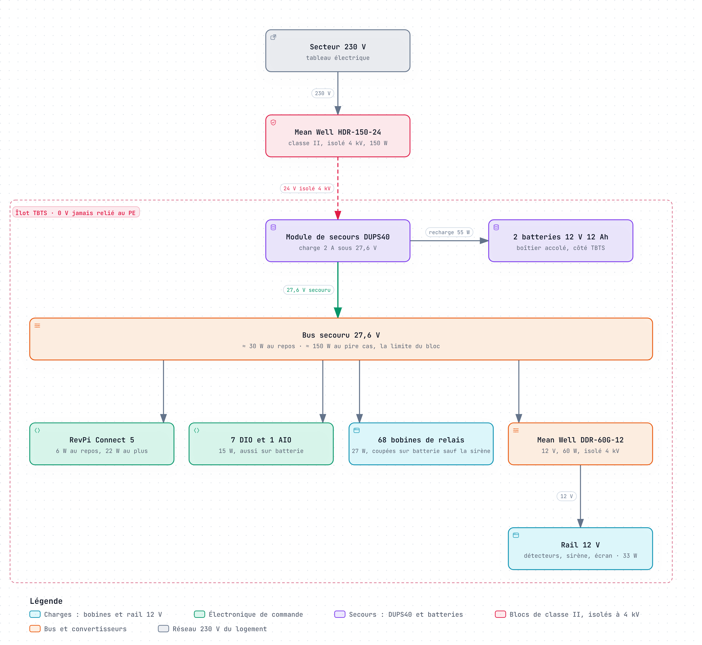
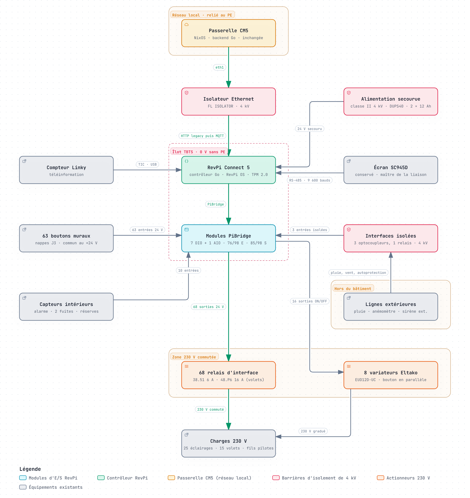
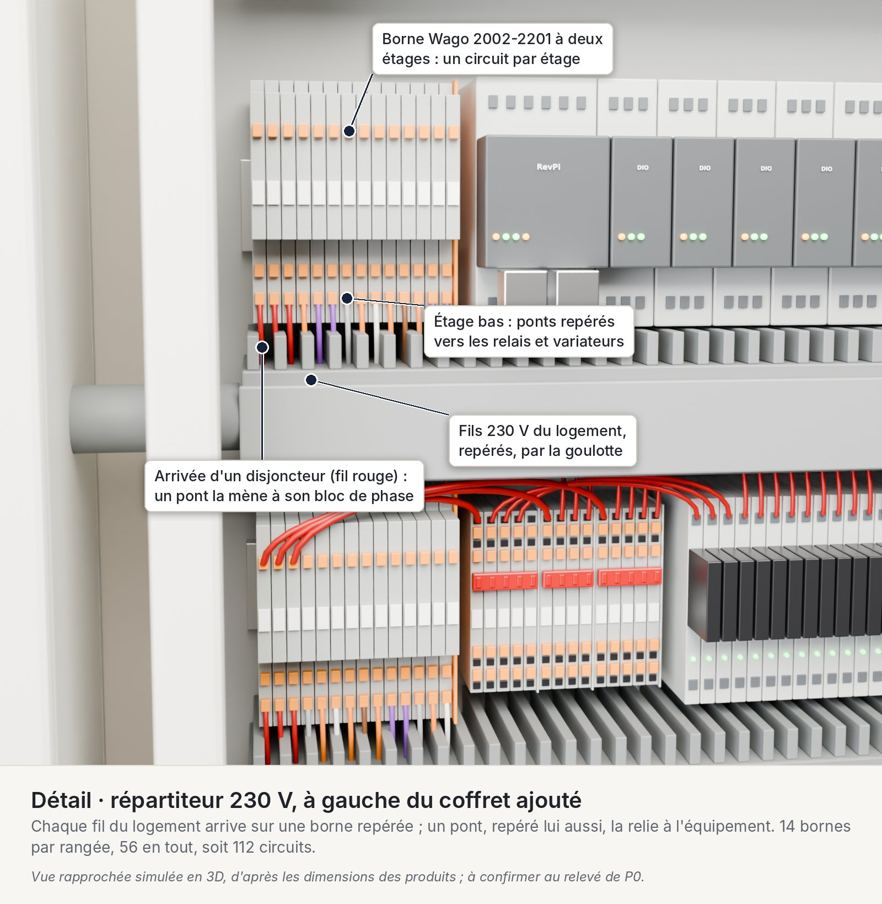
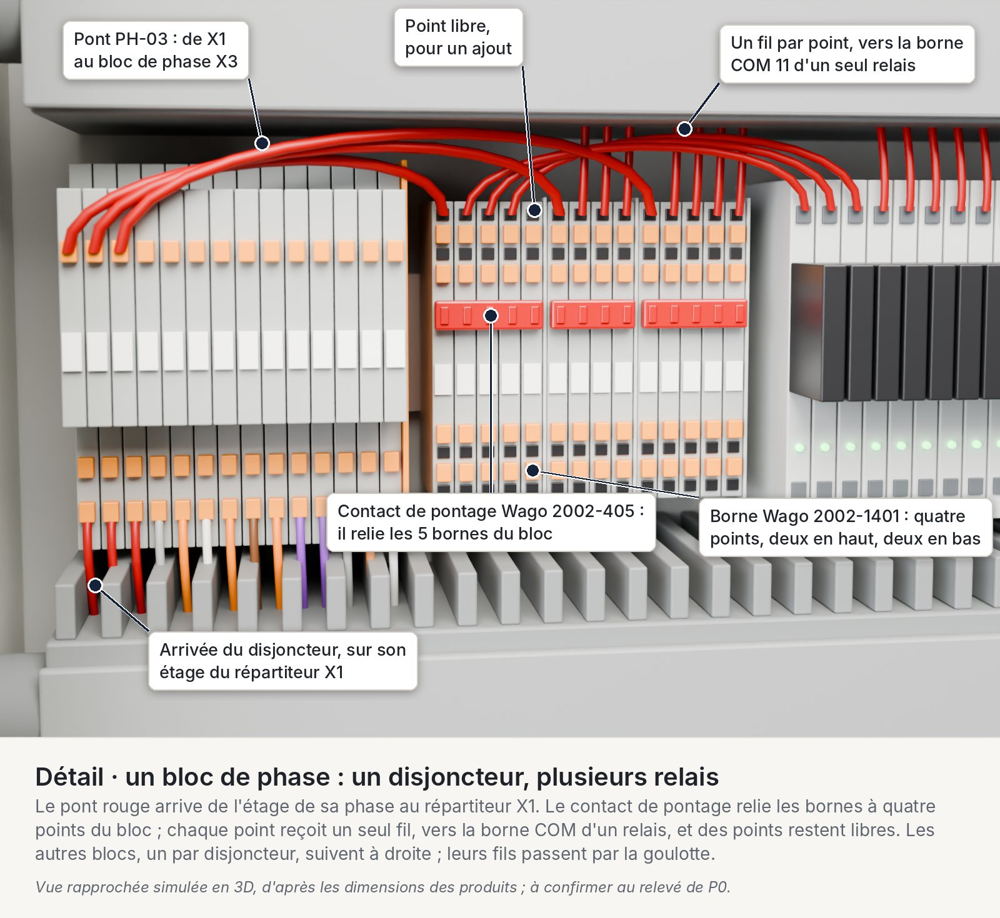
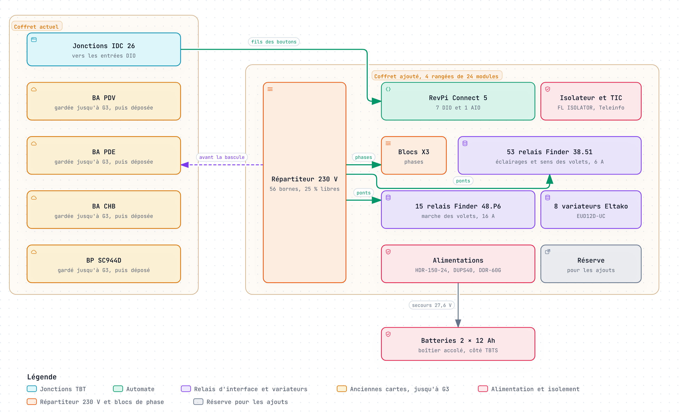
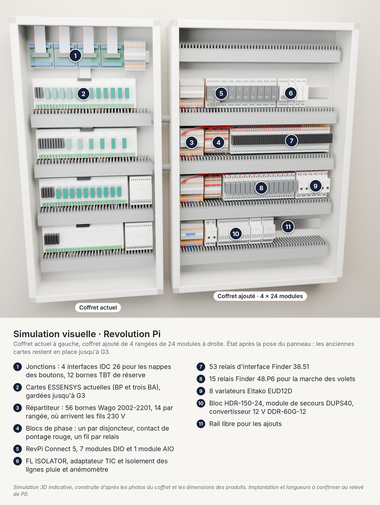
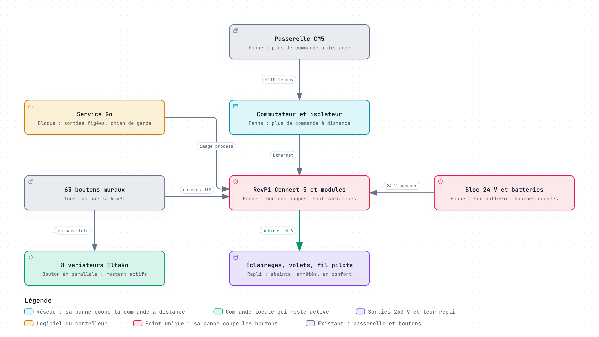
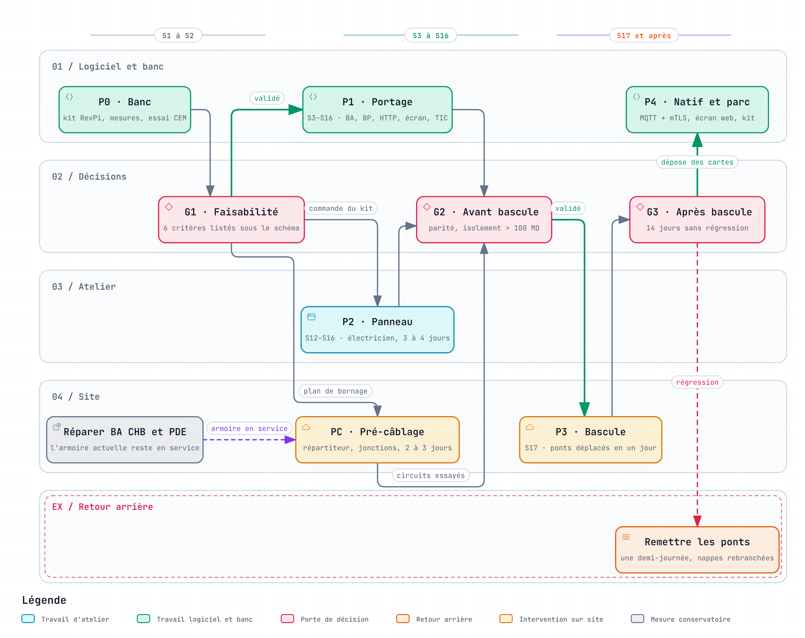

# Étude de remplacement : ESSENSYS → Revolution Pi

Oct 19, 2026 · @Nicolas

## Synthèse

Remplacer l'armoire ESSENSYS par une Revolution Pi est faisable, et le remplacement complet (scénario B) est recommandé. Une Connect 5, 7 modules DIO, 1 AIO, 68 relais d'interface et 8 variateurs Eltako y remplacent les quatre cartes propriétaires. Il faut compter environ 5 450 € HT de matériel, câblage de migration compris, et 13 à 16 semaines-personne de logiciel.

Ce que cela apporte :

- **Fin des points faibles révélés par la foudre** : plus de PIC16F946 ni de bus I2C non isolé, et plus de 230 V sur une carte qui porte de la TBT.
- **Un firmware devenu logiciel Linux** : la table d'échange reste le contrat et la passerelle ne change pas en phase 1. Les évolutions bloquées deviennent possibles : statut réel des relais, Home Assistant, HTTPS.
- **Une identité matérielle et des pièces suivies** : la Connect 5 intègre le TPM 2.0 que recommande la conception PKI de la passerelle, et elle est garantie jusqu'en 2036.
- **Un câblage prêt pour la suite** : les fils passent par un répartiteur et des jonctions repérés, avec 25 % de réserve. La bascule et le retour arrière ne déplacent que des ponts, et 22 entrées et 13 sorties restent libres.

Ce que cela coûte : environ 5 450 € HT de matériel par armoire, dont 42 % pour la RevPi. Le logiciel demande 13 à 16 semaines à temps plein, soit 5 à 7 mois à 20 h par semaine. S'y ajoutent 2 à 3 jours de pré-câblage, l'armoire restant en service, 3 à 4 jours de câblage du panneau et une journée de bascule.

Ce qu'il faut accepter : un seul contrôleur commande tous les circuits. Une panne de la RevPi, de son alimentation ou du service Go prive 25 éclairages et 15 moteurs de volets de leurs boutons. Les parades sont décrites dans la section Modes dégradés.

Décisions à prendre :

- [ ] Retenir le scénario B pour cette armoire
- [ ] Arbitrer les modes dégradés : chien de garde applicatif, secours des éclairages, Connect 5 de rechange
- [ ] Commander le kit de banc P0 (environ 1 120 € HT, réutilisé dans l'armoire, sauf l'alimentation)
- [ ] Lancer la réparation provisoire des BA CHB et PDE
- [ ] Faire poser le répartiteur et les jonctions des nappes, utiles quelle que soit la solution retenue
- [ ] Pendant le projet, appliquer les protections de priorité 1 de l'analyse experte : étoile 0 V N2, PTC et TVS sur le +15 V, FL ISOLATOR devant le BP
- [ ] Faire valider par l'électricien la TBTS, l'alimentation de classe II et les boutons des salles de bains
- [ ] Choisir les variateurs : Eltako EUD12D-UC, local, ou Shelly Pro Dimmer 2PM, en réseau

## Existant ESSENSYS

L'armoire repose sur quatre cartes propriétaires dans un seul coffret : un boîtier principal (BP) et trois boîtiers auxiliaires (BA) chaînés sur un bus I2C à 50 kHz. Depuis la foudre du 9 août 2026, deux BA ne répondent plus (index 12 = 0x18) : 38 relais et 5 variateurs sont hors service.

| Carte | Rôle et cœur | Sorties | Entrées | État oct. 2026 |
| --- | --- | --- | --- | --- |
| SC944D (BP) | Contrôleur, Ethernet, table d'échange ; ColdFire MCF52259, MQX 3.8 | 3 relais (cumulus, prise sécurité, arrosage), coupure machines, 4 TRIAC fil pilote, 2 sirènes | 3 détecteurs alarme, 3 autoprotections, pluie, anémomètre, secteur, 3 réserves ; 2 sondes de fuite ; Linky ; écran | Remplacé, dialogue OK |
| SC940D (BA PDV) | Pièces de vie ; PIC16F946 | 5 relais monostables, 12 bistables (6 volets), 3 variateurs | 20 boutons muraux | Remplacé, répond |
| SC942C (BA CHB) | Chambres ; PIC16F946 | 7 monostables, 10 bistables (5 volets), 4 variateurs | 21 boutons muraux | Muet |
| SC941C (BA PDE) | Pièces d'eau ; PIC16F946 | 13 monostables, 8 bistables (3 volets et le store), 1 variateur | 22 boutons muraux | Muet |

Autour de l'armoire : l'écran tactile SC945D (RS-485 half-duplex à 9 600 bauds, maître de la liaison), la sirène SC946D et les détecteurs de fuite SC947. La passerelle CM5 sous NixOS dessert le segment armoire (eth1, 10.0.1.0/24). Son backend Go traduit le protocole HTTP legacy du BP : polling toutes les 2 s sur une table d'échange de 953 indices.

Chaque BA bascule lui-même ses relais sur un appui de bouton. Le BP lui fournit son alimentation de 15 V, qu'il coupe sur batterie, et lui relaie les ordres distants.

Cinq raisons poussent à remplacer plutôt qu'à réparer :

- **Pièces** : le PIC16F946 est en approvisionnement tendu, et les TVS d'origine (suffixe GS08) ne se commandent plus.
- **Logiciel figé** : les sources du pilote I2C du BP sont perdues, et seul le binaire 099-37 est sûr. La chaîne CodeWarrior / MQX 3.8 n'a pas de build qualifié ; les variateurs SC943 et le SC947 n'existent qu'en .hex.
- **Conception** : bus partagé sans isolement (un nœud mort fait taire les trois BA), BA sans chien de garde, ordres acquittés avant exécution, boutons sans optocoupleur.
- **Sécurité électrique** : sur les BA rév. D, J1/J2 sont estimés à 2 à 3 mm du 230 V (non mesuré), contre 5,5 mm imposés par le schéma du BP.
- **Alternative maison** : la « génération 3 » en RS-485 isolé impose de nouvelles cartes et une couche liaison réécrite dans les firmwares BP et BA. Trames, CRC et couche application restent inchangés.

Sources : [vue d'ensemble matériel](https://github.com/essensys-hub/essensys-doc/blob/main/archi/hardware-overview.md), [incident foudre](https://github.com/essensys-hub/essensys-memory/blob/main/wiki/synthesis/incident-foudre-bus-i2c-2026-08.md), [démarrage BP/BA](https://github.com/essensys-hub/essensys-memory/blob/main/raw/analyses/2026-10-demarrage-bp-ba/analyse.md), [commande locale des BA](https://github.com/essensys-hub/essensys-board-SC940/blob/main/SC940D/Prog/code_ba%20%28fichiers%20sources%201.7%29/source/traitement.c), [ADR 0001](https://github.com/essensys-hub/essensys-board-SC944D/blob/main/docs/adr/0001-generation-3-rs485-isole.md).

## Gamme Revolution Pi 2026

La RevPi Connect 5 (réf. 100412 : 4 Go, 32 Go, RS-485, sans Wi-Fi, 581 € HT) est la base à retenir. C'est la seule base actuelle qui réunit un port RS-485 pour l'écran, un TPM 2.0 pour la PKI, 10 emplacements PiBridge et une disponibilité garantie jusqu'en 2036 au moins.

| Base | Cœur | RS-485 | TPM 2.0 | Modules PiBridge | Prix HT |
| --- | --- | --- | --- | --- | --- |
| [Connect 5](https://revolutionpi.com/de/produkte/revpi-connect-5) | CM5, 4 × Cortex-A76 à 2,4 GHz, 4 ou 8 Go | 1, isolé | Infineon SLB 9670 | 10, soit 5 par côté | 581 €, suppléments compris |
| [Connect 4](https://revolutionpi.com/de/docs/revpi-connect-4) | CM4, 2 à 8 Go | 1 | SLB 9670 | 10 | dès 418 € + suppléments |
| [Connect S / SE](https://revolutionpi.com/de/docs/revpi-connect-s) | CM4S, 1 Go | 1 | Non | 5 à gauche, modules Con à droite | dès 438 / 418 € + suppl. |
| [Core S / SE](https://revolutionpi.com/de/docs/revpi-core-s) | CM4S, 1 Go | Non | Non | 10 | dès 299 / 266 € + suppl. |
| [Flat S](https://revolutionpi.com/de/docs/revpi-flat-s) | CM4S, 1 Go | 2, isolés | SLB 9670 | Aucun (non modulaire) | dès 446 € + suppl. |

Les bases modulaires acceptent 10,8 à 28,8 V continu. La Connect 5 consomme au plus 22 W, typiquement moins de 6 W, et mesure 45 mm de large. Son prix inclut un supplément RAM de 35 €, annoncé comme temporaire, et un supplément eMMC de 10 €, qui ne l'est pas.

La borne de terre fonctionnelle (FE) des bases « peut en général rester non raccordée » selon KUNBUS, ce qui reste compatible avec un coffret TBTS sans PE. KUNBUS conseille toutefois de la raccorder en environnement électromagnétique sévère. La laisser libre réduit l'immunité aux perturbations : l'essai CEM du banc P0 tranchera.

| Module (22,5 mm) | Voies | Caractéristiques utiles | Prix HT |
| --- | --- | --- | --- |
| [DIO](https://revolutionpi.com/fileadmin/downloads/datasheets/Datenblatt_RevPi_DIO.pdf) | 14 entrées et 14 sorties 24 V | Sorties 500 mA protégées, PWM de 40 à 400 Hz, compteur jusqu'à 2 kHz, isolé du bus | 196 € |
| [DI](https://revolutionpi.com/fileadmin/downloads/datasheets/Datenblatt_RevPi_DI.pdf) | 16 entrées 24 V | Type 1/3, compteur jusqu'à 2 kHz | 157 € |
| [DO](https://revolutionpi.com/fileadmin/downloads/datasheets/Datenblatt_RevPi_DO.pdf) | 16 sorties 24 V | 500 mA, une fréquence PWM commune | 170 € |
| [RO](https://revolutionpi.com/fileadmin/downloads/datasheets/Technisches_Datenblatt_RevPi_RO.pdf) | 4 relais à fermeture | 250 V AC, 5 A résistif, 2 A inductif ; homologation UL « prévue » | 153 € |
| [AIO](https://revolutionpi.com/fileadmin/downloads/datasheets/Datenblatt_RevPi_AIO.pdf) | 4 entrées et 2 sorties analogiques, 2 sondes Pt100/Pt1000 | 16 bits, entrées isolées des sorties | 317 € |
| [MIO](https://revolutionpi.com/fileadmin/downloads/datasheets/Datenblatt_RevPi_MIO.pdf) | 8 entrées et 8 sorties 0-10 V, 4 TOR | PWM jusqu'à 2 kHz | 204 € |

La gamme ne couvre pas deux besoins de l'armoire, d'où les relais et variateurs tiers de la section suivante. Les deux derniers points sont des limites générales :

- **relais inverseurs ou bistables** : le RO n'offre que 4 contacts à fermeture, soit 40 relais au plus par base ;
- **TRIAC et variateur 230 V** : aucune sortie de ce type ;
- **KNX et DALI** : aucun module ; le KNX IP passe par CODESYS sous licence payante ;
- **Modbus TCP ou RTU** : seulement en logiciel, comme « appareil virtuel » de PiCtory.

Côté logiciel et support :

- **RevPi OS Trixie 13.0** (Debian 13, noyau 6.18.37) est livré depuis 09/2026 et supporté jusqu'au 30 juin 2030 ; Bookworm l'est jusqu'au 30 juin 2028.
- **piControl** expose l'image process dans /dev/piControl0 ; PiCtory écrit la configuration dans /etc/revpi/config.rsc. Il n'existe pas de bibliothèque Go officielle, seulement un projet communautaire « expérimental », mais l'interface (read, write et ioctl) est courte.
- **Docker** est pris en charge. Aucun portage NixOS n'est connu : il faudrait le noyau RevPi et le module piControl.
- **Pérennité** : KUNBUS garantit la Connect 5 jusqu'en 2036 au moins, et Raspberry Pi produit le CM5 jusqu'en janvier 2036.

La Connect 4 conviendrait aussi, pour environ 450 € avec suppléments, mais sans garantie de disponibilité publiée. Prix : [liste officielle](https://revolutionpi.com/de/bestellen/uebersicht-produkte-und-preise), relevée le 19 octobre 2026.

## Correspondance fonctionnelle

L'armoire compte 76 entrées TOR, 85 sorties TOR et 2 entrées analogiques. La RevPi ne commute jamais le 230 V elle-même : 68 sorties passent par des relais d'interface 24 V et 16 par des variateurs à commande isolée.

| Fonction | Existant | Cible | Entrées | Sorties |
| --- | --- | --- | --- | --- |
| Boutons muraux | 63 contacts secs en 5 V sur 3 nappes J3 (20, 21 et 22) | Entrées 24 V ; nappes reprises par interface IDC 26, commun passé au +24 V | 63 | 0 |
| Éclairage | 25 relais monostables 6 A | Relais d'interface 24 V, 6 A (Finder 38.51, qui embarque le 34.51 des BA) | 0 | 25 |
| Volets et store | 15 moteurs, 30 relais bistables 16 A | « Marche » en 16 A (Finder 48.P6, 0,55 kW de moteur), « sens » en 6 A (38.51) basculé à l'arrêt ; verrouillage câblé | 0 | 30 |
| Variateurs | 8 cartes SC943 sur les BA | 8 Eltako EUD12D-UC : bouton câblé en parallèle, ON et OFF centraux pilotés, réglage selon la configuration de chaque voie (indices 494 à 517) | 0 | 16 |
| Fil pilote | 4 TRIAC synchronisés au secteur | 2 relais et 2 diodes par zone ; Confort −1 et −2 (ECO et ECO+) séquencés en logiciel | 0 | 8 |
| Cumulus, prise sécurité, arrosage, machines | 3 relais et 1 sortie | 4 relais d'interface | 0 | 4 |
| Sirènes | PWM intérieure d'environ 1,7 kHz à 4 niveaux, sortie extérieure | 1 sortie de commande, PWM ou analogique selon l'essai, et 1 relais isolé | 0 | 2 |
| Alarme | 3 détecteurs, 3 autoprotections | Entrées 24 V ; autoprotection de la sirène extérieure par interface isolée | 6 | 0 |
| Pluie et vent | 1 entrée, 1 compteur d'impulsions | 1 entrée, 1 entrée compteur, par interfaces isolées à 4 kV | 2 | 0 |
| Secteur et batterie | Synchro secteur, tension batterie sur ADC | Contacts « décharge batterie » et « défaut batterie » du module de secours DUPS40 | 2 | 0 |
| Réserves BP | 3 entrées | Entrées 24 V | 3 | 0 |
| Fuites | 2 détecteurs actifs SC947, lus sur ADC | 2 entrées analogiques, ou TOR si l'essai le permet | 2 analog. | 0 |
| Linky | UART à 1 200 bauds | Adaptateur TIC USB | — | — |
| Écran SC945D | RS-485 à 9 600 bauds | Port RS-485 de la base | — | — |
| **Total** |  |  | **76 + 2 analog.** | **85** |

Adaptations électriques :

- **Boutons** : seul le commun change, du 0 V au +24 V protégé. Le 24 V reste sous 30 V continu ; son usage en volumes 1 et 2 des salles de bains (§701) est à valider par l'électricien.
- **Isolement 230 V / TBT** : le 230 V ne passe plus sur une carte qui porte de la TBT ; la séparation est celle du relais d'interface (6 kV, 8 mm). Les BA utilisent déjà ce relais, mais J1/J2 y sont estimés à 2 à 3 mm du 230 V (non mesuré).
- **Volets** : « marche » passe sur un relais 16 A (Finder 48.P6, 0,55 kW de moteur), comme les bistables 16 A actuels. « Sens » est un inverseur 38.51 : montée et descente ne peuvent plus être alimentées ensemble. Le logiciel ne bascule « sens » qu'avec « marche » ouvert, après un temps mort. La puissance de chaque moteur reste à relever.
- **Variateurs** : le bouton attaque aussi l'entrée locale de l'Eltako, la gradation fonctionne même RevPi arrêtée. L'Eltako ne renvoie pas son état : le statut réel ne couvre pas ces 8 voies. Alternative : le Shelly Pro Dimmer 2PM (2 voies de 200 W, Ethernet, MQTT, 77,30 € TTC) rend le niveau réglable et lisible à distance. Il ajoute en revanche un appareil 230 V sur le réseau de l'armoire.
- **Frontières du coffret** : chaque liaison qui sort de l'îlot TBTS est isolée à 4 kV eff. au moins, comme le prescrit le retex foudre. Cela vaut pour l'Ethernet (FL ISOLATOR), l'alimentation (bloc de classe II), la TIC (adaptateur à optocoupleur, tenue à vérifier) et les lignes extérieures : pluie, anémomètre, sirène extérieure et son autoprotection. La fiche du FL ISOLATOR annonce 4 kV sans préciser l'essai : la tenue de 60 s est à vérifier.

Sources : [Finder série 38](https://manualmachine.com/finder/3891/8656803-user-manual/), [Finder série 48](https://www.emas.cz/files/1703329/J3fkWmjV/elosos1086851.pdf), [Eltako EUD12D-UC](https://www.eltako.com/fileadmin/downloads/de/_bedienung/EUD12D_21100905-3_dt.pdf), [Shelly Pro Dimmer 2PM](https://www.domadoo.fr/fr/eclairage-connecte/6973-shelly-module-variateur-rail-din-2-canaux-wi-fi-avec-mesure-d-energ-3800235268179.html), [entrées BA](https://github.com/essensys-hub/essensys-board-SC940), [FilPilote.c](https://github.com/essensys-hub/client-essensys-legacy/blob/main/C/FilPilote.c), [commande de la sirène (Hard.c)](https://github.com/essensys-hub/client-essensys-legacy/blob/main/C/Hard.c), [détecteur de fuite SC947](https://github.com/essensys-hub/essensys-memory/blob/main/raw/architecture/repos/essensys-board-SC947-xB.md), [configuration des variateurs](https://github.com/essensys-hub/essensys-doc/blob/main/archi/exchange-table.md), [protection surtensions](https://github.com/essensys-hub/essensys-doc/blob/main/docs/install/protection-surtensions.md), [FL ISOLATOR](https://www.phoenixcontact.com/en-nz/products/network-isolator-fl-isolator-100-rjrj-2313931).

## Alimentation et autonomie

L'armoire passe sur un bloc 24 V de classe II isolé à 4 kV, un module de secours et un convertisseur 12 V isolé. Le DRC-100B envisagé d'abord est écarté : sa sortie n'est isolée de la terre qu'à 0,5 kV, alors que le retex demande 4 kV aux autres frontières du coffret.

Le BP fournit aujourd'hui le 12 V des détecteurs, des sirènes et de l'écran. La sirène SC946D a un amplificateur de 25 W spécifié de 8 à 26 V : elle ne supporterait pas les 27,6 V du bus secouru. Le Mean Well DDR-60G-12 (12 V, 60 W, isolement renforcé de 4 kV continu) fournit donc ce rail.

| Poste | Repos (W) | Pire cas (W) | Sur batterie (W) | Base du calcul |
| --- | --- | --- | --- | --- |
| Connect 5 | 6 | 22 | 6 | fiche Connect 5 |
| 7 DIO et 1 AIO | 15 | 15 | 15 | 1,5 W par DIO, 4,8 W pour l'AIO |
| 68 bobines de relais | 3 | 27 | 0 | 0,25 W (38.51) ou 0,5 W (48.P6) sous 24 V, + 32 % sous 27,6 V ; repos estimé |
| Rail 12 V : détecteurs, sirène, écran | 5 | 33 | 5 | sirène de 25 W en alarme, rendement de 88 % ; repos estimé |
| Recharge des batteries | 0 | 55 | — | DUPS40, 2 A sous 27,6 V |
| Total | ≈ 30 | ≈ 150 | ≈ 26 |  |

Le pire cas réunit l'alarme, les 68 bobines, le processeur au maximum et la recharge : il atteint les 150 W du Mean Well HDR-150-24. Le logiciel l'évite en différant les mouvements groupés de volets pendant une alarme ou une recharge, ce qui retire environ 15 W. Si la mesure du banc confirme ce pire cas, l'armoire passe sur deux blocs HDR-150-24 comme dans les études Opta et Raspberry Pi : bus secouru pour la RevPi et le rail 12 V, bus secteur pour les 68 bobines.

Sur batterie, le contrôleur coupe toutes les bobines, sauf celle du relais de la sirène extérieure, puisque les charges 230 V n'ont plus de secteur. L'autonomie visée est de 8 h hors alarme, une nuit de coupure : 2 batteries de 12 V 12 Ah la donnent en utilisant 70 à 75 % de leur capacité (estimation à mesurer en P0).

Le HDR-150-24, sans borne de terre, se pose dans le coffret. Le DUPS40, le convertisseur 12 V et les batteries sont côté TBTS, 0 V non relié au PE ; les batteries vont dans un boîtier accolé au coffret. La passerelle et le commutateur réseau ont leur propre alimentation, à secourir aussi pour que les alertes partent pendant une coupure.

{ loading=lazy }

Lecture : le secteur alimente un seul bloc HDR-150-24 de classe II, isolé à 4 kV, qui marque l'entrée de l'îlot TBTS. Le module DUPS40 et ses deux batteries tiennent le bus secouru de 27,6 V. Ce bus alimente la Connect 5, ses modules, les 68 bobines et le convertisseur DDR-60G-12 du rail 12 V. Au pire cas, il atteint les 150 W du bloc ; sur batterie, les bobines sont coupées, sauf celle de la sirène extérieure, et il reste environ 26 W. La version interactive du schéma, générée par Archify, accompagne l'étude.

Sources : [HDR-150](https://www.meanwell.com/Upload/PDF/HDR-150/HDR-150-SPEC.PDF), [DRC-100B](https://www.meanwell.com/catalog/product/files/basic-html/page92.html), [DUPS40](https://www.power-supplies-australia.com.au/mean-well-dups40-ups-module), [DDR-60G-12](https://befr.rs-online.com/web/p/dc-dc-converters/1757796), [AIO](https://revolutionpi.com/en/docs/revpi-aio), [sirène SC946D](https://github.com/essensys-hub/essensys-memory/blob/main/raw/architecture/repos/essensys-board-SC946D.md), [alimentation du BP](https://github.com/essensys-hub/essensys-doc/blob/main/archi/hardware-sc944d.md).

## Architectures cibles

Le scénario B est recommandé : c'est le seul qui supprime à la fois les BA défaillants, le PIC16F946 et le bus I2C. Le scénario A coûte environ 3 300 € de moins en matériel, mais garde les BA et leurs faiblesses : PIC16F946, bus I2C non isolé, isolement non démontré.

A ne se défend donc que comme étape, sur une armoire aux BA sains et risques acceptés. Il demande un pont USB-I2C isolé, par exemple un MCP2221A suivi d'un ISO1640, et la réparation des BA. La taille du parc à équiper, qui amortit le logiciel, reste à préciser.

| Critère | A. BP de substitution | B. Remplacement complet | C. B et passerelle fusionnée |
| --- | --- | --- | --- |
| Périmètre | La Connect 5 remplace le SC944D ; les 3 BA restent, derrière un pont USB-I2C isolé | Connect 5, 7 DIO, 1 AIO, relais et variateurs remplacent les 4 cartes | Comme B, et la Connect 5 porte aussi la pile de la passerelle |
| Panne des BA CHB et PDE | Non résolue | Résolue | Résolue |
| PIC16F946 et bus I2C | Conservés | Supprimés | Supprimés |
| Recâblage | Côté BP seulement | 90 fils 230 V par le répartiteur, 4 nappes par des jonctions | Comme B |
| Logiciel | Logique BP et maître I2C à écrire | Logiques BP et BA | Comme B, plus la pile NixOS à refaire sur RevPi OS |
| Matériel HT | ≈ 2 140 €, plus la réparation des BA | ≈ 5 450 € | ≈ 5 450 €, sans passerelle à fournir |
| Verdict | Étape possible sur des BA sains, risques acceptés | **Recommandé pour cette armoire** | Plus tard, pour une installation neuve |

{ loading=lazy }

Lecture : chaque liaison qui sort de l'îlot TBTS franchit une barrière de 4 kV (en rose), et le 230 V ne passe que par les relais et les variateurs. La version interactive du schéma, générée par Archify, accompagne l'étude.

La passerelle CM5 et ses services restent en place : la RevPi prend l'adresse du BP sur le segment eth1 et parle d'abord le protocole HTTP legacy. La réservation DHCP passe sur l'adresse MAC de la RevPi, qui reprend aussi la clé d'accès distant de 16 octets du BP. Le scénario C attendra : aucun portage NixOS n'existe pour la RevPi, et le boîtier mêlerait services exposés à Internet et pilotage des sorties.

## Câblage de migration et évolutivité

Aujourd'hui, les fils du logement arrivent directement sur les bornes des cartes, et les boutons sur leurs nappes. Changer d'équipement oblige à reprendre chaque fil, et revenir en arrière aussi. Le câblage de migration sépare ces fils de l'équipement qui les pilote. Il est commun aux trois études, et peut être posé avant même de choisir.

{ loading=lazy }

Lecture : les fils 230 V arrivent sur un répartiteur, sur le côté droit ; les nappes arrivent sur des jonctions, en haut. Des ponts repérés relient ces bornes à l'équipement : d'abord aux anciennes cartes, puis à la Revolution Pi. La version interactive du schéma, générée par Archify, accompagne l'étude.

Ce qu'il faut poser :

- **Répartiteur 230 V, à droite (coffret ajouté, ou côté droit du coffret actuel si le relevé de P0 le permet)** : chaque fil existant quitte sa carte pour une borne repérée. Cela concerne les 63 départs des BA, les 8 départs du BP, une douzaine de phases d'alimentation et jusqu'à 7 neutres du BP, soit environ 90 fils. Les fils en place sont en H07V-U 1,5 mm² rigide, que des bornes à poussoir reçoivent tels quels. La phase de chaque disjoncteur est ensuite répartie vers les relais par un bloc de phase (voir plus bas).
- **Jonctions des nappes, en haut** : les quatre nappes IDC 26 arrivent par le haut, sur les J3 des trois BA et du BP. Un second connecteur, serti sur chaque nappe, la relie à une interface IDC 26 vers bornes. L'ancienne carte reste branchée sur le connecteur d'origine jusqu'à la bascule.
- **Tensions séparées** : la TBT en haut, le 230 V sur le côté droit, avec des goulottes distinctes. L'analyse experte demande aussi, en priorité 1, d'éloigner les nappes des bornes de phase.
- **Réserve** : 25 % de bornes libres au répartiteur, soit une vingtaine de circuits, et 12 bornes TBT à deux étages libres près des jonctions, soit 24 circuits. Les conducteurs inutilisés des nappes arrivent aussi sur bornes.
- **Repérage** : chaque fil, borne et pont porte le même repère, reporté dans un plan de bornage tenu à jour dans essensys-doc.

| Élément | Quantité | Place sur rail | Prix HT |
| --- | --- | --- | --- |
| Bornes à poussoir à deux étages, 2,5 mm² (Wago 2002-2201) : 90 fils et 25 % de réserve | 56 | ≈ 0,3 m, côté droit | ≈ 99 € |
| Interfaces IDC 26 vers bornes, 50 V et 1 A (RS PRO) | 4 | ≈ 0,3 m, en haut | 256 € |
| Bornes TBT à deux étages, en réserve | 12 | ≈ 6 cm, en haut | ≈ 21 € |
| Embouts, cloisons, butées, repères, connecteurs IDC à sertir, contacts de pontage bleus des neutres (/000-006) | — | — | ≈ 55 € (estimation) |
| Fil H07V-K 1,5 mm² et embouts de câblage pour les ponts | — | — | ≈ 40 € (estimation) |
| Total |  | ≈ 0,65 m | ≈ 470 € |

Connecteurs retenus, les mêmes dans les trois études :

| Connecteur | Rôle | Référence |
| --- | --- | --- |
| Borne de passage à deux étages, à poussoir, 2,5 mm², 5,2 mm de large | Répartiteur : chaque étage reçoit un circuit, le fil du logement d'un côté, le pont repéré de l'autre. 56 bornes, soit 112 circuits | [Wago 2002-2201](https://buerklin.com/en/p/wago/series-terminals/2002-2201/09H4322) |
| Interface IDC 26 vers bornes à vis, sur rail DIN, 50 V et 1 A | Jonction : reçoit la nappe des boutons d'une zone et ramène ses 26 conducteurs sur bornes. Une par nappe, soit 4 | [RS PRO 403-320](https://befr.rs-online.com/web/p/interface-modules/0403320) |
| Connecteur IDC 26 femelle, pas de 2,54 mm, pour nappe au pas de 1,27 mm, avec serre-câble | Second connecteur serti sur chaque nappe : l'interface se branche sans débrancher l'ancienne carte | [3M 3399-6026](https://fr.rs-online.com/web/p/connecteurs-idc/8280403) |

{ loading=lazy }

{ loading=lazy }

Lecture : les deux vues rapprochées montrent les connecteurs retenus en place, en haut du coffret actuel pour les nappes et à gauche du coffret ajouté pour le répartiteur ; les ponts et les repères sont ceux du plan de bornage.

### Repiquer une phase sur plusieurs relais

Un disjoncteur du tableau alimente toujours plusieurs relais. Sur les BA, les relais d'un même groupe ont leur commun relié sur le circuit imprimé, et ce commun sort sur deux bornes P : la phase arrive sur l'une et repart vers le groupe suivant par l'autre, avec un fil rouge. C'est le repiquage. Les schémas « Borniers » des cartes comptent 10 groupes sur le BA PDV, 13 sur le BA CHB et 14 sur le BA PDE, pour 63 sorties ; le BP reçoit trois phases (alimentation, fil pilote, arrosage) et jusqu'à sept neutres, reliés sur sa carte.

{ loading=lazy }

Lecture : chaque groupe a deux bornes P reliées sur la carte, ici J14 et J15 ; le trait sérigraphié montre le commun des deux relais du groupe. Les fils rouges repiquent la phase d'un groupe au suivant, et le groupe des volets reçoit la sienne par un autre fil, blanc. Les fils orange et violets partent vers les luminaires, la prise commandée et le volet.

Avec la Revolution Pi, aucune carte ne relie plus les communs : chaque relais d'interface a sa propre borne COM (11), et les peignes Finder des supports 93.01 ne relient que les bornes de bobine A1 ou A2. Des bornes Wago pontées répartissent donc la phase, dans un bloc de phase par disjoncteur, noté X3, au début des rangées de relais.

{ loading=lazy }

Lecture : à gauche, la phase passe d'une borne P à l'autre sur les cartes. À droite, elle arrive sur son étage du répartiteur X1 ; un pont la mène à son bloc X3, où un contact de pontage relie quelques bornes à quatre points, et chaque point donne un fil à un seul relais. La version interactive du schéma, générée par Archify, accompagne l'étude.

Comment un bloc Wago repique la phase :

1. **Un bloc par disjoncteur** : la phase garde son étage au répartiteur X1, repéré PH-03 par exemple. Un pont la conduit au bloc PH-03 du panneau.
2. **Un contact de pontage** : le bloc réunit quelques bornes de passage à quatre points, Wago 2002-1401, de la même série que le répartiteur mais à un seul étage. Un contact de pontage Wago de 2 à 10 raccords (2002-402 à 2002-410, 25 A, en rouge avec le suffixe /000-005) s'enfonce dans leur fente de pontage : toutes portent la phase.
3. **Un fil par point** : chaque borne a quatre points à poussoir, deux en haut et deux en bas. Le pont venu de X1 prend le premier ; chaque autre point reçoit un seul fil, vers la borne COM d'un relais 38.51 ou 48.P6, ou l'entrée L d'un variateur ou du bloc 24 V. Au moins un point reste libre pour un ajout.
4. **Un repère par fil** : « PH-03.2 → K12:11 » se lit « bloc PH-03, point 2, vers la borne 11 du relais K12 ». Le plan de bornage tient ces listes.

Un fil par relais, plutôt qu'un repiquage de relais en relais, permet de retirer un relais sans couper les suivants et d'essayer chaque fil seul. Aucune borne de relais ne porte plus le courant de tout le groupe.

Règles, à faire valider par l'électricien :

- **Jamais deux disjoncteurs dans un bloc** : relier deux blocs mettrait deux disjoncteurs en parallèle ; un fil du bloc pourrait alors porter la somme de leurs calibres sans qu'aucun ne déclenche, et couper l'un ne mettrait plus le bloc hors tension. Un bloc ne sert que les circuits de son disjoncteur actuel, relevés en P0.
- **Courants** : les fils en place et les ponts sont en 1,5 mm², que la NF C 15-100 protège par un disjoncteur de 16 A au plus, sous les 24 A de la borne et les 25 A du contact de pontage. Le calibre de chaque disjoncteur qui alimente l'armoire est à vérifier en P0 : un circuit en 20 A demanderait du 2,5 mm² de bout en bout.
- **Même disjoncteur** : un circuit prend sa phase et son neutre sur le même disjoncteur phase-neutre, donc sous le même interrupteur différentiel. Un neutre pris sur un autre circuit fait déclencher le différentiel, ou n'est plus coupé avec sa phase.
- **Neutres** : les neutres du BP arrivent sur X1, chacun avec la phase de son circuit : N\_ALIM (alimentation et bobines des contacteurs, quatre bornes), N\_FP (fil pilote) et N\_EV (électrovanne, deux bornes). Un contact de pontage bleu (suffixe /000-006) ne relie que les bornes d'un même neutre ; ces trois neutres restent séparés. Le bloc 24 V prend sa phase sur PH\_ALIM et son neutre sur N\_ALIM. Les BA n'ont pas de borne de neutre : si la notice des Eltako demande le neutre, il faudra l'amener de la borne N du disjoncteur de chaque circuit concerné.

Pendant la migration :

- **Pré-câblage** : le fil du disjoncteur quitte la borne P de la carte pour son étage de X1, et un pont le ramène sur la même borne P. Les repiquages des cartes ne bougent pas.
- **Bascule** : un seul pont par disjoncteur passe de la carte au bloc X3, câblé vers les relais avec le panneau et resté hors tension jusque-là.
- **Retour arrière** : ces ponts reviennent sur les cartes.

{ loading=lazy }

Lecture : le pont rouge arrive de X1, le contact de pontage relie cinq bornes à quatre points, trois fils partent vers les premiers relais, et des points restent libres ; les autres blocs suivent, et leurs fils passent par la goulotte. Vue simulée en 3D, à confirmer au relevé de P0.

Pour la Revolution Pi, cela fait 61 fils de phase : 25 relais d'éclairage, 15 relais de marche des volets, 8 relais de fil pilote, 4 relais d'options, 8 variateurs et le bloc 24 V. Les relais de sens prennent la phase sur la marche de leur volet. Avec une douzaine de blocs, il faut environ 24 bornes à quatre points et 12 contacts de pontage : environ 90 € HT et 13 cm de rail.

Sources : [schémas des BA, feuille Borniers](https://github.com/essensys-hub/essensys-board-SC940), [schéma du BP](https://github.com/essensys-hub/essensys-board-SC944D), [fiche Wago 2002-2201 et ses accessoires](https://www.alldataresource.com/assets/Wago_Corporation/Wago-Corporation-2002-2201-Double-Deck-Terminal-Block-Specification-Sheet.pdf), [borne à quatre points Wago 2002-1401](https://buerklin.com/en/p/wago/series-terminals/2002-1401/09H4219), [contact de pontage Wago 2002-410](https://www.wago.com/ch-fr/bornes-sur-rail/contact-de-pontage/p/2002-410), [contacts de pontage pour la série 2002](https://uk.rs-online.com/web/p/din-rail-terminal-accessories/5076591), [version rouge 2002-410/000-005](https://www.rowse-automation.co.uk/wago-2002-410-000-005), [version bleue 2002-402/000-006](https://uk.rs-online.com/web/p/din-rail-terminal-accessories/2783244), [peigne Finder 093.20.1, bornes A1 ou A2](https://buerklin.com/en/p/finder/relays-accessories/093-20-1/34G1079), [notice Eltako EUD12D, entrées séparées du 230 V](https://www.eltako.com/fileadmin/downloads/de/_bedienung/EUD12D_21100905-3_dt.pdf), [calibres de la NF C 15-100](https://hager.com/fr/normes/nfc-15-100/disjoncteur).

{ loading=lazy }

Lecture : à gauche, le coffret tel qu'il est. Chaque carte reçoit sa nappe par le haut et ses fils 230 V par le bas, et le côté droit n'a qu'environ 4 cm libres. À droite, le même coffret après le pré-câblage : les jonctions occupent le haut, les fils passent par le répartiteur du coffret accolé, et des ponts les ramènent aux cartes, toujours en service. La version interactive du schéma, générée par Archify, accompagne l'étude.

Le coffret supplémentaire, accolé à droite du coffret actuel, reçoit le répartiteur, les blocs de phase et le panneau, soit environ 1,65 m de rail : quatre rangées de 24 modules suffisent, avec peu de marge. Les jonctions restent en haut du coffret actuel, et les cartes en place jusqu'à G3 ; leur dépose libère ensuite ce coffret pour les ajouts. Le relevé de P0 dit si le côté droit du coffret actuel peut recevoir le répartiteur.

{ loading=lazy }

Lecture : le coffret ajouté reçoit le répartiteur contre le coffret actuel, puis les rangées de la RevPi, des blocs de phase et des relais, des variateurs et des alimentations ; une petite réserve reste libre. Le coffret actuel garde les jonctions en haut et les quatre cartes jusqu'à G3. Les batteries vont dans un boîtier accolé. Implantation indicative, à confirmer au relevé de P0.

{ loading=lazy }

Lecture : simulation 3D d'après les photos du coffret et les dimensions des produits, après la pose du panneau ; les fils rouges partent des blocs de phase vers chaque relais. Les anciennes cartes restent en place jusqu'à G3 ; l'implantation exacte sera fixée au relevé de P0.

Déroulement :

1. **Relevé et plan, en P0** : place libre sur le côté droit et en haut, longueur des fils, plan de bornage.
2. **Pré-câblage, 2 à 3 jours d'électricien, armoire en service** : chaque fil passe sur sa borne, un pont le relie à l'ancienne carte, et le circuit est essayé. La phase de chaque disjoncteur revient par un pont sur la borne P qu'elle quittait ; les repiquages des cartes ne bougent pas. Le second connecteur des nappes est serti et branché sur sa jonction.
3. **Bascule, une journée** : les ponts passent sur les relais de la Revolution Pi, chaque phase sur son bloc de phase, les nappes quittent les anciennes cartes, et les bornes des jonctions, déjà câblées vers les entrées DIO pendant le câblage du panneau, sont mises en service en fermant le commun des boutons, resté ouvert jusque-là. Pendant cette journée, le logement n'a ni boutons, ni écran, ni alarme, ni fil pilote : prévenir les occupants, choisir une journée hors période de chauffe, prévoir un éclairage d'appoint.
4. **Retour arrière, une demi-journée** : les ponts reviennent sur les anciennes cartes, qui restent en place jusqu'à G3, et les nappes se rebranchent une fois rouvert le commun des boutons.

{ loading=lazy }

Lecture : chaque circuit a un seul repère, porté par sa borne 230 V au répartiteur X1 et par la borne de son bouton à la jonction X2. Les tables suivent l'ordre éclairages, variateurs, volets ; les phases, les neutres du BP et la réserve complètent les 112 circuits du répartiteur ; chaque bloc de phase a sa table, comme l'exemple PH-03. Le brochage J3 de chaque bouton et les phases restent à relever en P0. La version interactive du schéma, générée par Archify, accompagne l'étude.

Évolutivité : aujourd'hui, le brochage des BA est figé dans le code (881 lignes de hard.h), le bus I2C ne connaît que trois BA, et chaque ajout demande de reprendre une carte. Avec la Revolution Pi et ce câblage, un ajout se résume à une borne, un pont, un fil de phase et une ligne de configuration. Le neutre d'un nouveau départ se prend sur son circuit, hors de l'armoire, dans la limite de 8 points d'éclairage par circuit.

| Ajout | Comment | Capacité libre |
| --- | --- | --- |
| Un éclairage ou un volet | Relais d'interface sur le rail, sortie DIO libre, pont au répartiteur, fil de phase sur un point libre de son bloc | 13 sorties ; 2 emplacements pour des DIO de plus, de 14 entrées et 14 sorties chacun |
| Un bouton ou un capteur | Borne TBT de réserve vers une entrée DIO libre | 22 entrées |
| Une zone ou un bâtiment | Modules déportés en Modbus TCP, ou seconde base, derrière un isolateur | Au-delà des 10 modules de la Connect 5 |
| Une commande à distance | Table de correspondance du service Go, modifiée sans recompiler ; MQTT et Home Assistant en phase P4 | — |

Sources : [interface IDC 26 RS PRO](https://befr.rs-online.com/web/p/interface-modules/0403320), [borne Wago 2002-2201](https://buerklin.com/en/p/wago/series-terminals/2002-2201/09H4322), [nappes J3 du BP et des BA](https://github.com/essensys-hub/essensys-doc/blob/main/archi/hardware-overview.md), [cheminement des nappes dans l'analyse experte](https://github.com/essensys-hub/essensys-doc/blob/main/docs/retex/foudre-2026/analyse-experte.md).

## Modes dégradés

Le scénario B concentre la commande sur un seul contrôleur : sa panne coupe les boutons de 25 éclairages et de 15 moteurs de volets. Seuls les 8 variateurs Eltako restent commandables, grâce au bouton câblé en parallèle.

Aujourd'hui, un BP planté ne prive pas les pièces de leurs boutons, puisque chaque BA bascule ses relais lui-même. Seule la perte de l'alimentation du BP coupe tout.

{ loading=lazy }

Lecture : la RevPi et son bloc 24 V sont les deux points uniques, en rose : la panne de l'un ou de l'autre coupe les boutons des 25 éclairages et des 15 volets. Seuls les 8 variateurs Eltako restent commandables, grâce au bouton câblé en parallèle, tant que la tension de commande de leur entrée locale est présente (24 V du bloc ou 230 V, à fixer en P0). La passerelle et le commutateur ne coupent que la commande à distance. Si la RevPi s'arrête, les sorties retombent dans la matrice de repli : lumières éteintes, volets arrêtés, radiateurs en confort. La version interactive du schéma, générée par Archify, accompagne l'étude.

Deux pannes se distinguent :

- **Contrôleur arrêté ou bus PiBridge muet** : les sorties DIO retombent à 0 après 50 ou 500 ms selon la version logicielle. Lumières éteintes, volets arrêtés, fil pilote sans signal, donc radiateurs en confort.
- **Service Go bloqué, piControl actif** : les sorties restent figées dans leur dernier état. Seul un chien de garde applicatif les ramène à la matrice de repli.

Parades à arbitrer en G1 :

- **Chien de garde applicatif** : systemd redémarre le service Go s'il ne signale plus sa vie ; entre-temps, un superviseur applique la matrice de repli.
- **Secours des éclairages** : télérupteurs 24 V commandés en parallèle par les boutons, ou relais à forçage manuel, au moins pour les pièces de passage. Chiffrage à faire.
- **Connect 5 de rechange** : celle du kit de banc, avec une configuration versionnée, s'échange en moins d'une heure (estimation).
- **Matrice de repli** : l'état de chaque sortie à l'arrêt du contrôleur est validé pièce par pièce avant G2.

Sources : [commande locale des BA](https://github.com/essensys-hub/essensys-board-SC940/blob/main/SC940D/Prog/code_ba%20%28fichiers%20sources%201.7%29/source/traitement.c), [fiche DIO](https://revolutionpi.com/fileadmin/downloads/datasheets/Datenblatt_RevPi_DIO.pdf).

## Migration logicielle

Le firmware des quatre cartes devient un seul service Go sur la RevPi, qui lit et écrit l'image process piControl. La table d'échange de 953 indices reste le contrat avec l'écran et la passerelle : en phase 1, rien ne change côté serveur.

| Bloc | Aujourd'hui | Sur RevPi |
| --- | --- | --- |
| Logique BP | C sur MQX, environ 6 000 lignes métier : alarme, chauffage et fil pilote, scénarios, arrosage, réveil, téléinfo, écran | Porté en Go, fichier par fichier, avec le C comme spécification |
| Logique BA | C v1.7 sur PIC, environ 4 800 lignes dont 900 de brochage : anti-rebond, appui long, double clic, temporisation des volets, extinction automatique | Porté en Go dans le même service |
| Table d'échange | Secteur Flash 0x7E000 (RWS) et EEPROM SPI | Fichier écrit de façon atomique, mêmes droits par indice |
| Contenu de la table : horaires, scénarios, réglages des variateurs, codes | Lu dans le BP 099-37 par mystatus | Exporté avant la bascule, importé dans le fichier, relu scénario par scénario en G2 ; sauvegarde quotidienne vers la passerelle, restauration essayée en G2 |
| Bus BA | Pilote I2C aux sources perdues, CRC-16, 5 codes de trame | Supprimé : sorties pilotées en direct |
| Mises à jour | OTA S19, binaire 099-37 seul flashable | Paquet ou conteneur versionné, déployé par Ansible |

Le portage lève le verrou actuel « jamais de nouveau build du BP ». Les propositions firmware v2 (statut réel, intégration Home Assistant, HTTP moderne) deviennent du logiciel Linux ordinaire.

| Interface | Phase 1 : compatibilité | Phase P4 : natif |
| --- | --- | --- |
| Passerelle | Client HTTP legacy, « BP virtuel » : myactions, mystatus, done ; acquittement envoyé **après** exécution | MQTT sur la Mosquitto de la passerelle, états retenus, mTLS |
| Écran SC945D | Serveur du protocole RS-485 existant (trames 0x0F à 0xAA, XOR) | Écran web sur tablette |
| Linky | TIC lue par un adaptateur USB | Inchangé |
| Supervision | Métriques Prometheus, santé de chaque module | Alertes par module dans Alertmanager |

Points de vigilance du portage :

- **Fil pilote** : le code FilPilote.c fait foi, pas la doc. OFF = alternance positive, CONFORT = aucun signal, HORS GEL = alternance négative, ECO++ = onde complète (Éco du GIFAM). ECO et ECO+ sont les ordres Confort −1 et −2 du GIFAM : onde complète pendant 3 s ou 7 s toutes les 300 s. Seul écart propre à Essensys : un hors-gel de 500 ms forcé au passage d'ECO ou ECO+ vers CONFORT, et entre modes ECO.
- **États de repli** : la matrice de repli et le chien de garde applicatif sont décrits dans la section Modes dégradés.
- **Chien de garde** : watchdog matériel, systemd et chien de garde applicatif, là où les BA actuels n'en ont aucun.
- **Parité** : rejouer sur banc les ordres du backend et les traces de l'espion I2C, puis comparer la table d'échange du BP 099-37 et celle du contrôleur, scénario par scénario.

Effort estimé par cette étude : 13 à 16 semaines-personne à temps plein, hors câblage du panneau. Le détail : E/S et table d'échange 2, logique BA 2, domaines BP 4 à 5, HTTP legacy et MQTT 2 (MQTT est développé avant la bascule et activé en P4), écran RS-485 1 à 2, banc et parité 2 à 3.

Deux autres voies existent. Réhéberger le C sous Linux avec une couche MQX simulée accélère la parité mais garde la dette ; CODESYS et Node-RED sortent de la pile Go du projet.

## Sécurité et PKI

La Connect 5 embarque un TPM 2.0, l'Infineon SLB 9670 : l'armoire peut enfin porter une identité matérielle. La conception PKI de la passerelle recommande ce type de TPM sur bus SPI, sans l'avoir encore implémenté. Aujourd'hui, le BP parle en HTTP clair sur le port 80, avec une authentification Basic à base de MD5.

| Sujet | Aujourd'hui | Avec la RevPi |
| --- | --- | --- |
| Identité de l'armoire | MAC et clé de 16 octets en EEPROM | Clé IDevID générée dans le TPM, certificat LDevID émis par step-ca, URI SPIFFE |
| Lien eth1 | HTTP clair, MD5 en Basic | Phase 1 : HTTP legacy, pare-feu limité à la passerelle. Phase P4 : MQTT sur TLS, certificat client, ACL par sujet |
| Migration de l'authentification | Hors périmètre de la PKI passerelle | Mêmes trois phases que la passerelle : jeton, mTLS optionnel, mTLS strict |
| Administration | Console Espion série, mot de passe d'activation figé dans le code | SSH par clé ; Cockpit, PiCtory et Node-RED coupés en exploitation |
| Suivi des failles | Aucun | Avis KUNBUS publiés en CSAF, 5 en 2026 |

Points à retenir :

- **Démarrage sécurisé** : annoncé sur la page produit, mais KUNBUS indiquait en avril 2025 ne pas le prendre en charge. L'outil de Raspberry Pi grave la clé en OTP, de façon irréversible : rien à activer avant qualification.
- **Interfaces web** : les avis de 2025 portaient sur un contournement d'authentification de PiCtory et sur l'intégration Node-RED sans authentification ; ceux du 12 août 2026 sur le module piControl. On configure sur banc, on versionne config.rsc, et l'armoire n'expose aucune page web.
- **Socle** : RevPi OS active par défaut firewalld, TLS 1.3 seul et un verrouillage après 3 échecs de connexion ; chaque image passe un test d'intrusion externe.
- **Cyber Resilience Act** : KUNBUS annonce la conformité d'ici décembre 2027. La variante sans Wi-Fi (100412) évite en plus le volet radio de la RED.
- **Sécurité électrique** : TBTS conservée et borne FE laissée libre, sous réserve de l'essai CEM. Alimentation TBTS de classe II, isolée à 4 kV comme le demande le retex foudre ; l'homologation UL de la RevPi exige de son côté une source SELV. Essai d'isolement à 500 V à la mise en service, entre les conducteurs 230 V pontés et la TBTS pontée, électronique déconnectée.
- **Ensemble monté** : les produits sont marqués CE, pas le panneau assemblé. Pour ce logement, l'électricien atteste la conformité à la NF C 15-100 ; pour un parc, l'ensemble relèverait de l'EN 61439 ou de l'EN 50491, à chiffrer.
- **Limite d'emploi** : KUNBUS exclut les fonctions dont dépend la sécurité des personnes. L'alarme et la détection de fuite ne doivent pas être présentées comme telles.

Sources : [fiche Connect 5](https://revolutionpi.com/fileadmin/downloads/datasheets/Datenblatt_RevPi-Connect-5.pdf), [avis de sécurité](https://revolutionpi.com/de/support/security-advisories), [démarrage sécurisé](https://revolutionpi.com/forum/viewtopic.php?p=17119), [cybersécurité KUNBUS](https://revolutionpi.com/de/blog/post/cybersecurity-industrial-raspberry-pi-penetration-tests), [PKI passerelle](https://github.com/essensys-hub/essensys-memory/blob/main/wiki/concepts/gateway-pki.md).

## Nomenclature et budget

Le scénario B demande environ 5 450 € HT de matériel par armoire, soit 6 540 € TTC, câblage de migration compris. La RevPi en représente 42 % (2 270 €) et les relais d'interface 23 % (1 261 €).

| Poste | Qté | Prix unitaire HT | Total HT | Source |
| --- | --- | --- | --- | --- |
| RevPi Connect 5, réf. 100412 | 1 | 581 € | 581 € | [liste KUNBUS](https://revolutionpi.com/de/bestellen/uebersicht-produkte-und-preise) |
| RevPi DIO | 7 | 196 € | 1 372 € | [liste KUNBUS](https://revolutionpi.com/de/bestellen/uebersicht-produkte-und-preise) |
| RevPi AIO | 1 | 317 € | 317 € | [liste KUNBUS](https://revolutionpi.com/de/bestellen/uebersicht-produkte-und-preise) |
| Relais Finder 38.51.7.024.0050, 6 A | 53 | 19,06 € | 1 010 € | [RS France](https://fr.rs-online.com/web/p/relais-d-interface/3864419) |
| Relais Finder 48.P6.7.024.1050, 16 A, « marche » des volets | 15 | 16,70 € | 251 € | [RS France](https://fr.rs-online.com/web/p/relais-d-interface/2868578) |
| Variateur Eltako EUD12D-UC | 8 | 43,45 € | 348 € | [zaehlerschrank24](https://www.zaehlerschrank24.de/multi-dimmschalter-eud12d-uc.html), 51,70 € TTC |
| Alimentation classe II Mean Well HDR-150-24 | 1 | 31,64 € | 32 € | [alimentatorishop](https://www.alimentatorishop.com/en/power-supplies-din-guide/meanwell-hdr-150-din-rail-power-supply-150w-voltages-12v-15v-24v-and-48v) |
| Module de secours Mean Well DUPS40 | 1 | 40,87 € | 41 € | [Prof-Elec](https://prof-elec.com/all-categories/power-supplies-transformers-ups/ups-battery-chargers/uninterruptible-dc-ups-din-rail-controller-output-24vdc-at-40a-2a-battery-charging-current-for-4ah135ah-lead-acid-battery-ups-module/) |
| Batteries plomb 12 V 12 Ah | 2 | ≈ 30 € | 60 € | estimation |
| Convertisseur isolé 24 → 12 V Mean Well DDR-60G-12 | 1 | 49,98 € | 50 € | [RS Belgique](https://befr.rs-online.com/web/p/dc-dc-converters/1757796) |
| Isolateur Ethernet Phoenix FL ISOLATOR 100-RJ/RJ | 1 | 204,97 € | 205 € | [RS France](https://fr.rs-online.com/web/p/modules-dinterface/7511392) |
| Adaptateur TIC Micro Teleinfo V3 | 1 | ≈ 20 € | 20 € | [Lectronz](https://lectronz.com/products/utinfo), 22,39 $ |
| Interfaces isolées des lignes extérieures et leur alimentation | 1 | ≈ 150 € | 150 € | estimation |
| Câblage de migration : 56 bornes à deux étages, 4 interfaces IDC 26, bornes de réserve, ponts, repérage | 1 | ≈ 470 € | 470 € | section Câblage de migration |
| Blocs de phase : 24 bornes à quatre points 2002-1401, 12 contacts de pontage rouges (/000-005), fils de phase | 1 | ≈ 90 € | 90 € | section Câblage de migration |
| Petit matériel : peignes, goulottes TBT et 230 V séparées, fusibles, fils du panneau | 1 | ≈ 250 € | 250 € | estimation |
| Coffret supplémentaire à droite, quatre rangées de 24 modules : répartiteur et panneau | 1 | ≈ 200 € | 200 € | estimation |
| Total matériel |  |  | ≈ 5 450 € |  |

Le HDR-150-24 est de classe II, sans borne de terre : il se pose dans le coffret, et son isolement de 4 kV tient la frontière de l'alimentation. Les prix sont relevés les 19 et 20 octobre 2026, hors port ; les relais sont au prix unitaire de détail et se négocient par lots. Pour les éclairages à LED, prévoir la variante à contacts AgSnO2 de la série 38, qui tient mieux le courant d'appel ; référence et prix à confirmer. Le FL ISOLATOR est à déduire s'il a déjà été acheté au titre des mesures de priorité 1. Le prix du DUPS40 et celui du 48.P6 sont à confirmer au devis.

À mettre en regard :

- **Kit de banc de la phase P0** : Connect 5, 1 DIO, 1 AIO et l'alimentation Mean Well MDR-60-24 vendue par KUNBUS (27,50 €), soit environ 1 120 € HT, réutilisés ensuite dans l'armoire, sauf l'alimentation.
- **Scénario A** : environ 2 140 € HT (Connect 5, 1 DIO, 1 AIO, 13 relais, alimentation et secours, convertisseurs 12 et 15 V, isolateurs Ethernet et I2C, interfaces extérieures, TIC), hors réparation des BA.
- **Génération 3 maison** (ADR 0001) : 25 à 50 € de composants par nœud, mais une nouvelle génération de cartes et une couche liaison à réécrire dans deux firmwares. C'est l'option la moins chère en matériel et la plus lourde en ingénierie.
- **Main-d'œuvre** : 13 à 16 semaines-personne de logiciel, réalisées en interne et non valorisées dans le budget ; à 500 € par jour, elles vaudraient 32 500 à 40 000 € HT. L'électricien pose le répartiteur en 2 à 3 jours, l'armoire restant en service, puis câble le panneau en 3 à 4 jours : environ 2 000 à 2 800 € HT (estimation). La bascule demande une journée.

## Risques et points ouverts

Aucun risque ne bloque le scénario B à ce stade, mais neuf points sont à lever en P0, avant de commander le reste du kit. Cinq d'entre eux et l'avis de l'électricien forment les six critères de la porte G1 : l'écran, la sirène, les détecteurs de fuite, l'essai CEM, la place dans le coffret et l'avis de l'électricien.

| Risque | Conséquence | Parade | Quand |
| --- | --- | --- | --- |
| Liaison de l'écran SC945D non vérifiée (couche RS-485, temps de réponse) | Écran mural perdu à la bascule | Mesure à l'oscilloscope et essai sur banc ; sinon écran web dès la bascule | P0 |
| Commande de la sirène SC946D : PWM d'environ 1,7 kHz (calcul d'après Hard.c, à confirmer), au-delà des 400 Hz du DIO | Sirène muette ou mal pilotée | Caractériser l'entrée ; sortie analogique de l'AIO si elle lit un niveau filtré, sinon sirène autonome | P0 |
| Sortie des détecteurs de fuite SC947 inconnue : le BP la lit sur ADC | Fuite non signalée | Mesure sur banc ; entrée TOR si le niveau le permet, sinon AIO | P0 |
| Classe d'émission industrielle des bases (IEC 61000-6-4), borne FE laissée libre | Perturbations radio dans le logement, immunité réduite | Câblage court, essai DAB, DECT et Wi-Fi sur banc ; KUNBUS ne dit rien de l'usage résidentiel | P0 |
| Place non démontrée : environ 1,35 m de rail pour les appareils et les blocs de phase, et 0,65 m pour le répartiteur et les jonctions, cartes gardées jusqu'à G3 | Panneau impossible à loger | Relever la longueur utile de chaque rangée, le côté droit et le haut du coffret ; coffret supplémentaire à droite, goulottes TBT et 230 V séparées | P0 |
| Pire cas d'alimentation à 150 W, la limite du HDR-150-24 | Coupure en surcharge | Mouvements groupés de volets différés pendant une alarme ou une recharge ; mesure sur banc | P0 |
| Puissance des 15 moteurs de volets non relevée | Relais « marche » sous-dimensionné | Relevé avant commande ; le 48.P6 tient 0,55 kW | P0 |
| Entrées locales des Eltako séparées du 230 V, sans isolation renforcée déclarée | TBT des boutons non garantie : bouton mural exposé au secteur en cas de défaut | Faire confirmer l'isolation par Eltako ; sinon relais de couplage entre bouton et variateur | P0 |
| Neutre peut-être demandé par les variateurs Eltako : les BA n'ont pas de borne de neutre | Neutres d'éclairage à amener à l'armoire, depuis le différentiel de chaque circuit | Lire la notice ; sinon prévoir ces neutres au répartiteur, ou un variateur sans neutre | P0 |
| Environ 250 points de connexion ajoutés : bornes, ponts et blocs de phase | Faux contact | Bornes à poussoir de marque, essai de chaque circuit à la pose, repère sur chaque pont | PC |
| Fils existants trop courts pour rejoindre le côté droit | Rallonges dans les goulottes | Bornes de passage repérées ; répartiteur placé au plus près de l'arrivée des fils, décidé au relevé | PC |
| Repiquage : deux disjoncteurs reliés par un bloc, ou un relais sur le mauvais bloc | Protection faussée, déclenchements intempestifs | Un bloc par disjoncteur, relevé en P0 et repéré ; à la mise en service, ouvrir chaque disjoncteur et vérifier que seul son bloc tombe | PC |
| Boutons en 24 V dans les volumes 1 et 2 (NF C 15-100, §701) | Non-conformité | Avis de l'électricien avant tout câblage | G1 |
| Contrôleur unique : sorties à 0 sans bus après 50 ou 500 ms, figées si seul le service Go se bloque | Boutons de 25 éclairages et 15 volets inopérants | Modes dégradés : chien de garde applicatif, secours des éclairages, Connect 5 de rechange, matrice de repli | G1 |
| Fil pilote : hors-gel forcé de 500 ms aux transitions ECO, propre à Essensys | Radiateurs mal pilotés | Reprendre FilPilote.c à l'identique, essai d'un radiateur par zone | P1 |
| Portage de 13 à 16 semaines-personne, sans bibliothèque Go officielle | Bascule retardée | Lots livrables, tests de parité automatisés, réparation provisoire des BA | P1 |
| Eltako : un double appui éteint progressivement en 60 min | Usage modifié | Validation avec les occupants ; option Shelly Pro Dimmer 2PM | P2 |
| ≈ 5 450 € HT de matériel par armoire | Frein pour le reste du parc, dont la taille reste à préciser | Comparaison avec l'ADR 0001 ; scénario A seulement comme étape, risques des BA acceptés | Décision |
| Fin du support de RevPi OS Trixie le 30 juin 2030 | Migration d'OS à prévoir | Déploiement reproductible par Ansible, version suivante essayée sur banc | 2029 |

## Feuille de route

La bascule intervient après 13 à 16 semaines de travail à temps plein et deux portes de décision, G1 et G2. La porte G3 suit la bascule et autorise la dépose des cartes. En durée calendaire, cela fait 5 à 7 mois à 20 h par semaine, ou 10 à 13 mois à 10 h, hors délais de livraison.

L'électricien pose le répartiteur et les jonctions pendant le portage (PC), l'armoire restant en service. Il câble ensuite le panneau en atelier (P2), pendant la fin du portage ; s'il est câblé par Nicolas, la bascule recule d'une semaine environ. En parallèle, une mesure conservatoire s'impose : réparer ou remplacer les BA CHB et PDE, pour que chambres et pièces d'eau restent pilotables pendant le projet.

{ loading=lazy }

Lecture : les semaines sont des semaines de travail à temps plein, et le schéma montre le cas de 16 semaines, avec la bascule en S17. Critères des portes :

- **G1, fin de P0** : écran SC945D vérifié, sirène SC946D caractérisée, sortie des SC947 mesurée, essai CEM, place relevée dans le coffret, avis de l'électricien sur la TBTS, l'alimentation et les boutons des salles de bains.
- **G2, avant la bascule** : parité de la table d'échange scénario par scénario ; isolement supérieur à 100 MΩ sous 500 V entre 230 V pontés et TBTS pontée ; matrice de repli validée ; répartiteur posé et chaque circuit essayé.
- **G3, 14 jours après la bascule** : aucune régression ; les quatre cartes peuvent être déposées.

Le retour arrière reste possible jusqu'à G3 : les quatre cartes restent en place, et les ponts du répartiteur reviennent sur elles en une demi-journée (estimation). D'où le relevé du coffret dès P0.

## Glossaire

| Terme | Sens |
| --- | --- |
| BP, BA | Boîtier principal (SC944D) et boîtiers auxiliaires (SC940D, SC941C, SC942C) de l'armoire |
| PDV, CHB, PDE | Zones des trois BA : pièces de vie, chambres, pièces d'eau |
| BP virtuel | Mode de compatibilité où la RevPi répond à la passerelle comme le BP, avec le même protocole HTTP |
| TBT, TBTS, SELV | Très basse tension ; la TBTS (SELV en anglais) reste sous 50 V alternatif ou 120 V continu, est séparée du 230 V par une isolation double ou renforcée, et n'est pas reliée à la terre |
| PE | Conducteur de protection, relié à la terre |
| FE | Borne de terre fonctionnelle des RevPi, utile à la compatibilité électromagnétique |
| CEM | Compatibilité électromagnétique |
| TOR | Tout ou rien : entrée ou sortie à deux états |
| PWM | Modulation de largeur d'impulsion |
| TVS | Diode qui écrête les surtensions |
| PTC | Fusible réarmable, dont la résistance monte quand le courant est trop fort |
| N2 | Carte annexe « étoile 0 V » du retex, qui relie le BP à chaque BA en étoile autour d'un plan 0 V |
| TIC | Téléinformation client du compteur Linky |
| I2C | Bus série court entre circuits, qui relie aujourd'hui le BP aux BA |
| RS-485 | Liaison série différentielle, ici entre l'écran et le BP |
| UART | Liaison série asynchrone d'un microcontrôleur |
| PiBridge | Bus qui relie la base RevPi à ses modules d'E/S |
| piControl, PiCtory | Pilote qui expose l'image process des E/S ; outil web qui configure les modules |
| MQX | Système temps réel du BP actuel |
| S19, OTA | Format de fichier du firmware du BP ; mise à jour à distance, par le réseau |
| eMMC | Mémoire flash soudée, plus fiable qu'une carte microSD |
| OTP | Mémoire programmable une seule fois |
| TPM, IDevID, LDevID | Puce de sécurité ; identité initiale générée dans le TPM ; identité locale émise par l'autorité ESSENSYS (step-ca) |
| SPIFFE | Standard d'identité de service, portée par une URI dans les certificats |
| mTLS | TLS avec un certificat de chaque côté |
| MQTT | Protocole de messages par sujets |
| HTTP legacy | Protocole actuel entre le BP et la passerelle, repris tel quel en phase 1 |
| DHCP | Service qui attribue les adresses réseau |
| SSH | Accès à distance chiffré à un système Linux |
| step-ca | Autorité de certification logicielle de la passerelle |
| CSAF | Format standard de publication des avis de sécurité |
| RED, CRA | Directive européenne sur les équipements radio ; règlement européen sur la cyberrésilience |
| GIFAM | Groupement qui a normalisé les ordres du fil pilote |
| Fil pilote | Fil qui transmet aux radiateurs électriques les ordres confort, ECO, hors-gel ou arrêt |
| Table d'échange | Les 953 indices que le BP partage avec l'écran et la passerelle |
| Parité | Même comportement que le BP actuel, vérifié scénario par scénario |
| Matrice de repli | État que prend chaque sortie quand sa commande se tait |
| Bascule | Passage des anciennes cartes à la nouvelle solution |
| Retex | Retour d'expérience, ici celui de la foudre du 9 août 2026 |
| ADR | Décision d'architecture écrite et versionnée, comme l'ADR 0001 de la génération 3 |
| Répartiteur | Rangée de bornes où arrivent les fils 230 V du logement ; des ponts les relient à l'équipement |
| Pont | Fil court et repéré entre une borne du répartiteur et l'équipement |
| Jonction, IDC 26 | Interface qui reçoit une nappe de boutons à 26 conducteurs et la ramène sur bornes |
| PC | Pré-câblage : pose du répartiteur et des jonctions, l'armoire restant en service |
| P0 à P4, G1 à G3 | Phases et portes de décision de la feuille de route |
| Priorité 1 | Mesures que l'analyse experte de la foudre classe comme les plus urgentes |
| Archify | Outil qui génère les schémas interactifs joints à l'étude |
| Ansible | Outil de déploiement reproductible d'un système Linux |
| Prometheus, Alertmanager | Collecte de métriques et envoi d'alertes, déjà en place sur la passerelle |
| Bloc de phase (X3) | Bornes Wago à quatre points (2002-1401) voisines, reliées par un contact de pontage : elles répartissent la phase d'un disjoncteur vers plusieurs relais |
| Contact de pontage | Barrette Wago enfoncée dans les fentes de bornes voisines pour les relier |
| Repiquage | Reprise d'une phase d'une borne à une autre pour alimenter plusieurs appareils |
| Borne P | Borne de phase d'un groupe de relais sur une carte BA : les relais du groupe partagent ce commun |

## Sources

ESSENSYS, dépôts essensys-hub, branche main au 14 octobre 2026 :

- Matériel : [vue d'ensemble](https://github.com/essensys-hub/essensys-doc/blob/main/archi/hardware-overview.md), [BP SC944D](https://github.com/essensys-hub/essensys-doc/blob/main/archi/hardware-sc944d.md), [BA SC940D](https://github.com/essensys-hub/essensys-doc/blob/main/archi/hardware-sc940d.md), [BA SC941C](https://github.com/essensys-hub/essensys-doc/blob/main/archi/hardware-sc941c.md), [BA SC942C](https://github.com/essensys-hub/essensys-doc/blob/main/archi/hardware-sc942c.md), [écran SC945D](https://github.com/essensys-hub/essensys-memory/blob/main/raw/architecture/repos/essensys-board-SC945D.md), [sirène SC946D](https://github.com/essensys-hub/essensys-memory/blob/main/raw/architecture/repos/essensys-board-SC946D.md), [détecteur de fuite SC947](https://github.com/essensys-hub/essensys-memory/blob/main/raw/architecture/repos/essensys-board-SC947-xB.md)
- Logiciel : [table d'échange](https://github.com/essensys-hub/essensys-doc/blob/main/archi/exchange-table.md), [domaines fonctionnels](https://github.com/essensys-hub/essensys-doc/blob/main/archi/domaines-fonctionnels.md), [protocoles du BP](https://github.com/essensys-hub/essensys-doc/blob/main/archi/legacy-client-protocols.md), [pattern bridge](https://github.com/essensys-hub/essensys-doc/blob/main/archi/bridge-pattern.md), [modernisation HTTP](https://github.com/essensys-hub/essensys-doc/blob/main/new_feature/firmware-http-modernisation.md), [passerelle CM5](https://github.com/essensys-hub/essensys-memory/blob/main/raw/architecture/repos/essensys-raspberry-gateway.md), [PKI passerelle](https://github.com/essensys-hub/essensys-memory/blob/main/wiki/concepts/gateway-pki.md)
- Incident et protection : [synthèse de l'incident](https://github.com/essensys-hub/essensys-memory/blob/main/wiki/synthesis/incident-foudre-bus-i2c-2026-08.md), [analyse experte](https://github.com/essensys-hub/essensys-doc/blob/main/docs/retex/foudre-2026/analyse-experte.md), [îlots TBTS](https://github.com/essensys-hub/essensys-memory/blob/main/wiki/concepts/ilots-tbts-et-equipotentialite.md), [protection surtensions](https://github.com/essensys-hub/essensys-doc/blob/main/docs/install/protection-surtensions.md), [démarrage BP/BA](https://github.com/essensys-hub/essensys-memory/blob/main/raw/analyses/2026-10-demarrage-bp-ba/analyse.md), [ADR 0001 génération 3](https://github.com/essensys-hub/essensys-board-SC944D/blob/main/docs/adr/0001-generation-3-rs485-isole.md)
- Code : [firmware BA v1.7](https://github.com/essensys-hub/essensys-board-SC940) (hard.h, gestionentrees.c, traitement.c), [firmware BP](https://github.com/essensys-hub/client-essensys-legacy) (FilPilote.c, Hard.c, global.h)

Revolution Pi (KUNBUS), pages relevées le 19 octobre 2026 :

- Prix : [liste des produits et prix](https://revolutionpi.com/de/bestellen/uebersicht-produkte-und-preise), [suppléments RAM et eMMC](https://revolutionpi.com/de/blog/post/ram-zuschlag), [alimentation MDR-60-24](https://revolutionpi.com/shop/de/netzteil-meanwell-hutschiene-mdr-60-24)
- Matériel : [Connect 5](https://revolutionpi.com/de/produkte/revpi-connect-5), [fiche Connect 5](https://revolutionpi.com/fileadmin/downloads/datasheets/Datenblatt_RevPi-Connect-5.pdf), [documentation Connect 5](https://revolutionpi.com/de/docs/revpi-connect-5), [mise en route et FE](https://revolutionpi.com/de/getting-started/revpi), [PiBridge](https://revolutionpi.com/de/docs/pibridge), [DIO](https://revolutionpi.com/fileadmin/downloads/datasheets/Datenblatt_RevPi_DIO.pdf), [DO](https://revolutionpi.com/de/docs/revpi-do), [RO](https://revolutionpi.com/fileadmin/downloads/datasheets/Technisches_Datenblatt_RevPi_RO.pdf), [AIO](https://revolutionpi.com/fileadmin/downloads/datasheets/Datenblatt_RevPi_AIO.pdf), [MIO](https://revolutionpi.com/fileadmin/downloads/datasheets/Datenblatt_RevPi_MIO.pdf)
- Logiciel : [protocoles](https://revolutionpi.com/de/software/protokolle), [RevPi Trixie](https://revolutionpi.com/de/docs/revpi-trixie), [piControl](https://revolutionpi.com/de/docs/picontrol), [bibliothèque Go communautaire](https://github.com/mezzato/revpi)
- Sécurité et usage : [avis de sécurité](https://revolutionpi.com/de/support/security-advisories), [tests d'intrusion et CRA](https://revolutionpi.com/de/blog/post/cybersecurity-industrial-raspberry-pi-penetration-tests), [démarrage sécurisé](https://revolutionpi.com/forum/viewtopic.php?p=17119), [usage prévu](https://revolutionpi.com/de/docs/safety)

Composants tiers :

- Relais : [Finder série 38](https://manualmachine.com/finder/3891/8656803-user-manual/), [Finder 38.51 chez RS](https://fr.rs-online.com/web/p/relais-d-interface/3864419), [Finder série 48](https://www.emas.cz/files/1703329/J3fkWmjV/elosos1086851.pdf), [Finder 48.P6 chez RS](https://fr.rs-online.com/web/p/relais-d-interface/2868578)
- Variateurs : [Eltako EUD12D-UC, notice](https://www.eltako.com/fileadmin/downloads/de/_bedienung/EUD12D_21100905-3_dt.pdf), [Eltako EUD12D-UC, prix](https://www.zaehlerschrank24.de/multi-dimmschalter-eud12d-uc.html), [Shelly Pro Dimmer 2PM](https://www.domadoo.fr/fr/eclairage-connecte/6973-shelly-module-variateur-rail-din-2-canaux-wi-fi-avec-mesure-d-energ-3800235268179.html)
- Alimentation et réseau : [Mean Well HDR-150](https://www.meanwell.com/Upload/PDF/HDR-150/HDR-150-SPEC.PDF), [HDR-150-24, prix](https://www.alimentatorishop.com/en/power-supplies-din-guide/meanwell-hdr-150-din-rail-power-supply-150w-voltages-12v-15v-24v-and-48v), [Mean Well DUPS40](https://www.power-supplies-australia.com.au/mean-well-dups40-ups-module), [DUPS40, prix](https://prof-elec.com/all-categories/power-supplies-transformers-ups/ups-battery-chargers/uninterruptible-dc-ups-din-rail-controller-output-24vdc-at-40a-2a-battery-charging-current-for-4ah135ah-lead-acid-battery-ups-module/), [DDR-60G-12 chez RS](https://befr.rs-online.com/web/p/dc-dc-converters/1757796), [Mean Well DRC-100, écarté](https://www.meanwell.com/catalog/product/files/basic-html/page92.html), [Phoenix FL ISOLATOR 100-RJ/RJ](https://www.phoenixcontact.com/en-nz/products/network-isolator-fl-isolator-100-rjrj-2313931), [FL ISOLATOR chez RS](https://fr.rs-online.com/web/p/modules-dinterface/7511392), [Micro Teleinfo V3](https://lectronz.com/products/utinfo)
