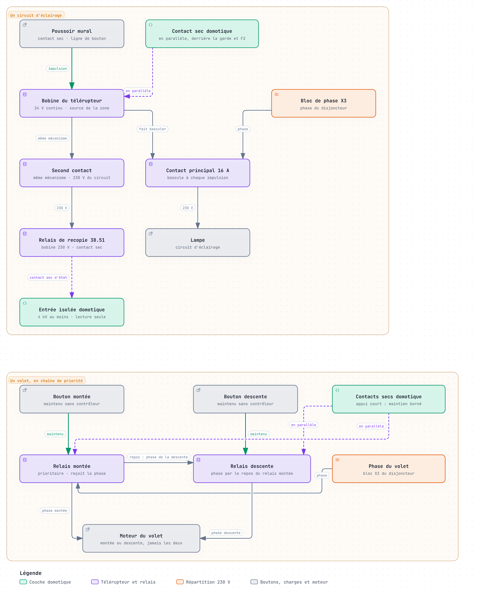
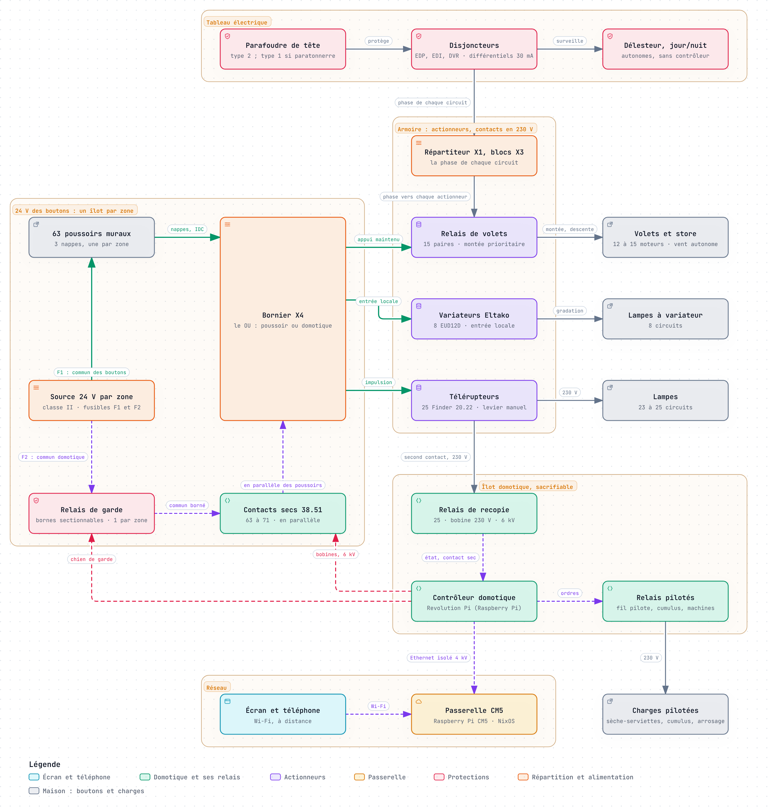
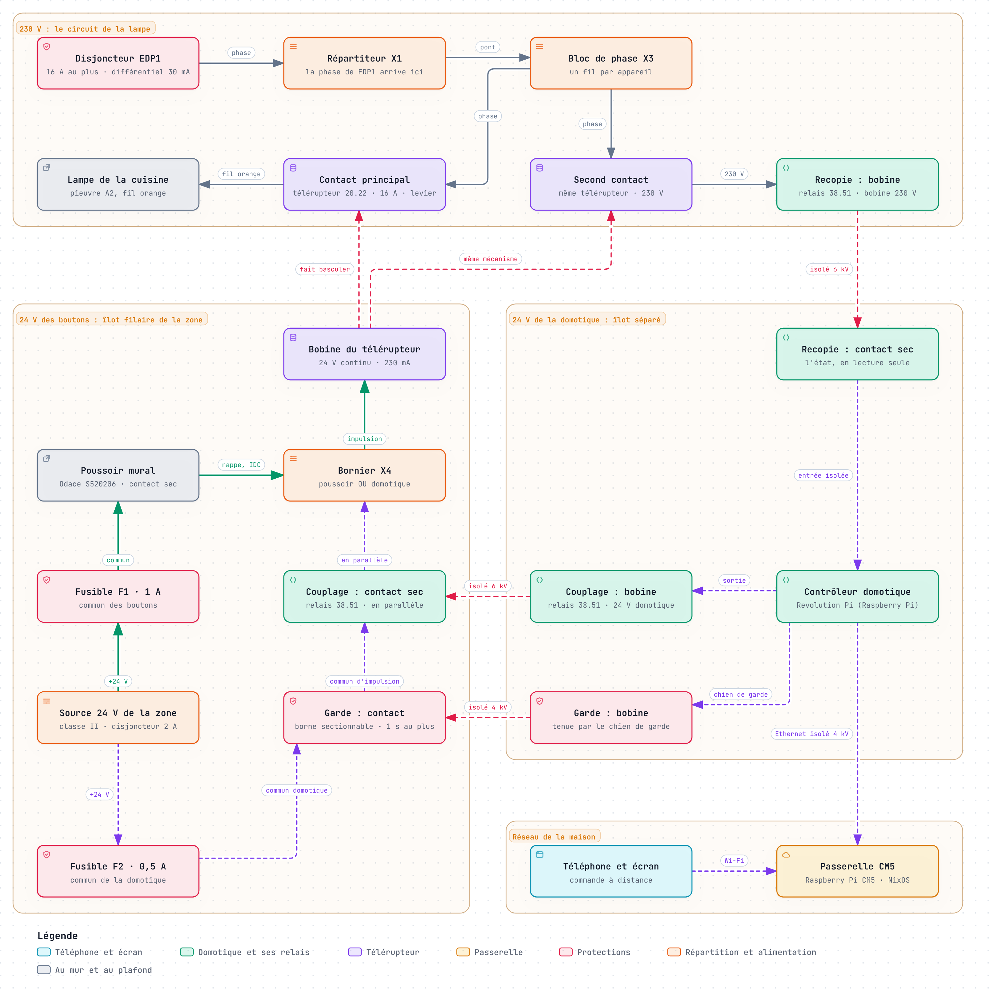
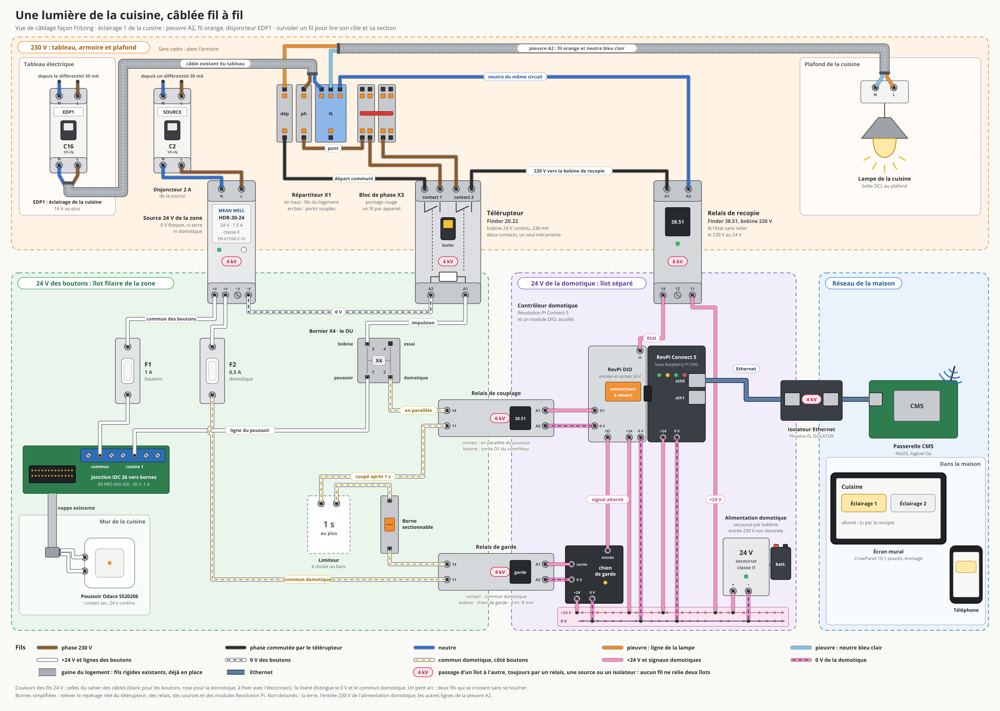

# Étude V2 : ESSENSYS filaire d'abord, domotique en dérivation

!!! info "Version V2 du 21 octobre 2026"
    Cette étude remplace les trois études V1 comme architecture recommandée. Elle répond à l'exigence posée après la foudre du 9 août 2026 : voir [Répondre à l'exigence de résilience](../../resilience.md). Ses chiffres viennent des six avis du [conseil d'autocritique](conseil.md), rédigés par des agents d'IA dans des rôles d'expert : ils restent à confirmer par un électricien, des devis et des essais.

Dans cette architecture, chaque bouton commande son circuit sans aucun calculateur : télérupteurs, relais de volets et variateurs à entrée locale, une source de commande par zone. La domotique s'ajoute en parallèle et peut s'arrêter sans rien couper. C'est l'architecture recommandée par le conseil d'autocritique du 21 octobre 2026, à la place des trois études V1.

## Synthèse

Une armoire « filaire d'abord » tient l'exigence de la V2 : si le contrôleur, un automate ou un Raspberry Pi tombe, les 63 boutons commandent toujours leurs lumières, leurs volets et leurs variateurs. La couche filaire seule, qui suffit à faire marcher la maison, coûte environ 3 450 à 3 950 € HT de matériel, et 6 450 à 7 850 € HT avec une couche domotique complète ; aucun logiciel n'est sur le chemin d'un bouton.

Ce que cela apporte :

- **Aucun calculateur du projet entre le bouton et la charge** : télérupteurs, relais de volets et variateurs à entrée locale ; seuls les 8 variateurs gardent un microcontrôleur du commerce. Une panne du contrôleur, du réseau ou du logiciel ne prive aucune pièce de ses boutons.
- **Une domotique sacrifiable** : elle agit en parallèle des boutons, par contacts secs. Si elle s'arrête ou se fige, le relais de garde la débranche en moins d'une seconde ; si elle envoie un ordre faux, des limites câblées la bornent, et la borne sectionnable de la zone la débranche à la main.
- **Une livraison par zones, sans logiciel** : chambres et pièces d'eau d'abord, puis pièces de vie. La maison reste utilisable à chaque étape.
- **Beaucoup moins de logiciel critique** : aucun avant la bascule, puis 5 à 11 semaines-personne de domotique, contre 11 à 28 semaines avant la bascule dans les études V1.

Ce que cela coûte : environ 3 450 à 3 950 € HT de matériel pour la seule couche filaire, 4 300 à 4 900 € HT avec une couche domotique minimale, et 6 450 à 7 850 € HT avec une couche complète, contacts secs et recopie d'état compris (section Nomenclature et coût). Il faut environ 1 000 € de plus si les fabricants n'attestent pas l'isolement entre commande et 230 V. L'électricien compte 6 à 8,5 jours selon le mainteneur ; l'électricien du conseil en ajoute 2 à 3 à la V1, et aucun devis ne le confirme. La couche filaire occupe 1,6 à 2,1 m de rail, 0,9 à 1,4 m de plus qu'en V1, donc un second coffret.

Ce qu'il faut accepter : on renonce à imiter le BP, double clic et appui long compris. Sans contrôleur, un volet se pilote en gardant le doigt sur le bouton. Le coffret compte plus d'appareils et de connexions, à essayer chaque année.

Ces chiffres viennent des avis du conseil d'autocritique du 21 octobre 2026, surtout ceux du mainteneur et de l'électricien ; ils restent à confirmer par devis et au relevé. [Rapport du conseil](conseil.md).

Décisions à prendre :

- [ ] Faire venir l'électricien une journée pour le relevé, avant toute commande
- [ ] Garder les BA déposés intacts, tant qu'une expertise est possible
- [ ] Vérifier l'état réel des BA des chambres et des pièces d'eau : un bouton, la LED DL1
- [ ] Demander par écrit à Finder et à Eltako l'isolement entre commande et 230 V
- [ ] Choisir entre télérupteurs électromécaniques et actionneurs Eltako (section Désaccords)
- [ ] Monter un banc d'un module de chaque type, avec un essai de choc à 2 puis 4 kV
- [ ] Faire contrôler le parafoudre de tête et la terre avant mai 2027

## Exigence et principe

La V2 inverse le principe des études V1 : le bouton commande directement un organe qui garde l'état, et la domotique sort de son chemin.

Depuis la foudre du 9 août 2026, deux BA sur trois ne répondent plus. Les trois études V1 remplaçaient les cartes par d'autres calculateurs : une Revolution Pi, quatre Opta ou quatre cartes nœuds. Chaque bouton passait par l'un d'eux, sauf les 8 variateurs Eltako.

L'exigence de la V2 : si le contrôleur, un automate ou un Raspberry Pi grille, les interrupteurs muraux pilotent toujours les relais, en filaire. La domotique devient une couche ajoutée, qui peut tomber sans rien couper.

| Point | Études V1 | V2 filaire d'abord |
| --- | --- | --- |
| Chemin du bouton | Entrée d'un calculateur, logiciel, puis relais | Bobine du télérupteur ou du relais, en direct |
| Mémoire de l'état | Dans le logiciel ; relais monostables | Dans le télérupteur, gardée sans tension |
| Contrôleur arrêté | Revolution Pi : 55 boutons sur 63 perdus ; Opta et Raspberry Pi : sa zone perdue | Aucun bouton perdu |
| Source 24 V perdue | Toutes les zones, bloc commun | Sa zone seulement ; levier dans le coffret |
| Logiciel avant la bascule | 11 à 28 semaines-personne | Aucun |
| Domotique | Sur le chemin du bouton | En parallèle, sacrifiable |

{ loading=lazy }

Lecture : à gauche, l'îlot filaire. Chaque bouton passe par le bornier de commande de sa zone et attaque directement un télérupteur, un relais de volet ou un variateur ; la source 24 V de la zone alimente les boutons par le fusible F1. Le relais de garde, alimenté par un fusible F2 distinct, porte les contacts secs que la domotique ferme en parallèle des boutons ; il s'ouvre dès que le contrôleur se tait ou se fige. Le fil pilote et les autres sorties restent au repos, donc en confort, tant que la domotique ne les commande pas.

Ce choix a un prix : on renonce à imiter le BP. Le double clic, l'appui long et les scénarios câblés dans les BA disparaissent du chemin filaire ; la domotique pourra en rendre une partie, en dérivation.

Sources : [incident foudre](https://github.com/essensys-hub/essensys-memory/blob/main/wiki/synthesis/incident-foudre-bus-i2c-2026-08.md), [rapport du conseil](conseil.md).

## Architecture par fonction

Les 63 boutons commandent leur charge sans contrôleur, et chaque autre sortie retombe dans un repli choisi au câblage. La couche domotique ajoute distance, horaires et lecture d'état ; l'alarme et les sirènes restent dans cette couche, sur batterie.

| Fonction | Organe retenu | Commande sans contrôleur | Apport de la domotique | Repli si tout s'arrête |
| --- | --- | --- | --- | --- |
| Éclairages (25) | Télérupteur à levier, bobine 24 V continu, second contact pour la recopie d'état | Le poussoir attaque la bobine | Impulsion, état, ordres groupés | État gardé, levier |
| Volets et store (15) | Deux relais de sens en chaîne de priorité | Commande maintenue | Appui court, horaires | Arrêt ; store rentré au vent |
| Variateurs (8) | Eltako EUD12D-UC en PRI 1 ou 5 | Entrée locale | Marche et arrêt centraux | Niveau gardé |
| Fil pilote (4 zones) | Relais au repos, commutateur par zone | Commutateur Auto, Confort, Hors-gel | Programmes, jamais l'arrêt | Confort, sans délestage |
| Cumulus | Contacteur jour/nuit manuel | Contact heures creuses du Linky | Inhibition, forçage | Heures creuses, si l'abonnement en a |
| Prise sécurité | Relais d'interface | Aucune | Ordre et état | Selon son rôle, à confirmer |
| Arrosage | Relais, contact à fermeture | Aucune | Programmes | Arrêt |
| Coupure machines | Relais, contact à ouverture | Aucune | Coupure sur fuite | Machines alimentées |
| Sirènes | Sorties de la couche domotique | Aucune | Toute la fonction | Muettes |
| Alarme | Couche domotique sur batterie | Aucune | Toute la fonction | Perdue |

« Tout s'arrête » : contrôleur, réseau et couche domotique hors service ; la source de commande de zone reste sous tension.

Ce que l'électricien pose et vérifie :

- **Éclairages** : le poussoir attaque la bobine 24 V continu d'un télérupteur, qui garde son état sans tension et se manœuvre à la main. Référence retenue : Finder 20.22, bobine 24 V continu, interrupteur bipolaire 2 NO dont les deux contacts basculent ensemble ; prix et suffixe à relever. Le Finder 20.28, inverseur à quatre séquences, ne convient pas : son second contact ne recopie pas le premier.
- **iTLs** : le Schneider iTLs A9C32211 (environ 28,70 € HT) n'est retenu qu'avec une réponse écrite de Schneider. Sa fiche limite l'impulsion à 1 s et à 5 manœuvres par minute, et ne donne pas le courant de bobine ; un appui long sortirait de sa spécification.
- **Attestation** : tout appareil dont la bobine est en TBTS et le contact en 230 V forme une frontière : télérupteurs, relais de volets, relais de couplage. La fiche Finder série 20 donne 4 kV entre bobine et contacts, sans déclarer d'isolation renforcée : il faut une attestation écrite. Sans elle, un 38.51 (19,06 € HT) commande un télérupteur à bobine 230 V : environ 1 000 € et 0,3 m de plus (Électricien).
- **Volets et store** : un inverseur 16 A Finder 19.91 forme la montée. Son contact repos alimente le contact de descente : montée excitée, la descente n'a plus de phase. La descente prend un relais 16 A à fermeture, le 48.P6 (16,70 € HT) si Finder déclare son isolation renforcée, sinon un second 19.91. Pour le store, la rentrée est prioritaire. Le 19.91 déclare une isolation renforcée ; son prix, estimé à 30 € par l'Électricien, reste à relever.
- **Commande des volets** : sans contrôleur, le volet bouge tant qu'on appuie et s'arrête sur ses fins de course ; avec, la domotique ajoute l'appui court. Une diode par poussoir et par contact domotique aiguille chaque ordre vers sa bobine, et chaque bobine continue a sa diode de roue libre. La chaîne évite le défaut du montage « marche + sens », qui peut renvoyer le moteur en montée au relâchement. Un Eltako EGS12Z-UC par volet (46,58 € TTC en Allemagne) donnerait l'appui court sans contrôleur.
- **Store au vent** : un automatisme vent autonome, à sortie relais en parallèle sur la rentrée, protège le store sans contrôleur. Sa référence reste à choisir, 100 à 200 € selon l'Électricien ; l'Automaticien cite les Eltako MSR12 et LRW12D, compatibilité à vérifier.
- **Variateurs** : les huit EUD12D-UC de la V1 restent (43,45 € HT), réglés en PRI 1 ou 5 pour que le bouton garde toujours la main. Leur entrée locale prend la source de commande de zone, et non le 24 V du contrôleur. Sans attestation d'Eltako, chaque entrée locale reçoit le 230 V par un 38.51 que pilote le poussoir, environ 150 € en tout ; leurs entrées centrales passent alors en 230 V et ne partagent plus le commun TBTS du relais de garde.
- **Fil pilote** : relais au repos, le fil pilote reste sans signal et les radiateurs en confort. Un commutateur par zone force le mode au tableau, 20 à 30 € selon l'Automaticien, référence à choisir. Le câblage interdit tout ordre arrêt depuis la domotique ; son schéma, avec le commutateur, la sortie fil pilote du délesteur et l'ordre de priorité, reste à arrêter avec l'électricien.
- **Délestage** : contrôleur mort, plus rien ne déleste. Si le bilan de puissance dépasse l'abonnement, un délesteur autonome d'environ 250 € (Mainteneur) se pose au tableau ; c'est un appareil 230 V, hors des îlots TBTS.
- **Source de commande de zone** : chaque zone a son 24 V continu de classe II, homologué EN 61558-2-16, séparé de celui de la domotique. Exemple : Mean Well HDR-30-24, 1,5 A, 4 kV CA entre entrée et sortie ; trois sources et leurs protections coûtent environ 130 € (Électricien). Leur 0 V ne touche ni le PE ni l'îlot domotique, et une source de rechange reste au coffret. Les trois sources ne partagent pas le même différentiel, et aucune n'est sous celui du lave-linge ou d'une salle d'eau.
- **Protections** : chaque source a son disjoncteur de 2 A. Côté 24 V, chaque zone a deux fusibles : F1, de 1 A, pour le commun des boutons, calé sur les jonctions IDC ; F2, de 0,5 A au plus, pour le commun des contacts domotiques, avant le relais de garde. Une domotique folle fait fondre F2, jamais F1 : les boutons restent. Coupée, une source ne prive que sa zone, dont les télérupteurs gardent leur état.
- **Courant des bobines** : une bobine Finder 20 tire 230 mA sous 24 V continu et admet 90 à 110 % de sa tension, soit 21,6 à 26,4 V. Plus de deux ordres simultanés dépassent F2 : la domotique séquence ses ordres groupés, et F2 protège la zone si elle ne le fait pas. Si une ligne murale ne tient pas 230 mA, le poussoir commande un 38.51 qui attaque la bobine.
- **Salles de bains** : en volumes 1 et 2, Legrand n'admet qu'un interrupteur TBTS 12 V, source hors volumes, en IPX5 (volume 1) ou IPX4 (volume 2). La FFB ne donne 30 V continu que pour le volume caché. Le 24 V continu y reste donc à confirmer par l'électricien, et le 24 V alternatif est exclu. S'il faut du 12 V, le poussoir attaque un relais à bobine 12 V dont le contact commande la bobine 24 V.

Sources : [Schneider iTLs A9C32211](https://docs.rs-online.com/3d64/A700000007836279.pdf), [Finder série 20](https://cdn.findernet.com/app/uploads/S20FR.pdf), [Finder 20.28](https://befr.rs-online.com/web/p/power-relays/0159773), [Finder série 19](https://cdn.findernet.com/app/uploads/S19EN.pdf), [Finder 38.51](https://fr.rs-online.com/web/p/relais-d-interface/3864419), [notice EUD12D](https://www.eltako.com/fileadmin/downloads/de/_bedienung/EUD12D_21100905-3_dt.pdf), [EGS12Z-UC](https://www.elektro-wandelt.de/Eltako-EGS12Z-UC-Stromstoss-Gruppenschalter-UC-1-1-Schliesser-nicht-potenzialfrei-16A-250V-AC-21200401.html), [Mean Well HDR](https://www.meanwell.com/catalog/product/files/basic-html/page26.html), [Legrand](https://www.legrand.fr/actualites/nf-c-15-100-ce-quil-faut-savoir-pour-linstallation-electrique-dune-salle-de-bains), [FFB](https://www.ffbatiment.fr/techniques-batiment/equipements-techniques/electricite-courant-fort-courant-faible/dossier-bam/la-norme-nf-c-15-100-demeure-la-reference).

## Schémas de principe

Un circuit d'éclairage et un volet suffisent à montrer le principe : le bouton agit sur l'actionneur sans rien d'autre, et la domotique se branche à côté.

{ loading=lazy }

Lecture : en haut, un circuit d'éclairage. Le poussoir envoie une impulsion 24 V à la bobine du télérupteur, qui fait basculer le contact principal : la lampe s'allume ou s'éteint. Le contact sec de la domotique est câblé en parallèle du poussoir, derrière le relais de garde et le fusible F2. Le second contact du télérupteur, porté par le même mécanisme, commute le 230 V du circuit vers la bobine d'un relais de recopie 38.51 ; seul le contact sec de ce relais rejoint l'entrée isolée de la domotique. Aucun contact de télérupteur n'est relié à la TBTS.

En bas, un volet. Chaque bouton commande son relais tant qu'il reste appuyé. La phase arrive sur le relais de montée, dont le contact repos alimente le contact de descente : montée excitée, la descente n'a plus de phase, et les deux sens ne peuvent jamais être alimentés ensemble. La domotique ferme les mêmes bobines, en parallèle, et tient l'ordre après un appui court ; une diode par poussoir et par contact aiguille chaque ordre, et chaque bobine continue a sa diode de roue libre.

Ce qu'il faut vérifier avant de câbler en série, isolement des appareils, courant des bobines et câblage exact des volets, est regroupé dans la section « Préalables et relevé de l'électricien ».

Sources : [fiche Finder série 20](https://cdn.findernet.com/app/uploads/S20FR.pdf), [rapport du conseil](conseil.md).

## Schémas détaillés

Deux schémas complètent le principe : toute l'armoire d'abord, puis une seule lumière, suivie du disjoncteur jusqu'au contrôleur. Les traits suivent le même code : gris pour le 230 V, vert pour le 24 V des boutons, violet pointillé pour la domotique, rouge pointillé pour un passage par un relais isolé.

### Toute l'armoire

{ loading=lazy }

Lecture : à gauche, l'îlot filaire d'une zone, en 24 V. Les 63 poussoirs reçoivent leur commun par le fusible F1 de la source de zone, et chaque ligne arrive au bornier X4. Le bornier attaque directement la bobine de chaque actionneur, au centre : relais de volets en appui maintenu, entrée locale des variateurs, impulsion des télérupteurs. En haut, le tableau donne la phase de chaque circuit par le répartiteur X1 et les blocs X3 ; les contacts des actionneurs alimentent les charges, à droite.

En bas, l'îlot domotique. Ses contacts secs ferment en parallèle des poussoirs, derrière le fusible F2 et le relais de garde, et les relais de recopie lui renvoient l'état des télérupteurs. Il commande seul ce qui n'a pas de bouton : fil pilote des sèche-serviettes, cumulus, coupure des machines, prises de sécurité, arrosage. La passerelle CM5 et l'écran restent derrière un isolateur Ethernet de 4 kV.

### Une lumière de bout en bout

L'exemple est l'éclairage 1 d'une cuisine, repéré comme dans un dossier d'exécution : pieuvre A2, fil orange, disjoncteur EDP1.

{ loading=lazy }

1. **Le 230 V** : la phase part du disjoncteur EDP1, arrive au répartiteur X1, passe par le bloc de phase X3, puis par le contact principal du télérupteur. Le fil orange de la pieuvre A2 la porte à la lampe, qui revient par le neutre bleu clair de la même pieuvre.
2. **L'appui** : la source 24 V de la zone alimente le commun des boutons par F1. Le poussoir ferme sa ligne, qui arrive par la nappe et la jonction IDC au bornier X4, puis à la bobine ; celle-ci revient au 0 V de la source, retour non dessiné. L'impulsion fait basculer les deux contacts du télérupteur : la lampe change d'état et le garde sans courant.
3. **La commande à distance** : le contrôleur, une Revolution Pi sur base Raspberry Pi, excite la bobine d'un relais de couplage 38.51. Son contact sec ferme 200 à 300 ms en parallèle du poussoir, sur le commun d'impulsion. Ce commun part de F2, passe par le contact du relais de garde et la borne sectionnable, et se coupe au-delà d'une seconde.
4. **La garde** : le contrôleur réarme un chien de garde toutes les 200 ms environ, qui tient la bobine du relais de garde. S'il se fige ou s'arrête, ce relais retombe en moins d'une seconde : plus aucun contact domotique n'est alimenté, et le poussoir reste seul maître.
5. **L'état** : le second contact du télérupteur, porté par le même mécanisme, alimente en 230 V la bobine du relais de recopie, qui revient sur le neutre du même circuit. Le contact sec de ce relais rejoint une entrée isolée du contrôleur : il sait si la lampe est allumée, sans jamais l'imposer.
6. **Le réseau** : le contrôleur parle à la passerelle CM5 par un Ethernet isolé à 4 kV ; le téléphone et l'écran passent par la passerelle.

Les traits rouges sont les seuls passages d'un îlot à l'autre. Chacun est un relais, bobine d'un côté et contact de l'autre, isolé de 4 à 6 kV : aucun fil ne relie le 230 V, les boutons et la domotique.

### La même lumière, fil à fil

Le même circuit, dessiné comme on le câble, à la manière de Fritzing : chaque appareil avec ses bornes, chaque fil avec sa couleur. Les fils rigides du logement arrivent en gaine par le haut de X1 ; les ponts souples de l'armoire partent par le bas. Les fils 24 V suivent le cahier des câbles : blanc pour les boutons, rose pour la domotique, avec un liseré pour le 0 V et pour le commun domotique.

{ loading=lazy }

Les bornes y sont simplifiées : le repérage réel du télérupteur, des relais, des sources et des modules Revolution Pi reste à relever sur chaque appareil. La terre et l'entrée 230 V de l'alimentation domotique n'y figurent pas.

## Domotique en dérivation

La couche domotique s'ajoute par des contacts secs en parallèle des 63 boutons : débranchée, elle ne retire rien au mur. Elle forme un îlot domotique à part, dont le 0 V ne touche ni l'îlot filaire ni le PE.

Règles d'insertion :

- **Contacts secs** : chaque sortie vers l'îlot filaire est le contact d'un relais 38.51, en parallèle du poussoir ou sur une entrée centrale d'EUD12D. Ce contact ajoute un ordre sans jamais retirer celui du bouton, et ne touche jamais une entrée prioritaire. Tenue fermée, une telle entrée rend le bouton inopérant, comme un EUD12D en PRI 2 ou 6.
- **Alimentation des contacts** : le commun des contacts domotiques part de la source de zone par son propre fusible F2, de 0,5 A au plus, puis passe par le relais de garde. Il ne passe jamais par F1, réservé à la nappe des boutons : une domotique folle fait fondre F2, et les boutons restent.
- **Relais de garde** : le commun des contacts de chaque zone passe par un relais tenu par un chien de garde matériel. Selon l'Automaticien, le contrôleur réarme ce chien de garde toutes les 200 ms environ, par un signal alterné couplé en capacitif. Faute de signal, le relais retombe en moins d'une seconde ; au démarrage, il ne colle qu'après plusieurs réarmements. Sa bobine est côté domotique et son contact sur la TBTS de zone : il se choisit, comme les optocoupleurs, à 4 kV efficaces et 8 mm au moins.
- **Borne sectionnable** : une borne par zone, sur ce même commun, isole d'un geste la couche domotique de la zone. Elle sert à la recette filaire et libère un circuit qu'un contact soudé tiendrait.
- **Lecture d'état** : le second contact du télérupteur commute le 230 V du circuit vers la bobine d'un relais de recopie 38.51 (6 kV, 8 mm), dont le contact sec va à une entrée optocouplée isolée à 4 kV au moins. Aucun contact de télérupteur n'est relié à une TBTS : deux contacts voisins d'un Finder 20 ne tiennent que 2 000 V CA, une isolation principale qu'aucune attestation ne changera (Spécialiste foudre, Sûreté). Coût : 25 × 19,06 = 476,50 € HT et environ 155 mm de rail ; la charge minimale de ce contact reste à vérifier.
- **Autres lectures** : les poussoirs de volets s'écoutent côté poussoir, en amont des diodes, par les mêmes entrées isolées ; la domotique ne prend donc pas ses propres ordres pour des appuis.
- **Jamais réimposée** : un changement non commandé marque le circuit « repris à la main », et les horaires attendent leur prochain front. Pour basculer, le contrôleur lit l'état, envoie 200 à 300 ms d'impulsion, relit, et ne réessaie pas si l'usager a appuyé.
- **Durées bornées côté filaire** : un relais soudé échappe à toute limite placée dans le contrôleur ; la limite se pose donc sur le commun. Chaque zone a deux communs domotiques : impulsion, pour les télérupteurs, coupé au-delà d'une seconde ; maintien, pour les volets, coupé au-delà de la course. Les valeurs et le montage se fixent au banc.
- **Ordres bornés en matériel** : aucune combinaison de relais ne donne l'arrêt au fil pilote. Un quatrième relais de garde coupe les bobines du fil pilote, qui retombe en confort.

| Si la domotique | Ce que fait le matériel | Ce que garde la maison |
| --- | --- | --- |
| Se tait : morte, éteinte, réseau coupé | Relais de garde ouvert en moins d'une seconde | Tous les boutons, fil pilote en confort ; plus de distance ni d'alarme |
| Se bloque, sorties figées | Chien de garde privé de signal, relais de garde ouvert | Idem ; lumières et volets ne bougent pas |
| Envoie un ordre faux | Chien de garde aveugle ; seules les bornes câblées limitent | Les boutons, sauf contre un volet tenu en montée : borne sectionnable |
| Est piratée | Mêmes bornes câblées | Les boutons ; chauffage au pire en hors-gel ; alarme et sirènes exposées |

La sécurité réseau (TLS, mTLS), que le Mainteneur reporte, doit donc être datée.

Le contrôleur s'achète en dernier, après les zones filaires et le banc. Il lui faut environ 85 sorties et 68 entrées, selon l'Électricien :

- **Revolution Pi Connect 5** : retenue par trois conseillers, c'est un contrôleur unique marqué CE, sous Linux et Go comme la passerelle, à entrées isolées. Une Connect 5 et sept DIO coûtent environ 2 000 € HT (Avocat du diable), dont 581 € HT pour la base ; la V1 comptait 2 270 € HT avec un module AIO. Ses 38.51 servent au couplage.
- **Serveur d'entrées-sorties** : le Mainteneur juge la Connect 5 surdimensionnée et propose un serveur sans logique, piloté par la passerelle. Un Opta Lite et deux D1608S coûtent environ 373 € ; la couche minimale, avec le reste de son matériel, environ 770 € HT, et une couche complète 1 250 à 1 900 € (Mainteneur). Ses entrées ne sont pas isolées et ses sorties sont statiques : pour tenir les règles ci-dessus, il lui faut des entrées isolées à 4 kV et un 38.51 devant chaque sortie. Ses sorties retombent ouvertes s'il perd la passerelle, qui porte la logique en Go ou sous Home Assistant.

Ce qu'on garde des études V1 :

- **Relais 38.51** : ils deviennent les relais de couplage, avec 6 kV et 8 mm entre bobine et contacts, à 19,06 € HT.
- **Isolement des entrées** : l'étude Raspberry Pi isolait chaque entrée par optocoupleur, TVS et résistance, mais à 3 kV ; la V2 demande 4 kV.
- **Battement de cœur et monostable** : la couche envoie un battement de cœur à la passerelle, qui alerte dès qu'il manque. Le monostable de repli de l'étude Raspberry Pi devient le relais de garde, en version du commerce.

À tester au banc :

1. Relais de garde : tuer l'application, figer le système, couper l'alimentation, mettre à jour. Retombée en moins d'une seconde, fil pilote en confort, lumières et volets immobiles, aucune impulsion au démarrage.
2. Contact soudé : tenir un contact domotique fermé. Le commun d'impulsion se coupe au-delà d'une seconde, celui de maintien au-delà de la course ; un seul circuit est touché, et la borne sectionnable rend la main.
3. Priorités : entrée centrale d'un EUD12D maintenue, en PRI 1 puis 5. Le bouton agit 20 fois sur 20.
4. Conflits : appui mural et ordre distant simultanés, 20 fois par voie. L'état lu égale toujours l'état réel, sans double basculement.
5. Fil pilote : toutes les combinaisons de sorties, à l'oscilloscope au radiateur. Jamais d'alternance positive seule, qui vaut arrêt.
6. Fusibles : toutes les sorties d'une zone fermées ensemble. F2 fond, F1 tient, et chaque bouton commande encore sa charge.
7. Court-circuit : un court-circuit franc sur une ligne de bouton ne coupe que F1 de sa zone (Sûreté).
8. Onde de choc : 2 puis 4 kV en mode commun sur une ligne de bouton, couche branchée. Le filaire marche encore, la domotique ne bloque rien ; 1 000 à 1 800 € en laboratoire selon l'avis foudre.

Sources : [prix KUNBUS](https://revolutionpi.com/de/bestellen/uebersicht-produkte-und-preise), [notice EUD12D](https://www.eltako.com/fileadmin/downloads/de/_bedienung/EUD12D_21100905-3_dt.pdf), [Finder série 38](https://docs.rs-online.com/e277/0900766b816bcc44.pdf), [Finder série 20](https://cdn.findernet.com/app/uploads/S20FR.pdf), [iTLs A9C32211](https://docs.rs-online.com/3d64/A700000007836279.pdf), [retex foudre](../../../retex/foudre-2026/analyse-experte.md).

## Foudre et frontières

La V2 coupe le chemin de l'onde au lieu de l'écrêter : deux îlots, séparés par des barrières d'au moins 4 kV. Les parafoudres restent au tableau et au bout des lignes extérieures, jamais dans les coffrets. Le chemin du 9 août restant inconnu, la V2 ferme toutes les voies.

L'îlot filaire, électromécanique, relie les boutons aux bobines des télérupteurs et des relais de volet : il doit survivre à l'orage. L'îlot domotique porte le contrôleur, l'alarme et les capteurs : il peut griller sans emporter le filaire.

Le Spécialiste foudre voulait un transformateur 50 Hz, sans électronique. Le verdict retient un 24 V continu de classe II par zone, le 24 V alternatif étant interdit en volumes 1 et 2.

Chaque frontière a sa barrière :

- **Règle commune** : chaque barrière se spécifie par sa rigidité d'une minute en kV efficaces, sa tenue en onde 1,2/50 µs et sa ligne de fuite : au moins 4 kV efficaces et 8 mm, selon le retex.
- **Télérupteur** : 4 000 V CA et 4 kV en onde 1,2/50 µs entre bobine et contacts (fiche Finder série 20) ; l'isolation renforcée reste à faire attester. La fiche cite aussi l'EN 60601-1 et « 2 x MOPP », une piste à présenter à Finder.
- **Commande** : contact sec d'un relais Finder 38.51 en parallèle du bouton, 6 kV et 8 mm entre bobine et contact. Son commun passe par le fusible F2, le relais de garde et une borne sectionnable par zone.
- **Lecture** : le second contact du télérupteur reste en 230 V et commande un relais de recopie 38.51 ; seul le contact sec de ce relais rejoint l'entrée optocouplée. Deux contacts voisins d'un télérupteur ne tiennent que 2 000 V CA.
- **Relais de garde et optocoupleurs** : 4 kV efficaces et 8 mm au moins.
- **Variateurs** : relais de couplage tant qu'Eltako n'atteste pas ses entrées. L'avis foudre le veut partout, contre une onde du circuit d'éclairage.

Les deux îlots sont deux TBTS distinctes. Leurs 0 V ne se touchent jamais et ne touchent pas le PE : ni liaison, ni varistance, ni TVS, ni éclateur. Les coffrets sont isolants, leurs rails non reliés au PE, et la borne FE des automates reste libre jusqu'à sa mesure.

Les 63 lignes de boutons forment la voie la plus nombreuse. Pour une boucle supposée de 10 m², l'avis foudre y calcule l'onde induite en mode commun :

| Impact à (m) | Pente de 10 kA/µs (kV) | Pente de 100 kA/µs (kV) |
| --- | --- | --- |
| 20 | 1 | 9,5 |
| 50 | 0,4 | 3,9 |
| 200 | 0,1 | 1 |

Entre un fil et son retour, la boucle ne fait que quelques cm² : une bobine ne voit presque rien. Les barrières encaissent donc le mode commun, et leurs 4 kV couvrent une foudre à quelques dizaines de mètres.

| Voie | Exposition | Protection retenue | Reste à vérifier |
| --- | --- | --- | --- |
| Lignes de boutons | Mode commun induit | Bobines seules ; contacts secs et optocoupleurs | Boîtes mixtes, conduits partagés, plaques reliées au PE |
| Alimentation 230 V | Réseau, par les condensateurs Y des blocs | Parafoudre de tête ; blocs de classe II à 4 kV ; trois disjoncteurs | Éclateur neutre-terre sans voyant ; tenue au choc des blocs |
| Ethernet | Commutateur partagé avec le dongle de l'onduleur | FL ISOLATOR ; dongle en Wi-Fi | Essai derrière le « jusqu'à 4 kV » |
| Pluie, anémomètre, sirène extérieure | Coup direct sur le mât ou la sirène | Barrière de 4 kV au coffret ; convertisseur isolé côté extérieur | Références ; place du mât ; capteur de l'automatisme vent |

Les parafoudres sont posés avant mai 2027 :

- **Tête de tableau** : le type 2 en place est contrôlé, cartouche changée, liaisons de 50 cm au plus, terre mesurée. Un type 1 est requis si le bâtiment porte un paratonnerre ou en a un à moins de 30 m (Legrand) ; sinon, l'analyse de risque décide. Une ligne aérienne en zone AQ2 impose un parafoudre.
- **Départs extérieurs** (arrosage, store, éclairage extérieur) : côté charge du contact, au bornier de sortie ou en bout de ligne.
- **Lignes TBT extérieures** : à l'entrée du bâtiment, côté extérieur de la barrière, si le mât est exposé.
- **Coffrets** : rien, s'ils restent à moins de 10 m de câble du parafoudre de tête (Hager) ; cette longueur se mesure au relevé.

L'avis sûreté voulait aussi un type 3 près des sources. Le verdict ne le retient pas : selon le Spécialiste foudre, il amènerait le courant de choc près de la TBT.

Le coffret photovoltaïque est à quelques centimètres à droite du coffret domotique, et les câbles de l'onduleur longent son angle haut droit. Le retex demande 30 à 50 cm entre ces câbles et les coffrets, ou une goulotte métallique reliée au PE aux deux bouts. L'électricien cherche pourtant la place de son second coffret à droite.

Restent le dessous, le dessus ou un autre mur, à relever au mètre ruban. Sinon, le verdict passe aux Eltako, environ 0,9 m de rail, si Eltako atteste leurs entrées.

Avant toute commande en série, l'essai de choc décide : onde 1,2/50 µs en mode commun sur une ligne de bouton, 2 puis 4 kV. Télérupteur, relais de couplage, contact sec et entrée optocouplée branchés, le filaire doit marcher et la domotique ne rien bloquer. Il faut un générateur loué, ou une journée de laboratoire à 1 000 à 1 800 € selon l'avis foudre.

Reste à mesurer :

- **Câblage** : lignes qui sortent du coffret, puis section, résistance de boucle et isolement de chaque nappe.
- **Tableau** : ligne aérienne ou non, paratonnerre à moins de 30 m.
- **Foudre** : densité de foudroiement et impacts du 9 août, par un certificat de foudroiement.
- **Fiches** : tenue du FL ISOLATOR et des blocs. Pour le Finder 20, la fiche donne 4 000 V CA pour toutes les bobines ; les 3,5 kV relevés par l'électricien viennent d'un distributeur, sans chemin précisé.

Sources : [analyse experte du retex](../../../retex/foudre-2026/analyse-experte.md), [protection contre les surtensions](../../../install/protection-surtensions.md), [Finder série 20](https://cdn.findernet.com/app/uploads/S20FR.pdf), [Finder 20.21.9.024.4000](https://www.radiolocman.com/datasheet/data.html?di=68020), [Finder série 38](https://docs.rs-online.com/e277/0900766b816bcc44.pdf), [Phoenix FL ISOLATOR](https://www.phoenixcontact.com/en-nz/products/network-isolator-fl-isolator-100-rjrj-2313931), [Hager, parafoudres](https://assets.hager.com/step-content/P%2FHA_39814370%2FDocument%2Fstd.lang.all%2FQZD787_Hager_Brochure_Protection_Parafoudres.pdf), [Legrand, le parafoudre est-il obligatoire](https://www.legrand.fr/questions-frequentes/le-parafoudre-est-il-obligatoire), [guide DEHN, d'après la CEI 62305-1](https://resources.ipd.com.au/Flipbook/35_DS702_E_2014_Lightning_Protection_Guide/files/basic-html/page24.html).

## Câblage, implantation et migration

La V2 garde le câblage de migration des V1. Sa couche filaire prend 1,6 à 2,1 m de rail, soit 0,9 à 1,4 m de plus qu'en V1, donc un second coffret (électricien). Chaque zone bascule ensuite seule, sans logiciel, en quelques heures.

### Ce qu'on garde des V1

- **Répartiteur X1** : 56 bornes Wago 2002-2201 à deux étages, soit 112 circuits pour environ 90 fils.
- **Blocs de phase X3** : un bloc par disjoncteur, en bornes Wago 2002-1401 reliées par un contact de pontage rouge. Un fil par appareil, et jamais deux disjoncteurs dans un bloc.
- **Jonctions IDC** : une interface IDC 26 vers bornes par nappe (RS PRO 403-320, 50 V et 1 A).
- **Plan de bornage** : un même repère par fil, borne et pont, tenu à jour dans essensys-doc.

Seule la cible des ponts change : les fils de X3 vont aux télérupteurs et aux relais de montée, soit environ 64 fils (électricien).

### Ce qu'on ajoute

- **Télérupteurs** : 25 Finder 20.22, à levier, bobine 24 V continu, d'environ 18 mm chacun.
- **Relais de recopie** : 25 relais 38.51 à bobine 230 V, un par télérupteur, pour lire l'état sans relier le 230 V à la TBTS.
- **Relais de volets** : deux par moteur en chaîne de priorité, soit 30 ; la montée, ou la rentrée du store, l'emporte. Une diode par poussoir et par contact, et une diode de roue libre par bobine continue.
- **Source de commande de zone** : un 24 V continu de classe II par zone (EN 61558-2-16), comme le Mean Well HDR-30-24. Le commun de la nappe y passe par un fusible F1 de 1 A, calé sur l'interface IDC ; le commun des contacts domotiques par un fusible F2 de 0,5 A au plus. Chaque source a son disjoncteur, sous un différentiel qui n'est pas celui des deux autres, et une quatrième attend en rechange.
- **Bornier de commande TBT X4** : par sortie, une borne à quatre points pour le poussoir, le contact domotique, la bobine et l'essai. Séparé du 230 V par une cloison, il rend le OU visible et testable au tournevis.
- **Relais de garde et borne sectionnable par zone**, en série sur le commun des contacts domotiques, avec deux communs : impulsion pour les télérupteurs, maintien pour les volets. Ouvrir la borne débranche la couche domotique de toute la zone : c'est son retour arrière. Un quatrième relais de garde coupe le fil pilote.

Le Spécialiste foudre préférait un transformateur 50 Hz, mais le 24 V alternatif est interdit en volumes 1 et 2.

Quantités par zone, d'après les cartes BA actuelles :

| Zone | Poussoirs | Éclairages : télérupteurs et recopies | Volets et store : paires de relais | Variateurs |
| --- | --- | --- | --- | --- |
| Pièces de vie (PDV) | 20 | 5 | 6 | 3 |
| Chambres (CHB) | 21 | 7 | 5 | 4 |
| Pièces d'eau (PDE) | 22 | 13 | 4, store compris | 1 |
| Total | 63 | 25 | 15 | 8 |

### La place

La couche filaire prend 1,6 à 2,1 m de rail, contre 0,7 m en V1 Revolution Pi. Le coffret ajouté de la V1, rempli « avec peu de marge », ne suffit plus ; il en faut un second, soit l'emprise de l'étude Opta : 3,1 m de rail (électricien). Ce compte, à refaire au relevé, inclut 134 mm de modules 19.21 que la V2 ne retient plus, et omet les relais de recopie (environ 155 mm), les relais de garde, les commutateurs de fil pilote, le délesteur et l'automatisme vent.

Le retex place le coffret photovoltaïque à quelques centimètres à droite, et les tableaux à gauche. Il impose 30 à 50 cm entre câbles photovoltaïques et coffrets, ou une goulotte métallique reliée au PE aux deux bouts. Restent le dessous, le dessus, un autre mur, ou le déplacement du coffret photovoltaïque (Spécialiste foudre).

Sans second coffret possible loin du photovoltaïque, le verdict passe aux Eltako, si Eltako atteste l'isolement de ses entrées. Leurs 48 actionneurs de 18 mm tiennent sur environ 0,9 m, peut-être dans les rangées des BA, à confirmer au relevé (Avocat du diable). L'Automaticien et l'Avocat du diable les voulaient en base ; le verdict ne les garde qu'en repli.

### La migration zone par zone

CHB et PDE passent les premières, sans réparer leurs BA, gardés intacts tant qu'une expertise est possible. L'Avocat du diable voulait les réparer d'abord ; le verdict ne réinvestit pas dans le bus I2C.

L'électricien pose X1 et les jonctions IDC pour toute l'armoire dès la première zone. En CHB et PDE, les ponts de X1 vont droit aux nouveaux appareils. En PDV, ils reviennent d'abord sur le BA, qui reste en service.

La bascule de PDV dépose le dernier BA et met fin au bus I2C. Pendant toute la transition, le BP garde chauffage, alarme, écran, délestage, cumulus et arrosage. Un essai d'une heure, nappe I2C du BA PDV débranchée, dira avant cette bascule s'il fonctionne sans BA (mainteneur).

La couche domotique se branche ensuite sur les points 2 de X4. Le BP part en dernier, fonction par fonction, chacune avec son retour arrière.

Les étapes de la bascule d'une zone :

1. **Préparer** : appareils câblés hors tension, plan de bornage écrit, F1, F2 et borne sectionnable ouverts, occupants prévenus.
2. **Consigner** tous les disjoncteurs de la zone : les bornes d'un BA portent plusieurs phases, et rien ne se pose sous tension.
3. **Libérer la nappe** : débrancher son connecteur du J3 et le ranger ; elle ne reste reliée qu'à sa jonction IDC.
4. **Passer les ponts** : chaque phase rejoint son bloc X3, chaque départ de X1 son appareil.
5. **Mesurer l'isolement** des circuits refaits : sous 500 V continu entre la TBTS et le 230 V, plus de 100 MΩ visés.
6. **Déconsigner** la zone, puis **fermer F1**, et seulement alors : le +24 V de zone détruirait les entrées 5 V d'un BA encore branché.
7. **Essayer** chaque poussoir et chaque levier, puis ouvrir chaque disjoncteur : seul son bloc X3 doit tomber.
8. **Clore** : plan de bornage à jour, BA étiqueté et rangé intact, pour l'expert ou le retour arrière.

Le retour arrière se fait zone consignée, dans l'ordre inverse : F1 et F2 ouverts d'abord, ponts ramenés sur la carte, nappe rebranchée sur le J3, isolement mesuré avant la remise sous tension. Il prend une demi-journée en PDV, dont le BA reste gardé deux semaines (mainteneur).

En CHB et PDE, des BA muets ne servent de retour arrière que si la LED DL1 les montre vivants. Sinon, les leviers des télérupteurs y suppléent.

### Ce que le dossier d'exécution doit confirmer

Sur l'installation étudiée, le dossier d'exécution de la maison confirme les quantités de la nomenclature. Il date d'avant la foudre et peut différer de l'existant ; le relevé vérifie ces points sur toute installation :

- **Éclairages** : les lignes commandées, leurs pieuvres et leurs disjoncteurs. Une pieuvre peut porter plusieurs lignes d'un même disjoncteur sur un neutre commun ; une sortie sans pieuvre n'a pas besoin de télérupteur.
- **Volets** : ceux qui sont câblés en pieuvre, et ceux qui n'en ont pas ou passent par la radio. Les paires de relais se comptent au relevé.
- **Disjoncteurs à cheval sur les zones** : un même disjoncteur peut desservir des pièces de zones différentes. Consigner une zone éteint alors des lumières d'une autre : la bascule se prépare disjoncteur par disjoncteur.
- **Charges pilotées** : prises des machines à laver (20 A, 2,5 mm²), cumulus et sa paire heures creuses, prises de sécurité, électrovanne d'arrosage.
- **Chauffage** : avec une pompe à chaleur, le fil pilote peut ne commander que les sèche-serviettes. Relais et commutateurs de fil pilote se limitent alors à ces sorties.
- **Poussoirs** : leur calibre ; une bobine de 230 mA ne gêne pas un poussoir donné pour 10 A.
- **Salles de bains** : la position de chaque poussoir par rapport aux volumes, mesurée sur place.
- **GTL** : des fiches débrochables en bout de pieuvre, comme les Wago 769, permettent de débrancher et rebrancher une pieuvre sans outil, ce qui simplifie bascule et retour arrière.

Sources : [borne Wago 2002-2201](https://buerklin.com/en/p/wago/series-terminals/2002-2201/09H4322), [borne Wago 2002-1401](https://buerklin.com/en/p/wago/series-terminals/2002-1401/09H4219), [interface IDC 26 RS PRO](https://befr.rs-online.com/web/p/interface-modules/0403320), [Mean Well HDR-30](https://www.meanwell.com/catalog/product/files/basic-html/page26.html), [Finder série 20](https://cdn.findernet.com/app/uploads/S20FR.pdf), [analyse experte du retex](../../../retex/foudre-2026/analyse-experte.md), [fiche Wago 769-603](https://buerklin.com/en/p/wago/pcb-connection-systems/769-603/44P6633).

## Modes dégradés

Quand la domotique tombe, les 63 boutons commandent toujours leur charge. La pire panne simple du filaire prive une zone de ses boutons, et ses lumières restent dans leur état.

| Panne | Effet | Ce qui reste | Parade |
| --- | --- | --- | --- |
| Contrôleur domotique arrêté | Plus de commande à distance, de scénarios, de chauffage programmé, de délestage ni d'alarme ; plus d'appui court sur les volets | Les 63 boutons ; volets en commande maintenue ; fil pilote sans signal, donc confort ; cumulus en heures creuses si l'abonnement en a | Relais de garde retombé ; commutateur Auto, Confort, Hors-gel par zone ; délesteur et automatisme vent autonomes |
| Contrôleur qui envoie un ordre faux ou bloqué | Contact soudé : la bobine reste sous tension, le bouton ne bascule plus ce circuit. Montée tenue : le volet ne descend plus, la montée étant prioritaire | Les autres circuits ; l'appui local des variateurs, réglés en PRI 1 ou 5 ; le commutateur du fil pilote | Relais de garde si le logiciel se fige, sinon borne sectionnable ; durée d'ordre bornée en matériel ; aucun arrêt au fil pilote |
| Réseau ou passerelle | Plus de commande à distance ni d'alerte | Tout le local, contrôleur et alarme compris | Rien d'urgent ; commutateur de rechange |
| Relais de garde | Retombé : la domotique de la zone ne commande plus. Collé : il ne débranche plus un contrôleur figé, sans le signaler | Les boutons, qui ne passent pas par lui | Essai de retombée, contrôleur coupé, à la recette puis aux essais périodiques |
| Source de commande d'une zone | Boutons, variateurs et volets de la zone sans commande | Lumières dans leur état, au levier ; les deux autres zones | Source de rechange, environ 30 min d'électricien ; un disjoncteur par zone |
| Un télérupteur | Son circuit seul : bobine coupée, ou contact collé et lampe allumée | Le levier, si la bobine seule est morte (selon le modèle) ; les autres circuits | Deux télérupteurs en rechange ; échange en 5 à 15 min |
| Un relais de volet | Son volet perd un sens, ou part en butée si un contact colle | Les autres volets ; jamais les deux sens à la fois, le verrouillage étant câblé | Deux relais de chaque type en rechange ; sans manette, un sélecteur en coffret reste à étudier |
| Un variateur | Son circuit seul | Les autres circuits | Un EUD12D en rechange, Eltako étant source unique |
| Le secteur | Charges et sources éteintes, volets arrêtés. Les coupures brèves, 300 ms puis 15 s, sont l'événement le plus fréquent | Télérupteurs dans leur état au retour ; variateurs : état gardé en PRI 1, luminosité seule en PRI 5 ; alarme sur batterie | Aucune batterie pour le filaire ; reprise après coupure brève essayée au banc |
| La foudre | Domotique peut-être détruite. Côté filaire, les sources de zone et les variateurs sont l'électronique exposée | Bobines et contacts ; lumières dans leur état, au levier, même si les trois sources meurent | Frontières de la section « Foudre et frontières » ; isolement et parafoudre contrôlés après l'orage |
| La batterie de l'alarme | Capacité perdue sans prévenir : alarme et écran tombent à la coupure (IPR 75, le plus fort de l'AMDEC) | Tout le filaire, qui n'a pas de batterie | Essai de capacité annuel dès la troisième année ; remplacement vers 4 ans |
| L'isolement qui se dégrade | Défaut latent : l'îlot flottant ne fait rien déclencher, et un bouton peut passer au potentiel du secteur (IPR 50) | Tout fonctionne, rien ne le signale | Mesure chaque année et après chaque orage proche ; isolation renforcée attestée à chaque frontière |

Ce tableau suppose deux conditions câblées. Les contacts domotiques tirent leur courant d'un fusible F2 distinct de celui des boutons : sans lui, une domotique folle ferait fondre F1 et priverait sa zone de ses boutons. Les trois sources de zone ne partagent pas le même différentiel : sinon, un défaut du lave-linge couperait les 63 boutons.

L'AMDEC de l'avis sûreté compte les modes de panne qui privent toute la maison de ses boutons. Elle en trouve 13 pour la Revolution Pi, 5 pour l'Opta, 4 pour la refonte Raspberry Pi et 0 pour le filaire autonome. Le découpage par zone des V1 arrêtait les pannes indépendantes, pas les causes communes : même code, même bloc 24 V, même foudre.

Contrôleur mort, rien ne déleste plus, et un soir de grand froid le disjoncteur de branchement peut tout éteindre, filaire compris. L'électricien compare donc chauffage en confort, cumulus et cuisson à la puissance souscrite. S'ils la dépassent, un délesteur autonome entre dans le filaire, pour environ 250 € selon le mainteneur.

Deux défauts restent latents dans toute architecture : la batterie qui perd sa capacité et l'isolement qui se dégrade. L'isolement se mesure chaque année et après chaque orage proche, avant de conclure que tout va bien parce que tout s'allume. La capacité de la batterie s'essaie chaque année, et la batterie se remplace vers 4 ans.

Sources : [Finder 20.21.9.024.4000](https://www.radiolocman.com/datasheet/data.html?di=68020), [notice Eltako EUD12D](https://www.eltako.com/fileadmin/downloads/de/_bedienung/EUD12D_21100905-3_dt.pdf), Enedis, coupures brèves, [fiche Yuasa NP12-12](https://cdn.autosolar.es/pdf/Bateria-Yuasa-NP12-12.pdf), [ZVEI, durée de vie des batteries](https://ZVEI.ORG/fileadmin/user_upload/Verband/Fachverbaende/Batterien/Merkblaetter/Industriebatterien/19e_Service_life_stationary_batteries_2019_EN_final.pdf), [délesteur Hager 60060](https://www.123elec.com/hager-delesteur-universel-3-voies-et-3-entrees-60060.html).

## Nomenclature et coût

La couche filaire seule, qui suffit à faire marcher la maison, coûte environ 3 450 à 3 950 € HT ; avec une couche domotique complète, environ 6 450 à 7 850 € HT. Ces totaux, recalculés après relecture sur les prix des avis, attendent encore les devis, et les parafoudres ne sont pas chiffrés.

| Poste | Qté | Prix unitaire HT (€) | Total HT (€) | Source |
| --- | --- | --- | --- | --- |
| Télérupteurs à levier, bobine 24 V CC : Finder 20.22 | 25 | ≈ 29, à relever | ≈ 720 à 740 | prix voisins du Finder 20.28 et de l'iTLs (mainteneur, électricien), à confirmer |
| Relais de recopie d'état : Finder 38.51, bobine 230 V | 25 | 19,06 | 477 | électricien, prix RS |
| Relais de volets, montée : Finder 19.91 inverseur | 15 | ≈ 30 | ≈ 450 | électricien, prix estimé |
| Relais de volets, descente : 48.P6, ou un second 19.91 | 15 | 16,70 | 251 | prix de l'étude V1 Revolution Pi ; plus cher en 19.91 |
| Variateurs Eltako EUD12D-UC | 8 | 43,45 | 348 | mainteneur (zaehlerschrank24) |
| Sources de commande de zone, disjoncteurs, fusibles F1 et F2 | 3, plus 1 rechange | ≈ 32 | ≈ 127 à 130 | mainteneur (prix V1), électricien ; estimations |
| Relais de garde : trois zones et le fil pilote | 4 | ≈ 20 à 40 | 80 à 160 | Automaticien : 60 à 120 € les trois, estimation |
| Commutateurs de fil pilote | 4 | 20 à 30 | 80 à 120 | Automaticien, estimation |
| Bornier X4, bornes sectionnables, diodes, résistances, repérage | — | — | 150 à 250 | électricien, estimation |
| Répartiteur X1, jonctions IDC, blocs de phase X3 | — | — | 560 | mainteneur, estimation V1 |
| Coffret ajouté et petit matériel | 1 | — | 450 | mainteneur, estimation V1 |
| Second coffret ajouté | 1 | ≈ 200 | ≈ 200 | électricien, estimation V1 |
| Couche domotique, minimale ou complète | 1 | — | 770 à 1 900 | mainteneur |
| Contacts secs de couplage : Finder 38.51, couche complète | 63 à 71 | 19,06 | 1 200 à 1 350 | électricien, prix RS |
| Protections : délesteur Hager 60060, si le bilan l'exige | 0 ou 1 | 249,95 | 0 à 250 | mainteneur (123elec), HT ou TTC non précisé |
| Protections : automatisme vent du store | 1 | — | 100 à 200 | électricien, estimation |
| Protections : parafoudres, barrières des lignes extérieures | — | à chiffrer | à chiffrer | Spécialiste foudre, sans prix |
| Électricien | 6 à 8,5 jours | ≈ 400 par jour | 2 400 à 3 400 | mainteneur, ratio V1, sans devis |

### Totaux

Trois niveaux, sur les lignes ci-dessus, électricien non compris :

| Niveau | Ce qu'il comprend | Total HT (€) |
| --- | --- | --- |
| Couche filaire seule | Télérupteurs, relais de volets, variateurs, sources, bornier, répartiteur, coffrets, commutateurs, délesteur et automatisme vent | ≈ 3 450 à 3 950 |
| Avec une couche minimale | La couche filaire, la couche minimale du Mainteneur et les relais de garde ; un 38.51 de plus par sortie statique utilisée | ≈ 4 300 à 4 900 |
| Avec une couche complète | La couche filaire, une couche qui commande et lit chaque circuit, ses contacts secs, la recopie d'état et les relais de garde | ≈ 6 450 à 7 850 |

Sans attestation d'isolement, un relais 38.51 commande chaque télérupteur, alors à bobine 230 V : environ 1 000 € de plus (électricien). Les huit variateurs prennent de même un relais de couplage chacun, environ 150 €.

Pour comparaison, le Mainteneur arrivait à 3 580 à 5 060 € HT pour une variante à un EGS12Z par volet et un seul coffret ajouté, et l'Électricien à 6 650 à 7 950 € HT en partant de la V1 Revolution Pi. Hors total : un banc d'environ 250 € (mainteneur) et l'essai de choc en laboratoire, 1 000 à 1 800 € selon l'avis foudre.

L'électricien compte 6 à 8,5 jours à environ 400 € par jour selon le mainteneur, sans devis ; l'électricien du conseil ajoute 2 à 3 jours à ceux de la V1. Le porteur du projet ajoute 1,5 à 3 jours de câblage TBT pour la couche domotique.

### Sur dix ans

Électricien, rechanges et batteries compris, le mainteneur place la V2 dans la fourchette des V1. Son calcul porte sur sa variante à 3 580 à 5 060 € HT ; refait avec les totaux ci-dessus, il rapprochera la V2 complète des V1, et la couche filaire seule restera la moins chère.

| Solution | Matériel annoncé (€ HT) | Total sur dix ans (€ HT) |
| --- | --- | --- |
| Revolution Pi | 5 450 | 8 350 à 10 240 |
| Arduino Opta | 5 600 | 8 010 à 8 810 |
| Raspberry Pi et Ethernet | 3 160 | 6 125 à 6 825 |
| V2, variante du mainteneur | 3 580 à 5 060 | 6 100 à 8 890, sans centrale d'alarme ; à refaire |

### Charge de travail

Aucune ligne de logiciel n'est sur le chemin du bouton : chaque semaine de domotique peut donc attendre. La domotique, fonctions du BP comprises, demande 5 à 11 semaines-personne, plus 1,5 à 2,5 de préparation (mainteneur).

Les V1 en demandaient 11 à 28 avant la bascule, et 13 à 30 au total. Le mainteneur juge ces estimations optimistes de 20 à 40 %.

| Solution | Semaines-personne avant le retour des 63 boutons : étude, puis mainteneur | Semaines-personne au total : étude, puis mainteneur | Mois à 20 h par semaine avant le retour des boutons |
| --- | --- | --- | --- |
| Revolution Pi | 13 à 16, puis 16 à 22 | 13 à 16, puis 16 à 22 | 5 à 6,5, ou 6,5 à 9 |
| Arduino Opta | 11 à 16, puis 14 à 21 | 13,5 à 20, puis 17 à 25 | 4,5 à 6,5, ou 5,5 à 8,5 |
| Raspberry Pi et Ethernet | 19 à 28, puis 23 à 35 | 20,5 à 30, puis 25 à 37 | 8 à 11, ou 9 à 14 |
| V2 filaire d'abord | 1,5 à 2,5 de préparation, aucun logiciel | 6,5 à 13,5 | 1,5 à 3, livraisons et électricien compris |

Les semaines comptent 35 h, comme dans les V1. Le mainteneur ne convertit pas ce temps en euros : il n'est pas payé, il est rare.

Sources : [Finder 20.28.9.024.0000 chez RS Belgique](https://befr.rs-online.com/web/p/power-relays/0159773), [Schneider iTLs A9C32211 chez domomat](https://www.domomat.com/19199-telerupteur-avec-signal-a-distance-16a-1no-48vca-24vcc-50-60hz-acti9-itls-schneider-electric-a9c32211.html), [Finder série 19](https://cdn.findernet.com/app/uploads/S19EN.pdf), [Eltako EUD12D-UC](https://www.zaehlerschrank24.de/multi-dimmschalter-eud12d-uc.html), [Eltako EGS12Z-UC](https://www.elektro-wandelt.de/Eltako-EGS12Z-UC-Stromstoss-Gruppenschalter-UC-1-1-Schliesser-nicht-potenzialfrei-16A-250V-AC-21200401.html), [délesteur Hager 60060](https://www.123elec.com/hager-delesteur-universel-3-voies-et-3-entrees-60060.html).

## Préalables et relevé de l'électricien

Sept préalables peuvent changer la commande, et le premier coûte une journée d'électricien, environ 400 € HT au taux déduit des V1 (Électricien, Mainteneur). Ce relevé tranche la place, le courant et la tension de commande ; rien ne se commande avant (verdict).

- **Relevé** : une ligne de bouton abîmée par la foudre doit être trouvée avant d'y mettre 24 V (Électricien). Le coffret photovoltaïque est à quelques centimètres à droite, là où les V1 ajoutaient leurs coffrets (retex).
- **Courant** : une bobine Finder série 20 tire 230 mA sous 24 V continu, et une jonction IDC est donnée pour 1 A (Électricien). La domotique séquence ses ordres groupés, car 25 bobines ensemble tireraient 5,75 A (Sûreté) ; si elle ne le fait pas, F2 fond et les boutons restent.
- **Attestations** : la fiche Finder série 20 donne 4 kV entre bobine et contacts, sans déclarer d'isolation renforcée. Eltako dit ses entrées « galvaniquement séparées », sans classe. Sans écrit, rien ne garantit la TBTS des boutons des salles de bains (Avocat du diable).
- **Essai de choc** : après une onde 1,2/50 µs de 2 puis 4 kV sur une ligne de bouton, l'îlot filaire doit marcher. L'îlot domotique peut mourir, sans rien bloquer (Spécialiste foudre).
- **État des BA** : dans l'armoire, seule la TVS D33 de l'ancien BP est détruite avec certitude (retex). Muet sur le bus ne veut pas dire sans boutons.
- **Assurance** : aucun avis n'en parlait (critiques 2 à 6). Après une foudre, les cartes déposées restent intactes tant qu'une expertise est possible ; un certificat de foudroiement aide à trancher l'origine, toujours ouverte, et Enedis peut être concerné si la surtension vient du réseau (critique 2).

| Préalable | Question | Comment trancher | Coût ou durée | Si oui | Si non |
| --- | --- | --- | --- | --- | --- |
| Relevé : place | Un second coffret tient-il à 30 à 50 cm des câbles photovoltaïques ? | Mètre et photo : dessous, dessus, autre mur | 1 jour, environ 400 € HT | Télérupteurs, 1,6 à 2,1 m de rail (Électricien) | Eltako, environ 0,9 m (Avocat du diable), s'il atteste l'isolement |
| Relevé : volumes | Des poussoirs sont-ils en volume 1 ou 2 ? | Relevé pièce par pièce | Même journée | Legrand n'y admet qu'un interrupteur TBTS 12 V, en IPX5 (volume 1) ou IPX4 (volume 2) : 24 V continu à confirmer, sinon relais à bobine 12 V devant la bobine 24 V | 24 V continu |
| Relevé : puissance | Confort, cumulus et cuisson dépassent-ils l'abonnement ? | Bilan de puissance | Même journée | Délesteur autonome, environ 250 € (Mainteneur) | Pas de délesteur |
| Relevé : parafoudre | Le type 2 en place suffit-il ? | État, terre, ligne aérienne, paratonnerre voisin, longueur de câble jusqu'aux coffrets | Même journée ; travaux avant mai 2027 | Le garder, cartouche changée par précaution (retex) | Type 1 si un paratonnerre est à moins de 30 m, sinon selon l'analyse de risque |
| Relevé : différentiels | Les trois sources de zone sont-elles sous des différentiels distincts ? | Relevé du tableau | Même journée | Rien | Déplacer une source, jamais sous le lave-linge ni une salle d'eau |
| Courant | Lignes et jonctions IDC tiennent-elles 230 mA ? | Résistance de boucle : bobine entre 21,6 et 26,4 V, soit 11,7 Ω au plus sous 24,0 V | Relevé, puis banc d'environ 250 € (Mainteneur) | Le poussoir attaque la bobine | Un 38.51 devant la bobine 24 V : 19,06 € et 6,2 mm par ligne |
| Attestations | Finder (20.22, 48.P6) et Eltako déclarent-ils une isolation renforcée ? | Demande écrite | 0 €, 1 à 2 semaines (Avocat du diable) | Poussoir en direct sur bobines et entrées locales | 38.51 devant des télérupteurs à bobine 230 V, environ 1 000 € ; relais de couplage pour les variateurs, environ 150 € (Électricien) |
| Essai de choc | Le filaire marche-t-il après 2 puis 4 kV ? | Banc, domotique branchée | 1 jour, 1 000 à 1 800 € en laboratoire (avis foudre) | Commande en série | Changer la pièce qui casse, refaire l'essai |
| Température | Le coffret reste-t-il 10 °C sous les 40 °C admis par le Finder 20 ? | Enregistreur pendant un été, bilan thermique | Un été | Rien | Ventiler, déplacer le coffret ou changer d'appareil |
| État des BA | Les boutons de chambre allument-ils encore ? | Appui, LED DL1 filmée 10 s | 0 €, 5 min (Avocat du diable) | Rien ne presse | Chambres et pièces d'eau d'abord, sans réparer |
| Heures creuses | L'abonnement a-t-il les heures creuses ? | Contrat, câblage du C1-C2 | 0 € | Contacteur jour/nuit manuel sur C1-C2, 4 A au plus (Mainteneur) | Linky muet ; cumulus sur la couche domotique, Marche forcée en repli |

Liste du relevé, nappes débranchées des cartes :

- [ ] Situer chaque poussoir des pièces d'eau par rapport aux volumes 0, 1 et 2, et noter son indice IP.
- [ ] Relever section, longueur et cheminement de chaque ligne, et sa résistance de boucle.
- [ ] Mesurer l'isolement, nappes débranchées : sous 250 V continu entre lignes et vers la terre ; sous 500 V continu entre les lignes réunies et les conducteurs 230 V, plus de 100 MΩ visés.
- [ ] Vérifier que la TBT actuelle n'est reliée au PE nulle part.
- [ ] Noter le type des poussoirs : 10 A ou faible courant, avec ou sans voyant.
- [ ] Repérer boîtes mixtes, conduits partagés et plaques métalliques reliées au PE.
- [ ] Mesurer la place dessous, dessus et sur un autre mur, et la distance aux câbles de l'onduleur.
- [ ] Faire le bilan de puissance : confort, cumulus et cuisson, face à l'abonnement.
- [ ] Contrôler le parafoudre de tête : cartouche, éclateur neutre-terre, liaisons de 50 cm au plus ; mesurer la longueur de câble jusqu'aux coffrets.
- [ ] Mesurer la terre ; noter une ligne aérienne ou un paratonnerre à moins de 30 m.
- [ ] Relever le différentiel en amont de chaque source de zone.
- [ ] Relever le contacteur du cumulus et le contact C1-C2 du Linky.
- [ ] Relever la puissance LED par circuit et la plaque des moteurs de volets.
- [ ] Lister les fonctions des BA vraiment utilisées : appui long, double clic, scénarios.
- [ ] Poser un enregistreur de température et d'humidité dans le coffret.
- [ ] Dresser la liste de câblage par zone : circuit, organe, référence, bornes X1, X3 et X4, disjoncteur et différentiel.

Sources : [Legrand, salle de bains](https://www.legrand.fr/actualites/nf-c-15-100-ce-quil-faut-savoir-pour-linstallation-electrique-dune-salle-de-bains), [FFB, salle d'eau](https://www.ffbatiment.fr/techniques-batiment/equipements-techniques/electricite-courant-fort-courant-faible/dossier-bam/la-norme-nf-c-15-100-demeure-la-reference), [Finder 20.21.9.024.4000](https://www.radiolocman.com/datasheet/data.html?di=68020), [Finder série 20](https://cdn.findernet.com/app/uploads/S20FR.pdf), [notice Eltako EUD12D](https://www.eltako.com/fileadmin/downloads/de/_bedienung/EUD12D_21100905-3_dt.pdf), [Hager, parafoudres](https://assets.hager.com/step-content/P%2FHA_39814370%2FDocument%2Fstd.lang.all%2FQZD787_Hager_Brochure_Protection_Parafoudres.pdf), [Legrand, parafoudre](https://www.legrand.fr/questions-frequentes/le-parafoudre-est-il-obligatoire), [délesteur Hager 60060](https://www.123elec.com/hager-delesteur-universel-3-voies-et-3-entrees-60060.html), [Linky, contact heures creuses](https://selectra.info/energie/guides/compteurs/linky/contacteur-jour-nuit), [analyse experte de la foudre](../../../retex/foudre-2026/analyse-experte.md).

## Désaccords à trancher

Six désaccords restent ouverts ; un relevé, un essai ou un devis départagera chacun, et le verdict fixe d'ici là un choix provisoire.

### Télérupteur électromécanique ou Eltako

- **Électromécanique** (Électricien, Sûreté, Spécialiste foudre) : état gardé sans tension, levier, aucun semi-conducteur face à l'onde. Le Finder série 20 tient 4 kV entre bobine et contacts ; la couche filaire prend 1,6 à 2,1 m de rail. Mais chaque bobine tire 230 mA, et un contact de domotique soudé bloque le télérupteur.
- **Eltako** (Automaticien, Avocat du diable) : 0,11 mA par entrée, 18 mm par circuit, entrées centrales pour la domotique. Les 48 actionneurs seuls tiennent sur environ 0,9 m de rail. Sans attestation, 63 relais de couplage coûtent environ 1 200 € ; chez l'Automaticien, une source de zone perdue éteint ses lumières.
- **Départage et choix** : courant des lignes, place et tenue au choc restent à mesurer. Le Mainteneur accepte l'un ou l'autre. Le verdict retient l'électromécanique, et Eltako seulement sans second coffret possible et avec attestation.

### Volets : chaîne ou EGS12Z

- **Chaîne de priorité** (Électricien, Spécialiste foudre, Automaticien) : deux relais, montée ou rentrée du store prioritaire, sans module électronique. Sans contrôleur, le volet bouge tant qu'on appuie ; avec lui, l'appui court revient.
- **EGS12Z** (Mainteneur, Avocat du diable ; l'Automaticien l'ajoute devant la chaîne) : l'appui court reste possible sans contrôleur, pour 39 à 50 € HT pièce. Le verrouillage entre montée et descente reste à vérifier au banc (Mainteneur).
- **Départage et choix** : un banc avec un vrai moteur, et la notice des moteurs pour l'inversion sans temps mort. Le verdict retient la chaîne, et un automatisme vent autonome rentre le store. Le « marche + sens » de la Sûreté est écarté : au relâchement, il peut renvoyer un instant le moteur en montée.

### 24 V continu ou transformateur 50 Hz

- **24 V continu de classe II** (cinq conseillers sur six) : une alimentation par zone, homologuée EN 61558-2-16 (Électricien).
- **Transformateur 50 Hz** (Spécialiste foudre) : ni électronique ni condensateur Y face à l'onde. Mais là où le 12 V alternatif s'impose, une bobine tire environ 0,54 A, plus de la moitié du 1 A d'une jonction IDC.
- **Règle des salles de bains** : en volumes 1 et 2, la TBTS est limitée à 12 V alternatif, source hors volumes (Legrand). Le 24 V alternatif y est donc interdit. La limite de 30 V continu, certaine pour le volume caché (FFB), reste à confirmer en volume 1.
- **Départage et choix** : le relevé des volumes et la norme en vigueur. Le verdict retient le 24 V continu, une source par zone avec un fusible de 1 A.

### Réparer d'abord les BA

- **Réparer d'abord** (Avocat du diable) : diagnostic selon la procédure du retex, pour quelques euros de pièces et une demi à une journée. On garde ainsi un retour arrière vers des cartes vivantes.
- **Ne pas réparer** (Électricien, Automaticien, Sûreté, Mainteneur) : ne plus investir dans le bus I2C, ni dans un PIC16F946 en approvisionnement tendu. Le filaire de ces deux zones coûte environ 2 000 € HT et 3 à 4 jours d'électricien (Électricien).
- **Départage et choix** : un bouton de chambre et la LED DL1 filmée dix secondes, puis, s'il y a lieu, l'expertise. Personne n'a vérifié que ces zones sont mortes (critiques 5 et 6). Le verdict ne répare pas, mais vérifie d'abord.

### Revolution Pi ou serveur d'E/S léger

- **Revolution Pi** (Électricien, Automaticien, Avocat du diable) : un contrôleur marqué CE, à entrées isolées, sous Linux et Go comme la passerelle. La Connect 5 coûte 581 € HT, un module DIO 196 € HT (KUNBUS).
- **Serveur d'E/S léger** (Mainteneur) : 2 270 € HT de Revolution Pi sont surdimensionnés, et RevPi OS Trixie n'est suivi que jusqu'en juin 2030. Un Opta Lite et deux D1608S, environ 373 € d'automates, ou un module Modbus TCP suffiraient, pilotés par la passerelle.
- **Départage et choix** : la liste des fonctions vraiment utilisées, puis des devis. Selon la couche, le matériel va de 4 300 à 7 850 € HT (section Nomenclature et coût). Le verdict achète la couche en dernier et garde la Connect 5 candidate.

### Poser vite ou après essais

- **Poser dès novembre** (Mainteneur) : chambres et pièces d'eau en novembre et décembre, pour environ 2 180 à 2 460 € HT. Ces zones sont muettes depuis août.
- **Poser après essais** (Sûreté, Spécialiste foudre) : attestation d'isolement, puis essai de choc avant la commande en série. Les six critiques reprochent au Mainteneur des Eltako en pièces d'eau sans ces contrôles.
- **Départage et choix** : l'état réel des BA ; si leurs boutons marchent, attendre ne coûte rien. Le verdict met relevé, attestations et essai avant la série : ils décalent le plan sans le changer.

| Désaccord | Choix provisoire et tenants | Autre option et tenants | Départagé par |
| --- | --- | --- | --- |
| Éclairages | Électromécanique : Électricien, Sûreté, Spécialiste foudre | Eltako : Automaticien, Avocat du diable | Courant, place, essai de choc |
| Volets | Chaîne de priorité : Électricien, Spécialiste foudre, Automaticien | EGS12Z : Mainteneur, Avocat du diable | Banc avec un vrai moteur |
| Source de commande | 24 V continu par zone : cinq conseillers | Transformateur 50 Hz : Spécialiste foudre | Volumes, norme en vigueur |
| BA | Ne pas réparer : quatre conseillers | Réparer d'abord : Avocat du diable | LED DL1, expertise éventuelle |
| Couche domotique | Revolution Pi, achetée en dernier : Électricien, Automaticien, Avocat du diable | Serveur d'E/S léger : Mainteneur | Fonctions utilisées, devis |
| Calendrier | Après essais : Sûreté, Spécialiste foudre | Dès novembre : Mainteneur | État des BA, attestations |

Sources : [Finder série 20](https://cdn.findernet.com/app/uploads/S20FR.pdf), [notice Eltako EGS12Z](https://www.eltako.com/fileadmin/downloads/fr/_bedienung/EGS12Z_21200401-2_internet_fr.pdf), [EGS12Z-UC, prix](https://www.elektro-wandelt.de/Eltako-EGS12Z-UC-Stromstoss-Gruppenschalter-UC-1-1-Schliesser-nicht-potenzialfrei-16A-250V-AC-21200401.html), [Legrand, salle de bains](https://www.legrand.fr/actualites/nf-c-15-100-ce-quil-faut-savoir-pour-linstallation-electrique-dune-salle-de-bains), [FFB, salle d'eau](https://www.ffbatiment.fr/techniques-batiment/equipements-techniques/electricite-courant-fort-courant-faible/dossier-bam/la-norme-nf-c-15-100-demeure-la-reference), [prix KUNBUS](https://revolutionpi.com/de/bestellen/uebersicht-produkte-und-preise), [analyse experte de la foudre](../../../retex/foudre-2026/analyse-experte.md).

## Feuille de route

En janvier 2027, les 63 boutons commandent leur charge sans calculateur, et le BP part au printemps 2027 (estimation du mainteneur). Ces dates supposent un électricien libre en novembre. Les essais demandés par le verdict peuvent les décaler sans changer l'ordre : les attestations demandent 1 à 2 semaines (avis de l'avocat du diable), puis viennent l'essai de choc en laboratoire et les délais de livraison.

{ loading=lazy }

Lecture : en novembre, le relevé de l'électricien et le banc mènent à une porte de décision avant toute commande : place, courant, isolement. Viennent ensuite les chambres et les pièces d'eau, puis les pièces de vie, qui mettent fin au bus I2C en janvier. La couche domotique arrive après, validée contrôleur coupé, avant le retrait du BP. Une régression ramène les ponts sur l'ancienne carte ; les protections contre la foudre courent jusqu'à mai 2027.

1. **Relevé, novembre 2026** : en une journée, l'électricien relève salles d'eau, lignes de boutons, place, bilan de puissance, parafoudre de tête et terre. Les BA déposés restent intacts, tant qu'une expertise est possible. Maison inchangée ; si la LED DL1 montre des BA vivants, rien ne presse.
2. **Banc et attestations, novembre 2026 (estimation)** : un module de chaque type passe au banc, et le BP tourne une heure sans BA. Les fabricants attestent l'isolement par écrit ; l'essai de choc à 2 puis 4 kV précède toute commande en série. Maison inchangée.
3. **CHB et PDE, novembre et décembre 2026 (estimation)** : X1, jonctions, coffret, sources de zone, 20 télérupteurs, 9 paires de relais de volets, 5 variateurs. L'électricien compte environ 2 000 € HT de matériel et 3 à 4 jours. Maison : 20 éclairages, 8 volets, le store et 5 variateurs reviennent au bouton, volets en commande maintenue, sans commande à distance.
4. **PDV et fin du bus I2C, janvier 2027 (estimation)** : 5 télérupteurs, 6 paires de relais de volets, 3 variateurs ; le BA PDV est déposé. Maison : les 63 boutons commandent leur charge sans aucun calculateur. Les PDV perdent la commande à distance jusqu'à la couche domotique, et le BP garde chauffage, alarme et délestage.
5. **Protections contre la foudre, avant mai 2027** : parafoudre de tête contrôlé ; type 1 si un paratonnerre est à moins de 30 m, sinon selon l'analyse de risque. Parafoudres côté charge sur les départs extérieurs, barrières isolées sur les lignes extérieures, rien dans les coffrets. Maison : prête pour les orages de l'été 2027.
6. **Couche domotique, février à avril 2027 (estimation)** : serveur d'E/S léger ou Connect 5, relais de garde, contacts secs sur X4 ; 3 à 5 semaines-personne. Recette : contrôleur coupé, réseau débranché, une sortie collée, les 63 boutons commandent leur charge. Maison : la commande à distance revient, et sa panne ne touche aucun bouton.
7. **Retrait du BP, printemps 2027 (estimation)** : fil pilote, cumulus sur le contact heures creuses du Linky, délesteur si besoin, alarme, écran. Chaque fonction bascule seule, hors chauffe pour le chauffage, avec son retour arrière ; 2 à 6 semaines-personne en tout. Maison : utilisable tout du long, BP déposé quand sa dernière fonction est passée.

Toutes ces dates sont des estimations, sauf l'échéance de mai 2027.

Sources : [analyse experte du retex](../../../retex/foudre-2026/analyse-experte.md), [protection contre les surtensions](../../../install/protection-surtensions.md), [Legrand, le parafoudre est-il obligatoire](https://www.legrand.fr/questions-frequentes/le-parafoudre-est-il-obligatoire), [contact heures creuses du Linky](https://selectra.info/energie/guides/compteurs/linky/contacteur-jour-nuit).

## Sources

Les chiffres de cette étude viennent des six avis du conseil d'autocritique du 21 octobre 2026 et des pages qu'ils citent ; les prix ont été relevés en octobre 2026.

- Conseil et études : [rapport du conseil](conseil.md) ; études V1 figées [Revolution Pi](../revolution-pi.md), [Arduino Opta](../arduino-opta.md), [Raspberry Pi et Ethernet](../raspberry-pi-ethernet.md) ; leur autocritique [Revolution Pi](autocritique-v1.md#revolution-pi), [Arduino Opta](autocritique-v1.md#arduino-opta), [Raspberry Pi et Ethernet](autocritique-v1.md#raspberry-pi-et-ethernet) ; [sections de câbles](sections-de-cables.md).
- Retour d'expérience et dépôt ESSENSYS : [incident foudre](https://github.com/essensys-hub/essensys-memory/blob/main/wiki/synthesis/incident-foudre-bus-i2c-2026-08.md), [analyse experte du retex](../../../retex/foudre-2026/analyse-experte.md), [protection contre les surtensions](../../../install/protection-surtensions.md).
- Télérupteurs et relais : [Finder série 20](https://cdn.findernet.com/app/uploads/S20FR.pdf), [Finder 20.21.9.024.4000](https://www.radiolocman.com/datasheet/data.html?di=68020), [Finder 20.28 chez RS](https://befr.rs-online.com/web/p/power-relays/0159773), [Schneider iTLs A9C32211](https://docs.rs-online.com/3d64/A700000007836279.pdf), [iTLs chez domomat](https://www.domomat.com/19199-telerupteur-avec-signal-a-distance-16a-1no-48vca-24vcc-50-60hz-acti9-itls-schneider-electric-a9c32211.html), [Finder série 19](https://cdn.findernet.com/app/uploads/S19EN.pdf), [Finder série 38](https://docs.rs-online.com/e277/0900766b816bcc44.pdf), [Finder 38.51 chez RS](https://fr.rs-online.com/web/p/relais-d-interface/3864419).
- Eltako : [notice EUD12D](https://www.eltako.com/fileadmin/downloads/de/_bedienung/EUD12D_21100905-3_dt.pdf), [EUD12D-UC, prix](https://www.zaehlerschrank24.de/multi-dimmschalter-eud12d-uc.html), [notice EGS12Z](https://www.eltako.com/fileadmin/downloads/fr/_bedienung/EGS12Z_21200401-2_internet_fr.pdf), [EGS12Z-UC, prix](https://www.elektro-wandelt.de/Eltako-EGS12Z-UC-Stromstoss-Gruppenschalter-UC-1-1-Schliesser-nicht-potenzialfrei-16A-250V-AC-21200401.html).
- Câblage et alimentation : [borne Wago 2002-2201](https://buerklin.com/en/p/wago/series-terminals/2002-2201/09H4322), [borne Wago 2002-1401](https://buerklin.com/en/p/wago/series-terminals/2002-1401/09H4219), [interface IDC 26 RS PRO](https://befr.rs-online.com/web/p/interface-modules/0403320), [Mean Well HDR](https://www.meanwell.com/catalog/product/files/basic-html/page26.html), [Phoenix FL ISOLATOR](https://www.phoenixcontact.com/en-nz/products/network-isolator-fl-isolator-100-rjrj-2313931).
- Foudre et normes : [Hager, parafoudres](https://assets.hager.com/step-content/P%2FHA_39814370%2FDocument%2Fstd.lang.all%2FQZD787_Hager_Brochure_Protection_Parafoudres.pdf), [Legrand, le parafoudre est-il obligatoire](https://www.legrand.fr/questions-frequentes/le-parafoudre-est-il-obligatoire), [guide DEHN, d'après la CEI 62305-1](https://resources.ipd.com.au/Flipbook/35_DS702_E_2014_Lightning_Protection_Guide/files/basic-html/page24.html), [Legrand, salle de bains](https://www.legrand.fr/actualites/nf-c-15-100-ce-quil-faut-savoir-pour-linstallation-electrique-dune-salle-de-bains), [FFB, salle d'eau](https://www.ffbatiment.fr/techniques-batiment/equipements-techniques/electricite-courant-fort-courant-faible/dossier-bam/la-norme-nf-c-15-100-demeure-la-reference).
- Réseau, énergie et batteries : Enedis, coupures brèves, [Linky, contact heures creuses](https://selectra.info/energie/guides/compteurs/linky/contacteur-jour-nuit), [délesteur Hager 60060](https://www.123elec.com/hager-delesteur-universel-3-voies-et-3-entrees-60060.html), [fiche Yuasa NP12-12](https://cdn.autosolar.es/pdf/Bateria-Yuasa-NP12-12.pdf), [ZVEI, durée de vie des batteries](https://ZVEI.ORG/fileadmin/user_upload/Verband/Fachverbaende/Batterien/Merkblaetter/Industriebatterien/19e_Service_life_stationary_batteries_2019_EN_final.pdf).
- Contrôleur : [prix KUNBUS, Revolution Pi](https://revolutionpi.com/de/bestellen/uebersicht-produkte-und-preise).
