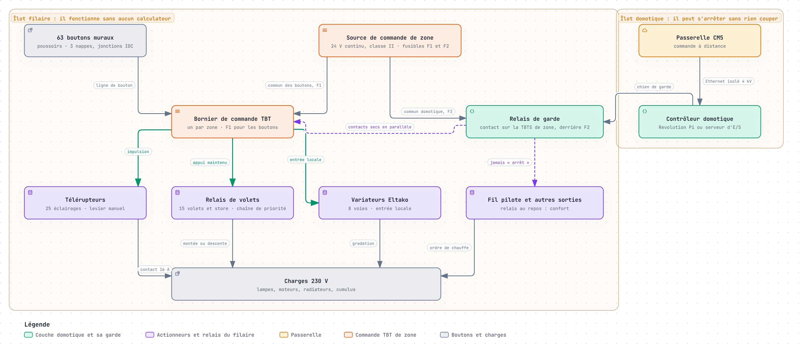
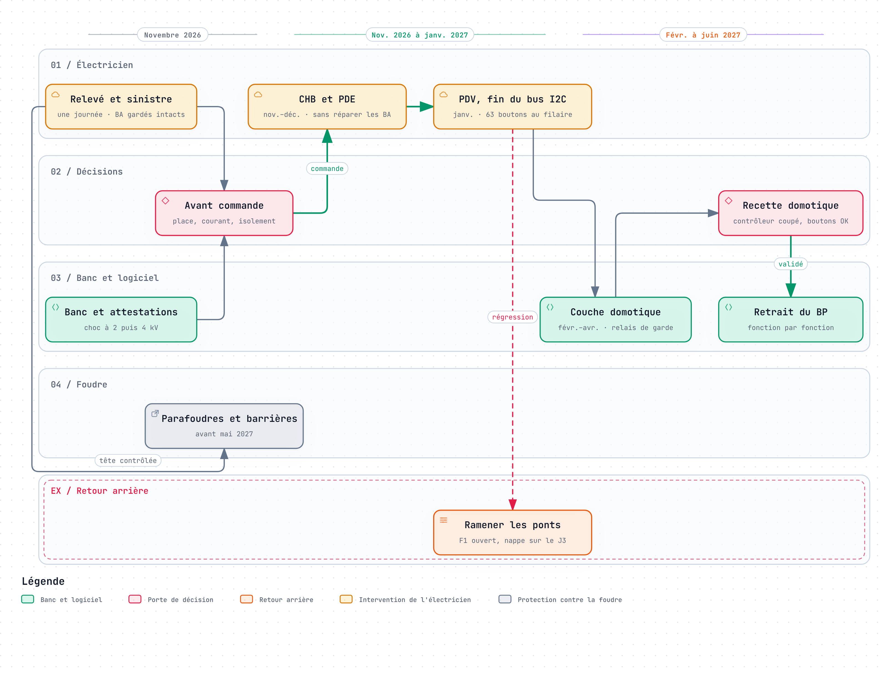

# Répondre à l'exigence de résilience

Après la foudre du 9 août 2026, deux boîtiers auxiliaires sur trois se sont tus, et les boutons de leurs pièces avec eux. La leçon est simple : une maison ne doit pas perdre ses lumières et ses volets parce qu'un calculateur est mort. Cette page dit ce que l'on exige désormais de l'armoire, pourquoi les trois études V1 n'y répondaient pas, comment l'architecture V2 y répond, ce que cela coûte, et comment on le prouvera avant d'équiper une maison.

!!! abstract "En bref"
    - **L'exigence** : si le contrôleur, un automate ou un Raspberry Pi grille, les 63 boutons muraux commandent toujours leurs lumières, leurs volets et leurs variateurs, en filaire. La domotique devient une couche ajoutée, qui peut tomber sans rien couper.
    - **La réponse** : chaque bouton attaque directement un organe qui garde l'état (télérupteur, relais de volet, variateur à entrée locale), alimenté par la source de commande de sa zone. La domotique se branche en parallèle, par des contacts secs, derrière un relais de garde qui la débranche en moins d'une seconde si elle se tait.
    - **Le prix** : environ 3 450 à 3 950 € HT de matériel pour la seule couche filaire, 6 450 à 7 850 € HT avec une couche domotique complète, un second coffret, et le renoncement au double clic et à l'appui long. Aucun logiciel n'est sur le chemin d'un bouton.
    - **La preuve** : un banc de deux lumières, des attestations d'isolement, un essai de choc de 2 puis 4 kV, et une recette par zone, contrôleur coupé.

Les chiffres de cette page viennent de l'[étude V2](remplacement-armoire/v2/filaire-d-abord.md) et des six avis du [conseil d'autocritique](remplacement-armoire/v2/conseil.md), rédigés par des agents d'IA dans des rôles d'expert. Ce sont des estimations : un électricien, des devis et des essais doivent les confirmer.

## L'exigence

> Si le contrôleur, un automate ou un Raspberry Pi grille, les interrupteurs muraux pilotent toujours les relais, en filaire. La domotique devient une couche ajoutée, qui peut tomber sans rien couper.

Elle se traduit en cinq critères que l'on peut vérifier :

| Critère | Comment on le vérifie |
| --- | --- |
| Aucun calculateur du projet entre un bouton et sa charge | Schéma ; recette contrôleur coupé, réseau débranché |
| Aucune panne simple ne prive toute la maison de ses boutons | AMDEC : nombre de modes communs, zéro visé |
| La pire panne simple du filaire ne prive qu'une zone, dont les lumières restent dans leur état | Essai : source de zone coupée, leviers des télérupteurs |
| Une domotique morte, figée, folle ou piratée ne bloque aucun bouton et ne coupe pas le chauffage | Essais du relais de garde, du contact soudé et du fil pilote |
| L'îlot des boutons survit à l'onde qui détruirait la domotique | Onde de 2 puis 4 kV en mode commun sur une ligne de bouton |

## Ce que la foudre a appris

L'[analyse de l'incident](../retex/foudre-2026/analyse-experte.md) a montré comment une armoire peut perdre ses boutons :

- **Un bus interne court reste un chemin de foudre.** Le bus I2C, seul lien galvanique entre des cartes flottantes, a servi de pont aux courants d'équilibrage.
- **Le chemin du bouton passait par un calculateur.** Chaque boîtier auxiliaire (BA) bascule lui-même ses relais sur un appui : un BP planté laisse les boutons actifs, mais un BA mort prive toute sa zone. Deux BA sur trois ne répondent plus sur le bus ; un appui et leur LED diront si leurs boutons marchent encore, car muet sur le bus ne veut pas dire sans boutons.
- **L'état vivait dans le logiciel.** Les relais monostables des éclairages ne retiennent rien.
- **La panne est restée silencieuse.** Les commandes perdues étaient marquées acquittées, et l'état des BA n'était relu qu'après un ordre.
- **Une cause commune fait taire tout le bus.** Une seule ligne tenue basse suffit à couper les trois adresses : le découpage en zones ne l'arrête pas.

## Pourquoi les études V1 ne suffisaient pas

Les trois études V1 remplaçaient les cartes par d'autres calculateurs. Elles soignaient la foudre et la disponibilité des pièces, mais toutes gardaient un calculateur entre le bouton et le relais, sauf pour les 8 variateurs.

| Étude | Principe | Si le calculateur meurt | Modes qui privent toute la maison de ses boutons (AMDEC) | Verdict du conseil |
| --- | --- | --- | --- | --- |
| [Revolution Pi](remplacement-armoire/revolution-pi.md) (V1) | Un contrôleur Linux, 7 modules DIO, relais d'interface | 55 boutons sur 63 perdus | 13 | Transformer : la Connect 5 reste candidate pour la couche domotique, achetée en dernier |
| [Arduino Opta](remplacement-armoire/arduino-opta.md) (V1) | Quatre automates : un par zone et un « BP » | Sa zone perd ses boutons ; le bloc 24 V commun éteint les trois | 5 | Abandonner ; garder le fusible par zone |
| [Raspberry Pi et Ethernet](remplacement-armoire/raspberry-pi-ethernet.md) (V1) | Cartes nœuds maison, Pico 2 en Ethernet | Sa zone perd ses boutons et ses lumières s'éteignent | 4 | Abandonner les cartes ; garder l'isolement des entrées, le relais de garde et le battement de cœur |
| [Filaire d'abord](remplacement-armoire/v2/filaire-d-abord.md) (V2) | Le bouton attaque un organe bistable | Aucun bouton perdu | 0 | Retenue |

Le défaut était commun : le bouton passait par un calculateur. Découper l'armoire en zones arrête les pannes indépendantes, pas les causes communes : même code, même bloc 24 V, même foudre. Le détail est dans l'[autocritique des études V1](remplacement-armoire/v2/autocritique-v1.md).

## La réponse : filaire d'abord, domotique en dérivation

La V2 inverse le principe : le bouton commande directement un organe qui garde l'état, et la domotique sort de son chemin. L'armoire compte deux couches, dans deux îlots séparés.

{ loading=lazy }

### Le bouton commande seul un organe qui garde l'état

- **Éclairages (25)** : un télérupteur électromécanique à levier par circuit, le Finder 20.22, à bobine 24 V continu et deux contacts qui basculent ensemble. Il garde son état sans tension et se manœuvre à la main.
- **Volets et store (15)** : deux relais en chaîne de priorité ; la montée, ou la rentrée du store, l'emporte. Sans contrôleur, le volet bouge tant qu'on appuie.
- **Variateurs (8)** : les Eltako EUD12D-UC, réglés en PRI 1 ou 5 pour que le bouton garde toujours la main. Leur entrée locale prend la source de la zone.

Aucun calculateur du projet n'est sur ce chemin. Seuls les 8 variateurs gardent un microcontrôleur, celui du commerce.

### Une source de commande par zone

- **Une source par zone** : un 24 V continu de classe II homologué EN 61558-2-16 pour chacune des trois zones (pièces de vie, chambres, pièces d'eau), séparé de celui de la domotique. Une source de rechange attend au coffret.
- **Deux fusibles par zone** : F1, de 1 A, pour le commun des boutons ; F2, de 0,5 A au plus, pour le commun des contacts domotiques. Une domotique folle fait fondre F2, jamais F1.
- **Des différentiels distincts** : chaque source a son disjoncteur, sous un différentiel qui n'est pas celui des deux autres. Un défaut du lave-linge ne coupe pas les 63 boutons.
- **Une panne bornée** : une source perdue ne prive que sa zone, dont les lumières restent dans leur état, au levier.

### Une domotique sacrifiable

La domotique ajoute la distance, les horaires et la lecture d'état. Elle ne retire jamais rien aux boutons.

- **Contacts secs en parallèle** : chaque ordre est le contact d'un relais Finder 38.51 (6 kV et 8 mm entre bobine et contact), câblé en parallèle du poussoir. Il ajoute un ordre sans retirer celui du bouton, et ne touche jamais une entrée prioritaire.
- **Relais de garde** : le commun de ces contacts passe par un relais tenu par un chien de garde matériel. Le contrôleur le réarme toutes les 200 ms environ ; s'il se tait ou se fige, le relais retombe en moins d'une seconde.
- **Borne sectionnable par zone** : un geste débranche la couche domotique de la zone. C'est son retour arrière, et la parade au contact soudé.
- **Durées bornées dans le câblage** : le commun d'impulsion se coupe au-delà d'une seconde, celui de maintien au-delà de la course d'un volet. Un relais soudé échappe au logiciel, pas au câblage.
- **Aucun « arrêt » au fil pilote** : aucune combinaison de relais ne le permet, et un quatrième relais de garde ramène les radiateurs en confort.
- **L'état lu, jamais réimposé** : le second contact du télérupteur, en 230 V, commande un relais de recopie 38.51 dont seul le contact sec rejoint une entrée isolée à 4 kV. Un changement non commandé marque le circuit « repris à la main ».

| Si la domotique | Ce que fait le matériel | Ce que garde la maison |
| --- | --- | --- |
| Se tait : morte, éteinte, réseau coupé | Relais de garde ouvert en moins d'une seconde | Tous les boutons ; radiateurs en confort ; plus de distance ni d'alarme |
| Se fige, sorties bloquées | Chien de garde privé de signal, relais de garde ouvert | Idem ; lumières et volets ne bougent pas |
| Envoie un ordre faux | Durées et ordres bornés par le câblage | Les boutons, sauf contre un volet tenu en montée : borne sectionnable |
| Est piratée | Mêmes bornes câblées | Les boutons ; chauffage au pire en hors-gel ; alarme et sirènes exposées |

### Couper le chemin de la foudre

La V2 coupe le chemin de l'onde au lieu de l'écrêter. Le chemin du 9 août restant inconnu, elle ferme toutes les voies.

- **Deux îlots TBTS distincts** : l'îlot filaire (boutons et bobines) doit survivre à l'orage ; l'îlot domotique (contrôleur, alarme, capteurs) peut griller sans l'emporter. Leurs 0 V ne se touchent jamais et ne touchent pas le PE : ni liaison, ni varistance, ni TVS, ni éclateur.
- **Une barrière à chaque passage** : au moins 4 kV efficaces et 8 mm de ligne de fuite, selon le retour d'expérience. Ce sont le télérupteur (4 kV entre bobine et contacts, isolation renforcée à faire attester), le relais 38.51 (6 kV), le relais de garde, les optocoupleurs et l'isolateur Ethernet vers la passerelle.
- **Les parafoudres hors des coffrets** : au tableau et au bout des lignes extérieures. Le parafoudre de tête et la terre se contrôlent avant mai 2027.
- **Les coffrets loin du photovoltaïque** : 30 à 50 cm des câbles de l'onduleur, ou une goulotte métallique reliée au PE aux deux bouts.

Les règles d'installation sont dans [Protection contre les surtensions](../install/protection-surtensions.md).

### Des replis choisis au câblage

| Fonction | Sans contrôleur | Repli si tout s'arrête |
| --- | --- | --- |
| Éclairages | Le poussoir attaque la bobine | État gardé, levier |
| Volets | Commande maintenue | Arrêt ; jamais les deux sens ensemble |
| Store | Commande maintenue | Rentré au vent par un automatisme autonome |
| Variateurs | Entrée locale | Niveau gardé |
| Fil pilote | Commutateur Auto, Confort, Hors-gel par zone | Confort, sans délestage |
| Cumulus | Contact heures creuses du compteur | Heures creuses, si l'abonnement en a |
| Délestage | Délesteur autonome, si le bilan de puissance l'exige | Rien ne déleste sans lui |
| Alarme et sirènes | Aucune | Couche domotique sur batterie ; perdues si elle tombe |

### Une migration sans logiciel

- **Ce qu'on garde des V1** : le répartiteur X1, les blocs de phase X3, les jonctions IDC et le plan de bornage.
- **Zone par zone** : chambres et pièces d'eau d'abord, puis pièces de vie, qui mettent fin au bus I2C. La maison reste utilisable à chaque étape.
- **Bascule et retour arrière** : chaque zone bascule en quelques heures, disjoncteurs consignés, et revient en arrière par les mêmes ponts.
- **Le logiciel après** : aucun logiciel avant la bascule. La couche domotique vient ensuite, et le BP part en dernier, fonction par fonction.

## Ce que garde la maison, panne par panne

| Panne | Ce qui reste |
| --- | --- |
| Contrôleur domotique arrêté | Les 63 boutons ; volets en commande maintenue ; radiateurs en confort |
| Réseau ou passerelle | Tout le local, contrôleur et alarme compris |
| Source de commande d'une zone | Les deux autres zones ; les lumières de la zone dans leur état, au levier ; rechange en 30 minutes environ |
| Un télérupteur | Les autres circuits ; le levier si la bobine seule est morte ; échange en 5 à 15 minutes |
| Un relais de volet | Les autres volets ; jamais les deux sens à la fois, le verrouillage étant câblé |
| Coupure du secteur | Au retour, télérupteurs dans leur état ; alarme sur batterie |
| La foudre | Bobines et contacts ; lumières dans leur état, au levier, même si les trois sources meurent |

Deux défauts restent latents dans toute architecture : la batterie de l'alarme, qui perd sa capacité sans prévenir, et l'isolement qui se dégrade. L'isolement se mesure chaque année et après chaque orage proche ; la batterie s'essaie chaque année et se remplace vers 4 ans.

## Ce que coûte la résilience

| Poste | Ordre de grandeur |
| --- | --- |
| Couche filaire seule, qui suffit à faire marcher la maison | ≈ 3 450 à 3 950 € HT de matériel |
| Avec une couche domotique minimale | ≈ 4 300 à 4 900 € HT |
| Avec une couche domotique complète : contacts secs, recopie d'état, relais de garde | ≈ 6 450 à 7 850 € HT |
| Sans attestation d'isolement des fabricants | ≈ 1 000 € de plus |
| Électricien | 6 à 8,5 jours, sans devis |
| Place | 1,6 à 2,1 m de rail, donc un second coffret |
| Logiciel | Aucun sur le chemin d'un bouton ; 5 à 11 semaines-personne de domotique après la bascule, contre 11 à 28 avant la bascule dans les V1 |

Ce que l'on accepte : on renonce à imiter le BP. Le double clic, l'appui long et les scénarios câblés dans les BA quittent le chemin filaire ; sans contrôleur, un volet se pilote en gardant le doigt sur le bouton. Le coffret compte plus d'appareils et de connexions, à essayer chaque année. Les parafoudres ne sont pas chiffrés.

## Comment on le prouvera

Rien ne se commande en série avant ces étapes.

1. **Le relevé de l'électricien**, une journée avant toute commande : volumes des salles d'eau, résistance et isolement de chaque ligne de bouton, place loin du photovoltaïque, différentiels, bilan de puissance, parafoudre de tête et terre.
2. **Les attestations** : Finder et Eltako doivent déclarer par écrit une isolation renforcée entre commande et 230 V. Sans elle, un relais de couplage s'ajoute devant chaque organe.
3. **Le [banc deux lumières](banc-deux-lumieres.md)** : la chaîne V2 complète, pour deux lumières. La lumière 1 passe par un télérupteur Finder 20.22, la lumière 2 par un Eltako ES12Z-200-UC, pour trancher le désaccord « électromécanique ou Eltako ».
4. **Les essais au banc** :
    1. relais de garde : tuer l'application, figer le système, couper l'alimentation, mettre à jour. Il retombe en moins d'une seconde, sans impulsion au démarrage ;
    2. contact soudé : un seul circuit est touché, et la borne sectionnable rend la main ;
    3. priorités : entrée centrale d'un variateur maintenue, le bouton agit 20 fois sur 20 ;
    4. conflits : appui mural et ordre distant simultanés, sans double basculement ;
    5. fil pilote : jamais d'ordre « arrêt », contrôlé à l'oscilloscope ;
    6. fusibles : toutes les sorties d'une zone fermées ensemble ; F2 fond, F1 tient ;
    7. court-circuit sur une ligne de bouton : seul le F1 de sa zone coupe ;
    8. onde de choc : 2 puis 4 kV en mode commun sur une ligne de bouton, couche branchée ; le filaire marche encore.
5. **L'essai de choc en laboratoire**, avant toute commande en série : 1 000 à 1 800 € la journée.
6. **La recette de chaque zone** : contrôleur coupé, réseau débranché, une sortie collée ; tous les boutons commandent leur charge.
7. **L'entretien** : isolement mesuré chaque année et après chaque orage proche, essai de retombée du relais de garde, essai de capacité de la batterie de l'alarme.

## Ce qui reste à trancher

Six désaccords restent ouverts ; un relevé, un essai ou un devis départagera chacun.

| Désaccord | Choix provisoire | Autre option | Départagé par |
| --- | --- | --- | --- |
| Éclairages | Télérupteur électromécanique | Actionneur électronique Eltako | Courant des lignes, place, essai de choc, banc |
| Volets | Chaîne de deux relais | Eltako EGS12Z | Banc avec un vrai moteur |
| Source de commande | 24 V continu par zone | Transformateur 50 Hz | Volumes des salles d'eau, norme |
| BA actuels | Ne pas les réparer, mais vérifier leur état | Les réparer d'abord | LED DL1, expertise éventuelle |
| Couche domotique | Revolution Pi, achetée en dernier | Serveur d'E/S léger, piloté par la passerelle | Fonctions utilisées, devis |
| Calendrier | Poser après les essais | Poser dès novembre | État des BA, attestations |

D'autres préalables peuvent changer la commande :

- la place d'un second coffret loin du photovoltaïque ; sinon des Eltako, environ 0,9 m de rail ;
- le courant admis par les lignes, 230 mA par bobine ;
- la tension admise en salle de bains : TBTS 12 V en volumes 1 et 2 ;
- la température du coffret ;
- l'état réel des BA ;
- la garde des BA déposés, intacts, tant qu'une expertise est possible.

## Feuille de route

{ loading=lazy }

| Quand (estimation) | Étape | La maison |
| --- | --- | --- |
| Novembre 2026 | Relevé, banc, attestations | Inchangée |
| Novembre et décembre 2026 | Chambres et pièces d'eau | 20 éclairages, 8 volets, le store et 5 variateurs reviennent au bouton |
| Janvier 2027 | Pièces de vie, fin du bus I2C | Les 63 boutons commandent leur charge sans aucun calculateur |
| Février à avril 2027 | Couche domotique | La commande à distance revient ; sa panne ne touche aucun bouton |
| Avant mai 2027 | Parafoudres | Prête pour les orages de l'été |
| Printemps 2027 | Retrait du BP, fonction par fonction | Utilisable tout du long |

Seule l'échéance de mai 2027 est ferme. Les essais peuvent décaler les autres dates sans changer l'ordre.

## Pour toutes les installations Essensys

Ces règles valent au-delà de cette armoire :

1. Un bouton ne passe jamais par un calculateur pour atteindre sa charge.
2. L'état d'un circuit vit dans un organe bistable, pas dans un logiciel.
3. La domotique ajoute un ordre, elle n'en retire jamais : contacts en parallèle, relais de garde, borne sectionnable.
4. Une source et un fusible par zone, et un fusible distinct pour la domotique.
5. Une barrière d'au moins 4 kV et 8 mm à chaque passage d'îlot ; le 0 V jamais au PE ; les parafoudres hors des coffrets.
6. Chaque repli se choisit au câblage et s'essaie à la recette : contrôleur coupé, réseau débranché, une sortie collée.
7. L'isolement se mesure chaque année et après chaque orage proche.

## Pour aller plus loin

- [Étude V2 « filaire d'abord, domotique en dérivation »](remplacement-armoire/v2/filaire-d-abord.md) : architecture, schémas, nomenclature, modes dégradés, préalables, feuille de route.
- [Conseil d'autocritique](remplacement-armoire/v2/conseil.md) et [autocritique des études V1](remplacement-armoire/v2/autocritique-v1.md).
- [Banc deux lumières](banc-deux-lumieres.md) : l'implantation sur rail DIN, les fils, le comparatif Finder et Eltako.
- [Sections de câbles](remplacement-armoire/v2/sections-de-cables.md) : rigide, souple et embouts dans l'armoire.
- [Retour d'expérience de la foudre](../retex/foudre-2026/synthese.md) et son [analyse experte](../retex/foudre-2026/analyse-experte.md).
- [Protection contre les surtensions](../install/protection-surtensions.md).
