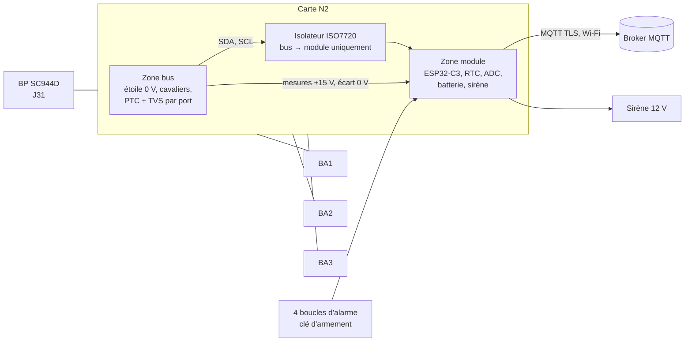

# Module N2 : espion I2C, surveillance et alarme

La carte N2 « étoile 0 V » relie le boîtier principal (BP, carte SC944D) aux boîtiers auxiliaires (BA) en étoile
autour d'un plan 0 V commun. Depuis la **révision B**, elle porte aussi un module ESP32-C3 qui :

- **écoute** le bus I2C BP ↔ BA sans pouvoir y émettre (mode espion, avec un mode debug) ;
- **surveille** la santé du bus et du +15 V : BA muet, ligne collée, PTC déclenchée ;
- **horodate les surtensions** (foudre) et en conserve la preuve en mémoire non volatile ;
- gère une **alarme intrusion** à 4 boucles avec sirène, qui continue de fonctionner sur batterie ;
- publie le tout en **MQTT sur TLS**.

Il est alimenté par le +15 V du bus et secouru par une batterie LiFePO4.

Sources : dépôt public [essensys-i2c-etoile-0v](https://github.com/essensys-hub/essensys-i2c-etoile-0v)
(schéma, PCB, BOM, firmware), change OpenSpec `n2-esp32-spy-alarm-2026-10-008`, ticket
[essensys-feature-lifecycle#28](https://github.com/essensys-hub/essensys-feature-lifecycle/issues/28).
Contexte : [retour d'expérience foudre 2026](../retex/foudre-2026/synthese.md).

!!! warning "Statut : prototype, non qualifié"
    La révision B est conçue (ERC et DRC sans erreur) et le firmware est construit et testé sur PC. Les essais sur
    banc (alimentation, batterie, bus, alarme, surtensions, MQTT, mises à jour) restent à faire. Les valeurs de cette
    page sont des valeurs de conception, sauf mention contraire.

!!! danger "Ce que le module n'est pas"
    - **Pas une alarme certifiée** (EN 50131) : c'est une aide à la détection, pas un système de sécurité agréé.
    - **Pas un acteur du bus** : il ne peut ni émettre, ni acquitter, ni réinitialiser le bus. Il ne remplace pas le
      pilote I2C du BP.
    - Le protocole HTTP entre l'armoire et la passerelle **n'est pas modifié**.

## Principe



**Pourquoi il ne peut pas perturber le bus.** L'écoute passe par un isolateur numérique dont les deux canaux vont
dans le sens bus → module : côté bus, il n'existe que des entrées. Aucune configuration logicielle ne peut tirer
SDA ou SCL. Le firmware ajoute ses propres garde-fous (broches d'écoute en entrée seule, contrôlées toutes les 10 s,
aucune API d'écriture, test automatique qui échoue si une écriture apparaît dans le code). Le cavalier **JP4**
déconnecte physiquement l'écoute.

**Pourquoi une panne du module ne coupe pas les BA.** Le module a sa propre PTC (0,2 A) et sa diode anti-retour sur
le +15 V. Un court-circuit côté module ouvre cette PTC ; les BA restent alimentés.

## Installation

!!! danger "TBTS : le 0 V n'est jamais relié à la terre"
    Le bus BP/BA est en très basse tension de sécurité. Aucune liaison 0 V–PE, ni par la carte, ni par le support,
    ni par une vis. Toute intervention dans le coffret se fait **après coupure du 230 V par une personne habilitée**.
    Voir aussi les règles de pose de l'[analyse experte foudre 2026](../retex/foudre-2026/analyse-experte.md) (§ 10).

### Pose de la carte

1. Monter la carte (235 × 68 mm) sur un **porte-carte DIN isolant**, ou sur des entretoises nylon M3. Les six trous
   de fixation ne sont reliés à rien.
2. Laisser **dégagé le bord haut**, côté antenne de l'ESP32 : pas de rail métallique, de câble ni de paroi métallique
   à moins de quelques centimètres. Dans un coffret métallique, prévoir un coffret plastique ou une antenne déportée
   (hors périmètre de la révision B).
3. Raccorder le bus comme pour la révision A : J1 vers J31 du BP, J2/J3, J4/J5 et J6/J7 vers J1/J2 de chaque BA,
   faisceaux AWG20 de 15 cm au plus, queue de cochon 0 V vers J31-3. **Ne plus chaîner les BA entre eux.** Le détail
   est dans le README du dépôt (consignes de pose).

### Batterie

- Accumulateur **LiFePO4 IFR18650** (3,2 V nominal, 1,5 Ah), dans le porte-pile BT1. **Jamais de Li-ion 3,7 V** :
  le chargeur est réglé pour 3,6 V en fin de charge.
- Charge à 200 mA, autorisée entre environ 3 et 43 °C (sonde CTN sur la carte).
- Le basculement secteur → batterie se fait sans coupure. Sur batterie, le BP a coupé le +15 V : il n'y a plus de
  trafic I2C, le module continue l'alarme et la journalisation.
- Autonomie de conception : environ **25 h** avec le Wi-Fi en économie d'énergie, 67 h en veille légère alarme
  armée, seulement 14 h si le Wi-Fi reste actif en permanence. L'objectif de 24 h dépend donc du mode d'économie du
  firmware sur batterie (à mesurer).

### Budget sur le +15 V

Le module consomme jusqu'à **100 mA environ** sur le +15 V (batterie vide en charge, Wi-Fi actif), en plus des BA.
Le +15 V du BP et les PTC des ports doivent être dimensionnés en conséquence (PTC ≥ 1,5 × courant BA). La sirène est
alimentée par la batterie, pas par le +15 V.

### Cavaliers et boutons

| Repère | Rôle | Position normale |
|---|---|---|
| JP1 à JP3 | Coupent SDA, SCL et +15 V d'un port BA (le 0 V reste raccordé) | Fermés |
| JP4 | Raccorde l'écoute I2C du module au bus | Fermé ; ouvert = aucune liaison module ↔ SDA/SCL |
| SW1 | Démarrage / service ; appui de 3 s = mode debug local | – |
| J11 | Contact à clé d'armement (contact sec) | – |
| J9 | Port de débogage USB / UART (console locale) | – |

### Provisionnement

Chaque module reçoit ses identifiants **hors dépôt** : identifiant d'appareil, Wi-Fi, URI `mqtts://` du broker,
certificats, clé de commande de 32 octets, préfixe des mises à jour. Le modèle est
`firmware/provisioning/n2_prov.csv.example` (valeurs fictives). La procédure (génération de la partition NVS,
chiffrée en version release) est dans le README du firmware.

Un module **sans provisionnement fonctionne en autonome** : écoute, journal, alarme et sirène, sans réseau.

!!! warning "Version release : irréversible"
    Le premier démarrage d'une image release grave les eFuses (Secure Boot, chiffrement de la flash, désactivation
    du JTAG). Ne jamais flasher une image release sur une carte de banc qu'on veut reprogrammer.

## Alarme intrusion

### Boucles

Quatre boucles **équilibrées** (bornier J10), chacune avec deux résistances de fin de ligne de 4,7 kΩ : une en série
avec le contact, une en parallèle. Le module distingue quatre états :

| État de la boucle | Résistance | Tension lue | Interprétation |
|---|---|---|---|
| Court-circuit | 0 Ω | ≈ 0,30 V | Sabotage |
| Fermée | 4,7 kΩ | ≈ 1,20 V | Repos |
| Ouverte | 9,4 kΩ | ≈ 1,68 V | Détection (ouverture, mouvement) |
| Coupée | ∞ | saturation | Sabotage |

Un sabotage (court-circuit ou coupure) est signalé **même alarme désarmée**.

Type de chaque zone (paramètre `zone_types` du provisionnement) : désactivée, **instantanée**, **temporisée**
(délai d'entrée) ou **24 h** (toujours surveillée). Par défaut : Z1 temporisée, Z2 à Z4 instantanées.

!!! tip "Autoprotection du coffret"
    La révision B n'a pas d'entrée dédiée à l'ouverture du coffret. Câbler ce contact sur une boucle déclarée en
    zone 24 h.

### Armement et désarmement

| Moyen | Remarque |
|---|---|
| Contact à clé (J11) | Local, anti-rebond de 150 ms |
| Console USB (J9) | `arm`, `disarm` ; voir la limite ci-dessous |
| MQTT | Commande **signée** (HMAC-SHA256, anti-rejeu) ; toute commande non authentifiée est rejetée et journalisée |

- Délai de sortie : 30 s ; délai d'entrée : 30 s (zones temporisées).
- L'armement est refusé si une zone est ouverte ou en défaut (événement `arm_refused`).
- Sirène 12 V, coupée au plus tard après **3 min**. Une sortie en court-circuit est détectée (`siren_fault`).

!!! warning "Console locale"
    La console USB n'a pas d'authentification : elle peut armer, désarmer et effacer le journal. Le port J9 doit
    rester dans le coffret fermé.

## Surveillance du bus et surtensions

| Événement | Déclencheur (valeur par défaut) |
|---|---|
| `ba_mute` / `ba_back` | Un BA n'acquitte plus son adresse pendant 10 s, puis répond de nouveau |
| `line_stuck` / `line_released` | SDA ou SCL maintenue basse plus de 100 ms, puis relâchée |
| `v15_low` / `v15_ok` | +15 V du BP sous 13 V, puis rétabli |
| `on_battery` | +15 V absent : le module passe sur batterie |
| `ptc_trip` | PTC d'un port déclenchée (aval < 2 V alors que l'amont est > 12 V) |
| `port_open` | Cavalier d'un port ouvert |
| `batt_low` / `batt_ok` | Batterie sous 3,0 V, puis rétablie |
| `surge` | Latch matériel : écart de 0 V au-delà de ± 1 V, ou +15 V au-delà de 20 V, même pour une impulsion de quelques µs |
| `zero_v_gap` | Écart de 0 V entre un BA et le BP au-delà de 0,5 V (mesure lente) |

Le latch de surtension capte une onde de foudre de type 8/20 µs que la mesure lente manquerait. La valeur associée à
un `surge` est celle mesurée au traitement du latch (au plus 50 ms après l'impulsion) : le latch prouve le
dépassement, il ne mesure pas la crête.

**Conservation des preuves.** Le journal (256 événements) est stocké en mémoire non volatile avec un contrôle
d'intégrité. Il survit à une coupure totale et ne s'efface **que** par une commande locale explicite
(`events-clear CONFIRMER` sur la console), jamais par MQTT.

**Horodatage.** Horloge RTC secourue, synchronisée par NTP quand le réseau est là. Chaque événement indique sa source
d'heure : `ntp`, `rtc` ou `uptime` (avant toute mise à l'heure). Les événements survenus hors réseau sont publiés
au retour du Wi-Fi.

## Mode debug

Désactivé au démarrage. Il s'active par un appui de 3 s sur SW1, par la console, ou par une commande MQTT signée
`debug`, pour une durée bornée (1 h par défaut). En mode debug, **toutes** les trames du bus sont publiées avec leurs
octets ; hors debug, seules les trames en erreur (NACK, CRC) le sont.

## MQTT

Connexion **`mqtts://` uniquement** (TLS avec le certificat d'autorité provisionné). Racine des topics :
`essensys/n2/<dev_id>/`.

| Topic | Sens | Contenu |
|---|---|---|
| `status` (retenu) | publié | `online` (`offline` par message de dernière volonté), version, état de l'alarme, mode debug, source de l'heure, BA muets |
| `events` (QoS 1) | publié | Journal d'événements |
| `frames` | publié | Trames en erreur ; toutes en mode debug |
| `counters` | publié | Compteurs de trames, d'erreurs et de pertes, toutes les 60 s |
| `alarm/state` (retenu) | publié | État de l'alarme |
| `events/dump`, `frames/dump` | publié | Relecture des journaux à la demande |
| `cmd` | **souscrit** | Seule entrée : commandes signées |
| `cmd/result` | publié | Résultat de chaque commande, rejets compris |

Exemple d'événement publié sur `essensys/n2/n2-exemple-01/events` :

```json
{"seq":42,"ts":1791900000,"tsrc":"rtc","type":"surge","ch":0,"value":1350}
```

`ch` désigne la zone, le port ou la ligne selon le type ; `value` est en mV ou en ms selon le type.

### Commandes

Format texte :

```text
v=1;seq=<n>;cmd=<arm|disarm|debug|status|events|frames|ota>[;arg=…][;ttl=…];mac=<hex>
```

- `mac` = HMAC-SHA256(clé de commande, `"<dev_id>|"` suivi du texte qui précède `;mac=`).
- `seq` doit être strictement croissant (conservé par le module) : une commande rejouée est rejetée.
- L'outil `firmware/tools/n2_cmd.py` du dépôt signe une commande, la clé étant passée par variable d'environnement.
- **Aucune commande n'agit sur le bus I2C.** Les mises à jour (`ota`) n'acceptent qu'une image signée, téléchargée
  en `https` sous le préfixe provisionné.

## Limites connues (révision B)

- Essais sur banc à faire : seuils réels des boucles, tenue de la sirène en court-circuit, autonomie, seuil du latch,
  relecture après coupure, broker, rejet d'une image non signée, tests de non-régression du bus.
- Avant fabrication : relecture humaine du routage automatique, vérification des empreintes (module ESP32-C3,
  chargeur) et du brochage du chargeur.
- Isolateur hors tension : si le BP coupe le +15 V mais garde SDA/SCL tirées, l'isolateur non alimenté pourrait être
  rétro-alimenté par ses entrées. À mesurer ; parade sans refaire le PCB : résistance d'entrée de 10 kΩ au lieu de
  1 kΩ, ou retrait de JP4.
- Pas de mesure de crête des surtensions ni d'entrée d'autoprotection dédiée (voir plus haut).
- Ne jamais tester le module sur une armoire en service : uniquement sur banc.
