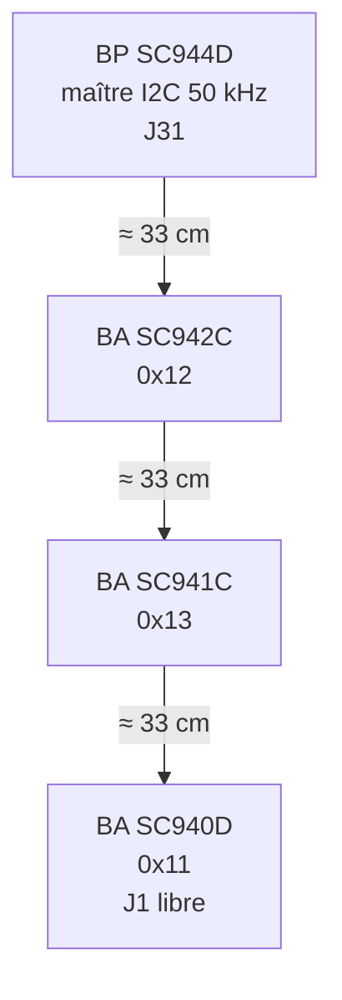
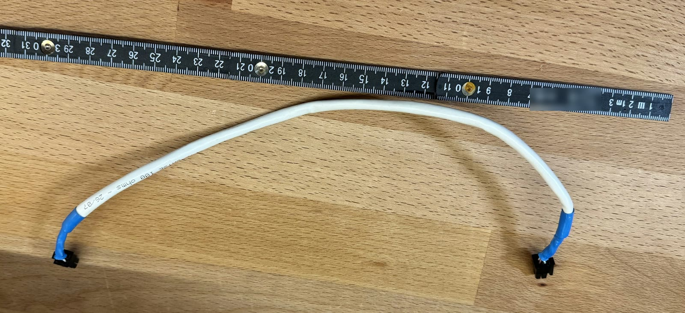
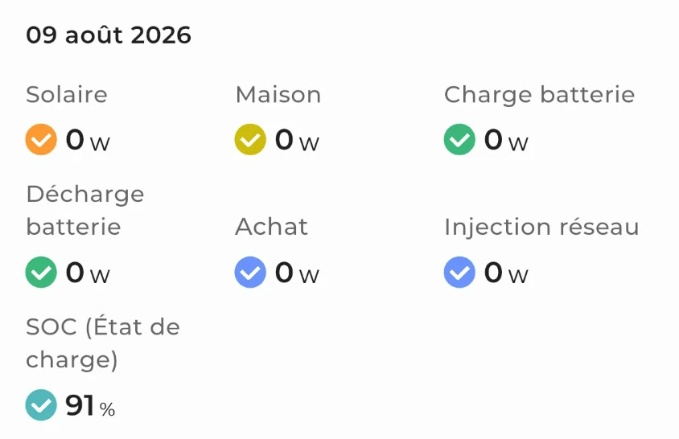
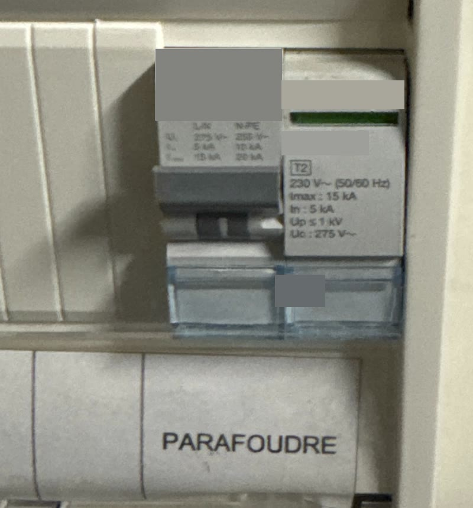
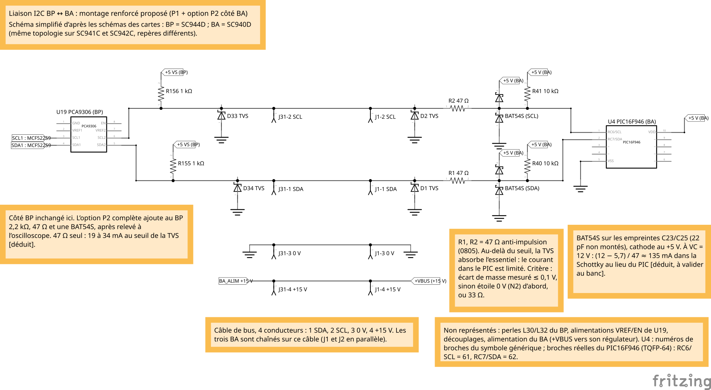
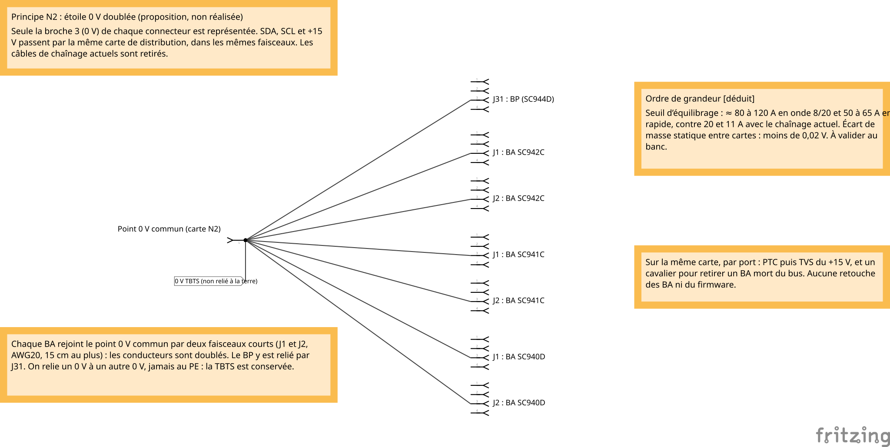
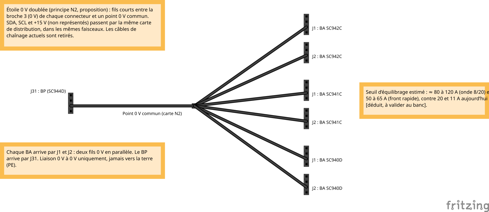

# Coup de foudre du 9 août 2026 : analyse experte

Le 9 août 2026, en fin d'après-midi, pendant un orage, un coup de foudre a été rapporté sur une installation Essensys équipée d'une centrale photovoltaïque (témoignage de l'occupant, sans attestation de foudroiement). Depuis, le boîtier principal (BP) ne dialogue plus avec aucun des trois boîtiers auxiliaires (BA). Cette page explique ce que l'analyse des schémas, du firmware, des photos du site et des calculs dit du phénomène, et ce qu'elle ne permet pas encore de dire.

Elle s'adresse aux électroniciens, aux contributeurs du projet open hardware et aux installateurs. Les références de cartes et de composants sont celles des dépôts Essensys. Les équipements tiers de l'installation sont désignés par des noms génériques.

!!! info "Comment lire cette page"
    Chaque affirmation importante porte une marque :

    - *[établi]* : lu sur un schéma, une nomenclature, dans le code ou une fiche technique, ou constaté sur une photo ou une mesure ;
    - *[déduit]* : calcul ou raisonnement d'ingénieur, à confirmer par une mesure ;
    - *[hypothèse]* : supposition sur l'installation ou sur la cause, à confirmer sur place ;
    - *[à vérifier]* : valeur de fiche technique citée sans relecture de la fiche ;
    - *[estimation]* : prix indicatif hors taxes, petites quantités.

    Les diagrammes interactifs s'affichent ici en version compacte. Le lien « Ouvrir le diagramme en plein écran » donne la version complète, avec la barre d'outils et les fiches de synthèse. Une image fixe est disponible sous chaque diagramme. Toutes les images s'agrandissent d'un clic.

!!! warning "Statut de l'analyse (octobre 2026)"
    L'analyse a été faite sur dossier et sur photos. **Aucune mesure électrique n'a encore été faite sur les cartes.** Le BA en cause, s'il y en a un, n'est pas identifié, et l'origine de la surtension n'est pas établie. Une première version de l'analyse, écrite sans les photos du site, supposait une topologie fausse ; elle a été corrigée (voir [Méthode](#methode)).

## Résumé { #resume }

- **Symptôme** *[établi]*. Depuis le 9 août 2026, aucun des trois BA ne répond au BP. Le microcontrôleur du BP semble tourner : sa LED de téléinformation est allumée et son lien Ethernet est actif *[déduit d'une photo, à confirmer par une vidéo]*.
- **Topologie** *[établi, photos]*. Les quatre cartes sont dans **un seul coffret**, chaînées par trois câbles d'environ 33 cm. Chaque carte est un îlot TBT flottant, relié à la maison par son propre câblage. Le seul lien galvanique entre ces îlots est le bus I2C à quatre fils : SDA, SCL, 0 V et +15 V.
- **Mécanisme** *[déduit]*. Le câble de bus n'a pas servi d'antenne : il a servi de **pont**. Quand un événement extérieur porte deux îlots à des potentiels différents, le courant d'équilibrage traverse le câble. Au-delà d'un écart de 6,3 à 7,8 V, atteint avec **11 à 20 A seulement**, les diodes de protection font passer ce courant par SDA et SCL. Il traverse alors le translateur U19 du BP et les broches des PIC des BA, que rien ne limite (résistances série de 0 Ω). Le fil +15 V reporte aussi l'écart sur l'alimentation du BA : son régulateur atteint ses 24 V vers 28 A d'équilibrage (ΔV ≈ 10 V, §6.5).
- **Pourquoi les trois BA à la fois** *[déduit]*. Le bus est partagé, sans tampon. Une seule ligne tenue basse suffit à faire taire les trois adresses : une TVS en court-circuit, une broche de PIC claquée, un canal de U19, ou un BA qui n'est plus alimenté. Un simple verrouillage, sans dégât, produit le même symptôme : le PIC n'a pas de watchdog (A8).
- **Origine** *[hypothèse]*. Quatre hypothèses restent ouvertes : entrée côté photovoltaïque par l'Ethernet (H-PV), surtension du réseau en mode commun (H-RÉS), surtension temporaire ou défaut d'onduleur (H-TOV), événements indépendants (H-IND). L'arrêt du photovoltaïque en même temps que la coupure du disjoncteur de branchement (témoignage) est attendu, l'onduleur s'arrêtant dès que le réseau disparaît : il ne départage pas les hypothèses. Le parafoudre AC du coffret photovoltaïque a ses fenêtres noires, mais on ignore depuis quand.
- **Court terme**. Sécuriser, faire un cycle complet d'alimentation des BA, puis, s'ils restent muets, isoler la carte fautive par débranchement. Passer R1/R2 de 0 à 47 Ω, protéger le +15 V (PTC puis TVS), remplacer le chaînage par une étoile du bus complet (seuil multiplié par 4 à 6) et isoler l'Ethernet du BP. Ne jamais poser de parafoudre RJ45 relié à la terre au BP.
- **Long terme**. Dans un coffret unique : une carte d'interconnexion équipotentielle et des ports isolés à la frontière. Pour un BA déporté : un module d'isolement par BA. Pour la génération 3 : RS-485 isolé.

## 1. Contexte { #contexte }

### 1.1 L'architecture Essensys

Un boîtier principal pilote trois boîtiers auxiliaires par un bus I2C. Le détail des cartes est dans [Vue d'ensemble du matériel](../../architecture/hardware-overview.md).

| Carte | Rôle | Microcontrôleur | Adresse I2C |
|---|---|---|---|
| **SC944D** (BP) | Maître du bus, Ethernet, téléinformation | NXP MCF52259 (ColdFire, logique 3,3 V) | Maître, 50 kHz |
| **SC940D** (BA) | Pièces de vie | Microchip PIC16F946 (logique 5 V), module SSP esclave | 0x11 |
| **SC941C** (BA) | Pièces d'eau | PIC16F946 | 0x13 |
| **SC942C** (BA) | Chambres | PIC16F946 | 0x12 |

Le bus passe par des connecteurs 2×2 : **J31** sur le BP, **J1 et J2** sur chaque BA, câblés en parallèle pour le chaînage. Il porte quatre conducteurs *[établi]* :

1. SDA ;
2. SCL ;
3. 0 V (GND) ;
4. +15 V (BA_ALIM), qui alimente les BA. Le BP peut le couper par sa commande TE2.

Chaque BA reçoit aussi une nappe **J3** de 20 à 22 entrées « tout ou rien » : des contacts secs vers son 0 V, sans optocoupleur. Il commande des sorties 230 V par relais et variateurs. **Aucune des quatre cartes n'a de liaison au PE** *[établi, sur les quatre schémas]* : chacune est un îlot TBT flottant, conçu pour la TBTS. Que l'isolement 230 V / TBT des BA tienne réellement ce rang reste à vérifier (§5.2, A6).

### 1.2 L'installation du site

Les quatre cartes sont empilées dans le même coffret *[établi, photos]*. Le SC940D est en bout de chaîne : son connecteur J1 est libre. L'ordre le plus probable est le suivant (la continuité derrière les goulottes n'est pas visible) :

- **Câble de bus** *[établi]* : câble réseau catégorie 5e « 100 ohms », probablement en AWG26 à 7 brins *[hypothèse]*, d'environ 30 à 35 cm par tronçon, serti sur des fiches 2×2 (contacts de 20 mΩ). Le nombre de fils par contact est inconnu.
- **Voisinage du 230 V** *[établi]* : les câbles de bus descendent à **1 à 5 cm des bornes de phase** des borniers, sans goulotte séparée. Le 230 V interne est en conducteur à simple isolation de 1,5 mm².
- **Tableau électrique**, accolé au coffret domotique : parafoudre de type 2 de tête (Uc 275 V, In 5 kA, Imax 15 kA, Up ≤ 1 kV), en montage « 1+1 » (une varistance phase-neutre, un éclateur neutre-terre). Régime de neutre TT.
- **Coffret de protection photovoltaïque**, à quelques centimètres à droite du coffret domotique. Côté DC : quatre parafoudres de type 2 (Ucpv 750 V entre + et −, 600 V vers la terre, In 20 kA, Imax 40 kA, Up 2,8 kV). Côté AC : un parafoudre de type 2 (Uc 320 V, Up ≤ 1,5 kV, Imax 15 kA), un disjoncteur bipolaire et un interrupteur différentiel 300 mA.
- **Onduleur hybride à batterie**, au-dessus du coffret photovoltaïque. Ses câbles passent près de l'angle haut droit du coffret domotique.
- **Réseau** : le dongle de supervision de l'onduleur est raccordé en Ethernet au **même switch réseau que le BP**.

<figure markdown="span">
  { loading=lazy }
  <figcaption>Implantation : les tableaux électriques à gauche, le coffret domotique fermé au centre, le coffret de protection photovoltaïque à droite, à quelques centimètres. Les câbles de l'onduleur arrivent au-dessus du coffret photovoltaïque et passent près de l'angle haut droit du coffret domotique. Étiquettes floutées, plaques et logos masqués.</figcaption>
</figure>

<figure markdown="span">
  { loading=lazy }
  <figcaption>Le coffret domotique ouvert. De haut en bas : SC940D, SC941C, SC942C, puis le BP SC944D avec son cordon Ethernet orange et sa LED de téléinformation allumée. Le mètre donne l'échelle. À ne pas reproduire : on n'introduit rien dans un coffret ouvert sous tension.</figcaption>
</figure>

<figure markdown="span">
  { loading=lazy }
  <figcaption>Les connecteurs du bus, à gauche des cartes. Sur le SC940D (en haut), J1 est libre : c'est le bout de la chaîne. Les câbles de bus passent à 1 à 5 cm des bornes de phase.</figcaption>
</figure>

<figure markdown="span">
  { loading=lazy }
  <figcaption>Un câble de bus inter-cartes : câble réseau catégorie 5e d'environ 30 à 35 cm, serti sur deux fiches 2×2. Ses gaines sont bleues, celles des câbles en place sont noires : c'est un autre câble, dont l'origine reste à vérifier.</figcaption>
</figure>

## 2. L'événement et les constats { #evenement }

### 2.1 Chronologie

| Quand | Fait | Statut |
|---|---|---|
| 9 août 2026, début d'après-midi | La production photovoltaïque monte à environ 5,5 kW | *[établi]*, capture de supervision |
| 9 août 2026, vers 16 h 20 | Orage. Coup de foudre et déclenchement du disjoncteur de branchement rapportés par l'occupant. Toutes les puissances du photovoltaïque tombent à 0 W et y restent jusqu'à minuit, batterie à 91 % | Foudre et déclenchement : témoignage de l'occupant. Arrêt à 0 W : *[établi]*, capture. Heure à quelques minutes près : *[déduit]* |
| Depuis | Plus aucun BA ne répond au BP | *[établi]* |
| Date inconnue | Les deux fenêtres du parafoudre AC du coffret photovoltaïque sont passées au noir | Fenêtres noires : *[établi]* en octobre. Date : inconnue |
| Octobre 2026 | Le dongle de supervision de l'onduleur ne répond plus sur le réseau | *[établi]*, mesure réseau |

<figure markdown="span">
  { width="360" loading=lazy }
  <figcaption>Supervision photovoltaïque du 9 août 2026, après l'événement : toutes les puissances à 0 W, batterie à 91 %. L'en-tête de l'application et le graphique horaire sont retirés de la capture.</figcaption>
</figure>

### 2.2 Ce qui a été constaté

| Élément | Constat | Ce que cela dit, et ne dit pas |
|---|---|---|
| Les trois BA | Muets *[établi]*. Leurs LED « ÉTAT » sont éteintes sur la photo | Bus bloqué (ligne tenue basse) ou refus d'acquittement (U19, lignes hautes) : à départager. LED non concluante : DL1 ne fait qu'un bref éclair par seconde, qu'une photo rate facilement |
| BP | LED de téléinformation allumée, LED de lien Ethernet verte | PHY Ethernet actif *[établi]*. Microcontrôleur probablement vivant *[déduit]* : une sortie figée allume aussi la LED, une vidéo dira si elle est fixe ou clignotante |
| Faces avant des cartes | Aucune trace de brûlure visible | Non concluant : les cartes sont capotées |
| Parafoudre de tête | Fenêtre d'état verte | En montage 1+1, seule la varistance phase-neutre a un voyant. L'éclateur neutre-terre a pu fonctionner sans laisser de trace |
| Parafoudres DC du coffret photovoltaïque | Aucune fenêtre rouge | — |
| Parafoudre AC du coffret photovoltaïque | **Deux fenêtres noires** | Principal indice matériel côté photovoltaïque. Le sens exact du noir (fin de vie, drapeau, module mal enfiché) est à lire dans la notice du fabricant |
| Dongle de supervision | Ne répond plus sur le réseau | Compatible avec un port Ethernet endommagé, mais aussi avec un simple onduleur à l'arrêt : le dongle est alimenté par l'onduleur |

<figure markdown="span">
  { loading=lazy }
  <figcaption>Le parafoudre de type 2 du tableau (Uc 275 V, In 5 kA, Imax 15 kA, Up ≤ 1 kV) : fenêtre verte. En montage 1+1, ce vert ne prouve pas que la partie neutre-terre n'a rien subi.</figcaption>
</figure>

<figure markdown="span">
  { loading=lazy }
  <figcaption>Le coffret photovoltaïque : parafoudres DC sans fenêtre rouge en haut ; en bas à gauche, le parafoudre AC (Uc 320 V, Up ≤ 1,5 kV) aux deux fenêtres noires. La date du noircissement est inconnue.</figcaption>
</figure>

### 2.3 Un enchaînement possible

Le diagramme ci-dessous reconstitue un enchaînement possible parmi d'autres. Seuls l'arrêt du photovoltaïque à 0 W et le constat final sont établis ; le coup de foudre et le déclenchement du disjoncteur sont rapportés par l'occupant. Les portes d'entrée sont des hypothèses non classées : H-PV y est détaillée en plus d'étapes, ce qui n'en fait pas la piste principale. L'équilibrage, dont le sens est inconnu, et les dégâts sont déduits par le calcul.

<iframe src="../archify/propagation-evenement.html?embed=1&amp;theme=light" title="Diagramme de séquence interactif : un enchaînement possible de l'événement du 9 août 2026" loading="lazy" style="width:100%;aspect-ratio:1044/690;height:auto;border:0"></iframe>

[Ouvrir le diagramme en plein écran](archify/propagation-evenement.html){ target="_blank" rel="noopener" }. Sept acteurs (foudre, tableau, installation photovoltaïque, switch réseau, BP, bus I2C, BA muet) et quatre phases : impact, entrée possible, équilibrage et dégâts, constat.

??? info "Image fixe du diagramme"
    { loading=lazy }

## 3. Méthode { #methode }

L'analyse croise six sources :

1. **Les schémas** des quatre cartes (PDF des projets), lus ligne par ligne du connecteur au circuit intégré, avec les nomenclatures, dont celle de la modification « DM » de janvier 2017.
2. **Le firmware** du BP (pilote I2C et gestion des BA) et les sources 1.7 du BA : reprise sur erreur, watchdog, mise à jour des indicateurs de défaut.
3. **Les fiches techniques** des composants en place : SMF5V0A, PCA9306, MCF52259, PIC16F946, LMR12010.
4. **Huit photos du site**, une capture de supervision et une mesure réseau.
5. **Des calculs CEM** : inductances propres et mutuelles des tronçons, seuils d'équilibrage, courants injectés.
6. **Deux relectures contradictoires**, l'une sur les calculs, l'autre sur la pratique de terrain, et deux analyses spécialisées (CEM, foudre et photovoltaïque). Les désaccords ont été arbitrés et tracés.

!!! tip "Leçon de méthode : photographier avant de modéliser"
    La première version de l'analyse supposait des BA dans des coffrets séparés, reliés par un long câble qui se comporte comme une antenne (« environ 1 kV sur 10 m »). Les photos ont montré **un seul coffret et trois tronçons de 33 cm**. Le modèle a changé de nature (un pont entre îlots, et non une antenne), les seuils aussi, et donc les priorités. Une photo du coffret ouvert aurait évité ce détour.

Les hypothèses sur l'origine n'ont pas été classées avant d'avoir des preuves. Pour chacune, on a cherché le **test qui la départage** des autres (§7).

<iframe src="../archify/demarche-analyse.html?embed=1&amp;theme=light" title="Diagramme de processus interactif : la démarche d'analyse" loading="lazy" style="width:100%;aspect-ratio:1125/826;height:auto;border:0"></iframe>

[Ouvrir le diagramme en plein écran](archify/demarche-analyse.html){ target="_blank" rel="noopener" }. Des symptômes aux actions, avec le retour des photos du site vers la lecture des schémas.

??? info "Image fixe du diagramme"
    { loading=lazy }

## 4. Interfaces I2C : ce que montrent les schémas { #schemas }

### 4.1 Côté BP : SC944D, page « Liaison Boîtiers Auxiliaires »

<figure markdown="span">
  { loading=lazy }
  <figcaption>Schéma du SC944D (page 7). Cliquez pour agrandir.</figcaption>
</figure>

Dans l'ordre, du microcontrôleur au connecteur *[établi]* :

- **MCF52259** (3,3 V), broches 28 (SCL) et 29 (SDA). Environ **55 mm de piste sans aucune protection**, ni résistance série ni écrêtage. Tirages R157/R158 de 4,7 kΩ vers +3V3S.
- **U19, PCA9306** (translateur de niveau 3,3 V ↔ 5 V). VREF1 = +3V3S. VREF2 et EN sont reliés et tirés vers +5VS par R154 (200 kΩ).
- **R155 (SDA) et R156 (SCL)** : tirages de 1 kΩ vers +5VS. C79/C80 (18 pF) ne sont pas montés.
- **L30 (SCL) et L32 (SDA)** : perles de ferrite 0603, 700 Ω à 250 MHz, 0,35 Ω en continu, 400 mA.
- **D33 (SCL) et D34 (SDA)** : TVS **SMF5V0A** vers GND, à 6 et 8 mm de J31.
- **J31** : 1 = SDA, 2 = SCL, 3 = GND, 4 = BA_ALIM.
- **BA_ALIM** : +15VSP (transistor T32, commandé par TE2 via T33, cavalier J58) → **L31** (100 Ω à 100 MHz) → J31-4. **Ni TVS, ni fusible, ni PTC.** Le régulateur U16 (LD1117, +12VSP) est alimenté directement par le +15VSP.

### 4.2 Côté BA : SC940D, page « Cœur »

<figure markdown="span">
  { loading=lazy }
  <figcaption>Schéma du SC940D (page 2), version « DM ». Les SC941C et SC942C ont la même topologie. En haut à droite, R79/R80 sont montées et le filtre L3 est retiré.</figcaption>
</figure>

Dans l'ordre, du connecteur au microcontrôleur *[établi]* :

- **J1 et J2**, câblés en parallèle : 1 = SDA, 2 = SCL, 3 = GNDBUS, 4 = +VBUS.
- **D1 (SDA) et D2 (SCL)** : TVS SMF5V0A vers le GND local, côté connecteur. Sur le SC940D, elles sont à 28 à 48 mm de J1/J2.
- **R1 et R2 : 0 Ω** (0805). Aucune limitation de courant.
- Nœud côté PIC : **R40/R41**, tirages de 10 kΩ vers +5 V. C23/C25 (22 pF) ne sont pas montés.
- **PIC16F946** : RC7 = SDA (broche 62), RC6 = SCL (broche 61).
- **Alimentation** : +VBUS → **R79 (0 Ω, montée)** → +Vin (C40, 220 pF, non monté) → filtre FI1 (25 V) → diode D3 → rail « +12V », qui vaut **14,3 V** en réalité, découplé par **C2 (10 µF / 16 V)** → **U1, LMR12010** (VIN 24 V en maximum absolu) → +5 V (4,93 V).
- **Masse** : GNDBUS → **R80 (0 Ω, montée)** → GND. Depuis la modification DM de janvier 2017, le filtre de mode commun L3 (2 × 1 mH) est remplacé par R79/R80, et C40 est retiré : **le fil 0 V du bus est relié directement au 0 V de la carte**.

Les désignateurs changent d'une carte à l'autre :

| Fonction | SC940D | SC941C | SC942C |
|---|---|---|---|
| PIC | U4 | U4 | U5 |
| Résistances série SDA / SCL (0 Ω) | R1 / R2 | R1 / **R3** | R1 / R2 |
| Tirages 10 kΩ SDA / SCL | R40 / R41 | R43 / R44 | R51 / R52 |
| 22 pF non montés SDA / SCL | C23 / C25 | C24 / C26 | C27 / C29 |
| 0 Ω VBUS / GNDBUS | R79 / R80 | R93 / R94 | R84 / R85 |
| Empreinte 220 pF (+Vin–GND) | C40 | C40 | C42 |
| Connecteur ICSP | J83 | J97 | J92 |
| Adresse (firmware 1.7) | 0x11 | 0x13 | 0x12 |

### 4.3 La liaison complète, redessinée

Les schémas Fritzing ci-dessous mettent bout à bout le côté BP et un BA. Ils sont simplifiés : les perles L30/L32, VREF/EN de U19, les découplages et l'alimentation du BA ne sont pas dessinés.

=== "Schéma"

    { loading=lazy }

    *Liaison actuelle. Au-delà d'environ 5,5 V, c'est la diode interne du PIC qui conduit la première, avant la TVS (6,4 V) : avec R1/R2 = 0 Ω, le PIC est l'écrêteur principal, sans limite de courant.*

=== "Vue platine"

    { loading=lazy }

    *La même liaison en vue platine : SDA en bleu, SCL en jaune, 0 V en noir, +15 V en orange.*

Source Fritzing : [liaison-i2c-actuelle.fzz](fritzing/liaison-i2c-actuelle.fzz){ download="liaison-i2c-actuelle.fzz" } (Fritzing 1.0.x).

## 5. Faiblesses chiffrées { #faiblesses }

### 5.1 BP

| # | Constat | Chiffres | Conséquence |
|---|---|---|---|
| B1 | La TVS écrête trop haut pour U19 | SMF5V0A : claquage de 6,4 à 7,1 V, 9,2 V à 21,7 A en onde 10/1000 *[établi, fiche]*. Vers 12 à 14 V à 50–70 A en onde 8/20 *[déduit]*. U19 : 7 V au maximum | U19 partage le courant avec la TVS. La perle (0,35 Ω) ne limite rien à l'échelle de la microseconde |
| B2 | Polarité négative | La TVS conduit en direct jusqu'à −2,5 V à 50 A. U19 tolère −0,5 V et −50 mA, le MCF −0,3 V *[établi, fiches]* | L'impulsion négative traverse le transistor passant de U19 jusqu'au MCF |
| B3 | Côté microcontrôleur | MCF non tolérant au 5 V (4,0 V au maximum), 25 mA par broche. 55 mm de piste sans protection | Interface la moins protégée de la carte. Les entrées pluie et vent ont, elles, perle, 4,7 kΩ, condensateur et BAT54S |
| B4 | BA_ALIM sans protection | Une surtension positive remonte par la diode interne de T32 vers +15VS, puis vers U2 (LMR12010, 24 V) et U16 (LD1117, **15 V en entrée au maximum**, alors que le +15VSP vaut 15,17 V nominal) | U16 est hors spécification dès le régime normal |
| B5 | Couplages de masse | Le 0 V est relié au blindage RJ45 par C63 (1 nF / 2 kV) et, par la terminaison « Bob Smith », aux huit fils du câble Ethernet (environ 1 nF / 2 kV). Le RJ45 J32 n'est isolé qu'à 1,5 kV et se trouve à 18 mm de J31 | Pendant un transitoire, le 0 V du BP suit l'Ethernet. Sur ce site, c'est le seul port de l'îlot relié métalliquement à des équipements potentiellement reliés au PE |
| B6 | Comportement de U19 | EN ≈ VREF1 + 0,6 V ≈ 3,9 V en fonctionnement normal | Un EN à 5 V ne signifie pas « interrupteur ouvert » : le canal reste passant, sans limitation de niveau, et expose le MCF |

### 5.2 BA

| # | Constat | Chiffres | Conséquence |
|---|---|---|---|
| A1 | Le PIC conduit **avant** la TVS, sans limitation | Diode interne du PIC vers 5,5 V, TVS à partir de 6,4 V. PIC : ±20 mA en injection, 25 mA par broche *[établi, fiche]* | Le PIC est l'écrêteur principal. Les entrées TOR de la même carte ont, elles, 22 kΩ en série |
| A2 | Seuils I2C du PIC | VIL ≤ 1,48 V ; VIH ≥ 3,45 V ; VOL ≤ 0,6 V à 8,5 mA | Le niveau haut exige 3,45 V : la fuite d'une TVS fatiguée se voit vite |
| A3 | Alimentation sans TVS | Rail « +12V » à 14,3 V. Tenues : C2 16 V, D6 20 V, LMR12010 24 V (20 V en fonctionnement), FI1 25 V | Conçue pour 12 V, la carte tourne sous 15 V : moins de 2 V de marge sur C2 |
| A4 | Masse du bus reliée en direct | R79/R80 montées, L3 et C40 retirés (DM 2017) | Le fil 0 V du câble est le chemin principal des courants d'équilibrage |
| A5 | Un 0 V étendu à tout le bâtiment | 20 à 22 entrées TOR à contact sec vers le 0 V, sans optocoupleur | Grande surface de captation. Chaque TVS d'entrée renvoie son courant dans le 0 V, qui est aussi la référence I2C |
| A6 | Isolement 230 V / TBT | J1/J2 à environ **2 à 3 mm** du relais K1 *[estimation sur plan d'assemblage]*. Le schéma du BP impose lui-même 5,5 mm pour le 230 V | Risque d'amorçage 230 V vers la TBT. À contrôler sur chaque BA (essai d'isolement) et sur les fichiers de fabrication |
| A7 | Un BA non alimenté charge le bus | Le PIC est réalimenté par ses diodes de protection : SDA et SCL se retrouvent entre 0,6 et environ 3 V *[déduit]* | Un BA mort resté branché suffit à bloquer les trois |
| A8 | Pas de watchdog | Watchdog désactivé à la configuration, aucun traitement d'erreur du module SSP *[établi, code]* | Un PIC bloqué peut tenir SCL bas jusqu'à une coupure d'alimentation |

### 5.3 Le bus dans son ensemble *[déduit à partir des valeurs établies]*

- **Tirages** : 1 kΩ en parallèle avec 3 × 10 kΩ = **769 Ω**, soit **environ 6,5 mA** à l'état bas. La norme I2C en mode standard prévoit 3 mA, donc au moins 1,53 kΩ.
- **Capacité** : quatre SMF5V0A par ligne, à 1 120 pF chacune sous 0 V, soit **2 à 3 nF** en moyenne sur la plage 0–5 V. Ce sont les TVS, et non le câble (environ 50 pF), qui fixent le temps de montée : **1,4 à 3,2 µs** de 0 à 3,45 V, pour une limite d'environ 4 µs à 50 kHz.
- **Marge de niveau bas, sens BA → BP** (le MCF lit, seuil 1,155 V) : 0,70 V tant que les masses sont au même potentiel. L'écart de masse statique ΔVg, dû au courant d'alimentation des BA qui revient par le fil 0 V, la réduit. Sur ce site, au SC940D : ΔVg = 6 × R(tronçon) × I(BA) ≈ **0,08 à 0,16 V** pour 0,15 à 0,3 A par BA *[hypothèse sur la consommation, non mesurée]*. Les contacts (2 × 20 mΩ) pèsent autant que le fil.
- **Marge de niveau bas, sens BP → BA** (le PIC lit, seuil 1,48 V) : **non déterminée**. Les sorties du MCF sont par défaut en sortance faible (2 mA), ce qui peut ramener la marge vers 0,15 V. Le système fonctionne depuis environ neuf ans, ce qui plaide pour une marge réelle suffisante : il faut la mesurer.

### 5.4 Firmware *[établi, code]*

- Le BP n'a **pas de procédure de récupération du bus** (9 coups d'horloge pour libérer un esclave bloqué). La reprise se limite à fermer et rouvrir le périphérique, jusqu'à 50 fois.
- Au-delà de 21 échecs, la commande est **abandonnée et marquée comme acquittée**. Les trames de configuration perdues ne sont **jamais renvoyées**.
- L'indicateur de défaut de communication (index 12, `comm_faults` côté serveur) n'est mis à jour **qu'après une commande** envoyée au BA concerné.
- Le pilote I2C de production du BP contenait des délais de garde qui ne sont pas dans les sources disponibles. Une recompilation réintroduirait des boucles d'attente infinies : **ne jamais reflasher le BP avec un nouveau build**, seulement avec l'image de production.

## 6. Le mécanisme { #mecanisme }

### 6.1 Quatre îlots, un pont

Les quatre cartes sont des îlots flottants. Chacun est relié à la maison par ses propres câbles : nappe J3 vers les boutons, sorties 230 V et, pour le BP, Ethernet, téléinformation et autres départs. Un événement extérieur qui porte un îlot à un autre potentiel fait circuler un **courant d'équilibrage** vers les autres îlots, par le seul chemin galvanique qui les relie : le câble de bus.

<figure markdown="span">
  ![Deux scènes. Au calme, quatre cartes (BP SC944D, BA SC942C, SC941C, SC940D) sont au même niveau, reliées par des arches violettes (le câble du bus) et par des câbles qui descendent vers la maison. Pendant le choc, les cartes sont nommées îlots A à D : l'îlot A, à gauche, pris pour exemple, est surélevé et frappé par un éclair arrivant par ses câbles. Des flèches rouges traversent les ponts puis ressortent par les câbles des autres îlots. Un zoom montre les 4 fils du bus : 0 V, SDA, SCL (en pointillés rouges au-delà du seuil) et +15 V.](schemas/iles-et-pont.svg){ loading=lazy }
  <figcaption>Le câble de bus est un pont entre îlots. L'îlot A est un exemple : ce peut être n'importe laquelle des quatre cartes, et celui du site n'est pas identifié.</figcaption>
</figure>

### 6.2 Le bon modèle : R + (L − M) par tronçon *[déduit]*

Un courant de mode commun induit presque la même tension sur SDA, SCL et le 0 V, qui partagent le même câble. Entre une ligne et son 0 V, seules apparaissent la résistance R et l'inductance propre diminuée de la mutuelle, L − M. Pour un tronçon de 33 cm d'AWG26 :

| Grandeur | Valeur |
|---|---|
| Inductance propre L | 0,46 µH |
| Mutuelle M avec un conducteur voisin du même câble | 0,30 à 0,37 µH |
| **L − M**, vue entre une ligne et son 0 V | **0,09 à 0,16 µH** |
| R (fil 0,046 Ω + deux contacts de 20 mΩ + cuivre des cartes) | ≈ 0,09 Ω |

### 6.3 Les seuils *[déduit, à valider au banc]*

Les écrêteurs I2C conduisent aux deux bouts dès que l'écart entre le 0 V du SC940D et celui du BP dépasse **6,3 à 7,8 V** selon la polarité. Au-delà, SDA et SCL deviennent des chemins parallèles au fil 0 V. Le courant d'équilibrage nécessaire dépend de la pente de l'onde :

| Configuration entre le SC940D et le BP | Onde 8/20 (0,2 Ipk/µs) | Front rapide (1 Ipk/µs) | Front très rapide (4 Ipk/µs) |
|---|---|---|---|
| **Actuelle** (trois tronçons AWG26) | **≈ 20 A** | **≈ 11 A** | ≈ 4 A |
| N1 : 0 V de 4 mm² plaqué, soudé sur chaque carte | ≈ 97 A | ≈ 25 A | ≈ 7 A |
| N2 : étoile 0 V, chaque BA par J1 et J2 | ≈ 80 à 120 A | ≈ 50 à 65 A | < 26 A (non recalculé) |
| Carte d'interconnexion et BA révisés avec plot 0 V | ≈ 875 A | ≈ 292 A | ≈ 83 A |

Pour fixer les idées *[ordre de grandeur général, pas une mesure du site]* : les courants de foudre se comptent en milliers d'ampères, et le parafoudre de tête du site est prévu pour 5 kA nominaux. Il suffit qu'une infime fraction de ce courant trouve un chemin vers un îlot pour dépasser le seuil.

**La position compte.** Le SC940D, à trois tronçons du BP (z ≈ 0,35 Ω en 8/20), a un seuil environ **3 fois plus bas** que le SC942C, à un seul tronçon (≈ 0,12 Ω). Cela n'en fait pas pour autant la carte défaillante, qui reste à identifier.

### 6.4 Au-delà du seuil : les broches I2C *[déduit]*

- **Côté BA.** Avec R1/R2 = 0 Ω, la diode interne du PIC est en parallèle avec D1/D2. La broche reçoit **1 à 2 A**, soit 50 à 100 fois son maximum de 20 mA, dès environ 30 A d'équilibrage en 8/20.
- **Côté BP.** La ligne monte à 9 ou 10 V, alors que U19 tient 7 V. En polarité négative, l'impulsion traverse U19 jusqu'au MCF.
- Les TVS encaissent beaucoup plus : leur propre limite correspond à environ 240 A d'équilibrage en 8/20. Les premiers composants exposés sont donc le PIC, U19 et, par le fil +15 V, l'alimentation du BA.

### 6.5 Le fil +15 V et le rail d'alimentation du BA *[déduit]*

Ce mécanisme est le plus discret, et il ne passe pas par les broches I2C :

1. Le courant d'équilibrage circule dans le fil 0 V, pas dans le fil +15 V.
2. Quand le 0 V du BA descend de ΔV sous celui du BP, le fil +15 V arrive donc au BA à **15 V + ΔV**, mesuré par rapport à son propre 0 V.
3. La diode D3 est déjà passante : ce surplus charge **C2 (10 µF / 16 V)** sans aucun seuil, avec une constante de temps d'environ 3 µs (0,3 Ω × 10 µF).
4. Le rail « +12V », à 14,3 V au repos, monte d'environ ΔV. **C2 dépasse ses 16 V dès ΔV ≈ 2 V.**
5. **U1 (LMR12010) atteint ses 24 V vers ΔV ≈ 10 V**, soit environ **28 A** d'équilibrage en 8/20 au SC940D : le même ordre de grandeur que le seuil I2C.

Ce mécanisme explique à lui seul un « BA mort, non alimenté » (U1, C2, D6 ou FI1 détruits) sans que RC6/RC7 aient souffert. D'où la règle de diagnostic : **tester l'alimentation du BA avant ses broches I2C** (§9). L'étoile 0 V (N2) le réduit aussi, puisqu'elle réduit ΔV.

### 6.6 Ce que le modèle écarte

- **« Environ 1 kV sur 10 m »** : cet ordre de grandeur ne vaut que pour un câble long dont la boucle est fermée. Il ne s'applique pas aux tronçons de 33 cm. Il reste pertinent pour les nappes J3 (§7.3).
- **L'induction directe des câbles photovoltaïques sur le port I2C** : ces câbles passent dans l'angle haut droit du coffret, alors que J1/J2 sont au bord gauche, à 50–60 cm. La boucle SDA/0 V d'un câble fait environ 1 mm (M ≈ 0,1 nH). Ils peuvent induire 2 à 18 V sur le côté 230 V droit du SC940D et sur sa nappe J3, pour 0,5 à 2 kA/µs, mais pas désigner le port I2C.

## 7. D'où vient le courant : hypothèses concurrentes { #hypotheses }

Le parafoudre de tête limite la tension à ses bornes : environ 1,5 kV entre phase ou neutre et terre, 1 kV au plus entre phase et neutre. Il ne fait rien pour la TBT flottante, pour le côté charge d'un contact de relais ouvert, pour la tension induite le long des circuits intérieurs, ni pour l'Ethernet.

<iframe src="../archify/installation-chemins-surtension.html?embed=1&amp;theme=light" title="Schéma d'architecture interactif : l'installation et les chemins possibles de la surtension" loading="lazy" style="width:100%;aspect-ratio:1389/800;height:auto;border:0"></iframe>

[Ouvrir le diagramme en plein écran](archify/installation-chemins-surtension.html){ target="_blank" rel="noopener" }. Les quatre cartes sont des îlots flottants reliés par le seul bus I2C. Les tirets marquent les chemins hypothétiques (H-PV, H-RÉS), le rose l'écoulement vers la terre.

??? info "Image fixe du diagramme"
    ![Capture du schéma d'architecture : réseau public, tableau électrique avec disjoncteur de branchement (déclenché selon l'occupant) et parafoudre de type 2, installation photovoltaïque avec parafoudres DC, onduleur hybride et parafoudre AC aux fenêtres noires, terre (PE), dongle de supervision et switch réseau, puis le coffret domotique où le BP SC944D et les BA SC942C, SC941C et SC940D sont chaînés par le bus I2C 4 fils. Les chemins hypothétiques de la surtension sont en tirets. En dessous, quatre cartes : établi, hypothèses concurrentes, le bus pont entre îlots, lecture des liaisons.](archify/installation-chemins-surtension.png){ loading=lazy }

### 7.1 Les quatre hypothèses

Elles ne sont pas classées : aucune n'est établie.

| # | Hypothèse | Pour | Contre, ou condition | Test qui départage |
|---|---|---|---|---|
| **H-PV** | Foudre côté photovoltaïque (induction sur les chaînes ou montée du PE de l'onduleur), puis **Ethernet** : dongle → switch → J32 du BP → 0 V du BP → bus → BA | Parafoudre AC aux fenêtres noires ; dongle muet ; même switch que le BP ; la terminaison Bob Smith couple les huit fils du câble au 0 V du BP | Avant amorçage, au moins trois capacités de 1 nF sont en série (dongle, deux ports du switch, J32) : **0,3 à 1,7 A** *[déduit]*, bien moins que les 11 à 20 A nécessaires. Le régime de 10 à 50 A exige l'amorçage de deux ou trois barrières, qui en garderaient la trace. Un switch relié au PE détournerait le courant | Journal des ports du switch ; switch flottant ou relié au PE ; résistance entre les broches 1 et 3 de J32 ; essai d'isolement de J32 et C63 ; journal de l'onduleur |
| **H-RÉS** | Foudre côté réseau, en **mode commun** (régime TT) | En montage 1+1, l'éclateur neutre-terre n'a pas de voyant : le vert du parafoudre de tête ne prouve rien. Le parafoudre AC du photovoltaïque écrête au même niveau (≈ 1,5 kV) | Il faut un chemin vers l'îlot : côté 230 V des BA (J1/J2 à 2–3 mm de K1) ou nappes J3 qui longent le 230 V | Traces d'amorçage dans la zone J1/J2–K1 ; isolement 230 V / TBT < 10 MΩ ; TVS d'entrée de J3 claquées ; données de foudroiement locales |
| **H-TOV** | **Surtension temporaire** venue du réseau HTA (U0 + 1 200 V pendant 0,2 s au plus, entre phase ou neutre et terre), ou **défaut de l'onduleur** ou du parafoudre AC (court-circuit vers la terre, qui ferait déclencher le disjoncteur de branchement) | Si le parafoudre AC a deux varistances vers la terre (ce que suggèrent ses deux fenêtres), il meurt là où un montage 1+1 à éclateur résiste. Son Uc de 320 V n'exclut qu'une surtension phase-neutre | Ne produit pas forcément d'impulsion sur l'îlot Essensys | Notice du parafoudre AC (architecture, sens des fenêtres) ; historique du gestionnaire de réseau ; journal de l'onduleur ; reprise ou non de la production après le réarmement (export horodaté de la supervision) |
| **H-IND** | **Événements indépendants** | Le parafoudre AC a pu noircir bien avant. Un onduleur à l'arrêt suffit à expliquer un dongle muet | Voir la chronologie (§7.2) | Date à laquelle les fenêtres ont été vues vertes pour la dernière fois ; état de l'onduleur ; dernière donnée de supervision ; dernière commande BA réussie |

### 7.2 Ce que dit la chronologie

- **La simultanéité ne départage rien.** Le 9 août, l'arrêt du photovoltaïque coïncide avec la coupure du disjoncteur de branchement (témoignage). C'est attendu : un onduleur raccordé au réseau s'arrête dès que le réseau disparaît (découplage, protection contre l'îlotage). Cela ne dit pas si l'installation photovoltaïque a été touchée. H-IND garde le même rang que les autres hypothèses.
- **Un déclenchement du disjoncteur de branchement est compatible avec un écoulement vers la terre** à travers les parafoudres : le courant résiduel fait réagir son dispositif différentiel *[hypothèse]*. Un disjoncteur de branchement différentiel sélectif est toutefois conçu pour tenir les courants de choc. Son déclenchement évoque aussi un courant de défaut durable, par exemple **le parafoudre AC passé en court-circuit vers la terre** *[hypothèse]*. Cette piste relierait le noircissement au 9 août sans passer par l'Ethernet. Test qui départage : la production a-t-elle repris après le réarmement ? L'export horodaté de la supervision (points réels ou interpolés) le dira.
- **Les points à 0 W après l'événement.** Sur la capture, les puissances restent à 0 W jusqu'à minuit. Si ces points ont réellement été transmis, la liaison de supervision vivait encore après l'événement, ce qui va contre un dongle détruit à ce moment-là *[hypothèse]*. Le même export le dira.
- **H-IND reste ouverte.** La date du noircissement du parafoudre AC reste inconnue, et le dongle peut être muet simplement parce que l'onduleur ne redémarre plus.
- **H-PV et H-RÉS restent à départager.** Un test simple se fait sur le BP déposé : une résistance ouverte entre les broches 1 et 3 de J32 (environ 150 Ω attendus) signerait le passage d'au moins une dizaine d'ampères par l'Ethernet, en entrée ou en sortie *[déduit]*. Elle ne donne pas le sens du courant : sous H-RÉS, l'Ethernet peut être le chemin de sortie du courant d'équilibrage si le switch est relié au PE.

### 7.3 Chemins secondaires, à garder en vue *[hypothèse]*

- **Nappes J3 des BA.** Le 0 V de chaque BA s'étend jusqu'à tous ses boutons. Une tension de mode commun le long d'une nappe ne fait circuler un courant que si la boucle se ferme à l'autre bout (amorçage dans une boîte, plaque reliée au PE). Pour un câble TBT à 1 cm d'un câble 230 V qui écoule un choc, la mutuelle vaut 0,5 à 1 µH/m : environ 0,5 à 1 kV sur 10 m à 100 A/µs, **si la boucle est fermée**.
- **Départs 230 V vers l'extérieur.** Avec un contact de relais ouvert, la surtension arrive sur la piste, à 2–3 mm de J1/J2.
- **Boucle afficheur / boutons.** Elle suppose un afficheur câblé sur le J3 du BP, qui semble vide sur les photos : chemin conditionnel.
- **Équipements PoE extérieurs.** Tout équipement PoE extérieur éventuel (caméra, point d'accès) relié au même switch serait une autre porte d'entrée vers le réseau du BP (inventaire du switch, §12).

## 8. Pourquoi plus aucun BA ne répond { #bus-bloque }

Le bus est **partagé, sans tampon** *[établi]*. Une seule ligne tenue basse, ou à mi-niveau, suffit à empêcher tout échange avec les trois adresses *[déduit]*. Quatre causes sont possibles :

- **une TVS en court-circuit**, qui est le mode de fin de vie normal d'une TVS ;
- **une broche de PIC claquée** (RC6 ou RC7), ou une broche de U19 côté BP ;
- **un BA qui n'est plus alimenté**, par exemple après le mécanisme du +15 V (§6.5). Son PIC est réalimenté par ses diodes de protection et tire SDA et SCL entre 0,6 et 3 V environ ;
- **un simple verrouillage, sans dégât**. Un PIC bloqué (CKP = 0) tient SCL bas jusqu'à une coupure de son alimentation *[déduit du code]*. Si le cavalier J58 est ouvert, ou si la batterie du BP a tenu pendant la coupure du 9 août, les BA n'ont peut-être jamais été réinitialisés depuis *[hypothèse]*. C'est la seule cause qui ne demande aucune réparation, et le test qui la départage est le moins coûteux : un cycle complet du +15 V (§9.2).

Le firmware aggrave la situation. Le BP n'a pas de procédure de récupération du bus, et les BA n'ont pas de watchdog : un PIC bloqué peut tenir SCL bas indéfiniment. Les commandes perdues pendant la panne ont été marquées comme acquittées : **il faudra renvoyer les configurations de tous les BA** après la réparation.

!!! note "Règle d'exploitation"
    Un BA non alimenté ne doit **jamais** rester branché sur le bus. On retire son câble des deux côtés, sans laisser de bout branché d'un seul côté.

<iframe src="../archify/etat-bus-i2c.html?embed=1&amp;theme=light" title="Diagramme d'états interactif : les états du bus I2C" loading="lazy" style="width:100%;aspect-ratio:1200/610;height:auto;border:0"></iframe>

[Ouvrir le diagramme en plein écran](archify/etat-bus-i2c.html){ target="_blank" rel="noopener" }. Du bus sain au bus bloqué, puis la récupération : d'abord un cycle du +15 V, puis le débranchement et la réparation à l'établi, ou la mise au rebut si l'isolement est insuffisant.

??? info "Image fixe du diagramme"
    { loading=lazy }

## 9. Méthode de diagnostic { #diagnostic }

Les étapes vont de E-1 (sécurité) à E2 (isoler la carte fautive), puis à l'établi et à la réception. Tout le travail sur les cartes se fait hors tension secteur ; **aucun essai automatisé ne pilote l'armoire réelle**.

### 9.1 E-1 : sécurité, avant de toucher quoi que ce soit

!!! danger "Après un coup de foudre, la barrière TBTS / 230 V peut être rompue"
    Tout le réseau TBT (câble de bus, nappes vers les boutons muraux, capteurs extérieurs) peut alors se trouver au potentiel du secteur.

    1. **Ne rien introduire dans un coffret ouvert sous tension**, ni outil ni mètre. Pour les photos : porte ouverte, mains dehors.
    2. **Sans toucher les cartes, 230 V présent, par une personne habilitée (BR)** : les bornes de phase sont à 1 à 5 cm, dans un coffret ouvert. Mesurer la tension alternative entre un 0 V TBT accessible (moins de la batterie du BP, ou une borne GND) et le PE, au VAT ou au multimètre en basse impédance (LoZ). Quelques volts qui s'effondrent en LoZ : couplage capacitif, normal. Plusieurs dizaines de volts, voire 230 V, qui tiennent en LoZ : **arrêt**, consigner l'ensemble et appeler un électricien. Si la mesure est normale, le cycle d'alimentation des BA (§9.2) peut être fait avant de consigner.
    3. **Consigner** selon la NF C 18-510 : séparation (le disjoncteur du BP, **tous** les départs commandés par les BA et la batterie du BP), condamnation, puis vérification d'absence de tension. L'onduleur hybride à batterie peut avoir une sortie de secours qui garde des circuits sous tension disjoncteur de branchement ouvert : vérifier ce qui y est raccordé. La personne habilitée qui consigne ouvre aussi le disjoncteur et l'interrupteur différentiel du côté AC du coffret photovoltaïque, par simple manœuvre des manettes en face avant. Vérifier ensuite l'absence de tension sur chaque bornier de BA, et entre J1/J2 et le PE. Sans habilitation : électricien.
    4. **Côté photovoltaïque, seul l'installateur intervient** sur les parafoudres, les disjoncteurs DC et les connecteurs. Les chaînes sont sous plusieurs centaines de volts continus dès qu'il fait jour. Ouvrir les disjoncteurs DC ne met pas les chaînes hors tension, un arc en courant continu ne s'éteint pas seul, et un connecteur ne se débranche jamais en charge. La batterie est au-delà de la TBT.
    5. **Charges figées** : les relais bistables du BA défaillant sont restés dans leur dernier état. Couper au disjoncteur toute charge restée sous tension.
    6. **Essais d'isolement à 500 V continu avant toute remise sous tension** : d'abord le **transformateur externe, primaire contre secondaire**, qui est la source de sécurité de toute la TBT (un isolement dégradé échappe à la mesure LoZ) ; puis le BP, toutes bornes 230 V reliées contre toutes bornes TBT reliées ; **les trois BA**, en commençant par le SC941C (pièces d'eau). En dessous de 10 MΩ, la carte n'est pas remise en service. Circuits extérieurs : au moins 0,5 MΩ, mesuré au tableau par l'électricien. À la remise sous tension, refaire la mesure 0 V–PE en LoZ.

Précautions de mesure :

- **Mode de travail** pour E0 à E2 : tout le 230 V consigné, BP alimenté par une **alimentation de laboratoire flottante** de 22 à 24 V continus, limitée à 1,5–2 A, sur l'entrée du pont (polarité indifférente). En dessous d'environ 20 V, le BP pourrait se croire sur batterie et couper le +15 V au bout de 12 s *[hypothèse]*. La logique des BA n'a besoin que du +15 V : les relais collent à vide et l'index 12 se met quand même à jour.
- **Oscilloscope relié à la terre** : sa pince de masse va **uniquement** sur GND (J31-3 ou J1-3), jamais sur les masses isolées des domaines fil pilote et téléinformation. Tant que l'isolement n'est pas vérifié : oscilloscope sur batterie ou sonde différentielle.
- **Ne jamais sonder J31 ou J1 avec des pointes nues** : la broche 4 (+15 V, sans fusible) est voisine de la broche 2 (SCL). Un glissement de pointe met 15 V sur SCL et recrée la panne. Mesurer avec un connecteur femelle aux fils sertis et repérés, ou sur les points de test (pastilles de R155/R156 et cathodes de D33/D34 au BP ; cathodes de D1/D2 et pastilles de R1/R2 sur un BA).
- **Couper le cuivre entre le photovoltaïque et le réseau local**, sans attendre le diagnostic : débrancher le câble Ethernet du dongle **côté switch**, après avoir vérifié qu'aucune alarme d'isolement n'est signalée par l'onduleur. Tenir la fiche par son corps, l'étiqueter, ne pas la rebrancher en cuivre. Si le dongle est vivant, le passer en Wi-Fi.

### 9.2 E0 : observer, porte ouverte, sans rien toucher

| Indice | Lecture | Interprétation |
|---|---|---|
| LED DL1 de chaque BA (fenêtres « ÉTAT ») | **Filmer 10 s** : la LED ne fait qu'un bref éclair par seconde quand le PIC tourne | Toutes éteintes : +15 V perdu (T32, L31, J58, ou court-circuit sur un BA). Une seule éteinte : ce BA n'est pas alimenté ou son PIC est arrêté, **cas le plus probable** |
| LED de téléinformation du BP | Fixe ou clignotante | Fixe : microcontrôleur vivant et téléinformation correcte. Clignotante : défaut de téléinformation |
| Index 12 (`comm_faults`) | Bits 0x04 = SC940D, 0x08 = SC942C, 0x10 = SC941C ; 28 = les trois en défaut | Mis à jour seulement **après une commande** vers le BA concerné. Commander un éclairage, pas un volet |
| Voyants des parafoudres, de l'onduleur, du dongle, des ports du switch | Photographier de face, avec et sans flash | État avant intervention |
| Horodatages | Journaux du switch, de la supervision (export horodaté, reprise de la production après le réarmement), du serveur Essensys (dernière commande BA réussie), du gestionnaire de réseau ; données de foudroiement | À relever avant que les historiques expirent. Sans chronologie croisée, aucune cause commune ne peut être attribuée |

**Puis le test le moins coûteux : un cycle complet d'alimentation des BA.** Il se fait après la mesure 0 V–PE en LoZ (E-1, point 2), si elle est normale, sans toucher les cartes. Vérifier d'abord le cavalier J58 et la batterie du BP. Couper le disjoncteur secteur du BP au moins 20 s : avec la batterie et J58 fermé, le BP coupe le +15 V au bout d'environ 12 s (§9.5) ; sinon, couper aussi la batterie. Envoyer ensuite une commande vers chaque BA (un éclairage) et relire l'index 12. **S'ils répondent**, la panne était un verrouillage logique, sans dégât. On garde quand même les essais d'isolement (E-1, point 6) et la mesure des fuites (§9.3) à la prochaine consignation, puisque le courant a pu fatiguer les protections.

### 9.3 E1 et E2 : isoler la carte fautive par débranchement

Tout est consigné à chaque manipulation.

1. **Retirer entièrement** le câble qui va au BA suspect, des deux côtés. Sur ce site, si le SC940D est en cause : le câble entre le J1 du SC941C et le J2 du SC940D.
2. Remettre sous tension (de préférence avec l'alimentation de laboratoire). Envoyer une commande à chacun des BA restants, puis relire l'index 12. **S'ils répondent**, le BA retiré tenait le bus : le service est en partie rétabli, la suite se fait à l'établi.
3. Sinon, retirer le BA suivant, et ainsi de suite jusqu'au BP seul.
4. Rebrancher depuis le BP **un BA à la fois**, en mesurant SDA et SCL au repos par rapport au +5 V local.

Le +5 V réel varie de 4,83 à 5,03 V selon la tolérance du régulateur : le critère de repos est donc **relatif**, sur l'écart ΔV = V(+5 V local) − V(ligne) *[déduit]* :

| ΔV au repos | Interprétation |
|---|---|
| ≤ 40 mV | Lignes libres. Si les BA ne répondent toujours pas : NACK (U19 bloqué, PIC hors service). Passer à l'oscilloscope |
| 40 mV à 0,5 V | Fuite de 50 µA à 0,6 mA : TVS fatiguée |
| Ligne entre 0,6 et ≈ 3 V | BA non alimenté qui réalimente son PIC par ses diodes, ou forte fuite |
| Ligne ≈ 0 V | Court-circuit franc : TVS, U19 côté 5 V, ou RC6/RC7 d'un PIC |

### 9.4 À l'établi : les mesures clés

=== "BP (SC944D)"

    **Hors tension, batterie débranchée**

    | Mesure | Valeur saine | En cas d'écart |
    |---|---|---|
    | Cathode de D34 (SDA) ↔ pastille +5VS de R155 ; idem D33 / R156 | ≈ 1,0 kΩ | Ouvert : perle L32 (ou L30) fondue, ou résistance coupée |
    | Mode diode, + sur GND, − sur la cathode de D34 puis de D33 | 0,55 à 0,70 V | ≈ 0 : TVS ou U19. Lever une patte de la TVS pour départager |
    | J32, résistance entre les broches 1 et 3 | ≈ 150 Ω (deux résistances Bob Smith de 75 Ω) *[déduit ; 75 Ω à vérifier]* | Ouvert : l'Ethernet a fait partie du chemin du courant, en entrée ou en sortie, avec au moins une dizaine d'ampères. Croisé avec un switch flottant et le journal des ports, cela plaide pour H-PV |
    | J32, isolement à 500 V : huit contacts reliés contre GND, puis blindage contre GND | > 100 MΩ | Valeur basse : condensateur de terminaison ou C63 percé. Ne pas dépasser 500 V |

    **Sous tension** (alimentation flottante de 22 à 24 V, rien sur J31)

    | Point | Valeur attendue | En cas d'écart |
    |---|---|---|
    | +15VS / +5VS / +3V3S | ≈ 15,2 V / 4,83–5,03 V / 3,3–3,4 V | — |
    | BA_ALIM (pastille J31 de L31) | ≈ 15 V | 0 V : T32/T33, cavalier J58, L31, ou BP qui se croit sur batterie |
    | U19, broches 7/8 (EN = VREF2) | **3,6 à 4,4 V** | ≈ 5 V : canal passant sans limitation de niveau ; si le côté microcontrôleur dépasse 3,5 V au repos, remplacer U19 tout de suite et contrôler les broches 28/29 du MCF. < 1 V : canal bloqué, NACK sur tous les BA |
    | Test de U19 : SDA du connecteur à GND (5 mA via R155) | Côté 3,3 V sous 0,1 V, puis retour à 3,3 V | Un sens qui ne passe pas : canal ouvert |

    À l'oscilloscope, BA débranchés, on doit voir START, adresse, NACK, STOP à 50 kHz, avec un niveau bas inférieur à 0,6 V. **Avant toute retouche lourde**, sauvegarder la flash par BDM. En cas de remplacement du microcontrôleur, flasher l'image de production 099-37, jamais un nouveau build.

=== "BA (SC940D, SC941C, SC942C)"

    Repères du SC940D ; pour les SC941C et SC942C, voir le tableau du §4.2. Tout est débranché, y compris J3 et les borniers. **Toujours comparer à un BA sain, dans la même polarité.** Commencer par l'**alimentation** (mécanisme du §6.5), puis l'I2C.

    | Mesure | Valeur saine | En cas d'écart |
    |---|---|---|
    | « +12V » (cathode de D3) ↔ GND | ≈ 0,8 kΩ (diviseurs des entrées TOR) | < 10 Ω : C2, U1 ou D6 |
    | J1-4 ↔ J1-3 | Comparable à un BA sain | < 10 Ω : FI1 ou court-circuit en amont de D3 |
    | D3, D6, U1 (VIN, SW, BOOST), FI1 | Diodes normales, pas de court-circuit, FI1 < 1 Ω en traversée | Composant en défaut |
    | J1-1 (SDA) ↔ +5 V, pointe + sur +5 V ; idem J1-2 (SCL) | ≈ 10 kΩ (R40, R41) | Ouvert : R1/R2 fondue ou piste coupée. Nettement plus bas : fuite du PIC |
    | J1-1 ↔ J1-2 | ≈ 20 kΩ | < 15 kΩ : carbonisation ou PIC |
    | Mode diode, + sur J1-3, − sur J1-1 puis J1-2 | 0,55 à 0,70 V | < 0,1 V : court-circuit. Dessouder R1 ou R2 pour savoir s'il est côté connecteur (D1/D2) ou côté PIC (RC7/RC6) |
    | Chaque entrée de J3 ↔ GND, en mode diode | Pas de court-circuit | TVS d'entrée claquée : l'entrée se comporte comme un bouton appuyé en permanence |
    | **Isolement à 500 V**, carte nue : bornes 230 V contre toutes les broches TBT (J1, J2, J3, ICSP) | > 100 MΩ | 10 à 100 MΩ : nettoyer, sécher, refaire. **< 10 MΩ : carte écartée.** Inspecter aussi la zone J1/J2–K1 à la loupe |

    **Sous tension à l'établi** : 15,0 V sur J1-4 (+) et J1-3 (−), courant limité à 50 mA puis 150 à 200 mA, en commençant par un BA sain pour avoir une consommation de référence. Attendu : 14,2 à 14,4 V sur la cathode de D3, 4,83 à 5,03 V sur le +5 V, un éclair de DL1 par seconde. Un maître I2C 5 V (une carte Arduino avec un scanner) sur J1-1/2/3 doit voir l'adresse du BA.

    Remplacer les varistances des variateurs sur le BA défaillant : elles se dégradent sans trace visible. Pour reprogrammer un PIC, n'utiliser que les fichiers `.hex` de production v1.7, et lire l'EEPROM de l'ancien PIC s'il répond encore.

??? note "Pièces de rechange"
    | Repère | Monté | À commander | Quand |
    |---|---|---|---|
    | D33, D34 (BP) ; D1, D2 (BA défaillant) | SMF5V0A-GS08 | SMF5V0A-E3-08 (le suffixe GS08 n'est plus au catalogue) | Systématique sur le BP et le BA défaillant. Sur les BA sains, seulement si la fuite dépasse environ 10 µA par ligne |
    | U19 | PCA9306DCUT | PCA9306DCUR / DCUT | Si le test échoue ; conseillé si D33/D34 ont claqué |
    | U16 (BP) | LD1117 (15 V max en entrée) | LM317 en SOT-223, même brochage *[à vérifier]* | Recommandé pendant que le BP est ouvert |
    | PIC (U4 ou U5) | PIC16F946-I/PT | Idem ; approvisionnement tendu | Si RC6/RC7 ou VDD sont en défaut |
    | U1 / D3 / FI1 | LMR12010YMK / GF1B / NFE31PT221D1E9L | Idem | Selon le diagnostic |
    | D6 | Schottky 20 V | Schottky 40 V, 30 V au minimum (empreinte à vérifier) | BA défaillant, puis à chaque dépose |
    | C2 | 10 µF / 16 V | 10 µF / 35 V X5R | Idem |
    | J32 / C63 (BP) | RJ45 à magnétiques / 1 nF 2 kV | Idem | Si les tests de J32 échouent |

### 9.5 Remise en service et réception

| Vérification | Critère |
|---|---|
| SDA/SCL au repos, tout branché, à J31 et au dernier BA | ΔV ≤ 40 mV par rapport au +5 V local |
| Écart de masse ΔVg entre J31-3 et J1-3 du dernier BA, relais collés | Attendu 0,06 à 0,16 V sans renfort, < 0,02 V avec l'étoile. Il conditionne le choix de R1/R2 (§10.1) |
| BA_ALIM au dernier BA | ≥ 14 V |
| Niveau bas BA → BP, mesuré au BP | < 0,85 V |
| Niveau bas BP → BA, mesuré au PIC | < 1,2 V, **mesure obligatoire** |
| Temps de montée de 0 à 3,45 V, au BA le plus éloigné | < 4 µs, à noter : il conditionne l'option renforcée |
| Fonctionnement | Une commande vers chaque BA réussit, l'index 12 revient à 0, aucun blocage pendant 24 h |
| Isolement | Essais réussis sur le transformateur externe (primaire contre secondaire), les trois BA et le BP |
| Ethernet | Dongle débranché du switch ; Ethernet du BP isolé, ou décision tracée |
| Configurations | **Renvoyées pour tous les BA**, pas seulement pour celui qui a été réparé |

Pour relancer les BA sans ouvrir l'armoire : couper le disjoncteur secteur du BP pendant au moins 13 s (20 s pour avoir de la marge). Le BP passe sur batterie, coupe le +15 V au bout d'environ 12 s, puis le rétablit environ 1 s après le retour du secteur. Il faut pour cela que la batterie soit présente et le cavalier J58 fermé. Les relais monostables retombent.

## 10. Protections à court terme, sans refaire de circuit imprimé { #court-terme }

Repères du SC940D ; pour les SC941C et SC942C, voir le tableau du §4.2 (par exemple R1/R3, R43/R44 et R93 sur le SC941C).

| Priorité | Action | Effet | Coût *[estimation]* |
|---|---|---|---|
| **P0** | Cycle complet d'alimentation des BA, avant tout démontage (§9.2) | Lève un simple verrouillage du bus, sans réparation | 0 € |
| **P0** | Sécurité et essais d'isolement sur le transformateur externe, les trois BA et le BP ; diagnostic ; réparation ; renvoi des configurations | Remise en service sûre | 10 à 30 € de pièces |
| **P0** | Remplacer D33/D34 et les D1/D2 du BA défaillant ; sur les autres BA, seulement si une fuite est mesurée | Supprime les courts-circuits et fuites latents | ≈ 2 € |
| **P0** | Débrancher l'Ethernet du dongle côté switch, le passer en Wi-Fi ; horodater l'événement | Coupe le seul lien métallique direct entre la zone photovoltaïque et l'îlot du BP | 0 € |
| En parallèle | Installateur photovoltaïque : remplacer le parafoudre AC, lire le journal de l'onduleur, contrôler le côté DC et l'équipotentialité | Rend au côté AC son parafoudre local. Non bloquant pour Essensys | Selon devis |
| **P1** | R1/R2 du BA réparé : **0 Ω → 47 Ω** anti-impulsion (§10.1) | Courant dans le PIC enfin borné : 20 à 140 mA. Survie probable, pas garantie | 0,5 € |
| **P1** | +15 V : **PTC en amont, puis TVS** (§10.3) | Écrête le +15 V ; une TVS morte n'arrête plus le BP | 3 à 8 € |
| **P1** | U16 → LM317 au BP ; **C2 en 35 V, D6 en 40 V, TVS après R79** sur chaque BA déposé | Supprime les composants hors marge et relève la tenue du rail « +12V » | 2 à 3 € par carte |
| **P1** | **Isoler l'Ethernet du BP** : fibre ou isolateur ≥ 4–6 kV (§10.5) | Coupe le couplage par la terminaison de J32 | 60 à 200 € |
| **P1** | **Étoile du bus complet (N2)** à la place du chaînage, ou à défaut renfort 0 V plaqué contre le bus (N1) (§10.4) | Seuil d'équilibrage 20 → 80 à 120 A en 8/20, 11 → 50 à 65 A en front rapide | 30 à 60 € |
| **P1** | Contrôle du parafoudre de tête par l'électricien (§12) | Le vert ne suffit pas : manette, amont, liaisons, terre | 30 à 60 € + main-d'œuvre |
| **P1** | Cheminement : bus et nappes loin des bornes de phase, avec manchon isolant ; cordon Ethernet sorti directement du coffret ; câbles photovoltaïques à 30–50 cm du coffret domotique, ou en goulotte métallique reliée au PE aux deux bouts ; croisements à 90° | Réduit les couplages | 10 à 30 € |
| P2 | 47 Ω sur les deux BA sains, à leur prochaine dépose | Comme ci-dessus | 1 € |
| P2 | **Option renforcée** : BAT54S et 47 Ω côté BP et côté BA (§10.2) | U19 limité vers 5,8 V ; PIC ramené près de ses limites | 3 € |
| P2 | PTC et TVS propres à chaque BA | Une TVS de BA en court-circuit ne coupe que son BA | 2 € par BA |
| P1/P2 | Départs 230 V vers l'extérieur : parafoudre côté charge du contact du BA (bornier de sortie du tableau si la ligne commutée y repasse, sinon à l'extrémité extérieure), jamais dans le coffret domotique ; type 2, ou 3 coordonné, à justifier par l'électricien (§12) | Ferme une porte d'entrée, y compris relais ouvert | 40 à 80 € par départ |
| P2 | Alerte serveur quand `comm_faults` n'est pas vide | Détection rapide | Développement |
| P3 | Ferrite à clipser autour des quatre fils ensemble | Fronts rapides seulement, presque rien en foudre | 2 à 5 € |

### 10.1 R1/R2 : 47 Ω à la place des 0 Ω

Avec une résistance série, la TVS prend l'essentiel du courant au-delà de son seuil, et le courant injecté dans le PIC est enfin borné. La diode interne du PIC conduit toujours la première, vers 5,5 V *[déduit]* :

| R série | TVS au seuil (6,4–7,1 V) | TVS à ≈ 12 V (onde 8/20, ≈ 50 A) | Polarité négative (≈ −2,5 V) |
|---|---|---|---|
| 0 Ω (actuel) | Non limité | Non limité | Non limité |
| **47 Ω** | 19 à 34 mA | ≈ 140 mA | ≈ 40 mA, risque de latch-up |
| 100 Ω | 9 à 16 mA | ≈ 65 mA | ≈ 19 mA |

La limite absolue du PIC est de ±20 mA : **47 Ω seul ne la respecte pas**. Il transforme une destruction quasi certaine en survie probable. Il ne relève pas non plus le seuil d'équilibrage du système, fixé par les écrêteurs : seules l'étoile N2 ou le renfort N1 le relèvent.

<figure markdown="span">
  { loading=lazy }
  <figcaption>Qui encaisse le choc sur une ligne de données du BA : aujourd'hui le PIC, avec 47 Ω la TVS.</figcaption>
</figure>

**Pourquoi pas 100 Ω ?** Pour le niveau bas. Dans le sens BA → BP, le MCF lit avec un seuil de 1,155 V et l'on vise au moins 0,3 V de marge. Modèle au pire (PIC 70 Ω, U19 6 Ω) *[déduit]* :

| Configuration | ΔVg = 0 | ΔVg = 0,1 V | ΔVg = 0,25 V | Verdict |
|---|---|---|---|---|
| Actuelle | 0,46 V (marge 0,70) | 0,55 V (0,61) | 0,69 V (0,47) | Référence |
| **BA 47 Ω, tirages 1 kΩ** | 0,70 V (0,46) | 0,78 V (0,37) | 0,92 V (0,24) | **Retenu si ΔVg ≤ 0,1 V** |
| BA 33 Ω, tirages 1 kΩ | 0,63 V (0,53) | 0,72 V (0,44) | 0,85 V (0,31) | Si ΔVg > 0,1 V |
| BA 100 Ω, tirages 1 kΩ | 0,94 V (0,22) | 1,02 V (0,13) | 1,15 V (0,01) | Refusé |
| BA 47 Ω + BP 47 Ω, tirages 1 kΩ | 0,88 V (0,27) | 0,97 V (0,19) | 1,09 V (0,06) | Refusé |

**Critère, en attendant la mesure de ΔVg** : ΔVg ≤ 0,1 V : 47 Ω. ΔVg > 0,12 V : poser l'étoile N2 d'abord (ΔVg < 0,02 V), sinon 33 Ω. Entre les deux : 47 Ω, avec vérification du niveau bas au MCF (< 0,85 V). Composant : 0805 anti-impulsion, par exemple Panasonic ERJ-P06J470V ou Vishay CRCW080547R0FKEAHP. Une carte à la fois, avec un test du bus après chacune.

### 10.2 Option renforcée : BAT54S, après relevé à l'oscilloscope

Les empreintes non montées C79/C80 (BP) et C23/C25 (BA ; C24/C26 sur SC941C, C27/C29 sur SC942C) sont du bon côté de la résistance série. Elles accueillent une **BAT54S montée « en l'air »** : anode basse sur la pastille GND, point commun sur la ligne, cathode haute reliée au +5 V par un fil court.

- **BP** : R155/R156 passent à 2,2 kΩ (courant à l'état bas de 6,4 à 3,9 mA, temps de montée multiplié par 1,72) ; L30/L32 sont remplacées par des 47 Ω anti-impulsion ; BAT54S sur C79/C80.
- **BA** : BAT54S sur C23/C25 ; R1/R2 passent à 100 Ω si ΔVg ≤ 0,1 V, sinon restent à 47 Ω.

Calcul avec une TVS à 12 V *[déduit]* : en positif, (12 − 5,7) / 47 ≈ 135 mA dans la Schottky, et U19 reste vers **5,8 V**, sous ses 7 V. En négatif, (2,5 − 0,6) / 47 ≈ 40 mA ; il subsiste environ −0,5 V sur les broches du MCF, dont la limite est −0,3 V. Le choix des tirages dépend du temps de montée mesuré aujourd'hui (tirages de 1 kΩ, de 0 à 3,45 V) :

| Temps mesuré | Action |
|---|---|
| ≤ 2,3 µs | Tirages de 2,2 kΩ |
| 2,3 à 2,97 µs | Tirages de 1,5 kΩ, avec 47 Ω côté BA et côté BP |
| Au-delà | Rester à 47 Ω seul côté BA |

=== "Schéma"

    { loading=lazy }

    *Liaison renforcée côté BA : 47 Ω anti-impulsion en série et BAT54S sur les empreintes C23/C25, cathode au +5 V. Le côté BP de l'option n'est décrit qu'en note.*

=== "Vue platine"

    { loading=lazy }

    *Mêmes positions que la vue de la liaison actuelle, pour comparer les deux images.*

Source Fritzing : [liaison-i2c-renforcee.fzz](fritzing/liaison-i2c-renforcee.fzz){ download="liaison-i2c-renforcee.fzz" }.

### 10.3 Le +15 V : PTC en amont, puis TVS

**Règle de topologie.** Une TVS d'alimentation finit en court-circuit. Elle doit donc toujours se trouver **en aval** d'un élément qui l'isole quand elle claque, et cet élément doit être **propre au nœud** qu'elle protège.

- **Côté BP**, deux solutions : remplacer L31 (empreinte 1812) par une PTC CMS ≥ 30 V et souder une SMAJ16A entre J31-4 et J31-3 ; ou poser un petit module sur rail DIN entre J31 et les BA (PTC, puis TVS vers le 0 V). Le courant de maintien de la PTC, **à la température du tableau**, doit valoir au moins 1,5 fois le courant de BA_ALIM mesuré relais collés. Un MF-R110 tient 1,10 A à 23 °C, environ 0,91 A à 40 °C et 0,85 A à 50 °C. Une PTC chauffe à plus de 100 °C quand elle déclenche : ne pas l'enfermer sous gaine au contact d'autres conducteurs.
- **Côté BA** : TVS **après R79**, sur les pastilles de C40 (par exemple une SMF16A, boîtier à vérifier), et R79 remplacée par une PTC propre au BA. **Jamais de TVS sur +VBUS, en amont de R79** : c'est le nœud de chaînage partagé, une TVS morte y couperait les trois BA.
- **Limite assumée** *[déduit]* : au courant crête, la TVS laisse monter environ 26 V, soit 25 V après D3. C'est au-delà des 24 V du LMR12010 et à la limite de FI1 (25 V). D'où C2 en 35 V et D6 en 40 V (30 V au minimum). Un régulateur 4–60 V au même brochage (LMR16006) est une option pour le BA réparé, à valider au banc.

### 10.4 Abaisser l'impédance entre les cartes : étoile N2 et renfort N1

Ces deux mesures relient un 0 V à un autre 0 V, **jamais au PE** : elles sont compatibles avec la TBTS. Toute pose se fait sous consignation complète.

**N2, recommandée : étoile du bus complet, 0 V doublé, sans retouche de carte.** Une petite carte passive sur rail DIN, au bord gauche du coffret où sont tous les J1/J2, porte un plan 0 V. Chaque BA y est relié par **J1 et J2**, deux faisceaux AWG20 de 15 cm au plus qui portent les quatre fils, ce qui double les conducteurs ; le BP par J31. **Les câbles de chaînage actuels sont retirés** : SDA, SCL et +15 V suivent le même faisceau que le 0 V. Ajouter des fils 0 V seuls en gardant le chaînage créerait la boucle interdite au §10.6, et les seuils ci-dessous ne s'appliqueraient plus. Seuil d'équilibrage : environ 80 à 120 A en 8/20 et **50 à 65 A en front rapide**, contre 20 et 11 A aujourd'hui *[déduit]*. C'est la seule mesure de court terme qui garde son efficacité quand le front raidit. La même carte peut porter, par port, la PTC et la TVS du +15 V et un cavalier pour retirer un BA du bus.

**Carte N2 réalisée (révision A, octobre 2026).** La carte « étoile 0 V » est conçue (KiCad 9, 110 × 68 mm, plan 0 V double face en cuivre 2 oz ; par port, un cavalier SDA/SCL/+15 V, une PTC puis une TVS SMAJ16A sur le +15 V) dans le dépôt public [essensys-i2c-etoile-0v](https://github.com/essensys-hub/essensys-i2c-etoile-0v) : schéma, BOM, Gerber, ERC et DRC sans erreur. Elle répond à la tâche 4.1 du change `i2c-surge-protection-2026-10-007` ([essensys-board-SC944D#1](https://github.com/essensys-hub/essensys-board-SC944D/issues/1)). Les seuils indiqués sur cette page suivent le modèle corrigé du change (la liaison unique vers J31 n'est pas doublée) et restent à mesurer au banc (tâches 4.2 à 4.4). La **révision B** (235 × 68 mm) ajoute un module ESP32 qui écoute le bus sans pouvoir y émettre, surveille le +15 V et les PTC, horodate les surtensions et gère une alarme intrusion sur batterie : voir [Module N2 ESP32](../../install/module-n2-esp32.md).

**N1, complément ou attente : renfort 0 V.** Conducteur souple de 2,5 à 4 mm², **plaqué contre chaque tronçon du bus** sur toute sa longueur. Le cheminement fait la moitié du gain : un renfort qui suit un autre chemin crée une boucle dont toute l'inductance apparaît entre le 0 V et SDA/SCL. Sur une carte déposée, on soude une queue de cochon AWG20 sur la broche traversante J1-3 ou J2-3, jamais un gros conducteur sur une pastille CMS. Gain : facteur 2 à 5, qui tombe sous 2 quand le front raidit.

**Repérage** : dans ce coffret, la plupart des couleurs servent déjà au 230 V. Poser des manchons aux deux extrémités : « 0 V TBTS – NE PAS RELIER À LA TERRE ». Jamais de vert-jaune ni de bleu clair.

=== "Schéma"

    { loading=lazy }

    *Principe N2 : les broches 0 V de J31 et des J1/J2 des trois BA partent en étoile d'un point commun, jamais relié à la terre. SDA, SCL et +15 V suivent les mêmes faisceaux (non dessinés). Proposition, non réalisée.*

=== "Vue platine"

    { loading=lazy }

    *Chaque BA rejoint le point commun par deux fils courts, le BP par un. Seuls les conducteurs 0 V sont dessinés : SDA, SCL et +15 V passent par la même carte de distribution, dans les mêmes faisceaux.*

Source Fritzing : [etoile-0v.fzz](fritzing/etoile-0v.fzz){ download="etoile-0v.fzz" }.

### 10.5 Isoler l'Ethernet du BP, ne pas le « parafoudrer »

- **Fibre** : une paire de convertisseurs, celui du BP **alimenté depuis l'îlot TBTS** (12–24 V du BP, ou alimentation TBTS flottante dédiée). Un bloc secteur de classe II recouplerait le BP au réseau électrique par ses condensateurs Y. Boîtier isolant, aucun raccordement de terre, rail non relié au PE dans le coffret domotique : un boîtier métallique ou une vis de terre recréerait la liaison 0 V–terre.
- **Ou isolateur Ethernet** tenant au moins 4 à 6 kV.
- Câble non blindé, ou écran non raccordé côté BP : un écran relié au PE et un C63 percé suffiraient à relier le 0 V à la terre.
- Le dongle de l'onduleur passe en Wi-Fi.

### 10.6 À ne pas faire

!!! failure "Fausses bonnes idées"
    - **Poser un parafoudre RJ45 relié au PE au BP**, ou au PE du coffret photovoltaïque voisin. Lors d'une montée du PE de la zone photovoltaïque, il porterait les paires Ethernet au potentiel de ce PE et injecterait directement dans le 0 V de l'îlot, par J32 (1,5 kV) et la terminaison : un nouveau chemin, ouvert pendant l'événement même qu'on redoute. S'il faut protéger le switch, le parafoudre va à l'extrémité de l'onduleur, relié à son PE ; mieux, on supprime le cuivre.
    - **Poser un éclateur à gaz entre le 0 V et la terre.** En fin de vie, il se met en court-circuit et fait passer l'îlot de la TBTS à la TBTP (NF C 15-100, §414), ce qui n'est pas admis dans les volumes 1 et 2 des salles d'eau (§701, *[à vérifier]* avec l'électricien). Il ne protège pas les ports I2C, puisqu'il amorce à plusieurs centaines de volts.
    - **Amener un conducteur PE dans le coffret domotique**, à côté d'un renfort 0 V : un intervenant finira par les relier.
    - **Monter L3 seule, ou retirer R79/R80.** Le retour de SDA/SCL passe par GNDBUS : L3 y ajouterait environ 314 Ω à 50 kHz et pousserait le mode commun dans D1/D2. C'est sans doute la raison de la modification DM de 2017.
    - **Mettre 100 Ω côté BA avec les tirages de 1 kΩ**, ou une résistance côté BP sans changer les tirages : la marge de niveau bas disparaît (§10.1).
    - **Monter des TVS 5 V « plus puissantes »** (SMBJ5.0A et équivalents) : leur fuite peut atteindre 800 µA, soit environ 2,5 V perdus sur le niveau haut.
    - **Monter C23/C25 en condensateurs** : avec 47 à 100 Ω, la constante de temps n'est que de 1 à 2 ns, sans effet contre la foudre. Ces empreintes servent mieux à la BAT54S.
    - **Poser une varistance nue sur une sortie 230 V.** Ce n'est pas un parafoudre au sens de la NF EN 61643-11 : ni déconnecteur thermique, ni protection de secours. En fin de vie, elle passe en court-circuit avec emballement thermique. Posée aux borniers d'un BA, elle ferait de plus entrer le courant de choc dans le coffret.
    - **Faire passer un renfort 0 V par un autre chemin que le câble de bus**, ou le relier au PE.
    - **Reflasher le BP avec un nouveau build**, ou un BA avec le build générique du dépôt : seulement les images de production.

## 11. Solution à long terme { #solution-long-terme }

### 11.1 Principe

**Écrêter plus fort ne supprime pas le chemin.** Il faut couper la boucle galvanique entre les îlots en isolant **les données et l'alimentation ensemble**, et rendre l'installation équipotentielle. Isoler l'I2C sans isoler l'alimentation ne sert à rien : le courant continue de passer par le 0 V et le +15 V. **On garde la TBTS**, à cause des pièces d'eau : aucune liaison galvanique entre le 0 V des cartes et la terre.

Le principe se décline selon la géométrie :

- **à l'intérieur d'un coffret**, rendre les 0 V équipotentiels à basse impédance, pour que l'écart entre cartes reste négligeable devant les seuils I2C ;
- **à sa frontière**, isoler ou protéger chaque port qui en sort. Sur ce site, la première boucle à couper est Ethernet ↔ îlot du BP ;
- **pour un BA déporté** (autre coffret, plus de 2 à 3 m, autre bâtiment), isoler chaque BA.

<figure markdown="span">
  { loading=lazy }
  <figcaption>Dans un coffret : même niveau. Entre bâtiments : isoler les données et l'énergie ensemble.</figcaption>
</figure>

### 11.2 Coffret unique : carte d'interconnexion équipotentielle

| Critère | A. Module d'isolement par BA | B. Protection des ports à la frontière | **C. Carte d'interconnexion** (fond de panier) |
|---|---|---|---|
| Principe | Couper le chemin galvanique entre îlots | Réduire le courant capté à la source | Rendre l'écart entre cartes négligeable |
| Effet *[déduit]* | Courant résiduel ≈ C·dV/dt : 0,2 A pour 200 pF à 1 kV/µs | Courant d'équilibrage réduit, écart entre cartes inchangé | Seuil ≈ 80 à 120 A (8/20) et 50 à 65 A (front rapide) sans retouche des BA ; ≈ 875 A et 292 A avec des BA révisés |
| Effets de bord | La tension se reporte sur la barrière la plus faible (J1/J2 à 2–3 mm de K1). Trois points de défaillance de plus | Référence des parafoudres à arbitrer (TBTS) | Ne coupe rien : au-delà du seuil, les TVS conduisent encore ; les 47 Ω et les BAT54S protègent alors les circuits intégrés |
| Matériel *[estimation]* | 150 à 250 € (trois modules) | Ethernet 60 à 200 € ; parafoudre de départ extérieur : 40 à 80 € | **60 à 100 €** |
| Coffret unique | Surdimensionné | Nécessaire pour les ports qui sortent | **Recommandé** |
| BA déporté | **Recommandé** | Nécessaire | Insuffisant |

**Contenu de la carte C** : un plan 0 V complet ; un bus en étoile, chaque BA par J1 et J2 ; par port, SDA et SCL avec 47 Ω et une TVS ≤ 50 pF, le +15 V avec PTC ≥ 30 V et SMCJ16A, et un cavalier de déconnexion ; des traversées pour les nappes J3, dont les fils 0 V sont reliés au plan. Seuls 4 à 6 fils sur 26 sont ainsi déviés : prévoir une TVS par entrée, ou ne pas compter sur cet effet.

**Recommandation** : C, plus B ciblé (Ethernet isolé, départs extérieurs), avec 47 Ω et l'option BAT54S. Le module d'isolement reste réservé aux BA déportés, ou en option si les essais de banc de C montrent des erreurs sous une onde 8/20 de 1 kA. Pour une **révision E des BA** : un plot 0 V vissable près de J1/J2, J1/J2 éloignés de K1 et des varistances d'au moins 6 à 8 mm avec une fente, et R1/R2 de 47 à 100 Ω montées.

### 11.3 BA déportés : module d'isolement par BA (MIB)

On garde les adresses, les trames, le CRC, le PIC16F946, le MCF52259 et le protocole avec le serveur. Chaque BA est derrière un module, d'abord en rétrofit sur rail DIN, puis intégré en révision E :

- **Isolateur I2C TI ISO1640DW** (SOIC-16 large, 5 kVrms, qualification renforcée). Son côté 1, côté BA, est alimenté **par le +5 V du BA** : un BA mort (VCC1 < 2,3 V) met l'isolateur en haute impédance des deux côtés et **libère le bus**. Un VCC1 fourni par le module laisserait le côté 1 tiré bas par un PIC non alimenté.
- **Superviseur de nœud** : si SDA ou SCL reste basse côté BA plus de 100 ms, il coupe VCC1. Il couvre le PIC bloqué sans watchdog. À concevoir et valider au banc.
- **Convertisseur isolé** 9–36 V → 12 V, 6 à 10 W, isolation **renforcée** 4 à 5 kVAC, tenue en onde de choc spécifiée, capacité d'isolement ≤ 100–200 pF. La sortie à 12 V ramène le rail « +12V » du BA vers sa tension de conception (11,1 V) et soulage le LMR12010. À vérifier : l'enclenchement des relais à 11 V et à chaud.
- **Barrière** : ≥ 8 mm sur le circuit du module ; connecteur côté BA d'une autre série, pour rendre l'inversion impossible ; J2 du BA neutralisé et étiqueté, puisqu'un chaînage par J2 court-circuiterait la barrière.
- **Pas de tampon TCA4307 par nœud** : TI déconseille plusieurs tampons sur un nœud commun, où l'étirement d'horloge produit de faux fronts.

Budgets *[déduit, à valider au banc]* : côté bus, seuls R155/R156 restent, à 2,2 kΩ (≈ 2,6 mA) ; niveau bas vu par le MCF ≈ 0,8 V, soit une marge d'environ 0,35 V. La capacité côté bus doit rester ≤ 400 pF : environ 210 pF sur ce site, mais les SMF5V0A actuelles (1 120 pF chacune) sont incompatibles. Côté BA, la capacité doit rester ≤ 80 pF : D1/D2 sont déposées ou remplacées par une protection ESD de 10 pF au plus, et la résistance série côté PIC ne dépasse pas 100 Ω.

### 11.4 Génération 3 : RS-485 isolé

C'est la bonne couche physique quand le PIC16F946, dont l'approvisionnement est tendu, devra être remplacé : liaison différentielle multipoint, transceivers isolés (TI ISO1410, ADI ADM2587E ou MAX14943), alimentation isolée par nœud, terminaison de 120 Ω. Côté BA, l'UART du PIC sait détecter une adresse sur 9 bits ; côté BP, l'UART2 est sur les mêmes broches 28/29 que l'I2C. Les trames et le CRC-16 restent identiques. Les transceivers non alimentés passent en haute impédance, et le pilote série standard du BP remplace le pilote I2C dont les sources de production sont perdues. En contrepartie, le firmware est à réécrire des deux côtés, et le SC941C n'a pas de broche libre pour la commande de direction : il faut un montage à direction automatique. La décision sera formalisée dans un ADR.

### 11.5 Règles de placement et de routage (révisions E)

- **Zonage** : Z1 « bus » (connecteurs, TVS, résistances, entrée du convertisseur), Z2 « TBTS locale » (microcontrôleur, J3), Z3 « 230 V ». Entre Z1 et Z2 : au moins 8 mm sans cuivre sur toutes les couches, rien sous l'isolateur ni sous le convertisseur. Entre Z2 et Z3 : au moins 6 à 8 mm avec une fente fraisée, selon l'EN 60664-1 et la norme produit.
- **Ordre fixe sur chaque ligne** : connecteur → TVS (à 10 mm au plus de la broche) → résistance série → écrêteur → circuit intégré. Le retour de la TVS va par une piste de 5 mm au plus, ou des vias, vers un petit plan GND_BUS relié à la broche 0 V du connecteur. **Le courant de surtension ne traverse jamais le plan logique.**
- **Masse** : un plan par îlot, sans recouvrement. Un condensateur Y de barrière de 1 nF au plus, seulement si les émissions l'exigent : il laisse passer environ 2 A à 2 kV/µs.
- **Signaux** : SDA/SCL côté bus en 20 mm au plus ; côté microcontrôleur en couche interne, avec garde de masse ; jamais parallèles aux commandes de relais.
- **BP** : J31 et le RJ45 sur des bords opposés (ils sont aujourd'hui à 18 mm) ; protection **au pied du microcontrôleur** (55 mm de piste nue aujourd'hui) ; magnétiques Ethernet de 2,25 à 4 kV et capacité de terminaison ≥ 3 kV, ou mieux un Ethernet isolé ou en fibre.
- **Faisceau** : une paire +15 V / 0 V dédiée ; SDA et SCL torsadées chacune avec un 0 V de signal ; **jamais SCL torsadée avec le +15 V**. Dans un coffret unique : 0,5 m au plus par liaison, 0 V renforcé, pas d'écran ni de PE. Pour un BA déporté : écran repris à 360° sur la barrette PE et isolé du 0 V, 3 m au plus en AWG20, en goulotte séparée du 230 V.

## 12. Protection de l'installation { #installation }

Ces points relèvent de l'électricien et de l'installateur photovoltaïque.

- **Parafoudre de tête** : présent, voyant vert, mais à **contrôler**. La manette du déconnecteur doit être sur « I » (une fenêtre verte ne suffit pas si le déconnecteur a ouvert), et l'éclateur neutre-terre n'a pas de voyant. Le parafoudre doit être alimenté en amont de tous les différentiels 30 mA, avec des liaisons de 50 cm au plus. Vérifier le PE, la prise de terre (régime TT) et les liaisons équipotentielles. Remplacer la cartouche par précaution, car une varistance vieillit sans faire basculer son voyant *[à vérifier]*. Un paratonnerre impose un type 1.
- **Départs 230 V vers l'extérieur** (éclairage extérieur, électrovanne, pompe à chaleur…) : parafoudre modulaire conforme à la NF EN 61643-11, coordonné avec celui de tête, posé **côté charge du contact du BA** : sur un bornier de sortie du tableau si la ligne commutée y repasse, sinon à l'extrémité extérieure, **jamais dans le coffret domotique**. Son type est à justifier par l'électricien : un type 3 (classe d'essai III) n'est pas dimensionné pour une ligne extérieure exposée, un type 2 peut être nécessaire. Posé au départ, en amont du contact, il est isolé de la ligne dès que le relais est ouvert : la surtension arrive alors sur la piste du BA, à 2–3 mm de J1/J2, sans rencontrer de protection. Le coffret domotique, accolé au tableau, n'a pas besoin de son propre parafoudre.
- **Lignes TBT extérieures** (capteurs pluie et vent, sirène) : si elles existent, préférer un isolement (interface à relais ou optocoupleur ≥ 4 kV) à un parafoudre vers le PE, qui ferait passer l'îlot en TBTP en fin de vie.
- **Séparation physique** : câbles photovoltaïques (DC, batterie, AC, PE) à 30–50 cm au moins du coffret domotique, ou en goulotte métallique reliée au PE aux deux bouts. TBT et 230 V jamais dans une même goulotte. Les isolants d'un câble catégorie 5e ne sont pas prévus pour côtoyer le 230 V (NF C 15-100, §528) : manchon isolant ou éloignement des bornes de phase.
- **Ethernet** : isolement plutôt que parafoudre (§10.5). D'abord **isoler le port Ethernet du BP** (fibre ou isolateur) : c'est la mesure robuste, valable pour toute installation. Ensuite, les équipements reliés au PE situés dans une autre zone (onduleur, équipements extérieurs) se raccordent en Wi-Fi ou en fibre. Une box raccordée en cuivre se protège à l'entrée télécom du bâtiment. Faire l'inventaire du switch : alimentation (avec ou sans terre), compteurs d'erreurs des ports, équipements PoE extérieurs.
- **Équipotentialité photovoltaïque** : conducteur des cadres d'au moins 6 mm² Cu (16 mm² avec paratonnerre *[à vérifier]*), relié à **la même borne principale de terre** que le parafoudre de tête ; connexions des parafoudres de 50 cm au plus ; + et − de chaque chaîne côte à côte avec le conducteur d'équipotentialité. Faire justifier l'absence de parafoudre DC côté modules selon la longueur critique du guide UTE C 15-712-1. Vérifier le type de l'interrupteur différentiel du côté AC : un onduleur sans transformateur demande en général un type A, voire B *[à vérifier]*.
- **Une seule terre** : si une annexe a sa propre prise de terre, interconnecter les terres ou protéger les lignes aux deux extrémités.

Ces règles seront ajoutées au guide d'installation : parafoudre de tête et règle des 50 cm, valeur de terre, type, longueur et section du câble de bus, séparation des câbles photovoltaïques, liaisons réseau des équipements reliés au PE, équipotentialité.

## 13. Plan d'essais { #essais }

Tous les essais se font **sur un banc** (BP, trois BA, câble représentatif, charges factices, aucun 230 V sur les sorties), jamais sur l'armoire réelle.

**Critère B redéfini** : la communication peut s'interrompre, mais reprend seule en moins de 10 s, **avec resynchronisation** ; aucune sortie ne change d'état sans commande, sauf lors d'un cycle de BA_ALIM (classé en critère C) ; aucune dégradation permanente.

| Essai | Niveau ou objectif | Surveillance |
|---|---|---|
| IEC 61000-4-2 (ESD) | ±8 kV au contact, ±15 kV dans l'air | Compteurs d'erreurs, état des sorties |
| IEC 61000-4-4 (salves) | ±1 kV par pince capacitive sur le bus ; ±2 kV sur l'alimentation et le secteur | Idem |
| IEC 61000-4-5, mode commun **entre îlots** | 2 kV ; 4 kV en essai de type si le convertisseur le permet | Analyseur logique à sondes isolées |
| IEC 61000-4-5, bus et 15 V | Ligne-ligne 0,5 kV, comme essai de marge | — |
| Courant d'équilibrage entre îlots | Onde 8/20 de 100 A puis 1 kA, et un front rapide, injectés entre le 0 V de J3 d'un BA en bout de chaîne et celui du BP (ou le RJ45), sur la configuration actuelle puis avec l'étoile ou la carte d'interconnexion. Critère : aucune conduction des écrêteurs I2C sous le seuil visé, rail « +12V » < 20 V | Rail « +12V », SDA/SCL |
| Couplage Ethernet | Onde de mode commun sur le câble Ethernet du BP (huit fils contre le 0 V), avec et sans isolateur ou fibre | Courant dans le fil 0 V du bus |
| Barrière | 1,5 kVAC pendant 60 s entre îlots, dans la limite de la tenue des modules | — |
| Marge de destruction | Deux ou trois échantillons poussés jusqu'à défaillance : le premier élément à lâcher doit être une TVS, **sans bloquer le bus** | — |

**Non-régression fonctionnelle** (tests `NR-*` rattachés aux tickets Bug) :

| Test | Attendu |
|---|---|
| Niveaux et temps de montée à 50 kHz, câble de 1 et 3 m, charge maximale | Niveau bas ≤ 0,85 V au MCF ; montée ≤ 1 µs avec isolateurs |
| Un BA hors tension | Les deux autres fonctionnent, le bus reste libre |
| SDA ou SCL forcée basse côté BA | Le superviseur libère le bus en 150 ms au plus ; les autres BA continuent |
| Branchement à chaud d'un nœud | Aucune erreur de CRC sur les autres |
| Cycle de BA_ALIM | Reprise complète et resynchronisation de la configuration |
| Compatibilité croisée | BP actuel avec modules d'isolement ; BA 1.7 et 1.8. Un BA retouché pour le module ne s'utilise jamais sans module |
| Endurance 72 h | Aucun NACK, aucune erreur de CRC, mémoire du BP stable |

Pour la pré-qualification, on peut louer un générateur ESD, salves et onde de choc. Les essais finaux se font en laboratoire accrédité, pour environ 1 000 à 1 800 € par jour *[estimation]*.

## 14. Limites et suite { #limites }

**Ce que l'analyse ne sait pas encore :**

1. **La nature de la panne** : simple verrouillage du bus, levé par un cycle d'alimentation (§9.2), ou carte endommagée.
2. **Quel BA est défaillant**, s'il y en a un. Il faut la vidéo des LED « ÉTAT », l'index 12 après une commande vers chaque BA, puis le débranchement (E1, E2).
3. **La chronologie croisée** : date à laquelle le parafoudre AC a été vu vert pour la dernière fois, export horodaté de la supervision (points réels ou interpolés après l'événement, reprise ou non de la production après le réarmement), journal du switch, dernière commande BA réussie, données de foudroiement.
4. **L'état de l'onduleur et du dongle** : en marche ou non, journal (parafoudres internes, isolement, défaut de terre), câblage de la sortie de secours.
5. **La notice du parafoudre AC** : architecture (1+1 ou deux varistances vers la terre), sens des fenêtres et du noir.
6. **Les grandeurs non mesurées** : consommation de chaque BA (elle fixe ΔVg et le choix de la PTC), ΔVg réel, niveau bas BP → BA au PIC, temps de montée actuel.
7. **Le coffret** : présence de la nappe J3 du SC942C, contenu du J3 du BP, nombre de fils par contact dans le câble de bus, distances 230 V / TBT réelles sur les fichiers de fabrication (J1/J2 ↔ K1), dont dépend la conformité TBTS par construction des BA.

**Limites du modèle.** Les seuils sont calculés avec un modèle au pire et des valeurs de fiche technique. Ils donnent des ordres de grandeur, pas des valeurs garanties, et doivent être validés au banc. L'ordre des étapes intermédiaires de la propagation est une reconstruction possible parmi d'autres, pas une mesure.

**La suite**, chaque fois avec un ticket dans le projet GitHub :

- réparation et retouches de court terme, puis mesures de réception, publiées en complément de cette page ;
- **firmware du BP** : reconstituer et publier un pilote I2C avec des délais de garde en temps (préalable à tout rebuild), récupération du bus par 9 coups d'horloge, commandes conservées au lieu d'être abandonnées, **resynchronisation des configurations** au démarrage et au retour d'un BA, état de santé par BA, sonde de présence périodique, compteur d'événements de surtension ;
- **firmware BA 1.8** : watchdog, sortie propre des états d'erreur du module SSP, NACK quand le tampon de commande est occupé, état de communication lisible par le BP ;
- **serveur** : alerte quand `comm_faults` n'est pas vide ;
- prototype de la carte d'interconnexion et banc d'essais, puis révisions E du BP et des BA ;
- corrections de la documentation matérielle : la liaison BA passe par J31 (et non J3), la logique des BA est en 5 V, L3 n'est pas montée, le bus tourne à 50 kHz.

## 15. Glossaire { #glossaire }

- **BA, BP** : boîtier auxiliaire (SC940D, SC941C, SC942C) et boîtier principal (SC944D) d'une armoire Essensys.
- **Bob Smith (terminaison)** : réseau de résistances et de condensateur qui relie les points milieux des paires Ethernet à une référence. Sur le BP, il couple les huit fils du câble au 0 V par environ 1 nF.
- **Courant d'équilibrage** : courant qui circule entre deux îlots portés à des potentiels différents, par le seul chemin qui les relie.
- **DM (modification)** : modification de janvier 2017 des BA : R79/R80 (0 Ω) montées, filtre L3 et C40 retirés.
- **Écrêteur** : composant qui limite la tension d'une ligne en dérivant le courant : TVS, diode Schottky, diode de protection interne d'un circuit intégré.
- **GDT** : éclateur à gaz. Amorce à quelques centaines de volts, finit en court-circuit.
- **Îlot** : ensemble de circuits qui partagent un même 0 V et n'ont aucune liaison galvanique avec la terre ni avec les autres îlots.
- **Index 12, `comm_faults`** : indicateur des défauts de communication avec les BA, remonté au serveur. Il n'est mis à jour qu'après une commande au BA concerné.
- **L − M** : inductance propre d'un conducteur diminuée de sa mutuelle avec un conducteur voisin. C'est ce que « voit » une ligne par rapport à son 0 V quand le même courant de mode commun les traverse.
- **LoZ** : mode basse impédance d'un multimètre. Il fait s'effondrer les tensions dues à un simple couplage capacitif.
- **MIB** : module d'isolement par BA : isolateur I2C et convertisseur isolé, avec une barrière renforcée.
- **Montage « 1+1 »** : parafoudre de tête à une varistance entre phase et neutre et un éclateur entre neutre et terre. Seule la varistance a un voyant d'état.
- **Mode commun** : tension ou courant présent de la même façon sur tous les conducteurs d'un câble, par rapport à une référence extérieure.
- **Onde 8/20, onde 10/1000** : formes d'onde normalisées de courant de choc : 8 µs de montée et 20 µs à mi-hauteur (foudre indirecte), 10 µs et 1 000 µs (fiches des TVS).
- **Parafoudre de type 1, 2, 3** : type 1 : courant de foudre direct (paratonnerre). Type 2 : tête d'installation. Type 3 : proximité des équipements. Uc : tension maximale de service ; Up : niveau de protection ; In : courant nominal ; Imax : courant maximal.
- **PE** : conducteur de protection, relié à la terre.
- **PTC** : fusible réarmable : sa résistance augmente fortement quand il chauffe.
- **ΔVg** : écart de potentiel statique entre le 0 V du BP et celui d'un BA, dû au courant d'alimentation des BA qui revient par le fil 0 V du bus.
- **TBTS, TBTP** : très basse tension de sécurité (isolée de la terre) et très basse tension de protection (reliée à la terre). La NF C 15-100 n'admet que la TBTS dans les volumes 1 et 2 des salles d'eau *[à vérifier avec l'électricien pour chaque installation]*.
- **TOV** : surtension temporaire, d'origine réseau, de durée longue (jusqu'à quelques centaines de millisecondes).
- **TVS** : diode de suppression de transitoires. Elle claque au-delà de sa tension de claquage et finit en court-circuit en fin de vie.
- **VAT** : vérificateur d'absence de tension, conforme à la NF EN 61243-3.

## Ressources { #ressources }

**Fichiers Fritzing** (Fritzing 1.0.x, composants de la bibliothèque standard) :

- [liaison-i2c-actuelle.fzz](fritzing/liaison-i2c-actuelle.fzz){ download="liaison-i2c-actuelle.fzz" } : la liaison telle qu'elle est câblée ;
- [liaison-i2c-renforcee.fzz](fritzing/liaison-i2c-renforcee.fzz){ download="liaison-i2c-renforcee.fzz" } : 47 Ω et BAT54S côté BA ;
- [etoile-0v.fzz](fritzing/etoile-0v.fzz){ download="etoile-0v.fzz" } : principe de l'étoile du bus, 0 V doublé, jamais relié à la terre.

**Diagrammes interactifs** : [un enchaînement possible de l'événement](archify/propagation-evenement.html){ target="_blank" rel="noopener" }, [démarche d'analyse](archify/demarche-analyse.html){ target="_blank" rel="noopener" }, [installation et chemins de la surtension](archify/installation-chemins-surtension.html){ target="_blank" rel="noopener" }, [états du bus I2C](archify/etat-bus-i2c.html){ target="_blank" rel="noopener" }.

**Fiches techniques des composants en place** : [Vishay SMF5V0A](https://www.vishay.com/docs/85881/smf5v0atosmf58a.pdf), [TI PCA9306](https://www.ti.com/lit/ds/symlink/pca9306.pdf), [NXP MCF52259](https://www.nxp.com/docs/en/data-sheet/MCF52259.pdf), [Microchip PIC16F946](https://ww1.microchip.com/downloads/en/DeviceDoc/41265A.pdf), [TI LMR12010](https://www.ti.com/lit/ds/symlink/lmr12010.pdf).

**Composants proposés** : [TI ISO1640](https://www.ti.com/lit/ds/symlink/iso1640.pdf), [TI TCA4307](https://www.ti.com/lit/ds/symlink/tca4307.pdf) (écarté par nœud), [TI LMR16006](https://www.ti.com/product/LMR16006), [TI ISO1410](https://ti.com/lit/gpn/ISO1410), [ADI ADM2587E](https://www.analog.com/ADM2587E).

**Pages liées** : [Vue d'ensemble du matériel](../../architecture/hardware-overview.md).
