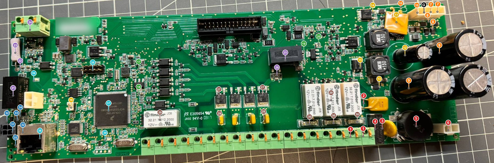
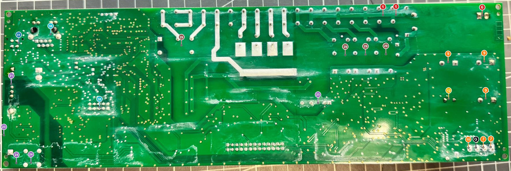

# Contrôler un boîtier principal au multimètre

Cette fiche guide le contrôle d'un boîtier principal (BP, carte SC944D révision D) **déposé**, par exemple le BP retiré du site après la foudre du 9 août 2026. Elle ne demande qu'un multimètre et une alimentation de laboratoire. Elle détaille et illustre les mesures « BP » du [§9.4 de l'analyse experte](analyse-experte.md#diagnostic), et y ajoute toute la chaîne d'alimentation.

Les repères (F3, U12, J31…) sont ceux du schéma et du fichier de placement du dépôt [essensys-board-SC944D](https://github.com/essensys-hub/essensys-board-SC944D) : `SC944D/Assembly/SC944D_Schematic.pdf` et `SC944D/Assembly/SC944D_Pick'nPlace.csv`. Les numéros des photos ont été placés à partir des coordonnées du fichier de placement.

!!! info "Comment lire les valeurs"
    - *[établi]* : lu sur le schéma ou la nomenclature ;
    - *[déduit]* : calculé à partir du schéma, à confirmer par la mesure ;
    - *[à vérifier]* : ordre de grandeur de fiche technique, non relu ;
    - *[hypothèse]* : comportement supposé, à confirmer.

    Quand une valeur n'est pas certaine, le meilleur étalon reste **un BP sain mesuré de la même façon**. Notez vos relevés dans la colonne « Relevé » : la page s'imprime.

## Sécurité

!!! danger "Jamais de 230 V sur la carte pendant ce contrôle"
    - Le BP porte une **zone secteur** (repères 1 à 6, et les sorties 27 à 30) : entrée 230 V, filtre et départs commandés. Ces points se mesurent **uniquement hors tension, à l'ohmmètre**.
    - La carte est **déposée** : aucun fil sur les borniers, pas de transformateur sur J52 ni J56, pas de batterie, rien sur J31.
    - Sous tension, le BP est alimenté **seulement** par une alimentation de laboratoire flottante de 24 V continus sur J56-1 et J56-2 (point 7). La polarité est indifférente, car le courant passe par le pont de diodes.
    - Si la carte vient d'une installation foudroyée, l'essai d'isolement à 500 V continu entre la zone 230 V et la TBT reste obligatoire **avant toute remise en service sur site** ([§9.1, point 6](analyse-experte.md#diagnostic)). Ce contrôle au multimètre ne le remplace pas.

!!! warning "Décharger les condensateurs avant chaque mesure à l'ohmmètre"
    Les trois condensateurs de 3 900 µF (point 9) ne se déchargent que dans le diviseur R56/R65 de 77 kΩ. Après la coupure, ils gardent une tension pendant **plus d'un quart d'heure** *[déduit : τ ≈ 11,7 mF × 77 kΩ ≈ 15 min]*.

    Avant toute mesure à l'ohmmètre ou en mode diode, **vérifiez au voltmètre** que le + de C13 est sous 0,5 V par rapport à G. Sinon, déchargez-le avec une résistance de 100 Ω / 5 W tenue par des pinces, pendant quelques secondes. Un ohmmètre branché sur un condensateur chargé donne des valeurs fausses et peut s'abîmer.

**Matériel.**

- Un multimètre avec ohmmètre, mode diode et voltmètre continu, et des pointes fines (les condensateurs de mesure sont en boîtier 0603 ou 0805).
- Une alimentation de laboratoire de 22 à 24 V réglable, avec limitation de courant.
- Des cordons à pinces crocodile, une loupe et une lampe.

**Ne jamais sonder J31 (point 31) avec des pointes nues.** La broche 4 porte le +15 V, sans fusible, à côté de SCL. Un glissement de pointe met 15 V sur le bus et recrée la panne. Les lignes du bus se mesurent sur D33, D34, R155 et R156 (points 32 et 33).

## Les points de mesure

**G** est la masse de référence (0 V, broche 3 de J56). Sauf mention contraire, la pointe **noire (COM)** va sur G.

Les couleurs regroupent les points par zone :

| Couleur | Zone | Points |
|---|---|---|
| Rouge | Entrée 230 V et filtre | 1 à 6 |
| Orange | Pont de diodes, +24 V, batterie | 7 à 10 |
| Jaune | Convertisseur +15 V et commutation | 11 à 16 |
| Vert | Régulateurs +5 V, +3,3 V, +12 V | 17 à 20 |
| Violet | Domaines isolés : téléinformation et fil pilote | 21 à 26 |
| Brun | Sorties 230 V : triacs, relais, fusibles | 27 à 30 |
| Bleu | Bus des boîtiers auxiliaires (BA) | 31 à 35 |
| Cyan | Cœur et Ethernet | 36 à 39 |

*Face composants. La carte est tournée d'un quart de tour : le connecteur Ethernet est à gauche, les gros condensateurs à droite, le bornier en bas. L'étiquette de numéro de série est floutée. Cliquez pour agrandir.*

*Face soudure, carte retournée : l'image est en miroir de la précédente. Seuls les points dont les broches traversent la carte sont repérés. C'est souvent la face la plus commode pour poser les pointes, en particulier sur J56 (7, 10 et G) et sur les pattes des gros condensateurs (9 et 12).*

| N° | Repère | Rôle |
|---|---|---|
| 1 | J50 (phase), J51 (neutre) | Entrée 230 V du BP (`PH_ALIM`, `N_ALIM`) |
| 2 | F3 | PTC 240 V~ / 0,25 A, en tête du primaire |
| 3 | VR1 | Varistance 300 V (V300LA10P), entre phase et neutre |
| 4 | C99 | Condensateur X2 100 nF / 275 V~ |
| 5 | L37 | Self de mode commun 2 × 20 mH |
| 6 | J52 | Vers le primaire du transformateur torique externe (230 V / 18 V) |
| 7 | J56-1 et J56-2 | Secondaire du transformateur (18 V~) ; **entrée de l'alimentation de laboratoire** |
| G | J56-3 | Masse (GND) |
| 8 | D28, D29, D39, D40 | Pont de diodes Schottky (PMEG4050EP) |
| 9 | C13, C14, C15 | Réservoir du +24 V : 3 × 3 900 µF / 35 V |
| 10 | F5 ; J56-4 | PTC 30 V / 4 A de la batterie (radiale, couchée sur U12) ; borne + batterie |
| 11 | U12, T27, T29 | Convertisseur 24 V → 15 V (LM3150 et deux MOSFET NTMS4801N), sous le corps de F5 |
| 12 | C109 | Sortie +15 V du convertisseur (1 000 µF / 25 V) |
| 13 | D45 | Diode du +15 V vers +15VS |
| 14 | T14 | Commutateur batterie → +15VS (P-MOS NTD2955G) |
| 15 | T32 | Commutateur +15VS → +15VSP, qui alimente les BA (P-MOS NTD2955G) |
| 16 | J58 | Cavalier de commande de +15VSP (fermé par défaut) |
| 17 | C105 (U2) | +5VS, sortie du convertisseur LMR12010 |
| 18 | C108 (U17) | +3V3S, sortie du régulateur LD1117 |
| 19 | C101 (U16) | +12VSP, sortie du régulateur LD1117 |
| 20 | C98 | +15VSP, entrée de U16 |
| 21 | U22 | Convertisseur isolé ±12 V de la téléinformation (R12P12D) |
| 22 | C91, C88 | Sorties +12 V et −12 V isolées de la téléinformation |
| 23 | R195 | Résistance série de la téléinformation, 22 kΩ / 3 W |
| 24 | J1, J2 | Bornes de téléinformation |
| 25 | U4 | Convertisseur isolé +12 V du fil pilote (R12P12S) |
| 26 | C29, C30 | Sortie +12 V isolée du fil pilote |
| 27 | T13, T17, T19, T20 | Triacs du fil pilote (T405-600B) |
| 28 | F6 à F9 | PTC des sorties du fil pilote (MF-RX012/250) |
| 29 | K1, K2, K3, K5 | Relais 12 V (Finder 32.21) |
| 30 | F1, F2, F4 | Fusibles temporisés 315 mA |
| 31 | J31 | Connecteur du bus des BA : 1 SDA, 2 SCL, 3 0 V, 4 +15 V |
| 32 | D33 (SCL), D34 (SDA) | Écrêteurs SMF5V0A du bus, au ras du blindage de J32 |
| 33 | R155 (SDA), R156 (SCL) | Résistances de tirage de 1 kΩ vers +5VS |
| 34 | U19 | Traducteur de niveau PCA9306 (3,3 V ↔ 5 V) |
| 35 | L31 | Ferrite du +15 V du bus (`BA_ALIM`) |
| 36 | J32 | Embase Ethernet RJ45 à transformateurs |
| 37 | U10 | Microcontrôleur MCF52259 |
| 38 | J33 | Connecteur de programmation BDM |
| 39 | DL6 (jaune), DL7 (verte) | LED de téléinformation et LED du cœur |

## Étape 1 : inspection visuelle

À la loupe, des deux côtés, avant de brancher quoi que ce soit.

| Où | Ce qu'on cherche |
|---|---|
| Écrêteurs D33/D34 (32), varistance VR1 (3), C99 (4) | Boîtier fendu, cratère, trace noire. Une varistance ou une TVS qui a conduit fort se fend souvent |
| Zone J31 – J32 – U19 (31 à 36) | Pistes ou pastilles brunies, vernis cloqué, odeur de brûlé. C'est le chemin du courant de foudre le plus probable sur le BP |
| Condensateurs électrolytiques (9, 12) | Dessus bombé, fuite d'électrolyte au pied |
| Face soudure | Résidus blanchâtres ou collants : les nettoyer à l'alcool isopropylique et laisser sécher avant tout essai d'isolement |
| Fusibles F1, F2, F4 (30) | Filament coupé ou verre noirci |

Les deux trous sombres visibles en haut de la face soudure, sous J32, sont les ergots en plastique de l'embase RJ45 : ce ne sont pas des brûlures.

## Étape 2 : hors tension, à l'ohmmètre et en mode diode

Alimentation débranchée, condensateurs déchargés (voir l'encadré « Sécurité »). Les mesures se font **dans l'ordre**. Sur un rail, la valeur affichée **monte pendant quelques secondes**, le temps de charger les condensateurs : notez la valeur stabilisée.

Mode diode : la pointe **rouge** est le +. Une diode Schottky en bon état affiche de 0,15 à 0,35 V dans le sens passant *[à vérifier selon le multimètre]*. Dans l'autre sens, elle affiche OL, ou une valeur qui monte lentement jusqu'à OL quand un condensateur se charge derrière.

### 2.1 Entrée 230 V et transformateur (points 1 à 6)

| N° | Mesure | Valeur attendue | En cas d'écart | Relevé |
|---|---|---|---|---|
| 1 | J50 ↔ J51 (phase ↔ neutre), transformateur débranché | OL (plus de 10 MΩ) *[déduit : seuls VR1 et C99 relient les deux fils]* | Basse : VR1 ou C99 en court-circuit | |
| 2 | Aux pattes de F3 | Quelques ohms à quelques dizaines d'ohms *[à vérifier, PTC de 0,25 A]* | OL ou plus de 1 kΩ à froid : F3 hors service. Chercher pourquoi elle a déclenché (VR1, C99, transformateur) | |
| 1 → 6 | J50 ↔ l'une des broches de J52 ; J51 ↔ l'autre | Continuité, moins de 50 Ω *[déduit : F3 puis un enroulement de L37]* | OL : F3 ou L37 coupé | |
| 3 | Aux pattes de VR1 | OL | Quelques ohms à quelques kΩ : varistance claquée. La remplacer | |
| 4 | Aux pattes de C99 | Monte jusqu'à OL | Court-circuit : condensateur percé | |
| 5 | Chaque enroulement de L37 ; puis entre les deux enroulements | Quelques ohms au plus *[à vérifier]* ; OL entre enroulements | Enroulement ouvert, ou enroulements reliés entre eux | |
| 6 | Sur le transformateur externe, déposé : primaire, puis secondaire | Primaire : quelques dizaines à quelques centaines d'ohms ; secondaire : quelques ohms au plus *[à vérifier]* | Primaire ouvert : protection thermique interne ouverte, ou transformateur mort. **Isolement primaire ↔ secondaire à 500 V obligatoire** avant de le réutiliser | |

### 2.2 Pont de diodes, +24 V et batterie (points 7 à 10)

| N° | Mesure | Valeur attendue | En cas d'écart | Relevé |
|---|---|---|---|---|
| G | J56-3 ↔ pied − de C13 (face soudure) | 0 Ω | Masse coupée | |
| 8 | Mode diode : rouge sur G, noire sur J56-1, puis sur J56-2 | 0,15 à 0,35 V | Près de 0 : diode basse du pont en court-circuit. OL : diode coupée | |
| 8 | Mode diode : rouge sur J56-1, puis sur J56-2 ; noire sur le + de C13 | 0,15 à 0,35 V | Idem pour les diodes hautes | |
| 9 | + de C13 ↔ G | Monte, puis se stabilise à plusieurs kΩ *[déduit : diviseur R56/R65 de 77 kΩ, plus l'entrée de U12]* | Moins de 10 Ω : un condensateur, U12 ou T27/T29 en court-circuit (voir 11) | |
| 10 | Aux pattes de F5 | Moins de 0,2 Ω *[à vérifier, PTC de 4 A]* | OL : F5 coupée, la batterie ne peut ni charger ni secourir | |
| 10 | J56-4 ↔ G | Environ 77 kΩ *[déduit : R61 + R67]* | Bas : défaut dans le chargeur (T35, D12) ou sur `VBATT` | |

### 2.3 +15 V, commutateurs et régulateurs (points 11 à 20)

| N° | Mesure | Valeur attendue | En cas d'écart | Relevé |
|---|---|---|---|---|
| 11 | + de C13 ↔ + de C109 | Pas de court-circuit (bien plus de 5 Ω) | Moins de 5 Ω : MOSFET haut T27 en court-circuit. Remplacer aussi U12 | |
| 12 | + de C109 ↔ G | Monte, puis se stabilise à plus de 1 kΩ *[déduit : diviseur R91/R95 de 247 kΩ]* | Moins de 10 Ω : MOSFET bas T29 ou C109 en court-circuit | |
| 13 | Mode diode sur D45 : rouge sur + de C109, noire sur la cathode de D45 | 0,15 à 0,35 V ; OL dans l'autre sens | Près de 0 dans les deux sens : D45 en court-circuit | |
| 14 | Ohmmètre entre la languette de T14 et sa patte 3 | Pas de court-circuit | Moins de 10 Ω : T14 claqué, la batterie est raccordée en permanence | |
| 15 | Mode diode : rouge sur C98 (+15VSP), noire sur C110 (+15VS) | Environ 0,5 V (diode interne de T32) ; OL dans l'autre sens | Près de 0 dans les deux sens : T32 claqué, les BA sont alimentés en permanence | |
| 16 | Aux broches de J58 | Cavalier présent : 0 Ω | Absent : +15VSP est fourni en permanence (`BA_ALIM` n'est plus commandé) | |
| 17 | C105 (+5VS) ↔ G | Plus de 100 Ω, stable *[déduit]* | Moins de 10 Ω : U2, D65, C6, C105 ou U19 côté 5 V | |
| 18 | C108 (+3V3S) ↔ G | Plusieurs dizaines d'ohms au moins : la logique 3,3 V charge le rail. Comparer à un BP sain | Proche de 0 : U17, un découplage ou le microcontrôleur en court-circuit | |
| 19 | C101 (+12VSP) ↔ G | Pas de court-circuit | Court-circuit : U16, U4 ou U22 côté entrée | |
| 20 | C98 (+15VSP) ↔ G | Pas de court-circuit | Court-circuit : U16, ou un circuit alimenté par +15VSP (sorties, `BA_ALIM`) | |

### 2.4 Domaines isolés (points 21 à 26)

La téléinformation et le fil pilote ont chacun leur propre masse, isolée de G par U22 et U4. Pour mesurer leurs tensions, les deux pointes se posent sur le même condensateur, jamais sur G.

| N° | Mesure | Valeur attendue | En cas d'écart | Relevé |
|---|---|---|---|---|
| 21 | G ↔ chacune des pastilles de C91 | OL | Une valeur mesurable : l'isolement de U22 est rompu | |
| 22 | Aux bornes de C91, puis de C88 | Pas de court-circuit | Court-circuit : condensateur ou U22 | |
| 23 | Aux pattes de R195 | 22 kΩ ± 5 % (20,9 à 23,1 kΩ) *[établi]* | OL : R195 coupée. Aucune téléinformation ne peut plus passer | |
| 24 | J1 ↔ G, puis J2 ↔ G | OL | Une valeur mesurable : isolement du domaine de téléinformation rompu | |
| 25 | G ↔ chacune des pastilles de C29 | OL | Une valeur mesurable : l'isolement de U4 est rompu | |
| 26 | Aux bornes de C29 | Pas de court-circuit | Court-circuit : condensateur ou U4 | |

### 2.5 Sorties 230 V (points 27 à 30)

| N° | Mesure | Valeur attendue | En cas d'écart | Relevé |
|---|---|---|---|---|
| 27 | Pour chaque triac, entre la languette (A2) et la patte A1 | OL | Bas : triac claqué, la sortie de fil pilote reste conductrice | |
| 28 | Aux pattes de F6, F7, F8 et F9 | Quelques ohms *[à vérifier, PTC de 0,12 A]* | OL : PTC hors service | |
| 29 | Aux deux broches de bobine de chaque relais, face soudure | Environ 720 Ω *[à vérifier : bobine 12 V de 200 mW]* | OL : bobine coupée ; nettement plus bas : spires en court-circuit | |
| 30 | Aux pattes de F1, F2 et F4 | Moins de 2 Ω | OL : fusible fondu. Chercher la cause avant de le remplacer | |

### 2.6 Bus des BA et Ethernet (points 31 à 36)

Ces mesures reprennent celles du [§9.4 de l'analyse experte](analyse-experte.md#diagnostic).

| N° | Mesure | Valeur attendue | En cas d'écart | Relevé |
|---|---|---|---|---|
| 32 – 33 | Cathode de D34 ↔ pastille +5VS de R155 ; puis cathode de D33 ↔ pastille +5VS de R156 | Environ 1,0 kΩ | OL : ferrite L32 (ou L30) fondue, ou résistance coupée | |
| 32 | Mode diode : rouge sur G, noire sur la cathode de D34, puis de D33 | 0,55 à 0,70 V | Près de 0 : TVS ou U19 en court-circuit. Lever une patte de la TVS pour savoir lequel | |
| 35 | Aux pastilles de L31 | Moins de 1 Ω | OL : L31 fondue, les BA ne reçoivent plus de +15 V | |
| 36 | J32, entre les broches 1 et 3 | Environ 150 Ω *[déduit ; 75 Ω par résistance à vérifier]* | OL : l'Ethernet a fait partie du chemin du courant | |

## Étape 3 : sous tension, avec l'alimentation de laboratoire

**Mise en place.**

1. Réglez l'alimentation sur **24,0 V**, avec une limite de **300 mA**, sortie coupée.
2. Branchez-la sur J56-1 et J56-2 (point 7), dans n'importe quel sens. Rien d'autre n'est branché, et le cavalier J58 est en place.
3. Allumez. Pendant environ une seconde, l'alimentation reste en limite de courant : elle charge les 11,7 mF du point 9. Le courant doit ensuite redescendre.
4. **Si l'alimentation reste en limite de courant** : coupez tout de suite et revenez à l'étape 2. Il reste un court-circuit.
5. Notez le courant de repos. Une fois le démarrage passé, la limite peut être remontée à 1,5 A.

En dessous d'environ 20 V, le BP pourrait se croire sur batterie et couper le +15 V au bout de 12 s *[hypothèse, §9.1]* : restez à 24 V.

Pointe noire sur **G**, sauf pour les points 22 et 26. **Mesurez dans l'ordre** : le premier rail absent désigne l'étage en défaut, et les rails suivants n'ont alors plus de sens.

| N° | Point | Valeur attendue | Si la valeur est absente ou fausse | Relevé |
|---|---|---|---|---|
| — | Courant de repos | À relever. Comparer à un BP sain | Plus de 1 A en régime établi : un étage chauffe. Cherchez-le au toucher, avec prudence, ou à la caméra thermique | |
| 9 | + de C13 (+24 V) | Tension de l'alimentation, moins 0,3 à 0,8 V | 0 V : pont de diodes coupé, ou alimentation mal raccordée | |
| 12 | + de C109 (+15 V) | Environ 15,2 V *[établi : 15,17 V théoriques]* | 0 V avec +24 V présent : U12, T27, T29 ou L10. Moins de 14 V : U12 en limitation | |
| — | + de C110 (+15VS, après D45) | 14,8 à 15,2 V *[déduit]* | 0 V avec +15 V présent : D45 coupée | |
| 17 | C105 (+5VS) | 4,83 à 5,03 V | 0 V : U2 (LMR12010), L14 ou D65 | |
| 18 | C108 (+3V3S) | 3,30 à 3,40 V *[établi : 3,36 V théoriques]* | 0 V : U17. Rien ne fonctionne sans ce rail | |
| 20 | C98 (+15VSP) | Comme +15VS, environ 1,6 s après la mise sous tension | 0 V avec J58 en place : le microcontrôleur ne commande pas T32, ou T32/T33 est en défaut. Retirez J58 (hors tension) : +15VSP doit alors être présent en permanence | |
| 19 | C101 (+12VSP) | 11,5 à 12,7 V *[établi : 12,12 V théoriques ± 5 %]* | 0 V avec +15VSP présent : U16 | |
| 22 | Aux bornes de C91, puis de C88 (domaine téléinformation) | Environ 12 V chacun, souvent un peu plus à vide *[à vérifier : convertisseur non régulé]* | 0 V : U22, ou +12VSP absent | |
| 26 | Aux bornes de C29 (domaine fil pilote) | Environ 12 V, souvent un peu plus à vide *[à vérifier]* | 0 V : U4, ou +12VSP absent | |
| 10 | J56-4, sans batterie | À relever : tension de fin de charge du chargeur, attendue vers 13,5 à 14 V *[hypothèse]* | 0 V : chargeur (T35, D12) ou F5 | |
| 35 | Pastille de L31 côté J31 (`BA_ALIM`) | Comme +15VSP | 0 V avec +15VSP présent : L31 coupée | |
| 32 – 33 | Cathodes de D33 et D34 (SCL, SDA) | Égales à +5VS à 40 mV près | Plus bas : fuite d'une TVS ou de U19 (voir le tableau ΔV du [§9.3](analyse-experte.md#diagnostic)) | |
| 34 | U19, broches 7 et 8 (EN = VREF2) | 3,6 à 4,4 V | Environ 5 V : canal passant sans limitation. Sous 1 V : canal bloqué, les BA ne répondent jamais | |
| 39 | DL6 (jaune, téléinformation) | Clignote, car aucune téléinformation n'est branchée *[déduit, §9.2]* : le microcontrôleur tourne | Éteinte ou fixe : microcontrôleur arrêté. Vérifiez +3V3S, puis les quartz | |
| 36 | LED de J32, câble vers un switch | Lien établi | Pas de lien : PHY U13, J32, ou quartz Q1/Q3 | |

Pour le test complet de U19 (SDA forcé à la masse à travers R155), voir le [§9.4 de l'analyse experte](analyse-experte.md#diagnostic).

## Étape 4 : interpréter

| Premier écart rencontré | Étage en cause | Suite |
|---|---|---|
| Court-circuit entre J50 et J51, ou F3 ouverte | Filtre d'entrée (VR1, C99) | Remplacer VR1, C99 et F3. Contrôler le transformateur à 500 V |
| Diode du pont en court-circuit ou coupée | Pont D28/D29/D39/D40 | Remplacer les quatre diodes |
| +24 V présent, +15 V absent | Convertisseur U12, T27, T29, L10 | Remplacer les MOSFET et U12 ensemble |
| +15VS présent, +5VS ou +3V3S absent | U2 ou U17 | Remplacer le régulateur en cause, puis vérifier la consommation |
| Rails corrects, DL6 éteinte | Microcontrôleur ou quartz | Sauvegarder d'abord la flash par BDM sur J33 (38). Voir [Firmware](https://github.com/essensys-hub/essensys-board-SC944D/blob/main/docs/firmware.md) |
| Tout est correct sauf le bus (31 à 35) | Interface des BA | Retouches D33/D34, U19, L31 : voir la [note de retouche](https://github.com/essensys-hub/essensys-board-SC944D/blob/main/docs/retouche-foudre.md) |
| Tout est correct | — | Le BP n'est probablement pas la cause. Passer aux BA ([§9.4, onglet BA](analyse-experte.md#diagnostic)) |

!!! tip "Avant toute réparation"
    - Sauvegardez la flash du microcontrôleur par BDM (J33) avant toute retouche lourde.
    - Si le microcontrôleur est remplacé, flashez l'image de production 099-37, jamais un nouveau build.
    - Un composant de protection qui a conduit (D33, D34, VR1) se remplace même s'il mesure bien : il peut garder une fuite latente.
